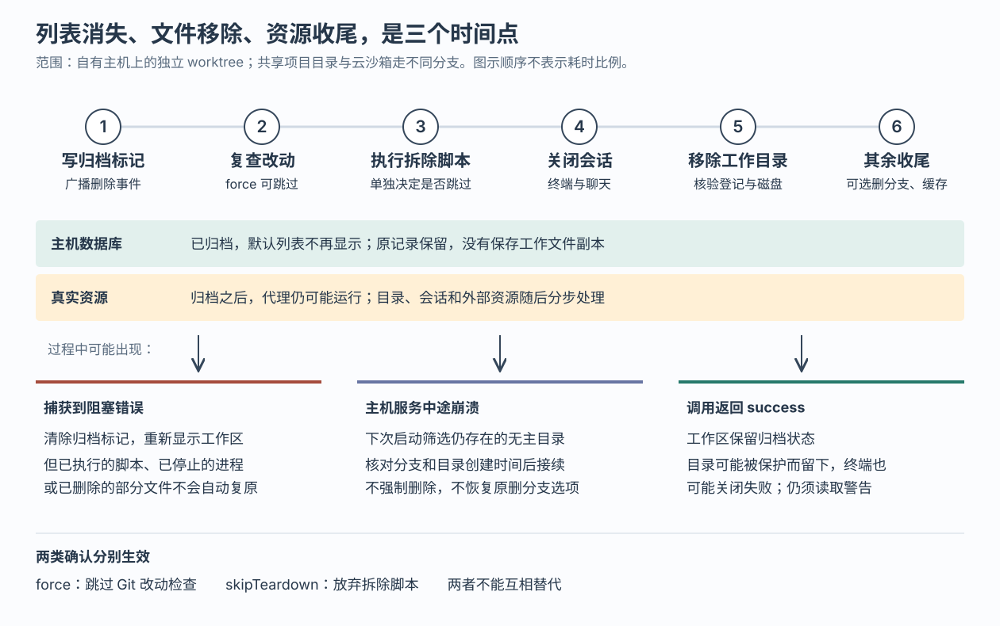

# Superset 删除工作区时如何收尾：归档意图、代码保护与失败恢复

假设一个编码代理正在修复登录错误，工作目录里还有未提交的文件，开发服务器也没有停止。你在 Superset 点击“删除工作区”，它很快从侧栏消失了。此时文件是否已经删除？如果拆除脚本失败，工作区重新出现，服务器是否也回到了原来的状态？如果应用中途崩溃，下次启动会继续删除，还是把代码留给你？

Superset 用分步清理处理这些问题：**先保存归档标记并通知界面，再检查代码、运行拆除脚本、关闭会话和移除目录。遇到部分错误就恢复工作区的可见性；服务进程中途崩溃，则在下次启动时有条件地继续收尾。** 这让界面可以及时响应，也留下恢复线索，但它没有把删除变成一次能够整体撤销的操作。

本篇接续已有五篇研报，深入前文只简要提到的工作区清理机制，不再重复创建、代理派发和终端恢复的整体介绍。依据是执行器提供的源码快照 `afc33f2ebc8c5a9195e6228b738a94dfc5c3ec23`。示例均为假设；本次只读取源码、测试和设计记录，没有启动项目、执行删除、运行仓库测试或连接外部服务。

**先确定删除对象：共享项目目录、独立工作目录和云沙箱，后果不同。**

Superset 将代码目录、终端和编码代理组织成工作区，但不是每个工作区都独占一份文件。当前主机清理入口用 `isLocalCheckoutWorkspace` 判断：只要工作区类型是 `local`，或者工作目录与项目原目录实际指向同一路径，就按共享目录处理。路径比较先解析符号链接，避免同一个目录因为写法不同而被误当成独立目录。[实现见 `is-local-checkout-workspace.ts`](https://github.com/superset-sh/superset/blob/afc33f2ebc8c5a9195e6228b738a94dfc5c3ec23/packages/host-service/src/trpc/router/workspace-cleanup/is-local-checkout-workspace.ts)。

| 删除对象 | 主机清理实际做什么 | 需要理解的边界 |
|---|---|---|
| 共享项目原目录的工作区 | 归档记录，关闭所属终端和聊天，处理缓存等收尾 | 跳过代码改动检查、拆除脚本、目录移除和分支删除，保护其他共享该目录的工作区 |
| 独立 `worktree` 工作区 | 检查改动，运行拆除脚本，关闭会话，通过 Git 移除检出目录，可选删除本地分支 | Git worktree 是同一仓库的额外检出目录；移除目录和删除分支是两项操作 |
| 无项目的 `session` 工作区 | 检查改动，关闭会话，直接删除托管目录 | 它是独立的小型仓库；这条流程不运行项目拆除脚本，当前恢复接口也不支持恢复它 |
| 托管云工作区 | 桌面调用云端 `cloudWorkspace.delete` | 删除对象包含云沙箱，不能只清理沙箱内部的工作区记录 |

最后一条由桌面的 `useDestroyWorkspace` 明确分流；本篇后续追踪自有主机路径，没有继续研究云沙箱销毁的内部实现。[桌面分流见 `useDestroyWorkspace.ts`](https://github.com/superset-sh/superset/blob/afc33f2ebc8c5a9195e6228b738a94dfc5c3ec23/apps/desktop/src/renderer/hooks/host-service/useDestroyWorkspace/useDestroyWorkspace.ts)。共享目录的“删除”更接近关闭这一工作区入口；独立 worktree 的删除则会真实移除文件，不能仅凭按钮名称判断风险。

**一次普通删除，先改变记录，再改变磁盘。**

从当前侧栏确认框进入，`DashboardSidebarDeleteDialog` 调用 `useDestroyDialogState.run`，再经 `useDestroyWorkspace` 请求所属主机的 `workspaceCleanup.destroy`。主机路由实际注册了这个入口，随后调用共享函数 `destroyWorkspace`，具体阶段由 `runDestroy` 和 `runDestroyPhases` 完成。[界面调用见 `useDestroyDialogState.ts`](https://github.com/superset-sh/superset/blob/afc33f2ebc8c5a9195e6228b738a94dfc5c3ec23/apps/desktop/src/renderer/routes/_authenticated/_dashboard/components/DashboardSidebar/components/DashboardSidebarDeleteDialog/hooks/useDestroyDialogState/useDestroyDialogState.ts)，[路由注册见 `router.ts`](https://github.com/superset-sh/superset/blob/afc33f2ebc8c5a9195e6228b738a94dfc5c3ec23/packages/host-service/src/trpc/router/router.ts)。

主机先等待正在进行的工作区命名提交任务结束，再读取工作区与项目记录。对存在的工作区，`archiveLocalWorkspace` 向主机数据库写入 `archivedAt`，即归档时间，以及 `archiveReason`，即删除或已合并的分类。原记录没有被删除。若关联的拉取请求——请求合并代码的记录，下文简称 PR——在本地记录中已合并，归为 `merged`；否则归为 `deleted`。这个分类不会替用户执行合并。

写入后，主机广播一个 `deleted` 事件。默认的 `workspace.list` 只取没有归档时间的记录，因此其他客户端重新查询时也会排除它；需要展示归档记录的调用方可以显式包含它们。**这里的“删除事件”表示工作区退出活动列表，尚不能证明目录或进程已经消失。** [归档、广播与反向恢复见 `local-workspace-store.ts`](https://github.com/superset-sh/superset/blob/afc33f2ebc8c5a9195e6228b738a94dfc5c3ec23/packages/host-service/src/workspaces/local-workspace-store.ts)，[列表过滤见 `workspace.ts`](https://github.com/superset-sh/superset/blob/afc33f2ebc8c5a9195e6228b738a94dfc5c3ec23/packages/host-service/src/trpc/router/workspace/workspace.ts)。

图中的顺序来自当前清理实现。归档是留下删除意图的时间点，实际清理成功是另一个时间点；不能把它们合称为一次不可分割的提交。数据库只能记录状态，无法把任意用户脚本、进程关闭和 Git 文件操作一起放进同一笔事务。[完整清理实现见 `workspace-cleanup.ts`](https://github.com/superset-sh/superset/blob/afc33f2ebc8c5a9195e6228b738a94dfc5c3ec23/packages/host-service/src/trpc/router/workspace-cleanup/workspace-cleanup.ts)。

**未提交改动的保护，需要同时看服务端和界面。**

打开确认框时，桌面先请求 `workspaceCleanup.inspect`。主机通过工作线程读取 Git 状态，返回是否有未提交改动、是否有未推送提交。这里把任务移到独立线程执行，目的是让较慢的 Git 查询不占住处理其他请求的主线程。未推送判断使用 `rev-list HEAD --not --remotes` 计数，比较的是当前本机保存的远程分支引用，没有在这里先联网刷新；查询失败时这一项保留为假。因此，没有警告不能证明远端已保存全部提交。[查询及移除任务见 `workers/tasks/git.ts`](https://github.com/superset-sh/superset/blob/afc33f2ebc8c5a9195e6228b738a94dfc5c3ec23/packages/host-service/src/workers/tasks/git.ts)。

预览与真正删除采用不同的错误策略。预览读取失败，`inspect` 仍允许尝试删除，并返回没有改动警告；桌面请求预览失败也不会阻止确认。真正删除时，只要没有设置 `force`，服务端会再次检查：查到未提交改动就抛出 `CONFLICT`，即操作冲突；工作线程超时或执行基础设施失败，表示改动状态未知，也会阻止这次删除。普通 Git 读取错误则允许继续，交给后面的目录与仓库清理处理。不能把这个策略扩展成“任何检查失败都会保护代码”。[错误分类见 `git-ops.ts`](https://github.com/superset-sh/superset/blob/afc33f2ebc8c5a9195e6228b738a94dfc5c3ec23/packages/host-service/src/trpc/router/workspace-cleanup/git-ops.ts)。

服务端复查只因未提交改动而阻止删除，没有把未推送提交作为同样的阻塞条件。桌面确认框将两者都作为警告，有任一警告时，按钮改为“仍然删除”，请求携带 `force:true`，跳过这次复查。

还有一条容易遗漏的调用方行为：假设预览显示干净，用户确认后代理又写入文件，服务端因未提交改动拒绝第一次删除。`useDestroyDialogState.run` 会捕获这类普通冲突，**自动以 `force:true` 再试一次，不再弹第二次确认**。这一分支也没有要求此前预览必须成功。代码注释将它解释为尊重用户已作出的删除确认；实际取舍是减少重复提示，同时放弃对新出现改动的再次确认。

同样，真正执行 `git worktree remove` 时，清理调用没有传入请求中的 `force`；底层任务默认使用 `--force --force`，可移除被锁定的 worktree。改动检查发生在拆除脚本和终端关闭之前，后面没有再次检查。因此，根据调用顺序可以推断：**复查通过之后仍有写入时，新改动也可能被移除。** 本次没有运行并发写入实验，不能声称已经复现，但当前路径没有提供检查到删除之间的文件冻结保证。

**“允许删除代码”和“放弃拆除脚本”是两项决定。**

回到开头的开发服务器。只删除文件不能保证服务器、容器或外部临时资源被释放，所以正常路径会在目录仍存在、其他会话尚未统一关闭时运行 teardown，也就是用户配置的拆除脚本。

`runTeardown` 复用终端创建能力，建立一个不显示为普通面板的伪终端。伪终端是给命令行程序提供交互式输入输出的系统对象；这里复用它，是为了沿用用户终端的 shell 环境。配置中的多条拆除命令用 `&&` 串联，前一条失败就不执行后一条；命令通过 `exec bash -c`，脚本通过 `exec bash` 执行，让隐藏终端随拆除程序退出并返回其退出状态。[执行实现见 `teardown.ts`](https://github.com/superset-sh/superset/blob/afc33f2ebc8c5a9195e6228b738a94dfc5c3ec23/packages/host-service/src/runtime/teardown/teardown.ts)。

脚本来源也不是固定的一份文件。共享解析器先合并项目配置、worktree 配置和本机用户覆盖，再应用本地配置的前置、后置或替换规则；有可用拆除命令时优先使用。否则依次找 worktree 和项目原目录中的 `.superset/teardown.sh`。这允许当前分支提供自己的清理方式，也能使用没有进入 Git 的本机脚本。[解析顺序见 `setup/config.ts`](https://github.com/superset-sh/superset/blob/afc33f2ebc8c5a9195e6228b738a94dfc5c3ec23/packages/host-service/src/runtime/setup/config.ts)。

默认执行期限为 60 秒；超时后请求终止，若退出回调仍不发生，再过两秒直接结算为失败，避免删除调用无限等待。失败结果带退出码、信号、超时标记和末尾输出。各入口对失败的处理不同：

| 入口或选择 | 改动检查 | 拆除脚本失败后 |
|---|---|---|
| 桌面普通 `workspaceCleanup.destroy` | 默认检查；确认警告或冲突重试后可跳过 | 阻止后续清理，撤销归档，显示失败信息 |
| 桌面仅设置 `force:true` | 跳过 | 仍会运行脚本，失败仍阻止清理 |
| 拆除失败后选择继续，设置 `skipTeardown:true` | 当前界面同时设置 `force:true` | 不再运行脚本，继续清理 |
| 外部 `workspace.delete` | 固定跳过 | 仍运行脚本，返回的脚本失败降为警告，继续清理 |

外部接口是命令行工具等程序使用的入口。本次还核对了 CLI，即命令行界面的 `archiveOnHost`：它实际调用 `workspace.delete`，并收集返回警告。因此，命令输出中的“Archived workspace”不能理解为只隐藏记录、保留目录。[外部路由见 `workspace.ts`](https://github.com/superset-sh/superset/blob/afc33f2ebc8c5a9195e6228b738a94dfc5c3ec23/packages/host-service/src/trpc/router/workspace/workspace.ts)，[命令行调用见 `archiveOnHost.ts`](https://github.com/superset-sh/superset/blob/afc33f2ebc8c5a9195e6228b738a94dfc5c3ec23/packages/cli/src/commands/workspaces/archive/archiveOnHost.ts)。

把两个开关分开有直接意义：用户允许丢弃未提交代码，不代表允许放弃容器或外部资源的清理。另一方面，脚本即使返回失败，也可能已经停止了部分服务；撤销归档不会反向执行脚本。实践中应让拆除脚本能够重复运行，并把“资源已经不存在”作为可接受结果。这是根据失败重试机制提出的建议，不是平台对任意脚本的保证。

**磁盘清理不仅看 Git 命令有没有报错，还要看清理之后留下了什么。**

拆除阶段通过后，主机按工作区归属关闭终端，再关闭聊天。终端关闭失败会加入警告，流程继续；终端模块会保留未成功结束的活动记录及销毁请求，供后续清理使用。这里没有要求先证明所有进程已死，才允许移除目录。[所属终端的清理见 `disposeSessionsByWorkspaceId`](https://github.com/superset-sh/superset/blob/afc33f2ebc8c5a9195e6228b738a94dfc5c3ec23/packages/host-service/src/terminal/terminal.ts)。

worktree 移除则更加严格。工作线程先执行 Git 移除命令，保留错误文本，再读取 `git worktree list --porcelain`，核对目标是否还被登记。仍有登记，或者无法确认登记结果，都会抛错，使工作区重新可见。它没有简单用错误消息判断“已经删过”。

但“没有登记”仍不等于“没有文件”。Git 可能已移除登记，却在删除目录内容时失败。主机因此继续检查磁盘：如果目录还在，并且位于该项目受管理的 worktree 根目录内部，就尝试直接递归删除；直接删除仍失败，整个调用报错。目录在管理范围之外，则保留目录并返回警告。**范围限制约束的是直接删除的兜底路径，并不表示 Superset 永远不会通过 Git 移除外部接管的、仍正常登记的 worktree。**

项目原仓库已经被移动或删除时，也没有可供执行 Git 清理的仓库；同样只有位于托管范围内的目录才允许直接删除。权限拒绝则不被当成目录不存在。路径检查还区分残留的符号链接，避免用“跟随链接后找不到目标”冒充目录已清理。[边界判断见 `worktree-paths.ts`](https://github.com/superset-sh/superset/blob/afc33f2ebc8c5a9195e6228b738a94dfc5c3ec23/packages/host-service/src/trpc/router/workspace-creation/shared/worktree-paths.ts)与[`path-state.ts`](https://github.com/superset-sh/superset/blob/afc33f2ebc8c5a9195e6228b738a94dfc5c3ec23/packages/host-service/src/runtime/path-state/path-state.ts)。

可选的本地分支删除安排在目录处理之后，使用 `git branch -D`，并不要求分支已合并；是否启用由删除分支选项决定。分支删除失败只加入警告，不让整个工作区重新出现。返回的 `success:true` 因而表示流程按既定容错规则完成；还要看 `warnings` 和 `worktreeRemoved`，不能据此断定进程、目录和分支全部消失。

这种区分有相应测试依据：`workspace-cleanup.test.ts` 模拟“Git 登记已消失但目录残留”，断言托管范围内的残留被继续删除；另一测试断言范围外目录保留、`worktreeRemoved:false`，同时返回成功和警告。它们验证的是有意区分的结果，而不是一个布尔成功值代表所有资源已清理。[测试见 `workspace-cleanup.test.ts`](https://github.com/superset-sh/superset/blob/afc33f2ebc8c5a9195e6228b738a94dfc5c3ec23/packages/host-service/test/workspace-cleanup.test.ts)。

**捕获错误和进程崩溃，需要两种恢复办法。**

普通阻塞错误会进入 `runDestroy` 的异常分支：`unarchiveLocalWorkspace` 清除归档时间和原因，再广播 `created`，让列表重新加入原工作区。这个“重新创建”事件没有创建新目录；它恢复的是记录的活动状态。若错误发生在目录删除途中，目录可能已经缺少部分文件；若发生在终端关闭之后，终端也不会被自动重新启动。因此，这是一种让剩余问题重新可见、可重试的补偿，不能称为恢复全部原状。

进程崩溃则没有机会执行异常分支。当前 `app.ts` 在非沙箱模式启动时，安排 `runArchivedWorkspaceReconcile` 继续检查归档记录；这是一次启动任务，并非这里注册的周期重试。它排除已软删除项目的工作区，因为项目删除有保留目录以供恢复的另一套语义。[启动接线见 `app.ts`](https://github.com/superset-sh/superset/blob/afc33f2ebc8c5a9195e6228b738a94dfc5c3ec23/packages/host-service/src/app.ts)。

启动检查不会把所有归档目录直接删除。它先筛出磁盘上仍存在、且没有活动工作区占用同一路径的记录，再比较目录创建时间与归档时间，并从 Git 的 `HEAD` 文件读取检出分支。`HEAD` 是 Git 记录当前检出位置的文件；这里要求它仍指向归档记录里的分支。目录创建时间晚于归档、分支不同或无法读取时，留下目录并记录日志；真正调用删除前，还会再次检查活动工作区的路径归属。[恢复实现见 `archived-workspace-reconcile.ts`](https://github.com/superset-sh/superset/blob/afc33f2ebc8c5a9195e6228b738a94dfc5c3ec23/packages/host-service/src/runtime/archived-workspace-reconcile.ts)。

通过这些条件后，恢复检查重新调用同一个 `destroyWorkspace`，但固定使用 `force:false`、`deleteBranch:false` 和尽力执行拆除脚本的模式。未提交改动可以阻止清理并让工作区重新出现，脚本返回的失败则降为警告。它没有照搬上一次用户同意的强制删除。

这也揭示了归档记录的能力上限：它保存“这个工作区已退出活动列表”，没有持久保存完整的删除请求、当前执行阶段或原来的删分支选项。如果崩溃时目录已移除，启动筛选就不会再选中它，未完成的分支清理也不会由这条路径补做。分支和创建时间检查有助于避开复用目录，但它们不是目录身份的不可变证明；本次没有验证所有文件系统的创建时间语义，也没有验证外部程序并发替换目录的情况。

同一服务进程内，`destroysInFlight` 和 `restoresInFlight` 两个集合会阻止同一工作区的删除与恢复重叠；它们不是跨进程锁，也不约束外部 Git 命令。重复删除产生带 `DELETE_IN_PROGRESS` 原因的冲突，桌面将其解释为“正在删除”，不会套用前面的自动强制重试。错误原因的区别在这里直接决定是否再次执行破坏性操作。

**删除后的“恢复工作区”，依赖 Git 中还找得到什么。**

用户主动恢复归档工作区走的是 `workspaces.restore`，与启动时继续清理方向相反。`restoreArchivedWorkspace` 先尝试重新准备检出目录，成功后才清除归档标记；确实新建了 worktree 时，再启动初始化脚本。共享原目录的工作区无需重新检出，无项目会话则被明确拒绝恢复。

恢复任务优先使用仍存在的本地分支或本机远程跟踪分支，必要时尝试从配置的远程仓库获取该分支。路径被其他目录占用、分支在别处检出、分支不存在，以及远程暂时不可达，分别返回不同结果。它没有读取归档时保存的文件备份，因为删除流程根本没有创建这份备份。[恢复入口见 `workspaces.ts`](https://github.com/superset-sh/superset/blob/afc33f2ebc8c5a9195e6228b738a94dfc5c3ec23/packages/host-service/src/trpc/router/workspaces/workspaces.ts)，[Git 恢复任务见 `gitRestoreWorktreeTask`](https://github.com/superset-sh/superset/blob/afc33f2ebc8c5a9195e6228b738a94dfc5c3ec23/packages/host-service/src/workers/tasks/git.ts)。

因此，保留本地分支时，已提交但未推送的内容仍可能恢复，不必一律理解为“必须推送才能恢复”。但如果同时删掉了本地分支，远程也没有对应分支，当前恢复路径就会失败；被强制删除的未提交文件更没有这条恢复保障。

`workspace-restore.integration.test.ts` 用具体断言表达了这一区别：保留分支后，恢复能重新出现已提交的文件；删除分支且没有可用远程分支时，记录继续归档；远程仍有分支时可以获取后恢复，远程不可达则报告连接失败。[测试见 `workspace-restore.integration.test.ts`](https://github.com/superset-sh/superset/blob/afc33f2ebc8c5a9195e6228b738a94dfc5c3ec23/packages/host-service/test/integration/workspace-restore.integration.test.ts)。

**这套设计适合快速收起工作，但保留成果仍要依靠明确动作。**

先归档并广播，使多个客户端不必等待慢脚本和大目录清理才更新列表；保留记录又为失败重试与重新打开提供入口。代价是一个归档标记承载多种实际情况：可能已经完全清理，可能刚开始删除，也可能留下受保护的目录。读者和调用程序都需要结合实际资源检查及警告理解结果。

本次阅读的测试对正常路径和若干故障有直接支撑：清理集成测试断言共享目录得到保留、未提交改动可阻止默认删除、拆除失败后归档被撤销；拆除集成测试用目录存在检查和外部标记证明脚本先于目录删除，并断言 `force` 不会跳过脚本；启动恢复的专门测试只验证了候选筛选，没有覆盖整个崩溃恢复过程。以上均是读到的测试断言，本次没有执行，不能写成运行验证通过。[清理集成测试](https://github.com/superset-sh/superset/blob/afc33f2ebc8c5a9195e6228b738a94dfc5c3ec23/packages/host-service/test/integration/workspace-cleanup.integration.test.ts)、[拆除集成测试](https://github.com/superset-sh/superset/blob/afc33f2ebc8c5a9195e6228b738a94dfc5c3ec23/packages/host-service/test/integration/workspace-delete-teardown.integration.test.ts)、[启动筛选测试](https://github.com/superset-sh/superset/blob/afc33f2ebc8c5a9195e6228b738a94dfc5c3ec23/packages/host-service/src/runtime/archived-workspace-reconcile.test.ts)。

设计文档也需按现行实现重新判断。仓库的 `workspace-delete-unification.md` 仍描述先删云端记录、不要归档标记和恢复扫描、强制删除跳过拆除脚本的旧方案；这些都不能作为本次实现的说明。当前注册路径、共享删除函数和上述测试共同支持的是本篇描述的本地归档与分步清理。[旧设计记录](https://github.com/superset-sh/superset/blob/afc33f2ebc8c5a9195e6228b738a94dfc5c3ec23/plans/workspace-delete-unification.md)。

对使用者，删除独立 worktree 前应先停止持续写入的代理，将需要保留的改动提交；若还准备删除本地分支，应确认远程或其他位置确实保存了成果。看到拆除失败时，应先判断服务器和外部资源是否仍需处理；选择跳过只会继续删除，不会替你完成脚本。对编排程序，应读取警告和资源结果，不能只检查 `success`；需要可靠保留成果时，也不能把“已归档”当成备份完成。对类似系统的实现者，这段源码提供的具体启示是：分别定义记录退出列表、进程停止、目录移除和成果可恢复的证据，并明确哪些失败值得阻止删除，哪些可以保留现场、返回警告。
