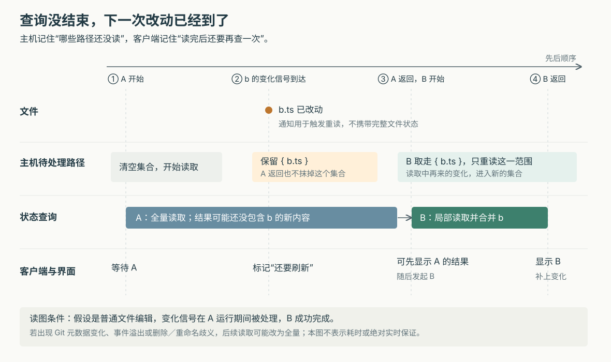

# Superset 怎样跟上代理的文件改动：Changes 刷新、局部重读与过期结果的边界

假设代理正在修复登录页。你刚打开 Changes（代码改动）面板，它又保存了一个文件；第一轮查询还没结束，代理已经把另一个文件改名，随后在终端里提交了代码。面板该立刻查询多少次？第一次慢查询返回时，会不会把后来的变化盖掉？如果查询失败，“没有改动”还可信吗？

Superset 采用的办法是：**把文件写入合并成重查信号，在查询进行时保留后续刷新，并只在变化范围明确时局部重读。** 它努力让界面在持续编辑后跟上实际文件，同时限制重复 Git 工作。但这里没有一次锁住仓库所有状态的读取，也没有“屏幕永远展示最新一刻”的保证。理解这条链，能帮助使用者判断审阅界面的可信范围，也能看清交互式开发工具如何协调监听、缓存和后台计算。

本篇接续已有六篇研报，研究此前未展开的代码改动读取机制，不重复工作区创建、终端恢复和任务派发。依据是执行器提供的源码快照 `a50aa443549df73866dca600421d849cf81f9b06`。以上场景是假设；本次只读源码、测试和设计记录，没有启动 Superset、执行仓库脚本或运行测试。下文“测试断言”均指阅读所得。

**先分清面板在比较哪两份内容。** Superset 把代码目录、终端和编码代理组织成工作区；本篇追踪的是桌面工作区页面向执行主机的 `host-service` 请求 Git 状态的路径。执行主机可以是本机，也可以是客户端连接到的另一台机器，文件读取发生在主机侧。

Git 不只保存工作文件，还维护“暂存区”，即准备放进下一次提交的内容，以及 `HEAD`，即当前检出的提交。`getGitStatusSnapshot` 返回三个不同的改动集合：

| 返回字段 | 具体回答什么 | 假设场景中的表现 |
|---|---|---|
| `unstaged`，未暂存 | 工作文件相对暂存区改了什么，另含未跟踪文件 | 代理刚保存的内容会进入这里 |
| `staged`，已暂存 | 暂存区相对当前提交改了什么 | 暂存后又编辑，同一路径可以同时出现在这两组 |
| `againstBase`，相对基准 | 从基准与当前分支的共同祖先，到当前提交改了什么 | 代理提交后，变化可转到这里；它不包含全部尚未提交的文件内容 |

第三项实际使用 `baseRef...HEAD` 的三点比较；`baseRef` 是选定的比较引用，通常指向本地保存的远端分支位置。界面再根据查看范围，把这些集合组合成列表。因此，列表中的一行、某个分组的增删行数和整个文件的最终净改动，不应混为一谈。[状态计算见 `git-status.ts`](https://github.com/superset-sh/superset/blob/a50aa443549df73866dca600421d849cf81f9b06/packages/host-service/src/trpc/router/git/utils/git-status.ts)，[列表组合见 `buildChangesetFiles`](https://github.com/superset-sh/superset/blob/a50aa443549df73866dca600421d849cf81f9b06/apps/desktop/src/renderer/routes/_authenticated/_dashboard/v2-workspace/$workspaceId/hooks/useChangeset/buildChangesetFiles.ts)。

**界面先登记“我正在关心这个工作区”，主机才维持监听。** 当前工作区页面的 `WorkspaceGitStatusProvider` 统一调用 `useGitStatus`，向顶部改动提示、文件树和改动列表提供查询结果。它在工作区页面挂载期间启用，不随 Changes 侧栏关闭而立即停止。

`useGitStatus` 一边调用 `git.getStatus`，一边通过 `useWorkspaceEvent` 订阅 `git:changed`。订阅不只是添加本地回调：它还调用客户端事件总线的 `watchGit`，向主机发送 `git:watch`。客户端与主机分别记录使用数量；同一连接重复登记相同工作区不会重复增加主机订阅。最后一个使用者释放后，主机拆掉真实监听。连接断开会释放该连接持有的登记，重连后客户端重新发送仍需要的登记。[页面数据入口](https://github.com/superset-sh/superset/blob/a50aa443549df73866dca600421d849cf81f9b06/apps/desktop/src/renderer/hooks/host-service/useGitStatus/useGitStatus.ts)、[客户端登记与重连](https://github.com/superset-sh/superset/blob/a50aa443549df73866dca600421d849cf81f9b06/packages/workspace-client/src/lib/eventBus.ts)和[主机订阅管理](https://github.com/superset-sh/superset/blob/a50aa443549df73866dca600421d849cf81f9b06/packages/host-service/src/events/event-bus.ts)共同构成这条连接。

主机的 `GitWatcher` 为有人关心的工作区监听两种来源：工作文件目录，以及 Git 管理目录。前者捕获保存、删除和改名，后者捕获暂存、提交等元数据变化，所以代理或用户在外部终端执行 Git 命令，也能触发相应刷新。监听工作文件时，它复用文件系统管理器，而不是给每个界面消费者单独建一套底层监听。

监听的建立本身需要异步查目录，期间可能漏过写入。为补这个窗口，`initializeWatcher` 在完成登记后主动安排一次广泛变化通知，让客户端再查一遍。主机另有每 30 秒运行的清理与重试扫描，用于停止已归档工作区的监听，以及重试仍有人关心、但此前未挂上的监听。**这个扫描不等于每 30 秒重新计算全部文件状态。** 它仍会查询未归档工作区表，但不会因此为所有工作区启动监听或 Git 状态计算。[实现见 `git-watcher.ts` 的 `initializeWatcher`、`rescan`](https://github.com/superset-sh/superset/blob/a50aa443549df73866dca600421d849cf81f9b06/packages/host-service/src/events/git-watcher.ts)。

**文件写入先被压缩成信号，信号不携带新的完整状态。** 假设开发服务器不断写入 `.next` 构建目录，而代理只修改了 `src/login.tsx`。让每次磁盘写入都触发一次完整查询，会把大量与代码审阅无关的工作送入系统。

`GitWatcher` 因此先过滤、再合并。Git 对象缓存、引用操作日志等特定管理目录事件被过滤；无法确定文件名时则保留通知。完全被 Git 忽略、且内部没有已跟踪文件的目录，也可以过滤。这里的目录集合通过询问 Git 获得，不靠简单匹配 `node_modules` 一类名称，因此不能据此理解为“构建目录中的所有文件都看不见”。忽略规则变化时，代码会扩大刷新范围，并检查底层监听是否需要重新建立，以重新观察被取消忽略的目录。

普通文件事件会收集相对路径，改名尽量带上新旧两端；一个合并批次最多保留 128 个不同路径，超过后改成“不指定路径的广泛变化”。事件溢出——操作系统没有完整保留全部通知——或工作目录根被重新建立，也会走广泛变化。此时继续猜局部范围已经不可靠。

普通文件变化通常按最后一次事件后 300 毫秒安排通知，只有 Git 管理目录变化的批次使用从首个事件起约一秒的窗口；每个批次另有一秒截止计时，避免持续写入把通知无限推迟。这些是代码里的合并参数，不是端到端刷新时限：线程繁忙、查询排队和网络往返仍会增加等待。[过滤与合并见 `GitWatcher`](https://github.com/superset-sh/superset/blob/a50aa443549df73866dca600421d849cf81f9b06/packages/host-service/src/events/git-watcher.ts)，[忽略目录识别见 `listGitIgnoredDirs`](https://github.com/superset-sh/superset/blob/a50aa443549df73866dca600421d849cf81f9b06/packages/host-service/src/runtime/git/ignored-dirs.ts)。

同一个变化信号接下来驱动两件事。主机入口先让 `GitStatusStore` 记住哪些路径需要重读，再由事件总线向客户端广播 `git:changed`。客户端收到的是“应重新读取”的提示，不是已经算好的增删行数。主机缓存与客户端查询由此使用同一条变化来源；缓存是否可用也与监听是否存活连接起来。[装配关系见 `app.ts`](https://github.com/superset-sh/superset/blob/a50aa443549df73866dca600421d849cf81f9b06/packages/host-service/src/app.ts)。

**查询进行时，新信号不能被简单忽略，也不必每来一次就取消重来。** 假设查询 A 已经开始，代理又保存了 `b.ts`。如果新调用只复用 A 的结果，A 可能根本没有读到这次写入；如果总是取消 A，持续编辑又可能让查询反复重启。

客户端的 `createTrailingRefreshScheduler` 让一次刷新继续执行，并把期间收到的通知压缩成“结束后还要再刷新”的标记。A 完成后，标记仍在就再查一次；后续查询期间还有通知，则继续保留下一次。它调用 `refetch({ cancelRefetch: false })`，失败也不会丢掉已经排好的后续刷新。页面释放调度器后，则不再启动新的后续工作。

主机还有另一层 `GitStatusRefreshLimiter`，处理来自多个界面或连接的请求。同一工作区的状态计算串行执行；同一工作区、相同比较基准的重复待执行请求可以合并，但不会把运行中的一次计算直接当作后续所有请求的最终结果。跨工作区则限制同时运行的状态任务，默认上限根据处理器数量取一到四。前台 Changes 查询优先于后台统计，但不会抢占已经运行的任务，也不是所有 Git 子进程数量的全局上限。[客户端刷新调度](https://github.com/superset-sh/superset/blob/a50aa443549df73866dca600421d849cf81f9b06/apps/desktop/src/renderer/hooks/host-service/useGitStatus/createTrailingRefreshScheduler.ts)与[主机查询调度](https://github.com/superset-sh/superset/blob/a50aa443549df73866dca600421d849cf81f9b06/packages/host-service/src/trpc/router/git/utils/git-status-refresh-limiter.ts)分别解决不同范围的重复工作。

获准执行后，`runStatusSnapshot` 进入缓存读取，必要时提交 `gitStatusSnapshotTask` 或 `gitStatusPartialTask`。正常工作线程路径会在工作线程中启动 Git、接收输出并解析，减少这些工作占用主机服务处理终端与请求的主线程。线程入口按任务类型从静态注册表找到处理函数，并通过消息返回结果；这不是只声明了一个未连接的后台接口。线程脚本缺失或工作线程短时间内多次崩溃时，`HostWorkerPool` 可以退回主线程执行，所以“使用工作线程”也有运行条件。[调用入口与任务提交](https://github.com/superset-sh/superset/blob/a50aa443549df73866dca600421d849cf81f9b06/packages/host-service/src/trpc/router/git/git.ts)、[任务实现](https://github.com/superset-sh/superset/blob/a50aa443549df73866dca600421d849cf81f9b06/packages/host-service/src/workers/tasks/git.ts)及[线程池与降级](https://github.com/superset-sh/superset/blob/a50aa443549df73866dca600421d849cf81f9b06/packages/host-service/src/workers/host-worker-pool.ts)可以相互核对。

**缓存不仅保存上次结果，还保存“哪些变化尚未算进去”。** `GitStatusStore` 按“工作区＋比较基准”保存不同版本的结果。比较基准不同，不能直接拿另一份相对基准的改动冒充；但同一次文件变化会记入所有已有版本。这份缓存放在主机进程内存中，不是数据库里持久保存的仓库状态。

每个版本的待处理状态有三种：

| 待处理状态 | 下次读取做什么 |
|---|---|
| 尚无缓存，或标记为必须全量 | 重新计算完整状态 |
| 有明确的路径集合 | 读取这些范围，再合并到缓存；遇到歧义时仍可升级为全量 |
| 空集合 | 直接返回缓存 |

关键动作发生在计算开始前：代码先取走本轮需要处理的路径，再放上一个新的空集合。因此，计算期间收到的后续路径会留在新集合中，不会被本轮完成顺手清掉。同一版本的读取还用 Promise——代表异步结果的对象——排成串行队列，后来的读取必须等前一轮缓存更新完成。

图中 A 的结果仍可能短暂显示，这套机制保住的是后续重读的机会。若全量计算期间收到广泛变化，代码甚至会把 A 的结果返回给本次调用者，却不把它保存为可复用的新缓存，下次必须重新全量读取。不能把“不让旧计算覆盖后续缓存”扩大成“旧数据绝不会出现在屏幕上”。

失败也要保护待处理信息：局部读取失败，把本轮路径放回；全量读取失败，恢复“必须全量”的标记。一次失败不会让该版本的串行队列永久卡住。工作区停止监听、缓存被丢弃时，`isLive` 还会检查原缓存对象是否仍属于当前登记，防止迟到的异步结果重新填入已经释放或重新建立的缓存。没有监听的工作区则每次全量读取，不保留这份依赖变化信号的缓存。[这些分支均见 `GitStatusStore`](https://github.com/superset-sh/superset/blob/a50aa443549df73866dca600421d849cf81f9b06/packages/host-service/src/trpc/router/git/utils/git-status-store/git-status-store.ts)。

**局部更新是重新询问 Git，再替换查询结果中的对应范围。** 它并不根据监听事件直接断言“文件现在是修改状态”，也不修改真实代码。`getGitStatusPartial` 对路径范围运行状态和行数查询，`applyStatusPartial` 先移除旧结果中被覆盖的条目，再放入新条目。这样，文件恢复为原内容后，新查询即使不再返回它，也能从面板移除旧记录。

它通常只重建未暂存集合，沿用已暂存、当前分支和相对基准集合；成立条件是收到的是普通工作文件变化。暂存区或提交引用改变时，应扩大范围。应用自己的暂存、取消暂存等接口会在成功返回前直接调用 `invalidateStatus`，要求下一次全量读取，避免客户端立即重查时，尚未等到延迟发送的 Git 管理目录事件便命中旧缓存。

删除与重命名解释了为什么局部计算必须有退出条件。假设 `old.ts` 改名为 `new.ts`，只查询一端可能看到删除或新文件，无法判断它们应配成一次重命名。当前实现发现局部结果包含删除、触及旧缓存中的重命名两端，或者新增文件可能与已有删除重新配对时，会升级为全量计算。全量路径再执行跨文件的重命名识别。这个选择牺牲部分局部更新机会，换取不把一组关联变化拆错。

路径还需要遵守 Git 的解释规则。例如 `app/[id]/page.tsx` 中的方括号可能被当成匹配语法，代码使用 `:(literal)` 要求按字面路径查询；嵌套仓库内部的事件要提升到 Git 在父仓库中报告的仓库根条目；macOS 上不同的 Unicode 文件名表示也需要归一化。这些处理都在确保监听器说的“哪个文件”和 Git 返回的“哪个条目”能够对上。[局部查询、合并与升级条件见 `git-status-partial.ts`](https://github.com/superset-sh/superset/blob/a50aa443549df73866dca600421d849cf81f9b06/packages/host-service/src/trpc/router/git/utils/git-status-partial/git-status-partial.ts)，[写操作主动失效见 `git.ts`](https://github.com/superset-sh/superset/blob/a50aa443549df73866dca600421d849cf81f9b06/packages/host-service/src/trpc/router/git/git.ts)。

**文件列表刷新后，代码差异正文还有自己的缓存要处理。** 一个已经处于修改状态的文件，再保存一次，列表的路径可能完全相同，具体改动行却已变化。只更新状态列表不足以保证差异正文更新。

`invalidateGitQueries` 因此同时使相关差异查询失效。收到明确路径时，它对单文件查询按路径处理；未暂存的批量补丁查询总会失效，因为任意新写入都可能加入这个集合，其他补丁查询则参考其已记录的请求路径。收到广泛变化时，还会让比较基准和提交列表重新读取，以应对外部提交或切分支。这里的补丁是描述改动行的文本，不是主机状态缓存里的局部结果，两者分别服务于“列出哪些文件”和“展示文件哪里不同”。[查询失效实现](https://github.com/superset-sh/superset/blob/a50aa443549df73866dca600421d849cf81f9b06/apps/desktop/src/renderer/hooks/host-service/useGitStatus/invalidateGitQueries.ts)及[补丁受影响范围判断](https://github.com/superset-sh/superset/blob/a50aa443549df73866dca600421d849cf81f9b06/apps/desktop/src/renderer/lib/diffPatchQuery/diffPatchQuery.ts)体现了这一分工。

不过，状态查询、补丁查询和读取文件内容并没有一起绑定到一个不可变的仓库版本。`getGitStatusSnapshot` 自身也包含多条 Git 命令，期间外部代理仍能写文件、暂存或提交。因此，串行调度减少的是 Superset 自己的竞争，不能锁住整个开发过程；文件列表和正文短暂来自不同读取时刻，仍是这类设计需要面对的边界。

**相对基准是否新鲜，还取决于一条监听器看不到的共享路径。** Git worktree 是同一仓库的额外检出目录：各目录有自己的工作文件与部分管理信息，但远端分支引用保存在共享 Git 目录中。当前 `GitWatcher` 对关联 worktree 监听的是其 Git 管理目录，没有同时覆盖共享目录。`base-ref-freshness.ts` 的注释明确指出这个边界，实际目录解析和调用也与之相符。

全量状态计算因此会给出应拉取的远端基准，主机随后启动后台拉取，先返回依靠现有本地引用算出的结果。协调器按“共享 Git 目录＋远端与分支”合并并发请求，避免多个 worktree 各拉一次。拉取前后引用位置确实改变时，它找出曾读取该引用的工作区，要求缓存全量失效，并主动广播变化。它还比较读取开始时间和引用移动时间，补偿“旧查询开始了，但登记时拉取已经完成”的交错。

这里配置的五分钟是拉取冷却期：失败也消耗这个间隔，避免断网时每次读取都重试；它不是独立运行的五分钟同步定时器。在本条路径中，调度拉取发生在完整状态计算之后，单纯返回缓存或局部结果不会启动它。因此，不能承诺相对远端基准最多只旧五分钟，也不能认为窗口重新获得焦点就必定触发真实 Git 全量查询——客户端发出请求后，主机仍可能返回缓存。[后台基准刷新](https://github.com/superset-sh/superset/blob/a50aa443549df73866dca600421d849cf81f9b06/packages/host-service/src/trpc/router/git/utils/base-ref-freshness.ts)与[`runStatusSnapshot` 的调用位置](https://github.com/superset-sh/superset/blob/a50aa443549df73866dca600421d849cf81f9b06/packages/host-service/src/trpc/router/git/git.ts)支持这个限定。

**失败能恢复读取机会，不等于界面一定清楚标出数据已经过期。** 监听流结束、抛错或 Git 目录监听失败时，`GitWatcher` 会停止两侧监听，并通过前面提到的回调丢弃状态缓存；仍被需要的工作区保留登记，等待扫描重挂。重挂后的主动通知再触发补查。这避免了在已经失去观察能力时，仍把旧缓存当成可以无限复用的结果。

查询层也有针对超时和连接错误的有限重试，但这与监听恢复不是同一回事；失败后能否继续刷新，仍取决于重试、后续事件或再次读取。部分辅助查询还选择降级，例如行数查询失败后使用空输出，某些统计可落到默认零值。所以即便状态接口整体返回成功，也不能把每个统计字段都当作独立验证过的完整结果。[客户端重试策略](https://github.com/superset-sh/superset/blob/a50aa443549df73866dca600421d849cf81f9b06/packages/workspace-client/src/providers/WorkspaceClientProvider/WorkspaceClientProvider.tsx)与前述全量、局部计算函数分别给出了这些行为。

当前界面还留下一个明确限制。`useChangeset` 向上返回 `isError` 和 `error`，但本次追踪的 `useChangesTab` 和 `DiffPane` 只取文件与加载状态。没有状态数据时，`useChangeset` 返回空文件数组；空列表组件在不加载时显示 “No changes”，即“没有改动”。**据这条渲染分支推断，在没有旧数据、查询最终失败且结束加载的条件下，界面可以显示“没有改动”，没有在这里单独呈现状态查询失败。** 若查询仍携带旧数据，列表生成逻辑也会继续使用它。这是源码分支推论，本次没有运行界面复现，也不表示所有错误提示入口都如此。[数据转换见 `useChangeset`](https://github.com/superset-sh/superset/blob/a50aa443549df73866dca600421d849cf81f9b06/apps/desktop/src/renderer/routes/_authenticated/_dashboard/v2-workspace/$workspaceId/hooks/useChangeset/useChangeset.ts)，[列表调用方](https://github.com/superset-sh/superset/blob/a50aa443549df73866dca600421d849cf81f9b06/apps/desktop/src/renderer/routes/_authenticated/_dashboard/v2-workspace/$workspaceId/components/WorkspaceSidebar/hooks/useChangesTab/useChangesTab.tsx)及[差异面板空状态](https://github.com/superset-sh/superset/blob/a50aa443549df73866dca600421d849cf81f9b06/apps/desktop/src/renderer/routes/_authenticated/_dashboard/v2-workspace/$workspaceId/hooks/usePaneRegistry/components/DiffPane/DiffPane.tsx)可以对照查看。

**测试主要交叉核验了交错顺序和局部更新的退出条件。** 本次实际阅读的断言包括：

| 测试范围 | 如何构造问题、断言什么 | 证据边界 |
|---|---|---|
| [监听批次截止计时](https://github.com/superset-sh/superset/blob/a50aa443549df73866dca600421d849cf81f9b06/packages/host-service/src/events/git-watcher.adversarial2.test.ts) | 用模拟计时器连续注入事件，检查持续写入仍会分批通知，且路径没有因反复延后而丢失 | 证明调度逻辑的预期，不是操作系统通知时延的测量 |
| [状态缓存交错](https://github.com/superset-sh/superset/blob/a50aa443549df73866dca600421d849cf81f9b06/packages/host-service/src/trpc/router/git/utils/git-status-store/git-status-store.test.ts) | 人为阻塞读取，在期间记入变化，检查后续局部读取、失败后路径保留，以及慢全量结果不会覆盖后续补读 | 计算函数被替换，未覆盖整个网络与真实 Git 并发 |
| [局部状态集成](https://github.com/superset-sh/superset/blob/a50aa443549df73866dca600421d849cf81f9b06/packages/host-service/src/trpc/router/git/utils/git-status-partial/git-status-partial.integration.test.ts) | 建临时 Git 仓库，实际编辑、恢复、新增和改名；对照局部合并与全量结果，并检查改名升级 | 检查选定案例；本次没有执行它们 |
| [监听故障恢复](https://github.com/superset-sh/superset/blob/a50aa443549df73866dca600421d849cf81f9b06/packages/host-service/src/events/git-watcher-failure.test.ts) | 使用临时仓库与可控文件事件流，模拟拒绝、结束、订阅失败和目录监听错误；检查缓存丢弃、登记保留、重挂及旧错误不拆掉新监听 | 文件事件流和部分故障经过替换，并非全部真实系统故障 |

另外，后台基准刷新的测试用模拟 Git 接口和时钟，检查共享目录去重、引用移动后通知多个工作区，以及迟登记读取者的补偿；它不能代替真实远端访问验证。源码和这些断言一起支持的是一套明确的恢复意图与算法，尚不能证明所有平台、断线和高负载组合都已可靠收敛。

这些实现适合代理持续编辑、用户边看边审阅的工作方式：按实际需要维持监听，把密集写入压成有限工作，对普通编辑局部重读，对关联变化退回全量，再用后续刷新补上读取期间发生的事情。代价也很具体：缓存的可靠性依赖变化信号和主动失效，界面各部分没有统一的读取时刻，远端基准新鲜度另有网络与触发条件。

对使用者，审阅结束前让代理停止修改，确认比较范围和基准，再在对应工作区终端核对 Git 状态与实际差异，会比仅凭一个空面板判断“已经干净”更可靠。对实现类似工具的人，可以借鉴“有监听才复用缓存”“读取前换走待处理集合”“保留一次后续刷新”和“歧义时扩大重查范围”这四个动作；同时应把未能读取、仍显示旧数据与确实没有改动明确区分。Superset 在本条链上已经认真处理了前四件事，错误状态如何完整传到审阅界面，仍有继续完善的空间。
