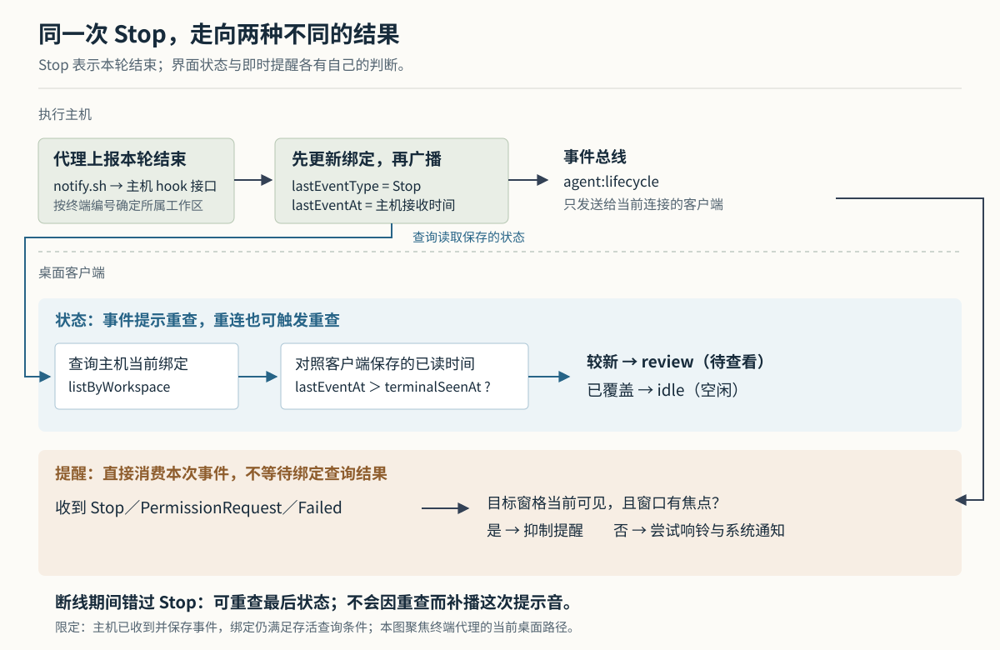

# Superset 怎样判断代理需要你处理：状态上报、已读记录与提示音的分工

假设你让一个编码代理修复登录错误，随后切到另一个工作区。它中途请求执行命令的许可，最后结束了这一轮工作。你希望侧栏能指出哪里需要处理，也希望提醒声响在自己正在使用的电脑上。若网络恰好断开，重新连接后，状态和声音会一起补回来吗？看过一次“结束”，是否就能消除所有提醒？

Superset 把这些问题交给三条相互配合的路径：**执行主机保存代理最后上报的状态，桌面客户端保存用户看到哪一次事件，即时通知决定是否响铃。** 因此，重连后可以重新查询最后状态，却不会因为重查而补播错过的提示音；看过“本轮结束”可以清除待查看标记，却不会自动消除仍在等待处理的许可请求或失败状态。

本篇接续七篇已有研报，包括尚未归档的 Changes 刷新研究，深入此前只简要提到的代理状态机制。依据是本次 `input/repository/` 快照 `a50aa443549df73866dca600421d849cf81f9b06`。重点是当前桌面工作区中的终端代理路径；结构化聊天只用于核对实现边界，不把结论扩大到所有客户端和云端状态。开头场景及后文时序例子均为假设。本次只读源码、测试与设计记录，没有启动 Superset、运行代理或执行仓库测试。

**代理先主动报告发生了什么，Superset 再统一解释。**

Superset 把代码目录、终端和编码代理组织成工作区，但通常不接管代理内部如何思考、调用工具。终端中不断出现文字，也不足以可靠判断程序正在工作、等待许可还是已经结束。当前路径主要依赖 hook，即代理在特定时刻调用的通知脚本。

以 Claude Code 为例，`agent-setup` 包的 `createClaudeSettingsJson` 把 Superset 的通知命令登记到会话开始、提交提示词、工具调用后、许可请求、正常结束和失败等事件上。它通过合并配置保留用户自己的设置。通知脚本由 `createNotifyScript` 生成；独立启动的主机服务在 `serve.ts` 中调用 `provisionAgentIntegrations` 准备这些集成，因此这条路径也考虑了没有桌面程序代为配置的主机。准备失败会记录日志并继续启动服务，不能据“终端能打开”推断通知集成已经可用。[注册实现见代理包装与配置文件](https://github.com/superset-sh/superset/blob/a50aa443549df73866dca600421d849cf81f9b06/packages/agent-setup/src/agent-wrappers-claude-codex-opencode.ts)，[独立主机配置入口](https://github.com/superset-sh/superset/blob/a50aa443549df73866dca600421d849cf81f9b06/packages/host-service/src/runtime/agent-provisioning.ts)。

通用的 `notify-hook.template.sh` 读取代理输入，提取事件、终端编号和代理会话编号，再向主机的 `notifications.hook` 接口发送请求。不同代理的字段拼写、事件名并不相同，脚本先处理部分差异，主机的 `mapEventType` 再统一为以下语义：

| 统一事件 | 代表的事实 | 终端绑定对应的界面状态 |
|---|---|---|
| `Attached` | 代理会话已经接入 | 单独出现时为空闲，不表示已开始工作 |
| `Start` | 本轮开始或仍有执行活动 | `working`，工作中 |
| `PermissionRequest` | 收到需要用户处理的阻塞类事件 | `permission`，需要处理 |
| `Stop` | 本轮结束 | 未看过时为 `review`，待查看；已看过时为空闲 |
| `Failed` | 代理报告本轮失败 | `failed`，失败 |
| `Detached` | 代理报告会话离开 | 从活动绑定中移除 |

这里的“统一”会损失细节。例如工具调用失败事件 `PostToolUseFailure` 被归入 `Start`，因为工具失败后代理仍可能继续尝试；代理本轮失败的 `StopFailure` 才归入 `Failed`。`PermissionRequest` 也可能覆盖提问或工具执行前的阻塞信号，不能一律解释成已经确认存在某个权限错误。正常结束 `Stop` 没有检查代码差异或测试结果，更没有证明登录错误已经修好。[映射规则见 `mapEventType`](https://github.com/superset-sh/superset/blob/a50aa443549df73866dca600421d849cf81f9b06/packages/host-service/src/events/map-event-type.ts)，[界面基础状态映射见 `agentStatusFromEvent`](https://github.com/superset-sh/superset/blob/a50aa443549df73866dca600421d849cf81f9b06/packages/shared/src/agent-status.ts)。

**主机按终端确定归属，避免把别人的活动算到当前代理头上。**

收到通知时，`notifications.hook` 不接受脚本自行指定工作区，而是按 `terminalId` 查询终端会话表，取得 `originWorkspaceId`。未知事件、缺失或未知终端都会被忽略。主机以自己的 `Date.now()` 生成接收时间，然后调用 `TerminalAgentStore.recordEvent` 更新绑定，再通过 `fanOutAgentLifecycle` 广播。这保证正常路径中，客户端收到通知后回查时，绑定已经先写入。[完整入口见 `notifications.ts`](https://github.com/superset-sh/superset/blob/a50aa443549df73866dca600421d849cf81f9b06/packages/host-service/src/trpc/router/notifications/notifications.ts)。

绑定记录的核心是“哪个终端、属于哪个工作区、运行哪种代理、对应哪个代理会话、最后是什么事件及其时间”。主机在 `app.ts` 把 `TerminalAgentStore` 接到 SQLite——主机上的文件数据库——持久层，因此终端代理的最后事件不只存在于桌面内存中。查询活动绑定时，持久层还联查终端会话：终端必须是 `active`，没有处置请求，仍有工作区归属，绑定本身也不能已经结束。这样，已经结束的绑定即使仍为恢复保留在数据库里，也不会继续贡献活动状态。[存储与状态更新](https://github.com/superset-sh/superset/blob/a50aa443549df73866dca600421d849cf81f9b06/packages/host-service/src/terminal-agents/store.ts)、[活动查询条件](https://github.com/superset-sh/superset/blob/a50aa443549df73866dca600421d849cf81f9b06/packages/host-service/src/terminal-agents/persistence.ts)共同界定了“还能查到状态”的范围。

归属还要处理两种容易混淆的情况。第一，主代理可能在工具调用里启动另一种代理程序。脚本比较包装器留下的代理身份与实际触发配置的代理种类，不一致时丢弃事件，避免内层命令把外层终端改认成另一种代理。没有 Superset 终端或标签环境标记时，脚本也直接退出，避免全局配置在其他终端触发后误报。

第二，同一种代理可能派出子代理。带子代理编号的通知进入独立名册，不更新父代理的生命周期，也不直接触发父代理的结束提醒。主机广播的是“绑定内容变了，请重查”，而不是“整个代理已经结束”。例如子代理已经完成搜索，主代理仍在综合结果，父代理的 `working` 就可以继续保留。这不是从文件名推测的分工：接收路由确有独立分支，测试也检查子代理通知没有改写父会话编号或增加生命周期广播。[脚本身份过滤与子代理分流](https://github.com/superset-sh/superset/blob/a50aa443549df73866dca600421d849cf81f9b06/packages/agent-setup/templates/notify-hook.template.sh)，[路由测试](https://github.com/superset-sh/superset/blob/a50aa443549df73866dca600421d849cf81f9b06/packages/host-service/src/trpc/router/notifications/notifications.test.ts)。

这些检查降低误归属，但没有把状态变成可信的验收凭据。生命周期入口使用不要求普通主机密钥的公开过程，账号归属等字段另有校验。它适合接收运行提示，不能承担“代码已经正确”或“操作已经获得业务授权”的证明。

图中上方路径读取保存的绑定，下方路径直接消费本次通知。两者可以独立失败，也可以在重连后表现不同。

**“待查看”由代理状态和用户记录共同算出。**

界面不是收到 `Start` 就把“工作中”永久存入自己的通知数据库。`useTerminalAgentBindings` 调用主机的 `terminalAgents.listByWorkspace` 读取绑定；收到 `agent:lifecycle`、`agent:bindings-changed` 或 `terminal:lifecycle` 时，让查询重新读取。`useTerminalAgentStatuses` 再把这些绑定交给 `deriveTerminalAgentStatus`。

对于 `Stop`，派生规则可以直接写成：

> 主机绑定的最后事件时间，大于客户端记录的已读时间 → 待查看；否则 → 空闲。

客户端 `v2-notifications/store.ts` 持久保存的是 `terminalSeenAt`——每个终端“用户已看到哪次事件”的时间——以及手动未读标记等信息。旧版本曾保存代理状态，新版迁移代码明确丢弃这部分状态，只保留手动未读，避免应用重开后从本地旧记录恢复出过期的工作提示。[绑定查询](https://github.com/superset-sh/superset/blob/a50aa443549df73866dca600421d849cf81f9b06/apps/desktop/src/renderer/hooks/host-service/useTerminalAgentBindings/useTerminalAgentBindings.ts)、[状态派生函数](https://github.com/superset-sh/superset/blob/a50aa443549df73866dca600421d849cf81f9b06/apps/desktop/src/renderer/hooks/host-service/useTerminalAgentStatuses/deriveTerminalAgentStatus.ts)和[客户端记录及迁移](https://github.com/superset-sh/superset/blob/a50aa443549df73866dca600421d849cf81f9b06/apps/desktop/src/renderer/stores/v2-notifications/store.ts)可以相互核对。

已读时间只能前进：较早的迟到记录不会覆盖较新的记录。常规主机事件路径还刻意使用事件中的主机时间，或回查绑定取得的主机时间，而不是用户电脑的当前时间。假设远程执行电脑比桌面慢两分钟，若桌面直接把自己的时间写进去，后续两分钟的结束事件都可能被当作已经看过。使用同一主机给出的时间，避免了这种跨机器比较。

这个同一时钟约定也有兼容例外：`V2NotificationController` 接收旧版 Electron 通知时，仍用桌面端的 `Date.now()` 给可见目标标记已读，再把事件转交主机。因此，不能把常规路径的时间处理扩大成所有入口都遵守的保证。

不过，这仍然是时间戳方案，没有为每轮工作建立递增事件序号；它不等于解决了所有系统时钟调整或同一毫秒事件的排序问题。当前机制主要回答“这条最新记录是否晚于已读记录”，没有保存每轮工作的完整历史。

已读规则只让 `review` 退回空闲。`permission` 和 `failed` 不受已读时间影响：看到一个许可请求并不表示已经回答，看到失败也不表示失败已经解决。侧栏按“需要处理的许可、失败、工作中、待查看”的顺序选最高优先级。因此，同一个工作区里，一个代理仍在工作时，另一个代理结束的待查看状态可能不是主图标；一个许可请求又能盖过工作中。这个图标表达的是优先提示，不能概括每个代理的全部状态。

工作区看板还会再做一层解释：对有项目的普通工作区，代理 `review` 可以进入“Finished · unread”，即“已结束、未读”；打开的拉取请求则可以进入“In review”，即“等待代码审阅”。拉取请求是请求把分支改动合并进仓库的记录。两处都含有“review”，却分别指用户尚未查看代理结果，以及代码进入协作审阅阶段；无项目的 `session` 工作区又会跳过前一种看板归类。[看板规则见 `deriveBoardColumn`](https://github.com/superset-sh/superset/blob/a50aa443549df73866dca600421d849cf81f9b06/apps/desktop/src/renderer/routes/_authenticated/_dashboard/v2-workspaces/utils/deriveBoardColumn/deriveBoardColumn.ts)。

**提示音由客户端决定，而且“已经看过”和“不必响铃”并非同一个判断。**

当前 `V2NotificationController` 按主机地址组织订阅，每个主机由一个 `HostNotificationSubscriber` 监听生命周期事件，再根据工作区找到对应界面布局。`handleV2AgentLifecycleEvent` 用终端编号查找主区和右侧区域里的窗格、标签；布局尚未准备好或没有找到终端时，仍保留只有工作区与终端编号的通知目标。

它忽略 `Start`、`Attached`、`Detached` 的响铃，对 `Stop`、`PermissionRequest`、`Failed` 才进入提醒处理。只有当前路由是目标工作区、目标位于当前标签的活动窗格，而且文档没有隐藏、窗口有焦点时，才抑制提醒。这里的“可见”是代码依据路由和活动选择作出的判断，不是对用户目光或实际阅读的检测；也不是同屏所有分栏都自动算作已看见。

声音在客户端发起，音量、静音与铃声设置也在这里读取；系统通知通过 Electron 的接口展示，通知点击目标携带工作区和终端编号。因此远程主机不必、也不适合替使用者决定在哪台电脑响铃。这与设计记录说明的动机一致：执行主机不知道用户正在看哪个窗口。[处理、抑制与系统通知调用见 `lifecycleEvents.ts`](https://github.com/superset-sh/superset/blob/a50aa443549df73866dca600421d849cf81f9b06/apps/desktop/src/renderer/routes/_authenticated/components/V2NotificationController/lib/lifecycleEvents.ts)，[目标解析见 `resolveV2NotificationTarget.ts`](https://github.com/superset-sh/superset/blob/a50aa443549df73866dca600421d849cf81f9b06/apps/desktop/src/renderer/routes/_authenticated/components/V2NotificationController/lib/resolveV2NotificationTarget.ts)。

值得细看的是顺序：处理函数先尝试给可见目标写已读时间，再检查是否应抑制声音。**写已读的可见性检查不要求窗口有焦点，也不检查文档是否隐藏；抑制提醒却检查这两项。** 因而可以推演：用户切到另一个应用，Superset 内仍选中这个终端；结束事件到来时，它可能被记作已读，同时仍响铃并请求系统通知。这个结果来自两套条件的直接组合，本次没有实测操作系统遮挡、最小化等所有界面行为。

同样，事件到来时找不到目标窗格，不会仅因“你已经打开这个工作区”就抑制提醒。目标解析测试明确检查：没有布局时退回终端目标，只有活动标签中的活动窗格才满足可见条件。这比只看工作区更精细，代价是界面布局尚未就绪时也可能提醒。

**断线恢复修复的是不同缺口，不能互相替代。**

从代理到主机、再从主机到桌面，是两段通信。第一段的常见问题是主机重启换了端口，而仍在运行的代理环境变量还保存旧地址。当前通知脚本先尝试环境中的地址，随后读取各组织的 `manifest.json`——记录当前主机服务地址的文件——继续尝试。某个主机回答“终端不归我，已忽略”时，脚本会继续寻找；找到回答 `ignored:false` 的主机才结束探查。[实现见通知脚本的 `dispatch_to_host`](https://github.com/superset-sh/superset/blob/a50aa443549df73866dca600421d849cf81f9b06/packages/agent-setup/templates/notify-hook.template.sh)。

这使下一次通知有机会找到重启后的服务，但脚本没有把全部失败事件保存到持久待发队列。请求有超时，失败后可能进入旧版兼容入口，最终退出；不能承诺主机完全离线期间的结束事件一定会在日后补到。还有一个兼容条件：所有地址都试过以后，只要有主机返回成功状态码，即便没有主机明确接收，脚本也会跳过旧版回退。因此 HTTP 成功状态码与“所属主机已记录事件”必须分开理解。

第二段是主机到桌面。主机 `EventBus.broadcastAgentLifecycle` 只向当前连接发送消息，没有为生命周期事件保存重放历史。一个连接发送失败不会阻止其他连接，失败连接会被移除；重新连接也不会请求此前漏掉的结束事件。[广播与连接处理见 `event-bus.ts`](https://github.com/superset-sh/superset/blob/a50aa443549df73866dca600421d849cf81f9b06/packages/host-service/src/events/event-bus.ts)。设计记录甚至明确把持久保存通知事件排除在目标之外，接受断线丢失提示音；这是有出处的取舍，而非仅从缺少代码猜测动机。[通知设计记录](https://github.com/superset-sh/superset/blob/a50aa443549df73866dca600421d849cf81f9b06/plans/20260422-v2-notification-hooks-client-side.md)。

状态可以另行恢复：工作区的 `useWorkspaceConnectionRefresh` 在事件连接重新打开或主机地址变化后取消旧查询、要求重读绑定。侧栏也订阅生命周期变化，并将查询的新鲜期设为 30 秒，让符合条件的焦点或重新挂载读取能够修正遗漏。**30 秒不是每隔 30 秒必查，也不是状态最多过期 30 秒的保证。** 侧栏只有在显示子代理时才另外配置一分钟重读，用来清除已失效的子代理名册。

因此，实际可恢复范围可以这样判断：

| 出问题的位置 | 当前路径能做什么 | 仍然缺少什么 |
|---|---|---|
| 通知还没到所属主机 | 从当前地址文件寻找服务，尝试投递 | 没有通用的离线事件补交队列 |
| 主机已保存，桌面错过广播 | 重新连接或后续查询时读取最后绑定 | 不补播错过的声音，也不恢复每轮事件历史 |
| 终端已经结束或被处置 | 活动查询排除对应绑定 | 活动状态列表不会永久保存这次失败或结束提示 |
| 最后一个结束通知没有产生 | 下次真实通知可能纠正；用户可清除状态 | 单纯重查无法推断从未上报的结束事实 |

这也限定了“主机是状态来源”的含义：主机保存的是最后接收到的代理报告，再结合终端记录筛选活动绑定，并非持续证明代理真实内部状态。[重连重查实现](https://github.com/superset-sh/superset/blob/a50aa443549df73866dca600421d849cf81f9b06/apps/desktop/src/renderer/hooks/host-service/useWorkspaceConnectionRefresh/useWorkspaceConnectionRefresh.ts)。

**手动清除是在纠正提示，不是在终止代理。**

用户按 Escape 或 Ctrl+C 中断前台代理一轮工作时，shell 可能仍活着，而代理没有发出 `Stop`。终端面板的 `useTerminalInterruptClear` 因此在按键事件发生、当前绑定为工作中或等待处理时，请求 `terminalAgents.clearWorkspaceStatuses`。侧栏的“Clear Status”也能调用这个接口。

主机把指定终端或整个工作区的绑定改成 `Stop`，保留原来的 `lastEventAt`，然后发送 `agent:bindings-changed`。由于这不是生命周期完成事件，不会触发一声人为制造的“完成”提醒。保留时间也避免让本来已读的记录凭空成为一条新的未读结束。对于终端绑定，这个接口可以清掉 `Failed`；聊天绑定另有保留失败的分支，不能说所有会话完全一致。[按键处理见 `useTerminalInterruptClear`](https://github.com/superset-sh/superset/blob/a50aa443549df73866dca600421d849cf81f9b06/apps/desktop/src/renderer/routes/_authenticated/_dashboard/v2-workspace/$workspaceId/hooks/usePaneRegistry/components/TerminalPane/hooks/useTerminalInterruptClear/useTerminalInterruptClear.ts)，[主机接口见 `clearWorkspaceStatuses`](https://github.com/superset-sh/superset/blob/a50aa443549df73866dca600421d849cf81f9b06/packages/host-service/src/trpc/router/terminal-agents/terminal-agents.ts)。

清除动作本身没有杀进程。按键是否真的中断了代理，还取决于终端中的程序怎样处理；若代理继续工作，下一个真实事件可以重新写回工作中。因此“状态清了”不等于“工作停了”，也没有“几秒内一定重新校正”的保证。

**迟到保护只处理了特定情况，仍有值得验证的时序边界。**

代理包装器为了尽早建立身份，会在启动后延迟约两秒、确认进程还存在，再发送一次会话开始报告。它可能比原生 hook 晚到。`TerminalAgentStore` 为此规定：同一会话的 `Attached` 不能把已经记录的工作中、许可、结束或失败改回初始状态；但它仍刷新 `lastEventAt`。存储测试对保留这些事件类型、同时更新时间都有明确断言。

将这条规则与已读规则组合，会得到一个具体的待验证案例：主机先在时间 100 收到 `Stop`，用户将 100 标为已读并离开；同一会话的延迟 `Attached` 随后在 200 到达。绑定仍为 `Stop`，时间却变成 200。下一次查询用“200 大于已读的 100”判断，可能重新显示待查看；即时通知又会因事件是 `Attached` 而不响铃。**保留了事件类型，并不等于保留了那一轮结束的时间身份。** 这是依据当前两个函数组合的推演，不是已经复现的界面缺陷。[启动报告生成](https://github.com/superset-sh/superset/blob/a50aa443549df73866dca600421d849cf81f9b06/packages/agent-setup/src/agent-wrappers-common.ts)、[存储实现及测试](https://github.com/superset-sh/superset/blob/a50aa443549df73866dca600421d849cf81f9b06/packages/host-service/src/terminal-agents/store.test.ts)支持这个核验方向。

存储层还会在绑定结束后的 30 秒窗口，拦下同会话、非新接入的部分迟到事件，避免抹掉结束记录。但这不是任意事件乱序的解决方案：常规输入没有每轮事件编号，主机时间也是接收时间。若上一轮的 `Stop` 晚于下一轮的 `Start` 到达，常规更新分支仍可能按到达顺序把最后状态写成结束。下一次活动可能纠正它，本次没有验证这种交错在真实代理上的发生条件或频率。

**测试证明了局部约定，尚未替整条交互链作保证。**

本次实际读到的断言包括：通知脚本测试用本地假服务模拟旧端口失效和错误组织，检查脚本仍找到所属主机；接收路由测试检查终端归属、子代理分流、失败映射，以及广播时绑定已可读取；存储测试检查延迟 `Attached` 的状态保留和结束后的迟到过滤；界面派生测试检查已读只清除 `review`，许可与失败仍保留；目标解析与客户端存储测试检查活动窗格判断和已读时间不倒退。

这些测试分布在 [通知脚本测试](https://github.com/superset-sh/superset/blob/a50aa443549df73866dca600421d849cf81f9b06/packages/agent-setup/src/notify-hook.test.ts)、前述路由与存储测试，以及[界面状态派生测试](https://github.com/superset-sh/superset/blob/a50aa443549df73866dca600421d849cf81f9b06/apps/desktop/src/renderer/hooks/host-service/useTerminalAgentStatuses/deriveTerminalAgentStatus.test.ts)。它们使用了假服务、模拟上下文或纯函数输入；本次没有执行它们，也没有验证真实代理版本、网络断线、系统通知权限和窗口焦点共同作用后的端到端行为。设计记录中的未来方案同样不能直接当作现状，例如当前已读存储就与文档早期设想的状态存储不同，应以现行调用和迁移实现为准。

对使用者，工作中提示适合帮助分配注意力，许可与失败需要进入对应会话处理；待查看消失只说明客户端把那次记录覆盖为已读。没有听到声音时，先区分主机是否收到事件、桌面是否漏过广播，再检查静音、目标窗格与窗口焦点。验收代码仍要看实际改动和测试；清除状态也应与终止进程分开操作。

对构建类似工具的人，可借鉴的是把代理报告、用户已读和即时提醒分别交给最了解它们的组件：主机掌握执行归属，客户端掌握交互上下文，查询提供断线后的重新读取机会。如果业务进一步要求每轮结束都有可追溯记录、跨设备一致已读或可靠补通知，就需要另外设计事件身份、持久投递和确认机制；当前这条为开发者分配注意力的路径，没有提供这些保证。
