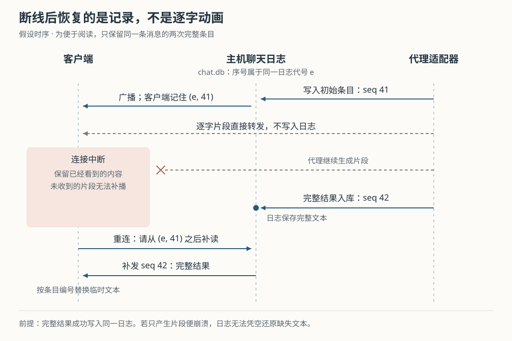

# Superset 聊天断线后能补回什么：事件记录、逐字输出与代理恢复的边界

假设你在 Superset 的聊天窗格里让代理修复登录错误。回复出现到一半时网络断开，代理仍在另一台电脑工作；重新连接后，完整回复出现了。另一次，运行代理的主机服务重启，聊天记录还在，代理却需要重新加载。为什么同样是“恢复聊天”，两次动作完全不同？如果发送消息后没收到确认，重试会不会让代理再做一遍？

Superset 分开处理这些问题：**主机记录可重读的聊天事件，客户端记住读到哪里，代理适配器负责让代理重新接上自己的会话。** 逐字出现的文字另走即时通道，不承担历史保存。由此，“界面能还原”“消息已被主机记录”“代理还能执行”分别需要不同证据。理解这一区别，才能判断该等补读、尝试恢复，还是核对实际文件和命令结果。

本文接续八篇历史研报，深入此前只提及的结构化聊天机制，不重复终端进程保活与侧栏提醒。依据是本次 `input/repository/` 快照 `0fd3fdaa6812fec9e0bb9cad00f94816e864c17f`。开头及后文时序均为假设；本次只读源码、测试和设计记录，没有启动 Superset、运行代理或执行仓库测试。文中测试结论均指读到的断言。

**先从当前聊天入口确定：谁处理消息，谁真正运行代理。**

Superset 把代码目录、终端和编码代理组织为工作区。本文追踪的聊天窗格能分别显示用户消息、代理回答、工具执行和许可请求；它与把所有内容输出到终端字符流的路径不同。桌面 `ChatPane` 挂载 `AcpChatPane`，由 `useSessionClient` 把命令发往目标主机的 `/chat-v3/trpc`，并连接 `/chat-v3/sessions/:sessionId/stream` 接收事件。这里的 tRPC 是客户端调用服务端函数的接口框架，WebSocket 则提供持续的双向连接；本条聊天流只向客户端发送，用户命令仍经过前一个接口。[主机注册见 `mount.ts`](https://github.com/superset-sh/superset/blob/0fd3fdaa6812fec9e0bb9cad00f94816e864c17f/packages/host-service/src/chat-v3/mount.ts)。

主机第一次需要聊天能力时，才建立 `chat-runtime`，打开主机数据库所在目录下独立的 `chat.db`。其中既有保存会话列表信息的表，也有按顺序追加事件的表。运行中的代理连接则在内存中的 `LiveSessionRegistry` 管理。这样，聊天记录可以比一次服务进程活得更久，但重开数据库不会自动重建全部代理连接。[装配见 `createChatRuntime`](https://github.com/superset-sh/superset/blob/0fd3fdaa6812fec9e0bb9cad00f94816e864c17f/packages/chat-runtime/src/index.ts)，[表定义见 `schema.ts`](https://github.com/superset-sh/superset/blob/0fd3fdaa6812fec9e0bb9cad00f94816e864c17f/packages/chat-runtime/src/db/schema/schema.ts)。

还需避开一个同名陷阱：当前桌面把 Claude、Codex 等预设映射到 `claude-acp`、`codex-acp` 等实现。ACP，即 Agent Client Protocol，是客户端与代理交换提示词、工具状态及会话信息的协议。主机通过 `acpHarnessEntries` 注册适配器；适配器把协议消息翻译成统一聊天事件。仓库另有原生 Claude、Codex 适配器，但不能因为它们也注册了，就把其调用过程当成当前桌面默认链路。[映射见 `harness.ts`](https://github.com/superset-sh/superset/blob/0fd3fdaa6812fec9e0bb9cad00f94816e864c17f/packages/chat/src/core/harness/harness.ts)，[主机适配器工厂见 `acpHarnesses.ts`](https://github.com/superset-sh/superset/blob/0fd3fdaa6812fec9e0bb9cad00f94816e864c17f/packages/host-service/src/chat-v3/acpHarnesses.ts)。

沿正常路径，调用关系可以压缩成下面这条链：

> 聊天界面发送提示词 → `commands.prompt` → 活动会话 `LiveSession.prompt` → 代理适配器执行；代理返回更新 → 统一为事件 → 写入聊天日志或直接转发 → 客户端合并并显示。

决定能否恢复的关键，就在“写入日志或直接转发”这个分岔。

**完整条目负责保存事实，逐字片段负责及时显示。**

假设代理要回答“已找到登录校验错误”。它可能先发“已找到”，再发“登录校验错误”。Superset 将这种追加片段称为 delta，即增量片段；客户端把它们暂存在 `liveStreams` 中显示。片段没有用于历史补读的事件序号，也没有写入 `chat.db`。

代理适配器还会给出完整条目。这里的“完整”指包含该条目当时全部字段，并不等于任务已经完成：一个工具条目可以先是运行中，后来变为已完成；同一个条目编号可以多次写入。ACP 的 `SessionStream` 在开始一条文本时发出初始条目，积累文字片段，在文本切换、收到完整消息或显式刷新时再发出包含累计文本的条目。工具状态更新也整理成完整条目。因此，历史保存的是一串状态记录，既包含过程，也包含已经收束的结果。[文本与工具整理见 `sessionStream.ts`](https://github.com/superset-sh/superset/blob/0fd3fdaa6812fec9e0bb9cad00f94816e864c17f/packages/chat-runtime/src/harness/acp/sessionStream.ts)。

`LiveSession.handle` 把条目、一次交互轮次和会话状态交给 `appendDurable`。这里的 durable 表示进入持久记录；一次交互轮次指提示词触发的一轮代理工作。`ChatJournal.appendEnvelope` 先校验事件，再在同一个 SQLite 事务中追加日志、更新会话列表摘要，提交后才返回带序号的事件供广播。SQLite 是主机上的文件数据库，事务使这两项数据库更新一同成功或失败。逐字片段则直接交给订阅中心，绕过这个写入过程。[执行与广播顺序见 `liveSession.ts`](https://github.com/superset-sh/superset/blob/0fd3fdaa6812fec9e0bb9cad00f94816e864c17f/packages/chat-runtime/src/sessions/liveSession/liveSession.ts)，[事务见 `journal.ts`](https://github.com/superset-sh/superset/blob/0fd3fdaa6812fec9e0bb9cad00f94816e864c17f/packages/chat-runtime/src/journal/journal/journal.ts)。

这带来一个有用的恢复窗口：事件已经入库、广播却没有送到客户端，客户端以后仍能补读。但如果只有文字片段产生，完整条目还没保存，主机便崩溃，聊天日志无法还原尚未写下的文字；代理自己的历史是否保存了它，是另一条路径的问题。

订阅中心默认约每 33 毫秒合并一批片段，收到持久事件前先把待发片段发送出去。这样，同一条消息通常先逐字显示，再由完整条目接管；没有订阅者时，片段直接丢弃。33 毫秒是调度间隔，不是显示延迟的性能保证。客户端的状态合并函数收到完整条目时，按条目编号替换记录，同时清除对应的临时文字、工具输入和终端输出缓冲。[订阅中心见 `subscriptions.ts`](https://github.com/superset-sh/superset/blob/0fd3fdaa6812fec9e0bb9cad00f94816e864c17f/packages/chat-runtime/src/stream/subscriptions/subscriptions.ts)，[合并规则见 `reducer.ts`](https://github.com/superset-sh/superset/blob/0fd3fdaa6812fec9e0bb9cad00f94816e864c17f/packages/chat/src/core/reducer/reducer.ts)。

图中的 41、42 是便于解释的假设序号；实际期间还可能插入工具、轮次和会话状态事件。即使重连时代理仍在生成，遗漏片段也不会马上补齐；后续完整条目到达后，显示才有机会与保存的内容一致。

**补读位置既要说明“读到第几条”，也要说明“读的是哪份历史”。**

每条持久事件携带游标，即下次继续读取的位置，格式为 `{ epoch, seq }`。`seq` 是同一会话日志内递增的序号；`epoch` 是这份日志的随机代号。假设旧日志读到第 41 条，日志重建后也出现第 41 条，只比较数字就会把两份无关历史拼起来。加上代号，主机能够拒绝这种拼接。

主机的 `openEpoch` 在已有日志仍存在时沿用代号；普通服务重启不会因重启本身就更换它。若重新打开的会话没有对应日志记录，则生成新代号，并重置相关摘要。`readSince` 检查会话是否存在、代号是否一致、游标是否超出当前末尾，并按序号升序读取后续记录。坏记录无法解析时，它返回 `journal_missing`，要求重新同步，而非把坏数据直接交给界面。[代号管理见 `epoch.ts`](https://github.com/superset-sh/superset/blob/0fd3fdaa6812fec9e0bb9cad00f94816e864c17f/packages/chat-runtime/src/journal/epoch/epoch.ts)，[补读与分页见 `replay.ts`](https://github.com/superset-sh/superset/blob/0fd3fdaa6812fec9e0bb9cad00f94816e864c17f/packages/chat-runtime/src/replay/replay.ts)。

客户端 `subscribeToSession` 每收到持久事件就记住游标，连接关闭后带着它重连。默认等待从 250 毫秒逐步翻倍，最多十秒；连接打开后重新计算等待次数。逐字片段不推进游标，因此不会把“已经看到几个字”误作“完整内容已经安全收到”。收到重置信号时，客户端清空补读游标，并通知上层重新读取历史。[连接管理见 `subscribeToSession.ts`](https://github.com/superset-sh/superset/blob/0fd3fdaa6812fec9e0bb9cad00f94816e864c17f/packages/chat/src/client/subscribeToSession/subscribeToSession.ts)。

这里还有一层容易忽略的区别：订阅接口没有游标时，默认只补最近 200 条事件；当前 React 聊天界面首次加载则优先调用 `getOutline`，读取整段会话的条目概览，再从概览游标接上事件流。概览保留对话结构，却省略工具调用的较大正文，界面按需要用 `getItemBodies` 补取；概览不可用时才退回事件分页。因此，不能把“流接口默认 200 条”理解成“聊天历史只保存 200 条”。[加载流程见 `useChatSession.ts`](https://github.com/superset-sh/superset/blob/0fd3fdaa6812fec9e0bb9cad00f94816e864c17f/packages/chat/src/react/useChatSession/useChatSession.ts)，[概览裁剪见 `outline.ts`](https://github.com/superset-sh/superset/blob/0fd3fdaa6812fec9e0bb9cad00f94816e864c17f/packages/chat/src/core/outline/outline.ts)。

重新读取历史本身也会遇到并发：概览请求尚未返回，代理又生成了新回答。`useChatSession` 在重新同步期间保留已到达事件，拿到概览后，通过 `newerThan` 过滤概览已经覆盖的持久事件，再合并较新的部分；若同步期间又收到重置信号，还会再同步一轮。这保护了当前概览路径中的交接，不等于所有错误都能自行修好。数据库里缺失的内容无法靠重新请求创造出来，分页兼容分支的处理也不完全相同。

实现还限定了“完整条目容易重放”的含义。客户端与主机历史重建共用同一套状态合并函数，可以避免两套解释规则逐渐偏离；按编号替换也避免重复条目越积越多。但 `reducer.ts` 并没有在应用条目前丢弃所有较旧序号：它先更新内容，再决定是否推进游标。所以，**当前机制能让按顺序补读的结果趋于一致，不能扩大成任意乱序到达都绝不倒退的保证。** 设计记录提出的抗重复、抗乱序目标，应结合实际传输顺序和调用方过滤理解。[设计取舍见协议决策记录](https://github.com/superset-sh/superset/blob/0fd3fdaa6812fec9e0bb9cad00f94816e864c17f/plans/20260804-chat-protocol-decisions.md)。

**发送成功、记录出现与代理执行完成，仍然是三个时刻。**

假设你点击发送后网络断开，客户端不知道主机究竟收没收到。`useChatSession` 先把消息加入 `Outbox`，即内存中的待发送箱，并为它分配两个编号：`commandId` 用于同一命令重试时判重，`clientId` 用于把主机回传的用户消息与界面中的待发送消息对应起来。收到带相同 `clientId` 的持久用户条目后，界面才从待发送箱移除它；一次接口正常返回本身不会直接移除。[待发送箱见 `outbox.ts`](https://github.com/superset-sh/superset/blob/0fd3fdaa6812fec9e0bb9cad00f94816e864c17f/packages/chat/src/core/outbox/outbox.ts)。

主机的 `commands.prompt` 用 `prompt:` 加命令编号作为判重键。默认缓存最近使用的 500 项结果，同一键仍在缓存中就返回已有结果。这能处理“主机已接收、客户端丢了响应”的常见重试，但缓存只在当前运行时内存中，进程重启或缓存淘汰后就不再提供相同保护。待发送箱本身也不是持久离线队列；不能承诺关闭应用后仍会补发所有尚未送达的消息。[命令入口见 `commands.ts`](https://github.com/superset-sh/superset/blob/0fd3fdaa6812fec9e0bb9cad00f94816e864c17f/packages/chat-runtime/src/commands/commands/commands.ts)，[缓存见 `commandDedupe.ts`](https://github.com/superset-sh/superset/blob/0fd3fdaa6812fec9e0bb9cad00f94816e864c17f/packages/chat-runtime/src/commands/commandDedupe/commandDedupe.ts)。

更关键的是，`LiveSession.prompt` 先保存用户条目，再把内容交给适配器；代理忙时则先排队。因此，回传条目证明主机记录了这条消息，并不证明代理已经执行。日志写入与代理实际执行也没有被同一个事务包住。根据这个顺序可以推演：若主机恰在保存后、交给代理前崩溃，历史里能看到请求，却不能据此认定工作已经开始。这是源码顺序支持的故障推演，本次没有注入崩溃实测。

**主机重启后，继续工作要重新接代理，而不是继续补读旧连接。**

`commands.getSession` 同时返回持久会话记录和 `live`。后者检查的是当前运行时是否还登记了活动会话对象，而不是读取数据库中的 `idle` 或 `running`。服务重启后旧记录仍可能写着空闲，活动对象却已不存在；另一方面，对象存在也不意味着代理健康，界面还单独检查 `dead`，即会话已失效的状态。

桌面的 `AcpChatPane` 发现旧会话不再活动或已失效，会在支持对应代理、且没有发现同一代理会话已转到终端继续运行时，尝试恢复。它关闭旧活动会话，通过 `createSession` 建立新的聊天会话，携带代理自己的 `harnessSessionId` 请求恢复；拿到的新聊天编号与旧编号不同。这里必须区分两个身份：Superset 的聊天编号用于组织自己的记录和连接，代理会话编号用于请求代理加载已有上下文。界面设有自动恢复次数限制，也会展示恢复失败信息，不能把这一过程当成无限重试。[完整判断见 `AcpChatPane.tsx`](https://github.com/superset-sh/superset/blob/0fd3fdaa6812fec9e0bb9cad00f94816e864c17f/apps/desktop/src/renderer/routes/_authenticated/_dashboard/v2-workspace/$workspaceId/hooks/usePaneRegistry/components/ChatPane/components/AcpChatPane/AcpChatPane.tsx)。

ACP 适配器先连接代理、协商协议版本，再加载会话：版本二调用 `session/resume`，要求从开头回放；版本一调用 `session/load`。代理通过 `session/update` 送回历史，适配器把它重新整理成聊天条目。正常运行时，代理回传的用户消息通常只是已有提示词的回声，可以略过；加载历史时则必须保留，因为这些用户消息可能原本是在命令行中输入的，新聊天日志尚未见过。**从 Superset 日志补读，与向代理加载历史，是两次不同的回放。**[实现见 `acpAdapter.ts` 的 `bootstrap` 与 `handleNotification`](https://github.com/superset-sh/superset/blob/0fd3fdaa6812fec9e0bb9cad00f94816e864c17f/packages/chat-runtime/src/harness/acp/acpAdapter.ts)。

恢复失败时，适配器并不一律偷偷开新对话。只有错误码或消息被 `sessionMissing` 判为“找不到原会话”，才降级调用 `session/new`，显示没有旧对话可加载的提示，并报告实际绑定的会话编号。其他加载错误进入失败路径，避免把暂时加载不了误当作没有历史。实际能恢复多少上下文，仍取决于代理保存的内容、协议实现、认证和工作目录；主机日志留存本身不能替代这些条件。

**安装更新另有一条主动续接路径，范围比通用崩溃恢复窄。**

桌面安装更新时，会让自己持有的主机服务退出，并预先写下 `chat-resume-after-update.json` 标记。主机收到终止信号后，只有标记已经存在，才把有代理会话编号、尚有运行或待处理工作的聊天写进去。保存内容包括代理身份、会话编号、工作区、待发提示词和暂停队列，而非只有界面显示的最后一句话。[桌面标记见 `host-service-coordinator.ts`](https://github.com/superset-sh/superset/blob/0fd3fdaa6812fec9e0bb9cad00f94816e864c17f/apps/desktop/src/main/lib/host-service-coordinator.ts)，[保存与续接见 `resumeAfterUpdate.ts`](https://github.com/superset-sh/superset/blob/0fd3fdaa6812fec9e0bb9cad00f94816e864c17f/packages/host-service/src/chat-v3/resumeAfterUpdate.ts)。

下次启动读取标记后，主机先删除它，再检查格式和时间；超过 30 分钟的标记被丢弃。有效条目分别尝试恢复，一项失败不阻断其他项。若原工作被中断，代码额外加入一句“Superset 因更新重启，请继续先前工作”的提示，再安排原待发消息；`promptOnceStarted` 等代理加载历史后才放行，暂停队列另行保留暂停状态。后台恢复出的聊天还可以按终端编号与代理会话编号交给随后接入的窗格，减少再次启动同一恢复会话的机会。

这个设计让一次有准备的更新可以主动续工，但它不是一般的崩溃任务队列：普通退出没有对应标记就不保存这份清单；读取时先删标记也意味着当轮恢复失败不会靠同一文件一直重试。追加“继续工作”的提示更不是让任意外部命令从中断点精确续跑。假如代理之前已完成一次有外部副作用的命令，却尚未保存清晰结果，恢复后仍需核对真实状态，不能仅靠聊天重放保证该命令恰好执行一次。

**现有测试支持局部恢复约定，尚不能替所有代理与故障作保证。**

| 实际读到的测试 | 断言如何支持本文结论 | 验证边界 |
|---|---|---|
| [`subscriptions.test.ts`](https://github.com/superset-sh/superset/blob/0fd3fdaa6812fec9e0bb9cad00f94816e864c17f/packages/chat-runtime/src/stream/subscriptions/subscriptions.test.ts) | 断开后从游标补读，与持续订阅者比较；不接收片段也能在完整条目到齐后得到一致结果；旧代号触发重置 | 使用模拟代理和接收器，不代表真实网络下所有时序 |
| [`journal.test.ts`](https://github.com/superset-sh/superset/blob/0fd3fdaa6812fec9e0bb9cad00f94816e864c17f/packages/chat-runtime/src/journal/journal/journal.test.ts) 与 [`replayIntegrity.test.ts`](https://github.com/superset-sh/superset/blob/0fd3fdaa6812fec9e0bb9cad00f94816e864c17f/packages/chat-runtime/src/replay/replayIntegrity.test.ts) | 重开同一数据目录保留日志和代号；坏记录返回重置信号 | 不证明所有磁盘损坏都能修复 |
| [`useChatSession.test.tsx`](https://github.com/superset-sh/superset/blob/0fd3fdaa6812fec9e0bb9cad00f94816e864c17f/packages/chat/src/react/useChatSession/useChatSession.test.tsx) | 人为阻塞概览返回，期间送入新回答，检查它没有被旧概览盖掉；同步中再重置会再取一次 | 覆盖特定界面交错，非任意乱序保证 |
| [`acpAdapter.test.ts`](https://github.com/superset-sh/superset/blob/0fd3fdaa6812fec9e0bb9cad00f94816e864c17f/packages/chat-runtime/src/harness/acp/acpAdapter.test.ts) 与 [`resumeAfterUpdate.test.ts`](https://github.com/superset-sh/superset/blob/0fd3fdaa6812fec9e0bb9cad00f94816e864c17f/packages/host-service/src/chat-v3/resumeAfterUpdate.test.ts) | 模拟不同版本的会话加载、历史回传、找不到会话时的新建；检查更新续接提示、坏条目跳过和标记过期 | 代理和部分运行时被替换，没有启动真实代理完成更新恢复 |

这套方案适合代理持续工作、客户端随时断开又返回的交互方式。把持久条目与即时片段分开，可减少逐字写入日志的工作；代价是未收束内容的恢复依赖后续完整条目。把聊天日志与代理会话分开，可保留可阅读记录并接入不同代理；代价是重新接上代理还要处理历史加载、身份映射和失败降级。协议决策记录明确表达了前一项动机；本文没有测量带宽、磁盘占用或恢复耗时。

对使用者，断线后先观察连接与完整结果是否补齐；主机重启后，再确认代理恢复是否成功。发送确认不明时优先使用同一条待发送消息的重试入口，避免手工重新发成一条新命令；涉及已运行命令，则核对文件、进程和外部结果。对实现类似系统的人，可以借鉴的是给历史读取、命令接收和实际执行分别留下证据，并明确每一种恢复动作的前提，而不是把它们都包装成一个含义模糊的“已恢复”。
