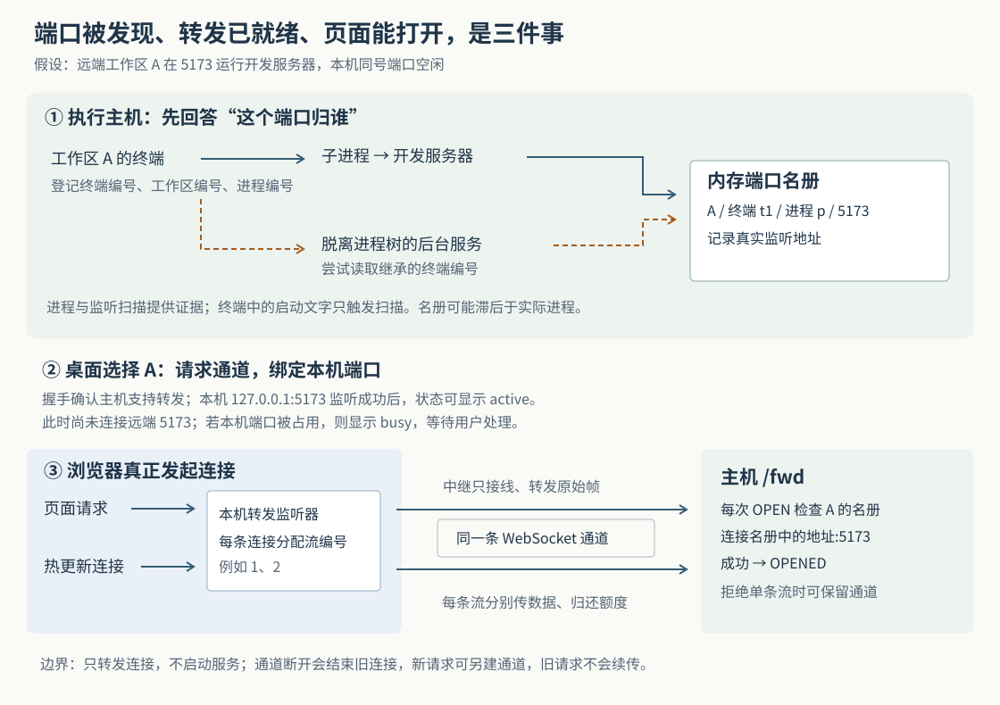

# Superset 怎样把远程开发服务器接到本机：端口归属、连接复用与恢复边界

假设你让代理在另一台电脑上修改登录页。代理启动开发服务器，Superset 的侧栏出现了 `5173`；你点开它，本机浏览器便能预览远端页面。与此同时，你自己的电脑也可能正在使用 `5173`，代理可能把服务器放到后台运行，网络也可能在页面加载到一半时断开。Superset 怎样知道这个端口属于哪个工作区？为什么有时端口已经显示出来，页面却仍然打不开？

当前实现先根据终端及相关进程建立端口名册，再按桌面窗口当前选择的远程工作区，在本机建立转发监听器。浏览器每发起一条连接，主机才尝试连接对应的开发服务器。**发现端口、建立转发入口、远端服务接受连接，分别由不同步骤确认。** 这让远程预览可以接入已有的工作区和中继机制，也决定了端口冲突、后台进程和断线恢复各自的边界。

本文接续九篇历史研报，研究此前没有展开的开发服务发现与桌面远程端口转发，不重复介绍工作区创建和远程终端协议。依据是本次 `input/repository/` 快照 `b01019dc163c69e6067f4753eab43a340a18b09b`。以上场景以及下文故障时序均为假设。本次只读取源码、测试和设计记录，没有启动 Superset、运行开发服务器、连接远程主机或执行仓库测试。范围是桌面端连接自有远程主机的这条路径，不将结论扩大到云工作区和其他客户端。

**端口归属从“谁启动了进程”开始，不从目录名称或日志里的网址开始。**

Superset 把代码目录、终端和编码代理组织成工作区，但 Git worktree——同一 Git 仓库的额外检出目录——隔开的是工作文件，并不分配独立的网络端口。同一主机上的两个工作区仍可能争用相同的监听地址和端口。显示工作区端口，需要另找归属依据。

主机创建或接管终端后，在 `terminal.ts` 调用 `portManager.upsertSession`，登记终端编号、工作区编号和终端进程编号。这里的 PID 是操作系统分配的进程编号。共享的 `PortManager` 随后读取一次系统进程表，调用 `buildProcessTrees` 找出各终端进程及其后代，再查询这些进程正在监听的 TCP 端口。TCP 是提供有序字节传输的连接协议；这里查的是“等待新连接”的端口，不是该进程访问过的所有网络地址。

因此，常见路径是：

> 工作区 A 的终端 → 终端启动的代理或命令 → 开发服务器进程 → 该进程监听的地址与端口 → A 的端口记录。

记录包含端口、PID、进程名、终端编号、工作区编号、发现时间和监听地址。主机按终端编号与端口组成记录键；同一终端同号端口的多个监听条目会被归并。扫描器还排除 `22`、`80`、`443`，所以“正在监听”也不意味着一定进入这个开发端口列表。[终端登记入口](https://github.com/superset-sh/superset/blob/b01019dc163c69e6067f4753eab43a340a18b09b/packages/host-service/src/terminal/terminal.ts)、[归属和记录管理](https://github.com/superset-sh/superset/blob/b01019dc163c69e6067f4753eab43a340a18b09b/packages/port-scanner/src/port-manager.ts)、[进程树与监听查询](https://github.com/superset-sh/superset/blob/b01019dc163c69e6067f4753eab43a340a18b09b/packages/port-scanner/src/scanner.ts)串起了这条调用链。

终端出现 `Local: http://localhost:5173/` 等启动文字时，`checkOutputForHint` 只安排一次较快的扫描，并不直接把日志里的端口当成事实。这个区别很实用：日志可能过期，程序也可能打印网址后立即退出，最终仍以进程和监听查询为准。

**后台服务器脱离终端进程树后，还能沿继承的终端编号找回来。**

代理可能启动后台服务器，随后用于启动它的中间进程退出。服务器仍在运行，却不再是终端进程的后代，单靠进程树便找不到它。

主机在准备终端环境时写入 `SUPERSET_TERMINAL_ID`。正常继承环境变量的后代进程也会带着这个编号。`DetachedProcessResolver.resolve` 专门处理没有进入本轮终端进程树的候选进程：读取其环境中的终端编号；本进程没有可用编号时，尝试沿父进程寻找最近的编号；最后只接受属于本轮已登记终端的结果。桌面自身的另一条终端路径使用 `SUPERSET_PANE_ID`，读取器也兼容这个字段。[编号注入](https://github.com/superset-sh/superset/blob/b01019dc163c69e6067f4753eab43a340a18b09b/packages/host-service/src/terminal/env.ts)、[后台进程归属解析](https://github.com/superset-sh/superset/blob/b01019dc163c69e6067f4753eab43a340a18b09b/packages/port-scanner/src/detached.ts)与[环境读取](https://github.com/superset-sh/superset/blob/b01019dc163c69e6067f4753eab43a340a18b09b/packages/port-scanner/src/terminal-env.ts)给出了实际连接。

环境归属每轮重新读取，不只按 PID 缓存。原因很具体：旧进程退出后，操作系统可能把同一个 PID 分配给新进程，甚至新旧进程的父 PID 也相同。继续沿用旧归属，就可能把无关服务放进工作区的端口列表。源码测试明确构造了这种编号复用，检查新一轮读取会改掉或移除旧归属。

这仍是有条件的找回机制。服务器若清除了编号，环境又不可读，祖先进程也没有可用线索，就不会得到归属。常规终端退出时还会注销扫描登记，因此，服务器继续存活不代表它能永远保留在原工作区端口列表中。环境编号本身也不是不可伪造的凭据；源码将这类识别定位为尽力而为的归属线索，不能据此把工作区视为进程安全沙箱。[后台进程测试](https://github.com/superset-sh/superset/blob/b01019dc163c69e6067f4753eab43a340a18b09b/packages/port-scanner/src/detached.test.ts)支持这些条件，而不是“所有后台服务都能识别”的保证。

**端口名册是持续更新的观察结果，会延迟，也会受到检查失败影响。**

当前配置每隔 2.5 秒触发一次周期检查；终端连续 60 秒没有输出后，降为约每 30 秒检查一次。终端输出会恢复较快节奏，启动提示会安排约 500 毫秒后的检查。这些是源码中的调度参数，不是实测发现时间。进程查询耗时、空闲判断和网络传递都会影响实际显示时间。

多个终端共用一轮进程表读取和批量监听查询；已有扫描进行时，后来的请求合并成后续扫描，避免并行重复检查。会话在查询期间换了进程或被注销，结果应用前还会比较会话对象，丢弃属于旧会话的结果。空闲终端本轮未到检查时间时，旧端口记录会保留，而不是先清空。

不同检查失败的后果并不一致。进程表读取失败，或者整轮环境读取抛错，会中断这一轮，保留先前名册；但监听查询中，macOS 的 `lsof` 错误被转成空结果，Linux 读取 `/proc`——操作系统提供进程和网络信息的文件接口——也有多处失败后返回空结果或跳过的分支。后者可能让端口暂时从名册消失。不能笼统地说“扫描失败都会保留旧状态”，也不能把“列表没有端口”当成服务已停止的确定证据。[扫描调度](https://github.com/superset-sh/superset/blob/b01019dc163c69e6067f4753eab43a340a18b09b/packages/port-scanner/src/port-manager.ts)、[监听查询错误处理](https://github.com/superset-sh/superset/blob/b01019dc163c69e6067f4753eab43a340a18b09b/packages/port-scanner/src/scanner.ts)和[Linux 实现](https://github.com/superset-sh/superset/blob/b01019dc163c69e6067f4753eab43a340a18b09b/packages/port-scanner/src/procfs.ts)共同界定了可信范围。

名册抵达界面还要经过另一段通信。主机 `EventBus.start` 把端口增加、移除转换为 `port:changed` 事件；桌面 `useDashboardSidebarPortsData` 初次调用 `ports.getAll` 获取快照，随后批量合并事件，并以 30 秒周期重新查询兜底。因此，这条桌面路径实际消费的是主机事件总线，不是同名 `ports.subscribe` 接口。重新查询读取的仍是主机现有名册，并不直接强制一次新的系统扫描。[主机事件装配](https://github.com/superset-sh/superset/blob/b01019dc163c69e6067f4753eab43a340a18b09b/packages/host-service/src/events/event-bus.ts)、[桌面数据入口](https://github.com/superset-sh/superset/blob/b01019dc163c69e6067f4753eab43a340a18b09b/apps/desktop/src/renderer/routes/_authenticated/_dashboard/components/DashboardSidebar/hooks/useDashboardSidebarPortsData/useDashboardSidebarPortsData.ts)与[快照接口](https://github.com/superset-sh/superset/blob/b01019dc163c69e6067f4753eab43a340a18b09b/packages/host-service/src/trpc/router/ports/ports.ts)可相互核对。

**选择远程工作区后，桌面先准备入口，浏览器请求到来时才连接服务。**

桌面布局挂载 `RemotePortForwarder`，从当前工作区页面取得编号。它调用的 `deriveForwardSyncInput` 只为 `remote-device` 类型生成转发目标；选择本机工作区或离开工作区页面时，交出空需求。`useRemotePortForwarding` 再把短时间内的端口变化合并，调用桌面主进程的 `portForwards.sync`。桌面主进程是 Electron 桌面应用中能使用本机网络接口的后台部分。

主进程的 `PortForwardManager` 按“主机地址＋工作区编号＋远端端口”管理转发项。每个窗口分别提交需求，管理器维持所有窗口需求的并集；一个窗口关闭或切走，只会移除其他窗口也不再需要的转发。端口占用仍由整台本机共享，多窗口并不会获得不同的端口空间。[选择规则](https://github.com/superset-sh/superset/blob/b01019dc163c69e6067f4753eab43a340a18b09b/apps/desktop/src/renderer/routes/_authenticated/_dashboard/components/DashboardSidebar/hooks/useRemotePortForwarding/deriveForwardSyncInput.ts)与[主进程管理器](https://github.com/superset-sh/superset/blob/b01019dc163c69e6067f4753eab43a340a18b09b/apps/desktop/src/main/lib/port-forward/port-forward-manager.ts)证明了这个范围。

对一个新增转发项，真实顺序如下：

1. `RelayForwardTransport.probe` 建立到目标主机 `/fwd` 的 WebSocket，即可持续双向传输消息的连接，并等待主机返回 `HELLO` 协议版本。
2. 握手成功后，管理器尝试在本机 `127.0.0.1` 绑定与远端相同的端口。绑定成功便写入 `active` 状态。
3. 浏览器连接本机端口后，管理器才调用 `openStream`，向主机发送带有流编号和远端端口的 `OPEN` 消息。
4. 主机查该工作区当前的端口名册。找到对应端口后，才用 `net.connect` 连接记录中的监听地址；连接成功返回 `OPENED`，两端开始传递字节。

这里的 `probe` 检查的是转发协议，不会向开发服务器发网页请求，甚至尚未建立到那个端口的 TCP 连接。因此，`active` 首先表示“本机转发入口已经绑定”，并非持续的应用健康检查。服务可以拒绝连接，也可以接受连接后返回错误页面。

主机连接时使用扫描得到的实际地址，而非一律连接 `127.0.0.1`。例如服务只监听 IPv6——另一种网络地址格式——的回环地址 `::1` 时，当前实现会使用这个地址；通配监听地址则映射到 IPv4 回环地址。这避免了“端口正确，连接地址却错了”的一类故障。[传输适配器](https://github.com/superset-sh/superset/blob/b01019dc163c69e6067f4753eab43a340a18b09b/apps/desktop/src/main/lib/port-forward/relay-forward-transport.ts)、[主机 `/fwd` 处理](https://github.com/superset-sh/superset/blob/b01019dc163c69e6067f4753eab43a340a18b09b/packages/host-service/src/ports/forward-mux-route.ts)给出了握手和连接的区别。

**网页、热更新和其他连接共用外层通道，但各自保留流编号和发送额度。**

一个页面可能同时请求脚本、图片，并建立用于热更新的长连接。Superset 没有让每条本机 TCP 连接都重新经历一次中继回拨，而是按“主机＋工作区”共享 `MuxSession`。Mux 是 multiplexing 的缩写，意为在一条通道中复用多条逻辑流；每条流有自己的编号，消息再区分打开、数据、结束、关闭和补充额度。

外层仍使用此前研报解释的中继接线方式：桌面请求远程主机路径，中继检查访问资格并通知主机回拨；主机 `TunnelClient.handleDial` 把连接接到本机 `/fwd`。主机入口还经过 `wsAuth` 身份校验。中继只转发外层帧，不需要解析里面的端口流编号。这样，端口转发能复用已有远程连接基础设施。[中继通用入口](https://github.com/superset-sh/superset/blob/b01019dc163c69e6067f4753eab43a340a18b09b/apps/relay/src/index.ts)、[主机回拨连接](https://github.com/superset-sh/superset/blob/b01019dc163c69e6067f4753eab43a340a18b09b/packages/host-service/src/tunnel/tunnel-client.ts)与[主机路由注册](https://github.com/superset-sh/superset/blob/b01019dc163c69e6067f4753eab43a340a18b09b/packages/host-service/src/app.ts)在当前源码中仍然连通。

这条通道传的是原始 TCP 字节，不专门解释网页协议。设计记录明确说明动机：开发服务器的热更新也需要持续连接，若只做普通网页请求代理，还需额外处理连接升级和请求体等问题。字节转发能让这些数据走相同路径；但侧栏的打开动作仍默认构造 `http://localhost:端口`，不会因为某端口实际运行数据库，就自动选择数据库客户端。[设计记录 D-1、D-6](https://github.com/superset-sh/superset/blob/b01019dc163c69e6067f4753eab43a340a18b09b/plans/done/20260824-1849-remote-port-forwarding.md)表达了动机，[浏览器地址生成](https://github.com/superset-sh/superset/blob/b01019dc163c69e6067f4753eab43a340a18b09b/apps/desktop/src/renderer/routes/_authenticated/_dashboard/components/DashboardSidebar/hooks/usePortOpenActions/usePortOpenActions.ts)界定了界面行为。该设计记录开头已注明部分实现被替换，不能沿用后文旧的“每个连接单独回拨”描述。

复用也要求处理快慢两端。当前协议为每条流的每个方向提供初始 1 MiB 发送额度，单条数据消息最多 256 KiB，一条会话最多容纳 128 条并发流。接收方把数据交给本地连接或消费者后，以 `WINDOW` 消息归还额度；接收方读不动时，暂停归还，发送方就暂停推进。这是背压，即让下游处理速度反向限制上游发送速度。控制消息不消耗数据额度，避免双方都等额度却无法送出补充消息。

桌面端会延迟完成写回调、等待额度；主机端会暂停上游读取、等待本地写缓冲排空。它们意在控制各流的积压，不等于整个系统所有缓冲都被同一个上限覆盖，也没有证明不同流之间具备严格带宽公平性。共享外层连接还意味着它断开时，里面的所有活动流一起受影响。[协议参数与帧定义](https://github.com/superset-sh/superset/blob/b01019dc163c69e6067f4753eab43a340a18b09b/packages/shared/src/port-forward-mux.ts)及[桌面流实现](https://github.com/superset-sh/superset/blob/b01019dc163c69e6067f4753eab43a340a18b09b/apps/desktop/src/main/lib/port-forward/mux-session.ts)支持这些结论；本次没有性能或公平性测量。

**本机端口冲突要由用户选择；换工作区并不等于停止开发服务器。**

假设远端使用 `5173`，本机也有程序监听同一端口。管理器绑定失败后进入 `busy`，尝试从本机扫描器取得占用者。界面提供“使用其他端口”；只有占用者已知时，才另提供停止本机程序的按钮。使用其他端口会以端口 `0` 请求操作系统分配可用端口，之后浏览器地址使用实际分配结果。

设计记录明确选择不自动换号：前端代码可能写死 `localhost:4000` 访问另一个服务，悄悄改号会让这类连接失效。即使用户主动换号，转发器也只改变本机入口，不会重写应用中的网址、跨域设置或回调地址。[冲突交互](https://github.com/superset-sh/superset/blob/b01019dc163c69e6067f4753eab43a340a18b09b/apps/desktop/src/renderer/routes/_authenticated/_dashboard/components/PortForwardBusyActions/PortForwardBusyActions.tsx)与前述设计记录 D-5 对应。

停止已知占用者，也不是看到一个旧 PID 就直接发终止信号。共享 `killPort` 会重新检查工作区归属、进程树或后台环境、监听地址、端口和进程名，并拒绝终止终端自己的 shell——接收命令的外壳程序。检查失败就不执行终止。代码同时承认：先检查、再按 PID 发信号，仍不是操作系统保证的原子动作，无法完全消除期间的进程替换窗口。

相比之下，转发入口每次 `OPEN` 只读取当前名册，没有执行上述整套重新检查。这产生一个需要保留的限制：假设旧服务退出，其他进程随即占用相同地址和端口，而名册尚未刷新，新转发可能连到后来的服务。这是根据缓存名册与连接代码组合得出的故障推演，本次没有复现。入口也没有因名册移除事件而重新检查所有已建立的流。因此，“只允许名册中的工作区端口”是一条访问筛选规则，不能理解成持续验证进程身份的强隔离。

当某个转发已不再被任何窗口需要，管理器关闭的是本机监听器及其连接。远端开发服务器不会因为这个操作自动停止；明确关闭服务才走进程终止路径。它把“访问服务”和“持有服务进程”分开，便于稍后重新接入，也意味着不能用“切走后本机端口消失”判断远端已经完成清理。

**恢复要看失败发生在哪一步，不能只看一项转发状态。**

| 失败位置 | 当前实现的处理 | 对使用者意味着什么 |
|---|---|---|
| 首次 `/fwd` 握手失败 | 转发项进入 `error`，尚未创建本机监听器；同一目标仍存在时，后续同步不会重新执行 `start` | 这条管理器路径没有同目标自动重试；让目标从所有窗口需求中移除后再加入，才会重新启动 |
| 已有入口，但某次 `openStream` 失败 | 关闭这次本机连接，状态改为 `error`，保留本机监听器 | 已打开的浏览器地址可发起新连接；后续成功打开流时可恢复 `active` |
| 已建立的数据流随通道断开 | 会话销毁活动流，本机和远端连接随之收尾 | 新请求可按需建立新通道，旧请求没有断点续传或自动重放 |
| 数据流建立后才出现连接错误 | 相关连接被销毁，管理器这处分支不直接修改转发状态 | 行上仍可能显示 `active`，不能据此断言当前页面请求成功 |
| 本机端口已被占用 | 显示 `busy`，等待用户选择 | 不是远端服务失效；先处理本机冲突 |

这些差异可在 `PortForwardManager.start`、`reconcile`、`accept`，以及 `MuxSession.destroySession` 中逐项核对。传输适配器发现旧会话已死亡后，会为下一次请求创建新会话；它没有在后台不断重拨并复原旧流。无活动流的会话还会在空闲后自行关闭，日后有请求再建立，这与远端服务是否继续运行无关。

界面也有一个值得留意的组合效果：`getPortBrowserUrl` 只给处于 `active` 的远程转发生成可打开网址，其他状态点击时会转向对应终端。因此，“保留的本机监听器可以接住下一次请求”不等于“当前端口按钮一定会替你发起这次请求”；已有浏览器标签重新加载，与重新点击错误状态的端口行，可能走出不同结果。这是源码调用关系的推演，不是本次观察到的界面复现。

测试提供了分层证据，但仍需区分覆盖范围。扫描管理器测试用模拟进程表和环境验证空闲保留、扫描合并、会话替换、后台归属，以及终止前拒绝过期信息；主机 `/fwd` 测试建立本地真实回显服务，检查 IPv6 地址、无归属拒绝、已关闭端口连接失败、多流独立和会话关闭清理。桌面管理器测试通过替代传输验证端口占用、换号、多窗口需求合并和“下次连接成功后恢复状态”；复用会话测试用简化主机检查多流共享连接和超过初始额度的数据传输。

这些分别见[扫描管理器测试](https://github.com/superset-sh/superset/blob/b01019dc163c69e6067f4753eab43a340a18b09b/packages/port-scanner/src/port-manager.test.ts)、[主机转发测试](https://github.com/superset-sh/superset/blob/b01019dc163c69e6067f4753eab43a340a18b09b/packages/host-service/src/ports/forward-mux-route.node-test.ts)、[桌面管理器测试](https://github.com/superset-sh/superset/blob/b01019dc163c69e6067f4753eab43a340a18b09b/apps/desktop/src/main/lib/port-forward/port-forward-manager.test.ts)和[复用会话测试](https://github.com/superset-sh/superset/blob/b01019dc163c69e6067f4753eab43a340a18b09b/apps/desktop/src/main/lib/port-forward/mux-session.test.ts)。本次没有执行这些测试；它们也不等价于真实代理、系统权限、跨网中继和浏览器共同参与的端到端验证。例如，复用测试中名为“死会话后重新连接”的用例随后使用了新主机地址，不能单靠它证明相同地址恢复的全部时序。

实际排查时，可以按这条执行链逐步缩小问题：先在执行主机确认服务确实监听、仍能归属到登记终端，再看本机端口是否冲突，最后区分通道握手、单条连接打开和应用响应。若主动换了本机端口，还要检查应用写死的地址。对于实现类似工具的人，这套设计可借鉴的地方，是让文件隔离、进程归属、网络入口和用户窗口需求分别由明确组件管理；同时，凡是依赖定期观察的归属判断，都应把观察延迟和失效条件带到使用者能够理解的状态说明中。
