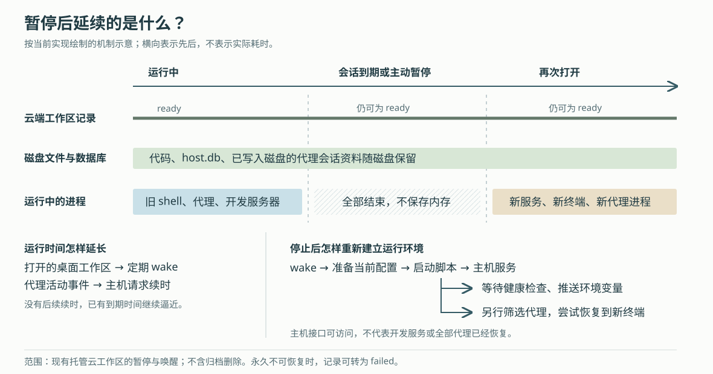

# Superset 云工作区暂停后怎样回来：运行续时、磁盘保留与代理重启的边界

假设你在 Superset 的云工作区里让代理修复登录错误，随后关掉电脑。第二天打开工作区，代码改动还在，终端里的代理也重新出现了。这是否意味着代理整夜都在运行？如果修复过程中启动了一个很久没有输出的测试，它也一定会被保留下来吗？

当前实现用两类请求延长云环境的运行时间：桌面为正在打开的工作区定期续时，主机在收到代理活动事件后请求续时。请求不再到来，沙箱——供应商提供的独立执行环境——便可能到期停止。**停止保留磁盘，结束所有进程；再次打开时，系统重启服务，再有条件地把代理会话接到新终端。** 因而，代码还在、工作区可以打开、代理已经恢复，是需要分别确认的三件事。

本文接续十篇历史研报，深入此前只简要提到的托管云工作区，不重复自有主机的终端保活和中继连接。依据是本次 `input/repository/` 快照 `e1fecdaaf58421ae1d5175e17e8d226c4fd93f6c`。文中场景均为假设；本次只读源码、测试和设计记录，没有启动 Superset、连接云沙箱、运行仓库测试或测量恢复时间。供应商行为以调用方式和仓库契约为依据，未另作线上验证。

**工作区记录存在，不等于执行环境正在运行。**

Superset 把代码、终端和编码代理组织成工作区。自有主机上的工作区由那台电脑运行；本文研究的云工作区则由云端接口管理供应商沙箱，沙箱里再运行 `host-service`，即负责文件、终端和代理操作的主机服务。

这条路径有三份各司其职的状态：

| 状态来源 | 保存或回答什么 | 不能据此认定什么 |
|---|---|---|
| 云端 `cloud_workspaces` 表 | 工作区生命周期、沙箱编号、已知地址、环境和创建者等 | 记录为 `ready` 不证明此刻有进程运行 |
| 供应商的沙箱与运行会话 | 沙箱是否运行、本轮何时到期、停止后的磁盘快照 | 运行中不证明代理或开发服务器已经可用 |
| 沙箱磁盘上的 `host.db` 及代理资料 | 终端归属、代理会话编号等恢复线索 | 保存了会话编号不证明代理一定能成功接回对话 |

云工作区枚举只有 `provisioning`、`ready`、`failed`、`deleted`，分别表示配置中、可使用、失败和已删除，没有单列“睡眠中”。`cloudWorkspace.sleep` 停止沙箱时也不把 `ready` 改成另一个状态。因此，这里的 `ready` 应理解为这条工作区记录允许进入访问流程，不能直接翻译成“所有服务已经就绪”。[云端表定义](https://github.com/superset-sh/superset/blob/e1fecdaaf58421ae1d5175e17e8d226c4fd93f6c/packages/db/src/schema/schema.ts)、[状态枚举](https://github.com/superset-sh/superset/blob/e1fecdaaf58421ae1d5175e17e8d226c4fd93f6c/packages/db/src/schema/enums.ts)和[暂停入口](https://github.com/superset-sh/superset/blob/e1fecdaaf58421ae1d5175e17e8d226c4fd93f6c/packages/trpc/src/router/cloud-workspace/cloud-workspace.ts)共同支持这个区分。

**侧栏可以列出很多工作区，只有真正打开的那一个需要续时。**

桌面的 `SandboxAccessProvider` 为列表中每个 `ready` 工作区调用 `cloudWorkspace.access`，但传入 `wake:false`。云端先检查组织成员资格、云功能使用权和该工作区的访问权限，再通过 `describeSandbox` 查询地址。这个查询明确使用 `resume:false`，避免仅仅为了显示侧栏就恢复全部云环境。

访问获准后，接口签发访问票据，即客户端向沙箱网关证明自己可以进入该工作区的临时凭据。拿到票据只是取得入口；它与沙箱是否运行是两回事。

当桌面路由实际打开某个云工作区时，另一个查询才传入 `wake:true`，并配置每十分钟重发一次，包含应用在后台的情况。它沿着下面这条实际调用链工作：

> `SandboxAccessProvider.requestAccess` → 云端 `cloudWorkspace.access` → `addressSandbox(..., "wake")` → `wakeCloudWorkspace` → 供应商适配函数 `wakeSandbox`。

这次调用既能唤醒已停止的环境，也能为正在运行的环境续时，并把返回的票据更新到地址缓存。恢复后供应商地址可能改变，票据也需要指向新的地址；只持有旧票据并不能完成恢复。[桌面访问与续时接线](https://github.com/superset-sh/superset/blob/e1fecdaaf58421ae1d5175e17e8d226c4fd93f6c/apps/desktop/src/renderer/routes/_authenticated/providers/SandboxAccessProvider/SandboxAccessProvider.tsx)、[云端访问入口](https://github.com/superset-sh/superset/blob/e1fecdaaf58421ae1d5175e17e8d226c4fd93f6c/packages/trpc/src/router/cloud-workspace/cloud-workspace.ts)、[访问票据生成](https://github.com/superset-sh/superset/blob/e1fecdaaf58421ae1d5175e17e8d226c4fd93f6c/packages/trpc/src/lib/sandbox/access.ts)分别负责这三个步骤。

这也说明，离开工作区不会立即发送“关机”命令，而是停止这一入口的定期唤醒。另一个客户端仍在使用它，或者代理仍在请求续时，环境就可能继续运行。

**没有人打开界面时，主机靠代理事件请求更多时间。**

沙箱内的 `serve.ts` 在主机服务开始监听后注册 `startSandboxKeepalive`。它监听 `TerminalAgentStore` 的 `activity` 事件，再调用云端 `sandbox.keepalive`；云端确认请求对应的工作区仍为 `ready` 后，执行 `topUpSandboxSession`。

这里的活动来自集成事件。终端代理的有效事件更新绑定后会触发 `noteActivity`；子代理的部分事件也会触发。结构化聊天则在收到可持久保存的条目事件等路径上报告活动。**本条续时链没有通过中央处理器占用率、普通终端输出量或“还有一个子进程”来判定工作。** [主机启动接线](https://github.com/superset-sh/superset/blob/e1fecdaaf58421ae1d5175e17e8d226c4fd93f6c/packages/host-service/src/serve.ts)、[代理活动来源](https://github.com/superset-sh/superset/blob/e1fecdaaf58421ae1d5175e17e8d226c4fd93f6c/packages/host-service/src/terminal-agents/store.ts)和[聊天事件桥](https://github.com/superset-sh/superset/blob/e1fecdaaf58421ae1d5175e17e8d226c4fd93f6c/packages/host-service/src/chat-v3/chatAgentBridge.ts)可串起这条回路。

`startSandboxKeepalive` 也不是“只要启动过就永久定时发送”。第一次活动可以立即触发请求；成功后设定十五分钟的间隔。在间隔内又有活动，才安排下一次请求；没有新活动，就不继续发送。一次请求进行中发生的活动会保留，等待后续发送。

失败处理同样有区别：网络错误或服务端错误采用带随机扰动的指数退避，从三十秒基数逐步增加，最长不超过十五分钟；明确的客户端拒绝则不自行反复重试，需要后续活动再触发。若请求一直失败，到期时间仍会逼近。这是尽力维持运行的机制，不是“只要代理还在，云环境绝不停机”的保证。[调度和重试实现](https://github.com/superset-sh/superset/blob/e1fecdaaf58421ae1d5175e17e8d226c4fd93f6c/packages/host-service/src/runtime/sandbox-keepalive/sandbox-keepalive.ts)、[云端续时入口](https://github.com/superset-sh/superset/blob/e1fecdaaf58421ae1d5175e17e8d226c4fd93f6c/packages/trpc/src/router/sandbox/sandbox.ts)。

回到开头的测试场景：如果测试长时间运行，但没有产生这条机制能识别的代理活动，也没有客户端为工作区续时，单凭测试进程存在并不足以阻止到期。等待用户回答的代理也不能仅凭“仍绑定在终端上”获得无限续时。

**“多久停止”取决于已有到期时间，不能只从关窗口开始数一小时。**

供应商适配代码将初始运行时长设为一小时，但两个续时入口的算法不同：

| 续时来源 | 对正在运行的沙箱怎样处理 |
|---|---|
| 打开工作区触发的 `wakeSandbox` | 剩余时间不足三十分钟时，请求再增加一小时；延长失败被捕获，后续仍尝试访问服务 |
| 代理活动触发的 `topUpSandboxSession` | 计算“从现在起一小时”与当前到期时间之差，差值超过一分钟才补足；不主动缩短已有期限 |

因此，离开界面时可能还剩超过一小时；最后一次活动还可能在十五分钟合并窗口内安排一次后续续时。这里只能解释调度规则，不能据此给出固定停机时刻。实现注释还明确考虑供应商拒绝超过单轮二十四小时上限的延长请求，不能把持续续时理解成同一批进程可以无限存活。这些数字均来自[当前 `vercel.ts` 的配置和调用](https://github.com/superset-sh/superset/blob/e1fecdaaf58421ae1d5175e17e8d226c4fd93f6c/packages/trpc/src/lib/sandbox/vercel.ts)，不是实测时延或独立核验过的供应商服务承诺。

代理续时专门调用当前运行会话的 `extendTimeout`，并先检查沙箱正在运行。代码解释，这是为了避免更高层的延长接口把已经停下来的环境意外唤醒。这个差别体现了一个实际取舍：后台活动可以延长已在进行的工作，重新启动计算则应由更明确的使用动作触发。

**暂停保存文件，唤醒重新建立服务。**

创建沙箱时，代码设置 `persistent:true`，工作区快照过期时间为三十天，并只保留最近一份快照。它为停止后的恢复提供磁盘基础，不是无限期备份，也不提供任意历史时刻回滚。

显式调用 `cloudWorkspace.sleep` 时，云端先确认沙箱是否运行；若正在运行，就执行 `stopAndSnapshot`。该函数记录旧快照编号，调用停止，再轮询，直到沙箱状态变为 `stopped` 且出现不同的新快照编号，最长等待三分钟。实现特意区分“停止请求已返回”和“新快照可用”，因为供应商可能在停止请求返回后继续生成快照。自动到期后的磁盘延续则依赖供应商的持久化契约，本次没有实测其写入耐久性。[创建配置、停止和快照等待实现](https://github.com/superset-sh/superset/blob/e1fecdaaf58421ae1d5175e17e8d226c4fd93f6c/packages/trpc/src/lib/sandbox/vercel.ts)。

再次打开时，`wakeCloudWorkspace` 先调用 `buildSandboxClaim`，组装本次运行需要的工作区身份、网络凭据规则、环境变量和代理登录文件。它读取的是当前配置，不是简单复用旧进程的环境。确认沙箱已停止后，还会在恢复前调用 `authorizeBoot` 检查并登记本轮运行的用量授权；明确拒绝可以阻止启动。

`wakeSandbox` 随后区分两条路径：沙箱仍在运行且主机服务能够回答时，更新相关规则、登录文件和托管环境即可；服务没有回答时，才尝试运行 `/usr/local/bin/superset-boot`。对已停止的沙箱，代码利用供应商执行命令时的恢复能力，先恢复磁盘，再运行启动脚本。[配置组装](https://github.com/superset-sh/superset/blob/e1fecdaaf58421ae1d5175e17e8d226c4fd93f6c/packages/trpc/src/lib/sandbox/claim.ts)、[工作区唤醒协调](https://github.com/superset-sh/superset/blob/e1fecdaaf58421ae1d5175e17e8d226c4fd93f6c/packages/trpc/src/router/cloud-workspace/wake.ts)和供应商适配函数共同完成这些动作。

启动脚本首先用文件锁和现有服务的进程编号防止重复启动，然后清除 `/run/superset`。这个目录放的是上一轮的进程编号、套接字和就绪标记；磁盘恢复会把这些文件也带回来，但它们描述的进程已经不存在。接着脚本检查所需软件包，按内容是否变化决定安装步骤，启动新的主机服务、桌面和代码目录准备流程。已有检出标记时，代码准备直接跳过，不在每次正常唤醒时重新拉取并覆盖代码。[实际启动脚本](https://github.com/superset-sh/superset/blob/e1fecdaaf58421ae1d5175e17e8d226c4fd93f6c/packages/sandbox/bundle/rootfs/usr/local/bin/superset-boot)。

这套方案延续了磁盘上的工作成果，却不延续内存、旧网络连接或旧 shell。开发服务器需要重新启动；若项目要在每轮启动时恢复服务，就应通过当前云启动钩子安排。钩子是启动时调用的项目命令，当前 `startHookCommands` 实际解析初始化阶段和默认终端命令，而不应机械套用早期设计文档中的配置名称。[当前钩子解析与执行](https://github.com/superset-sh/superset/blob/e1fecdaaf58421ae1d5175e17e8d226c4fd93f6c/packages/host-service/src/runtime/sandbox-self-seed/sandbox-self-seed.ts)。

还有一个容易忽略的顺序：`settleSandbox` 等待主机健康接口回答，再推送托管环境变量，便完成自己的等待。项目启动钩子由脚本另行等待代码目录和环境变量就绪后发起。**主机接口已经连通，不代表项目服务已经启动成功。** 代理自动恢复也是主机开始监听后另行发起的工作，不是这个健康检查的完成条件。

**代理回来时，用的是保存的会话编号和一个新终端。**

沙箱模式的 `serve.ts` 会在主机服务开始监听后调用 `resumeCrashedAgents`，最终进入 `resumeCrashedAgentSessions`。它先核对磁盘中的终端记录，把仍记为活动、实际上已没有对应运行会话的终端代理标记为因终端消失而结束，再筛选恢复候选。

候选必须保存了代理会话编号，结束原因必须是 `terminal-exited`，即终端消失；代理自己正常离开的 `detached` 和用户明确销毁的 `disposed` 不在这组候选中。启动扫描只取最近五分钟标记结束的候选，最多尝试八个。这里的“五分钟”不是要求用户在停机五分钟内回来：刚才的核对会为停机前仍活动的记录写入当前结束时间；它主要避免把此前早已结束的候选全部重新启动。[启动恢复实现](https://github.com/superset-sh/superset/blob/e1fecdaaf58421ae1d5175e17e8d226c4fd93f6c/packages/host-service/src/trpc/router/terminal-agents/terminal-agents.ts)、[失去终端后的核对](https://github.com/superset-sh/superset/blob/e1fecdaaf58421ae1d5175e17e8d226c4fd93f6c/packages/host-service/src/terminal/reaper/reaper.ts)与[候选查询条件](https://github.com/superset-sh/superset/blob/e1fecdaaf58421ae1d5175e17e8d226c4fd93f6c/packages/host-service/src/terminal-agents/persistence.ts)共同限定了范围。

对每个候选，`resumeTerminalAgentSession` 先用带条件的数据库更新，把结束原因从 `terminal-exited` 改成 `resumed`，取得本次恢复资格。同一主机进程内的并发调用还会共享正在执行的恢复请求。随后它确认代理配置支持恢复，调用 `runAgentInWorkspace`，传入旧代理会话编号，但使用空提示词，在新终端启动代理。

这里有一个细致的例外：代理如果只上报过“已接入”，还没有真正开始对话，系统会检查代理自己的会话存储。只有明确查不到对话时，才改为新启动；存储不可读不能当作对话不存在。启动失败会交还恢复资格，供后续重试；成功后记下旧终端对应的新终端，清理旧入口，并广播 `resumed` 事件。桌面既监听事件切换窗格，也会查询已记录的后继终端，弥补错过广播的情况。[恢复状态写入](https://github.com/superset-sh/superset/blob/e1fecdaaf58421ae1d5175e17e8d226c4fd93f6c/packages/host-service/src/terminal-agents/persistence.ts)、[桌面跟随新终端](https://github.com/superset-sh/superset/blob/e1fecdaaf58421ae1d5175e17e8d226c4fd93f6c/apps/desktop/src/renderer/routes/_authenticated/_dashboard/v2-workspace/$workspaceId/hooks/usePaneRegistry/components/TerminalPane/components/TerminalAgentAutoResume/TerminalAgentAutoResume.tsx)。

这些措施防止多个窗格因重连而反复启动同一个候选，但无法让代理执行的全部操作一起完成或一起撤销。旧测试命令不会从被中断的指令位置继续运行；代理接回对话后是等待输入、继续工作还是报告失败，仍取决于相应代理的恢复行为。数据库领取资格与创建进程也分属不同操作，不能由此宣称任何崩溃时序下都能完整恢复，更不能推出对 Git 推送、数据库写入等外部动作“恰好执行一次”。本文追踪的是终端代理恢复，不将其扩大为全部结构化聊天的自动恢复保证。

**不同失败会留下不同后果，不能统一解释为“再等一会儿”。**

| 出现的情况 | 当前路径怎样处理 | 对使用者意味着什么 |
|---|---|---|
| 唤醒后主机健康检查在约一分钟等待窗口内没有成功 | 抛出 `SandboxNotReadyError`，访问接口转换为超时 | 本次访问未就绪；这条唤醒路径不因此直接把记录改为永久失败 |
| 供应商返回沙箱不存在，或快照已无法恢复的错误 | 将供应商的 404、410 转为 `SandboxUnavailableError`，尝试把 `ready` 改为 `failed` 并清除地址 | 原环境可能已不可恢复，重复请求旧地址无法补回磁盘 |
| 更新网络规则失败，或运行中续时被拒绝 | 某些分支只记录警告或忽略延长错误，仍继续健康检查和环境推送 | 接口能回答，不证明凭据规则更新和续时全部成功 |
| 组织的云用量授权被明确拒绝 | 恢复前可以拒绝开机；运行中的用量结算也有宽限后停止逻辑 | 即便有人打开工作区、代理仍活动，也不保证继续运行 |

前面三类处理可在 `addressSandbox`、`wakeSandbox`、`markSandboxUnavailable` 中核对；用量授权与运行中停止见[当前 `meter.ts`](https://github.com/superset-sh/superset/blob/e1fecdaaf58421ae1d5175e17e8d226c4fd93f6c/packages/trpc/src/router/cloud-workspace/meter.ts)。首次配置环境失败另有收尾策略，不能把上表的唤醒超时处理套用到创建流程。

登录配置变化还会带来另一种“看起来没有恢复好”。每次唤醒都会重新准备当前登录资料，但已在运行的代理进程不会因此重新继承环境变量。`wakeCloudWorkspace` 比较本轮启动时记录的凭据摘要与当前摘要，必要时让桌面显示重启提示。`restartCloudWorkspace` 会先停止并等待快照，再启动环境；它结束整台沙箱上的进程，不是只刷新一个界面。[凭据变化比较与重启](https://github.com/superset-sh/superset/blob/e1fecdaaf58421ae1d5175e17e8d226c4fd93f6c/packages/trpc/src/router/cloud-workspace/wake.ts)。

**源码中的测试支持局部契约，尚不能代替真实云环境验证。**

本次实际阅读的测试包括：`sandbox-keepalive.test.ts` 用缩短的间隔和替代请求检查无活动不发送、活动合并、服务错误重试与明确拒绝不自行重试；`vercel.test.ts` 替换供应商对象并控制时间，检查补足到期时间及忽略过小差值；`terminal-agents.test.ts` 使用内存数据库、替代代理启动函数，检查恢复参数、并发合并、重复调用、失败归还资格和无对话时新启动；`persistence.test.ts` 检查条件领取只能成功一次，以及正常退出和明确销毁不应被误恢复。[续时调度测试](https://github.com/superset-sh/superset/blob/e1fecdaaf58421ae1d5175e17e8d226c4fd93f6c/packages/host-service/src/runtime/sandbox-keepalive/sandbox-keepalive.test.ts)、[供应商适配测试](https://github.com/superset-sh/superset/blob/e1fecdaaf58421ae1d5175e17e8d226c4fd93f6c/packages/trpc/src/lib/sandbox/vercel.test.ts)、[代理恢复测试](https://github.com/superset-sh/superset/blob/e1fecdaaf58421ae1d5175e17e8d226c4fd93f6c/packages/host-service/src/trpc/router/terminal-agents/terminal-agents.test.ts)、[恢复记录测试](https://github.com/superset-sh/superset/blob/e1fecdaaf58421ae1d5175e17e8d226c4fd93f6c/packages/host-service/src/terminal-agents/persistence.test.ts)。

仓库还提供真实沙箱探查程序，检查二次启动日志中的运行目录清理、跳过未变安装步骤、保留代码检出和主机服务就绪。但本次没有执行它；已读断言不能证明这些场景在当前线上环境全部通过。[唤醒探查代码](https://github.com/superset-sh/superset/blob/e1fecdaaf58421ae1d5175e17e8d226c4fd93f6c/packages/sandbox/src/environments/probe.ts)。

阅读中也发现了需要限定的旧说明：状态枚举注释仍提到“首个入站连接唤醒”，早期沙箱设计记录把凭据刷新与十分钟续时放在一起。当前实际路径则显式区分 `wake:false` 与 `wake:true`，并另外注册三十分钟一次的凭据刷新器。因此，本文关于谁唤醒、谁续时的结论取自当前调用链，没有把旧注释当作运行事实。[独立凭据刷新器](https://github.com/superset-sh/superset/blob/e1fecdaaf58421ae1d5175e17e8d226c4fd93f6c/packages/host-service/src/runtime/sandbox-credential-refresh/sandbox-credential-refresh.ts)。

**这套设计适合保留开发现场，同时允许计算环境暂时停止。**

从实现效果推断，把“记录可访问”与“进程正在运行”分开，可以让列表查询和访问凭据更新不必维持所有沙箱；磁盘保留加条件恢复，则减少重新准备代码和重新寻找代理对话的工作。代价是恢复需要协调供应商会话、启动脚本、主机数据库、代理自身存储和客户端窗格，任何一层成功都不能代表整条链完成。

实际使用时，长时间无人值守的任务应确认代理确实能报告活动，并把重要结果写入文件、提交或外部任务记录；需要重启的开发服务应放进能够重复执行的启动命令，避免再次启动时重复创建资源。回来后先看文件和日志，再核对代理对话与测试结果；若中断前执行过推送、迁移等外部动作，应先检查实际结果再要求重做。对实现类似系统的人，这里值得迁移的做法是分别记录访问资格、运行期限和会话恢复关系，再为每一层定义成功证据与失败处理。
