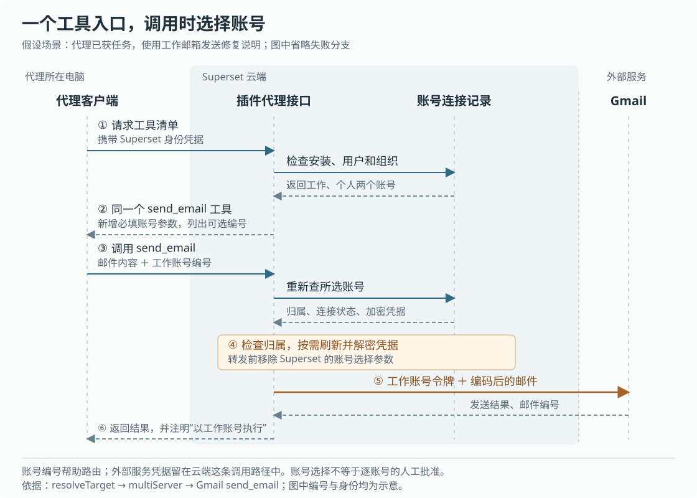

# Superset 怎样让代理选对外部账号：插件入口、凭据代用与批准边界

假设你同时连接了工作邮箱和个人邮箱，让编码代理“用工作邮箱把修复说明发给同事”。代理已经能调用 Gmail 的发送工具，但“能发送”还没有回答三个问题：这次用哪个邮箱，谁把登录凭据交给 Gmail，以及以前批准过这个工具是否就覆盖了新增的邮箱。

Superset 的处理方式是：**给插件保留一个稳定入口，连接多个账号时要求调用携带账号参数，再由云端检查归属、准备凭据并执行。** 代理在这条路径中拿到的是账号编号和工具结果，不需要把 Gmail 令牌写进自己的插件配置。这个设计减少了各台电脑维护账号列表的工作，但没有提供逐账号的人工批准，也没有保证发送结果丢失后重试不会重复发信。

本文接续十一篇历史研报，研究此前没有展开的外部插件工具调用。依据是 `input/repository/` 快照 `8e301a70004374ea62ed933af04ca42cbcb3b1e3`，重点追踪代理通过 HTTP（客户端发送网络请求所用的协议）访问插件的路径；工作区、终端和云环境恢复只作为背景。示例均为假设。本次只读源码、测试和设计记录，没有启动服务、连接邮箱、发送请求或运行仓库测试。下文的测试证据指读到的断言，不代表本次验证通过。

**先准备一个稳定入口，再在调用时决定使用哪个账号。**

Superset 把代码目录、终端和编码代理组织成工作区，同时通过插件给代理提供邮件、事项等外部能力。这里使用 MCP，即模型上下文协议：客户端先读取服务提供的工具名称和参数说明，再请求执行某个工具。插件入口因此既要能说明“可以做什么”，也要能确定“以谁的身份做”。

对内置目录中需要连接外部账号的插件，`desiredPluginMcpServers` 调用 `pluginProxyMcpServers`，生成类似 `/mcp/plugins/superset/gmail` 的云端地址。配置名称保持为 `gmail`，不会因为增加工作邮箱就另建一个 `gmail-work` 服务。这里的 `superset` 是插件市场标识，地址同时包含市场和插件名，避免把不同来源的同名插件混为一项。[入口生成见共享插件实现](https://github.com/superset-sh/superset/blob/8e301a70004374ea62ed933af04ca42cbcb3b1e3/packages/shared/src/plugins/index.ts)。

本机配置可以保存一条取请求头的辅助命令：`superset auth mcp-headers`。命令从命令行工具当前的登录状态取得 Superset 身份凭据及组织信息，输出给代理客户端，而不是把一份长期凭据直接写入代理的 MCP 配置。它取得的是访问 Superset 的身份，之后用于 Gmail 的外部服务令牌由云端另行处理。[辅助命令](https://github.com/superset-sh/superset/blob/8e301a70004374ea62ed933af04ca42cbcb3b1e3/packages/cli/src/commands/auth/mcp-headers/command.ts)与[请求头构造](https://github.com/superset-sh/superset/blob/8e301a70004374ea62ed933af04ca42cbcb3b1e3/packages/cli/src/lib/plugins/mcp-client.ts)显示了这两种身份的分工。

“入口稳定”并不等于配置一定写入成功。`syncManagedMcpServers` 对部分代理的配置记录自己写入值的散列，也就是内容摘要；用户后来修改的条目会转为用户所有，不再强行覆盖。对另一类配置，它用标记围出托管部分，并跳过用户已定义的同名服务。主机启动时还会根据安装清单核对配置；清单无法读取时跳过核对，避免把“读失败”当成“所有插件都已卸载”。因此，账号已经连接、插件入口已经写入、正在运行的代理已经发现工具，需要分别检查。[配置合并](https://github.com/superset-sh/superset/blob/8e301a70004374ea62ed933af04ca42cbcb3b1e3/packages/agent-setup/src/managed-mcp-servers.ts)、[核对逻辑](https://github.com/superset-sh/superset/blob/8e301a70004374ea62ed933af04ca42cbcb3b1e3/packages/agent-setup/src/reconcile-mcp-servers.ts)和[主机装配](https://github.com/superset-sh/superset/blob/8e301a70004374ea62ed933af04ca42cbcb3b1e3/packages/host-service/src/runtime/agent-provisioning.ts)可以连起来看。

本文讨论上述凭据代理入口；本地进程型插件和用户自行配置的直连服务，不应直接套用这条链。

**云端先确认调用者，再检查插件和账号，不能只凭一个账号编号执行。**

网络请求进入 `apps/api` 中的插件路由后，先经过限流和 `resolveMcpContext` 身份解析。普通客户端可以使用 Superset 接口密钥，或 OAuth 访问令牌；OAuth 是让应用获得限定访问权、而不直接使用用户密码的授权方式。代码确定用户及当前组织，并重新查询组织成员关系。接口密钥携带组织范围；覆盖多个组织的旧式 OAuth 令牌需要指定其中一个，不能随意借请求头切到令牌范围外的组织。[路由入口](https://github.com/superset-sh/superset/blob/8e301a70004374ea62ed933af04ca42cbcb3b1e3/apps/api/src/app/mcp/plugins/%5Bmarketplace%5D/%5Bplugin%5D/route.ts)、[身份解析](https://github.com/superset-sh/superset/blob/8e301a70004374ea62ed933af04ca42cbcb3b1e3/packages/mcp/src/auth.ts)及[组织选择规则](https://github.com/superset-sh/superset/blob/8e301a70004374ea62ed933af04ca42cbcb3b1e3/packages/mcp/src/token-organization.ts)构成入口检查。

接着，`resolveTarget` 决定这次请求交给谁处理。它先通过 `installedPlugin` 查询调用者是否安装并启用了指定来源的插件，再查询账号连接。两类数据库记录回答不同问题：

| 记录 | 保存什么 | 不能据此认定什么 |
|---|---|---|
| `plugin_installs`，插件安装记录 | 用户、来源市场、插件名、版本、描述文件、启用状态 | 安装 Gmail 不代表已经连接邮箱 |
| `connections`，外部账号连接 | 组织、连接者、连接器、外部身份、加密令牌、到期时间、断开原因 | 有记录不代表凭据仍然有效，也不代表代理已获得本次操作的人工批准 |

“连接器”在这里负责某个外部服务的登录和凭据规则，不等同于插件的工具列表。例如 Gmail 与 Google Calendar 可以共用 Google 连接。默认账号查询限定当前用户、当前组织及对应连接器，不是从组织内任意人的连接中挑选。如果请求使用 `?connection=<账号连接编号>` 固定账号，`pinnedConnection` 还会检查连接者及组织；编号不匹配时转为需要连接账号，而不会改选另一条记录。[安装查询](https://github.com/superset-sh/superset/blob/8e301a70004374ea62ed933af04ca42cbcb3b1e3/packages/trpc/src/router/plugins/connections.ts)、[账号查询](https://github.com/superset-sh/superset/blob/8e301a70004374ea62ed933af04ca42cbcb3b1e3/packages/trpc/src/lib/connectors/lookup.ts)与[目标解析](https://github.com/superset-sh/superset/blob/8e301a70004374ea62ed933af04ca42cbcb3b1e3/packages/trpc/src/router/plugins/proxy/resolve-target.ts)说明了实际条件。

**同一个发送工具，在多账号时会多出一个必填参数。**

目标解析返回 `needs-auth` 时，`buildPluginServer` 提供一个名为 `authenticate` 的工具，调用结果指引用户打开连接地址。正常的单账号目标保留工具原来的参数形式。没有固定账号、且查询到多个候选连接时，系统建立 `multi` 目标，由 `multiServer` 提供带账号选择的工具。

以前面的两个邮箱为例，客户端仍然只看到一个 `send_email`，但它的参数说明会增加 `superset_account`，列出连接编号、邮箱标签，并把该字段加入必填列表。调用时不提供账号，返回的是带 `isError: true` 的工具结果，解释可选账号；它不会偷偷选择最近登录的那个邮箱。如果原工具已经使用这个字段名，代理层会统一换成 `superset_account_id` 或带数字的名字，避免覆盖外部工具自己的参数。[参数加工与选择见 `account-argument.ts`](https://github.com/superset-sh/superset/blob/8e301a70004374ea62ed933af04ca42cbcb3b1e3/packages/trpc/src/router/plugins/proxy/account-argument.ts)。

执行检查优先接受准确编号，也接受没有歧义的账号标签。两个账号都叫“工作”时，系统要求使用编号。服务初始化说明还要求代理在用户没有指定账号时先询问，但这是一段给代理阅读的指示；后端能强制的是“必须给出可识别的账号”，不能证明这个选择确实来自用户的明确答复。

这也是稳定入口的一项代价。[账号参数设计记录](https://github.com/superset-sh/superset/blob/8e301a70004374ea62ed933af04ca42cbcb3b1e3/plans/20261002-plugin-mcp-account-as-argument.md)说明，客户端的工具批准和允许列表可能以服务名、工具名为依据，改变服务名会影响既有配置。设计因此接受“一次工具批准覆盖多个账号”，再在结果中记录实际账号。**账号参数提供路由选择，不是一个独立的人工批准步骤。** 本次没有运行各代理客户端，不能断言它们都会怎样展示或复用批准。

图中只画正常的 Gmail 路径。账号编号用于 Superset 内部选择；真正向 Gmail 请求时，代理层已经移除新增的选择参数。

**一次发送怎样落到真实接口，而不是停留在工具声明。**

`multiServer` 收到 `tools/call`，即 MCP 的工具执行请求后，先用 `chooseAccount` 解析账号，再通过目标上的 `resolve(connectionId)` 重新进入 `resolveTarget`。账号归属和连接状态会再次检查，随后 `ensureFreshConnection` 按需更新令牌，`connectionSecrets` 解密执行所需的资料。HTTP 路由对每次请求都会重新解析目标；它没有把初始化时拿到的凭据永远绑定在网络会话上。

Gmail 属于仓库内实现的工具服务。`firstPartyServer` 从明确的注册表找到 `gmailServer`，后者按工具名分发到 `messageHandlers.send_email`。这个处理函数读取收件人和正文等字段，把邮件编码后，调用 `gmail` 请求 `/messages/send`。`gmail` 使用所选账号的令牌，向 `https://gmail.googleapis.com/gmail/v1/users/me` 下的对应路径发送请求。外部接口返回邮件编号和会话编号后，处理函数生成工具结果；多账号代理层再追加执行账号标签，并在 `_meta.superset_account` 中记录连接编号。这里的 `_meta` 是附带给客户端的结构化元数据。[服务注册](https://github.com/superset-sh/superset/blob/8e301a70004374ea62ed933af04ca42cbcb3b1e3/packages/trpc/src/router/plugins/servers/index.ts)、[工具分发](https://github.com/superset-sh/superset/blob/8e301a70004374ea62ed933af04ca42cbcb3b1e3/packages/trpc/src/router/plugins/servers/gmail/handlers/index.ts)、[发送实现](https://github.com/superset-sh/superset/blob/8e301a70004374ea62ed933af04ca42cbcb3b1e3/packages/trpc/src/router/plugins/servers/gmail/handlers/messages.ts)和[Gmail 请求封装](https://github.com/superset-sh/superset/blob/8e301a70004374ea62ed933af04ca42cbcb3b1e3/packages/trpc/src/router/plugins/servers/gmail/api.ts)把这条链落到了实际网络动作。

另一类插件由外部 MCP 服务执行。代理层在真正调用时创建上游客户端，带上云端解析出的地址与请求头，并在 `finally` 中关闭会话；读取工具列表另走缓存。这两条分支共用账号选择，但不能把 Gmail 的邮件参数检查、错误格式和网络行为推广给所有供应商。[两类执行分支见 `plugin-server.ts`](https://github.com/superset-sh/superset/blob/8e301a70004374ea62ed933af04ca42cbcb3b1e3/packages/trpc/src/router/plugins/proxy/plugin-server.ts)，[外部会话见 `upstream-client.ts`](https://github.com/superset-sh/superset/blob/8e301a70004374ea62ed933af04ca42cbcb3b1e3/packages/trpc/src/router/plugins/proxy/upstream-client.ts)。

**账号列表变化和工具列表过期，是两种不同的问题。**

一个账号暂时无法使用时，直接从列表中删除它并不总是合适。当前 `resolveTarget` 会保留标为 `needs_reauth`、即需要重新授权的连接，明确由用户断开的连接则排除。例如工作邮箱失效、个人邮箱仍有效，保留前者可以让“用工作邮箱”得到重新连接的提示，而不是无声退化成只有个人邮箱的调用。

如果用户真的断开工作邮箱，只剩个人邮箱，旧客户端仍可能携带工作账号参数。单账号分支的 `withoutStaleAccountArgument` 会发现这个参数不属于剩余账号并拒绝；如果参数正好指向剩余账号，则去掉参数后继续。但客户端若完全不带账号参数，单账号分支仍会使用当时唯一的账号。因而，这套兼容检查不能证明“一个长期运行的代理永远绑定最初那个邮箱”；需要固定身份的调用应使用明确的连接编号，并在账号变化后重新核对意图。[状态筛选](https://github.com/superset-sh/superset/blob/8e301a70004374ea62ed933af04ca42cbcb3b1e3/packages/trpc/src/router/plugins/proxy/resolve-target.ts)和[旧参数检查](https://github.com/superset-sh/superset/blob/8e301a70004374ea62ed933af04ca42cbcb3b1e3/packages/trpc/src/router/plugins/proxy/account-argument.ts)支持这一边界。

工具清单还涉及另一层不确定性。Gmail 等仓库内服务直接提供静态定义，不需要逐个账号联网询问。对于外部 MCP 服务，`multiServer.gather` 汇总各账号的清单，并记录哪个账号提供哪个工具。同名工具采用首先读到的定义，没有合并不同账号之间的参数差异。如果某账号明确认证失败，它不被列为可执行者；如果只是暂时无法读取清单，则保留其作为已知工具候选账号的资格。这样不会把一次网络故障当成权限消失，但最终能否执行仍要交给实际调用确认。

外部清单按“连接编号＋插件名”缓存五分钟，同进程中对同一清单的并发读取共用一个请求；多账号的参数名称和工具归属也有五分钟缓存。它们缓存的是描述和布局，并不替代执行时的账号解析。单个账号的列表等待超过十秒会被归为暂时未知，但这里使用的是等待竞赛，没有因此直接取消底层工作。这些时间是源码阈值，不是实测耗时或服务保证。[清单汇总见 `multiServer`](https://github.com/superset-sh/superset/blob/8e301a70004374ea62ed933af04ca42cbcb3b1e3/packages/trpc/src/router/plugins/proxy/plugin-server.ts)，[清单缓存见 `upstream-catalog.ts`](https://github.com/superset-sh/superset/blob/8e301a70004374ea62ed933af04ca42cbcb3b1e3/packages/trpc/src/router/plugins/proxy/upstream-catalog.ts)。

这也修正了“设计记录等于当前实现”的读法：账号参数方案最初写的是从一个可用账号读取工具，当前代码已经汇总多个账号；文档还提出 Slack 触发调用应固定账号，但本次读取的 Slack `openSession` 没有传入连接编号。本文关于每次请求重新解析的结论限于上述 HTTP 路由，不扩展为所有进程内调用的统一承诺。[Slack 工具装配](https://github.com/superset-sh/superset/blob/8e301a70004374ea62ed933af04ca42cbcb3b1e3/apps/api/src/app/api/integrations/slack/events/utils/run-agent/plugin-tools.ts)是一个实际存在的不同调用方。

**凭据失效时，系统尽量区分“需要重新登录”和“对方暂时不可用”。**

`ensureFreshConnection` 对 OAuth 连接检查到期时间，默认提前六十秒尝试刷新，也允许连接器覆盖这个阈值。刷新令牌是用于换取新访问令牌的凭据；它可能被供应商轮换，使旧值只能使用一次。两个云端请求同时刷新，就可能出现一个成功、另一个被拒绝的情况。

当前实现没有在等待外部授权服务器时长期持有数据库事务。同进程请求通过内存中的 `inFlight` 合并；跨进程写入则比较数据库里的旧到期时间，条件仍匹配才更新，未命中就重新读取。刷新被拒绝的请求还会立即及稍后再读一次，检查是否已有其他请求写入新令牌。源码注释明确解释，这样做是为了避免外部服务器变慢时占住数据库连接。[刷新实现见 `refresh.ts`](https://github.com/superset-sh/superset/blob/8e301a70004374ea62ed933af04ca42cbcb3b1e3/packages/trpc/src/lib/connectors/refresh.ts)。

这是一套减少重复请求、识别常见竞争的措施，不是跨进程的全局锁。另一个请求超过等待窗口才写完时，本次仍可能先报告需要重连；成功刷新分支允许清除同轮竞争产生的重授权标记。没有刷新令牌等分支与带旧令牌条件的拒绝处理也不完全相同，因此不能笼统说所有失效标记都具备相同的并发保护。

| 失败情况 | 当前路径的动作 | 应怎样理解 |
|---|---|---|
| 刷新端点无法连接，或返回服务器错误 | 抛出 `ConnectorUnavailableError`；目标解析转换为网关错误 | 本次不能完成刷新，不据此断言用户授权失效 |
| 到期后没有刷新令牌，或刷新被拒且未发现其他请求的新结果 | 标记 `needs_reauth`，返回重新连接指引 | 需要用户处理所选账号，不会自动换另一个邮箱 |
| 工具调用抛出数字错误码 `401` | 清理本进程相关清单缓存，尝试标记该代凭据失效 | 识别依赖错误码；不能承诺读懂任意供应商的文本错误 |
| 普通工具错误、权限不足或响应丢失 | 按对应分支返回或传播错误 | 不能统一解释为“重新登录即可解决”，也不能认定外部动作没有发生 |

其中，`markNeedsReauth` 在收到旧令牌值时，会把它放入更新条件，减少迟到的认证失败覆盖刚刷新的凭据。缓存清理只作用于处理该请求的进程，其他进程仍可能暂时保留旧清单。重新查账号也不是持续撤销机制：读取凭据之后已经发出的请求，不会因为数据库随后断开连接就自动被收回。

**代用凭据还需要限制它被发往哪里。**

把令牌集中在云端，只解决了代理配置不必直接保存外部令牌的问题。如果插件描述文件可以任意指定接收地址，云端仍可能把令牌送错地方。

`remoteBinding` 因此区分插件市场：只有明确的第一方市场可以按其描述绑定受支持连接器的地址，仓库内工具服务也只对该来源开放。其他来源若使用支持动态客户端注册的 OAuth 连接器，代理层改用连接器自身登记的工具服务地址和绑定规则，忽略插件指定的收集地址及额外凭据头；不满足条件则拒绝。一个社区插件仅仅取名为 `gmail`，不会因此获得仓库内的 Gmail 工具。[目标绑定实现](https://github.com/superset-sh/superset/blob/8e301a70004374ea62ed933af04ca42cbcb3b1e3/packages/trpc/src/router/plugins/proxy/resolve-target.ts)与[对应测试](https://github.com/superset-sh/superset/blob/8e301a70004374ea62ed933af04ca42cbcb3b1e3/packages/trpc/src/router/plugins/proxy/resolve-target.test.ts)给出了这些限制。

外部 MCP 请求和令牌刷新还经过 `credentialFetch`：只接受加密的 HTTPS 地址，拒绝自动跟随重定向；地址模板也禁止把凭据直接展开到网址中。这些限制分别减少明文传输、重定向转送和令牌进入网址的风险。Gmail 的仓库内请求则使用固定基础地址，不能把 `credentialFetch` 的所有行为直接套过去。[请求与模板限制见 `manifest.ts`](https://github.com/superset-sh/superset/blob/8e301a70004374ea62ed933af04ca42cbcb3b1e3/packages/trpc/src/router/plugins/manifest.ts)。本文没有对完整连接流程、所有网络目标或全部插件开展安全审计。

**测试支持了局部契约，实际使用仍要核对账号和外部结果。**

`plugin-server.test.ts` 用内存传输连接真实 MCP 客户端与代理服务，断言必填账号参数、所选凭据传递、转发前移除参数、结果注明账号，以及缺少账号时不调用后端。外部工具执行和凭据在测试中使用替代实现。`resolve-target.test.ts` 则替代安装与连接查询，检查跨用户、跨组织编号被拒绝，以及待重连账号仍被保留；它没有真实执行数据库筛选。[代理服务测试](https://github.com/superset-sh/superset/blob/8e301a70004374ea62ed933af04ca42cbcb3b1e3/packages/trpc/src/router/plugins/proxy/plugin-server.test.ts)和[目标解析测试](https://github.com/superset-sh/superset/blob/8e301a70004374ea62ed933af04ca42cbcb3b1e3/packages/trpc/src/router/plugins/proxy/resolve-target.test.ts)因此证明的是这些接口约定。

`refresh.test.ts` 通过替代网络响应与数据库返回顺序，检查竞争失败者采用新令牌、供应商故障不写断开标记等行为；其数据库替身没有执行真实数据库更新条件，不能当作多进程刷新竞争已被端到端验证的证据。[刷新测试](https://github.com/superset-sh/superset/blob/8e301a70004374ea62ed933af04ca42cbcb3b1e3/packages/trpc/src/lib/connectors/refresh.test.ts)需要在这个范围内理解。

对使用者，这些实现意味着：连接多个账号后，在任务里明确账号；账号标签重复时使用编号；自动执行且必须固定身份时，让调用明确固定连接。出现重连提示，只处理对应账号；出现外部服务故障，则不要把反复重新授权当作通用修复。账号变化后的错误提示也应促使重新确认意图，而不是机械删掉账号参数重试。

发送邮件等外部写操作还要单独核对结果。当前 Gmail `send_email` 路径直接发送请求，没有在这里登记持久化判重键或自动对账。假设 Gmail 已经发送成功，返回结果却在途中丢失，再调用一次就可能再次发送；结果附带的执行账号信息也可能尚未到达客户端。这是按当前调用链得出的失败推演，本次没有复现。

对类似系统的实现者，可迁移的思想是把稳定的工具入口、当前账号集合和每次执行的凭据分开管理；让错误说明下一步该做什么，同时保留“未知”状态。适用边界也应随接口一起说明：工具清单不是权限证明，账号编号不是人工批准，账号复查不是撤回已发请求，工具结果更不能代替外部写入的判重与核验。
