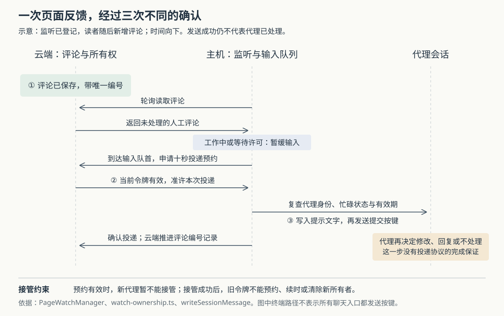

# Superset 怎样把页面评论交给正确的代理：监听接管、投递预约与输入确认

假设代理写了一份方案，你把页面链接发给同事。同事在某段文字旁留言“这里需要补充失败后的处理”，代理随后收到提示、修改页面，再在原评论下回复。若你中途把页面交给另一个代理，旧代理还会不会收到反馈？若提示文字已经进入终端，提交按键却没发出去，系统该不该再送一次？

Superset 把这件事拆成三步：**云端保存评论，执行主机决定何时投递，代理自己决定如何回应。** 为避免交错，云端登记当前监听者，发送前再给一次短暂的投递预约；主机同时核对代理身份和输入状态。但这条链不是一个可以跨重启持续补送的任务队列，“页面有人监听”也不代表评论一定会被处理。

本文接续十二篇历史研报，研究此前未展开的页面反馈回流。Superset 把代码、终端和编码代理组织成工作区；这里的页面是可以分享、发布新版本并接受评论的 HTML 文档。当前快照的 README 已使用 Paradev 名称，源码仍保留大量 Superset 标识，本文沿用研究来源名称。依据为 `input/repository/` 快照 `b36f1b31bf71443e21987e9b67f1a4b3ce562ee9`。以上及后续故障场景均为假设；本次只读源码、测试和设计记录，没有启动项目、发布页面、运行代理或执行仓库测试。

**发布成功与监听成功是两件事。**

代理执行 `superset pages publish report.html` 时，命令先上传文档、调用云端 `page.publish` 完成发布，随后才尝试登记评论监听。自动登记要求没有指定 `--no-watch`，且能够取得工作区编号、终端编号和组织编号。终端编号取自 `SUPERSET_TERMINAL_ID`；`registerWatch` 找到本机主机接口，调用 `pageWatch.assign`。登记失败只写入“未监听”的说明，已经成功的页面发布不会因此撤销。[发布命令](https://github.com/superset-sh/superset/blob/b36f1b31bf71443e21987e9b67f1a4b3ce562ee9/packages/cli/src/commands/pages/publish/command.ts)与[登记实现](https://github.com/superset-sh/superset/blob/b36f1b31bf71443e21987e9b67f1a4b3ce562ee9/packages/cli/src/commands/pages/publish/utils/registerWatch/registerWatch.ts)展示了这个顺序。

主机侧的 `PageWatchManager` 保存“哪个页面交给哪个工作区、哪个会话”的关系。它先确认目标属于指定工作区、代理绑定仍有效、会话仍存活，再向云端申请监听权。云端请求完成后还会重新检查目标，避免慢请求返回时，原代理已经退出。

真正的代理身份也不是菜单上的 `claude` 或 `codex` 标签。`matchesAgentBinding` 比较终端、工作区、代理类型和本次启动编号；没有启动编号时比较启动时间，已有代理会话编号时也核对它。这样，同一个终端位置后来换了一个代理，不会仅因位置没变就继承旧投递。[监听管理器](https://github.com/superset-sh/superset/blob/b36f1b31bf71443e21987e9b67f1a4b3ce562ee9/packages/host-service/src/page-watch/page-watch-manager.ts)与[身份比较函数](https://github.com/superset-sh/superset/blob/b36f1b31bf71443e21987e9b67f1a4b3ce562ee9/packages/host-service/src/terminal-agents/matches-agent-binding.ts)共同承担这层检查。

**评论先成为云端记录，再成为代理输入。**

云端 `pageComment.create` 检查组织成员身份、页面评论权限和所指版本是否存在，然后在一笔数据库事务中创建评论主题和第一条评论。主题保存页面版本、定位信息以及被选中的文字；评论保存正文和作者类型。创建时还记录 `agentActivatedAt`，表示该主题已向代理开放。这里“开放”不等于把评论分配给某个具体代理，后者由监听关系决定。[评论路由](https://github.com/superset-sh/superset/blob/b36f1b31bf71443e21987e9b67f1a4b3ce562ee9/packages/trpc/src/router/page-comment/page-comment.ts)是保存与读取的实际入口。

主机没有等云端推送评论，而是定期调用 `pageComment.list`。该接口返回页面各版本的主题，而不是只返回最新版本。因此，页面更新之后，旧版本上的讨论仍可以成为反馈上下文。主机随后用 `selectThreadsToDeliver` 做筛选：

- 已解决的主题暂不触发；其中未见过的评论保留资格，重新打开主题后仍可触发。
- 只由新的人工评论触发，代理自己的回复不触发下一轮。
- 用评论的唯一编号判断是否见过，不依赖评论时间或两台机器的时钟是否一致。
- 每批最多登记一千条新评论；每个主题最多触发五次，达到上限的新评论仍会被登记为已见，但不再送入代理。

这里“一次触发”可以包含多条新评论，不等于一个主题只能有五条评论。提示还会带上所选主题中此前见过的内容和代理回复，让代理能理解讨论经过。达到上限后，“已见”尤其不能解释成“代理已经读过”。这些行为均来自[筛选函数与测试](https://github.com/superset-sh/superset/blob/b36f1b31bf71443e21987e9b67f1a4b3ce562ee9/packages/host-service/src/page-watch/trigger.ts)。

图中的三次确认各有对象。评论存在，证明数据保存了；预约成功，证明当前监听者暂时可以发送；输入成功，证明主机完成了这次交接。是否真的修改、正确回复，还要看代理和页面后续结果。

**换代理时，云端既保存当前所有者，也保存交接进度。**

页面表的 `watchState` 保存随机令牌、已见评论编号、各主题触发次数、当前投递预约，以及最近完成的预约编号。主机内存另存真实会话绑定和运行中的轮询状态。这两份状态分工不同：云端协调不同主机之间的接管，主机负责实际找到代理并写入输入。[数据结构](https://github.com/superset-sh/superset/blob/b36f1b31bf71443e21987e9b67f1a4b3ce562ee9/packages/db/src/schema/schema.ts)中的 `PageWatchOwnership` 定义了前一份记录。

云端 `claimPageWatch` 等操作在事务中锁住页面行，锁定后再读取数据库当前时间。它们按同一页面排队执行，避免两个主机同时改写监听状态。此处令牌是识别当前监听轮次的标识；调用接口仍需经过组织与页面写权限检查，知道令牌本身不等于获得页面权限。[接口检查](https://github.com/superset-sh/superset/blob/b36f1b31bf71443e21987e9b67f1a4b3ce562ee9/packages/trpc/src/router/page/page.ts)与[所有权实现](https://github.com/superset-sh/superset/blob/b36f1b31bf71443e21987e9b67f1a4b3ce562ee9/packages/trpc/src/router/page/watch-ownership.ts)可以连起来看。

当前实现允许新监听者接管仍然活跃的旧监听者；旧监听者心跳没过期，并不会阻止接管。真正暂时阻止接管的是未过期的投递预约：主机准备发送时，`reservePageWatchDelivery` 为当前令牌登记十秒有效期，这十秒也称为租约，即有期限的操作资格。预约期间，换人和释放监听都会返回冲突；主机登记新目标时，会以短间隔重试冲突，但有十秒等待预算。

接管成功后，旧令牌不能继续续时、预约发送，也不能清除新监听者。即使旧主机仍拿着一份过时的内存记录，最终发送前也拿不到预约。这比仅在本机用一个以页面编号为键的表，更能约束跨主机竞争。

但接管是否保留历史进度，要看旧监听是否仍活跃：

| 登记时的状态 | 云端如何确定起点 | 对读者的影响 |
|---|---|---|
| 旧监听仍有效，切换到新令牌 | 保留已见编号和触发次数 | 未投递的新评论可交给新代理；已见内容不因换人全部重送 |
| 没有有效旧监听，或心跳已过期 | 查询当前全部人工评论，将其作为已见基线，次数重新开始 | 重新监听主要接收此后的新评论，已有积压不会自动补送 |
| 同一令牌在有效期内再次登记 | 返回已有进度并续时 | 请求重试不会另建一份起点 |

这项区别直接影响故障恢复：假设主机停了很久，同事在此期间留下评论，后来你重新登记监听，那些评论可能已经进入新基线。它们没有从页面消失，但不会因此自动变成一次代理输入。**当前机制适合持续会话中的反馈回流，不能当作离线待办补交系统。**

**主机等代理可以接话，再把文字和提交按键顺序送进去。**

监听器把最后活动为 `Start` 或 `PermissionRequest` 的代理视为忙碌，分别对应正在工作和正在等待许可。发现新评论时会记下等待起点，暂缓投递；代码没有“等够两分钟就强行输入”的分支。这个判断依赖代理状态上报，不是从屏幕文字推断出代理真正理解了什么。

对于终端代理，`sendAgentMessage` 进入 `writeSessionMessage`。同一个会话的提示输入共用一条串行队列，避免一条消息的文字与另一条消息的提交按键混在一起。投递预约不是进入队列时就申请，而是等到队首才申请；拿到预约后再检查代理是否还是原来那个、是否被取消、是否又忙了、预约是否到期。[终端输入实现](https://github.com/superset-sh/superset/blob/b36f1b31bf71443e21987e9b67f1a4b3ce562ee9/packages/host-service/src/terminal/terminal.ts)中的这几个检查，防的是排队期间目标发生变化。

实际输入经过 PTY，即供命令行程序交互的伪终端。代理消息会去除危险控制字符，并用“带边界的粘贴”标记包住正文，让程序把多行内容当作一段粘贴文字。主机写入正文，等待短暂间隔，再复查目标和预约，最后写入回车。构造提示的 `buildWatchPrompt` 也会清理评论者姓名、正文和定位文字里的控制字符。这些清理防止文字变成终端控制按键；它们不证明评论内容在语义上可信，也不保证代理会正确判断需求。[提示构造](https://github.com/superset-sh/superset/blob/b36f1b31bf71443e21987e9b67f1a4b3ce562ee9/packages/host-service/src/page-watch/buildPrompt.ts)还明确要求代理自行判断哪些评论需要修改、回复或不处理。

这里也有结构化聊天分支，不能把所有会话都画成敲键盘。`app.ts` 发现绑定带有聊天会话编号时，改为调用 `promptChatSession`：核对绑定、取得预约、检查会话未死亡，再向聊天运行时提交提示命令。它不等待代理完成这一轮。[主机装配](https://github.com/superset-sh/superset/blob/b36f1b31bf71443e21987e9b67f1a4b3ce562ee9/packages/host-service/src/app.ts)与[聊天投递](https://github.com/superset-sh/superset/blob/b36f1b31bf71443e21987e9b67f1a4b3ce562ee9/packages/host-service/src/chat-v3/promptChatSession.ts)证明两条路径在此分开。

**发送后的确认能重试，但进程崩溃留下的未知不会自动消失。**

发送成功后，主机把待确认投递标为成功，再调用 `finishPageWatchDelivery`。云端合并评论编号、只增加不降低触发次数，并记住完成的预约编号。同一预约再次确认会直接返回成功，这叫幂等：重复确认不会重复推进状态。

假设云端已经确认，返回响应却丢了，主机仍保留内存中的待确认记录。下一轮会先重试确认，不重新发送，也不先发送后面的评论。这是代码明确覆盖的恢复窗口。但主机的待确认记录只在内存中，不能据此宣称任意崩溃后都只投递一次。

另一种情况更棘手：文字已经尝试写入，回车却因为代理更换、租约到期或终端写入失败而没有成功。终端返回 `inputStaged`，表示输入可能已进入会话。这个标记在写入调用前就设置，因此它表达的是保守的不确定性，不是程序已经接收文字的证据。监听器遇到它会停止该页面监听，不自动再发；投递也不会被登记为成功。它宁可留下人工核对的现场，也不冒着重复提交或提交残留文字的风险不断重试。

按调用顺序还可以推演一个未实测窗口：提示已送入会话，主机在确认云端前崩溃。如果新监听者在旧心跳仍有效时接管，云端可能保留“该评论尚未确认”的进度，随后再次投递；若等心跳过期才重新登记，现有评论又会进入新基线。二者都说明，数据库确认与会话输入没有组成一笔不可分割的事务。本文没有复现此时序，不能断言线上具体会出现哪种界面结果。

**有限轮询与主动停止，决定了监听适用的时间范围。**

当前管理器每五秒检查一次；超过五分钟没有成功推进人工评论时，安静页面的评论查询降到约每分钟一次，仍按三十秒间隔检查是否需要续时。云端九十秒没有心跳便不再显示有效监听。页面已分配、页面最近有人续时，以及本次评论已经送达，是三种不同状态；心跳主要证明监听链还在续时。

主机同时限制最多二十个页面监听。连续五次失败会停掉对应监听；权限拒绝、未授权或页面不存在则立即停止。终端退出事件会触发清理，每轮还会复查目标，补上遗漏事件的情况。两小时超时从等待起点或最近成功推进评论的时间计算，持续忙碌也不会无限等待。主机重启不会从云端枚举并重建这些内存监听，需要重新发布或分配。

设计记录解释过为何把轮询放在 `host-service`：它同时能访问云端评论和本地会话。文档也把避免无限反馈循环作为次数上限的理由。这个理由仍有源码支撑：命令行回复是否标成代理，部分依赖调用者提供会话编号；缺少归属信息的代理回复可能被记成人工回复。但设计记录中的“云端只有显示字段”“按时间推进游标”等描述已经不能代表当前实现，实际代码增加了云端所有权、投递预约和评论编号集合。文档还提到过一次早期真实代理试跑，那是历史记录，不能替代当前快照的验证。[设计记录](https://github.com/superset-sh/superset/blob/b36f1b31bf71443e21987e9b67f1a4b3ce562ee9/plans/20260828-pages-comment-watcher.md)与[作者归属说明](https://github.com/superset-sh/superset/blob/b36f1b31bf71443e21987e9b67f1a4b3ce562ee9/packages/trpc/src/router/page-comment/agent-access.ts)应带着这些差异阅读。

**现有测试把哪些保证落到了断言上？**

本次实际阅读了以下测试，均未运行：

| 测试 | 读到的关键断言 | 验证边界 |
|---|---|---|
| `trigger.test.ts` | 同时间评论按编号区分；代理回复不触发；已解决主题可重新打开；达到上限后只确认不发送 | 纯筛选逻辑，不含网络与终端 |
| `page-watch-manager.test.ts` | 排队时接管会取消旧发送；等待许可不强制投递；预约往返耗时计入有效期；确认响应丢失时不重发；输入可能残留时停止 | 使用替代云端接口和发送函数 |
| `watch-ownership.postgres.integration.ts` | 并发主机只有一个令牌有效；预约阻止接管；旧令牌不能清除新所有者；重复确认无副作用；两个管理器只把新评论交给接管者 | 需要专用 PostgreSQL 数据库；发送端仍为替代实现 |
| `terminal.send-snapshot.node-test.ts` | 真终端场景结合替代写入，检查到队首才预约、写入边界标记、预约失效或写入失败后的 `inputStaged` | 没有以真实编码代理验证其最终理解与执行 |

分别可定位到[管理器测试](https://github.com/superset-sh/superset/blob/b36f1b31bf71443e21987e9b67f1a4b3ce562ee9/packages/host-service/src/page-watch/page-watch-manager.test.ts)、[数据库协议测试](https://github.com/superset-sh/superset/blob/b36f1b31bf71443e21987e9b67f1a4b3ce562ee9/packages/trpc/src/router/page/watch-ownership.postgres.integration.ts)和[终端测试](https://github.com/superset-sh/superset/blob/b36f1b31bf71443e21987e9b67f1a4b3ce562ee9/packages/host-service/src/terminal/terminal.send-snapshot.node-test.ts)。测试支持这些局部契约，不能合并成“真实网络、崩溃和全部代理共同参与时，反馈必定处理一次”的结论。

对使用者，发布后先确认返回结果确实写着正在监听；长时间离线后回来，主动查看已有评论，再重新分配代理。发现输入可能残留时，先检查会话，再决定如何补送。修改后发布到同一个页面编号，并核对回复和实际页面结果；监听器给出的提示也明确要求使用 `--page`，以便更新读者已有的链接。

对类似工具的实现者，这条链值得借鉴的是把“保存了什么”“当前交给谁”“何时可以输入”“交接是否确认”分别记录，同时在接近副作用发生的位置再次检查资格。轮询与现有代理会话结合，适合有人持续审阅、代理仍在运行的反馈循环；若目标是离线积压不丢、跨重启自动继续、代理处理也能判重，就还需要持久化待办、稳定的投递身份和消费确认协议。当前源码没有提供这整套保证。

交付核对：正文源码链接对应的本地文件与配图引用均存在，SVG 已通过 XML 解析。当前环境的缩略图工具和无界面浏览器均未能启动，配图尚未完成实际渲染后的视觉核验。
