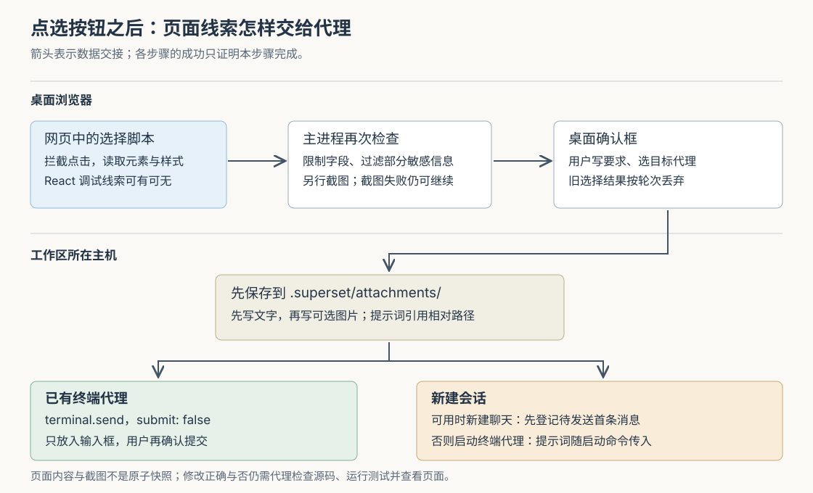

# Superset 怎样把“改这个按钮”交给代理：元素定位、上下文附件与提交边界

假设你在 Superset 的浏览器窗格里预览登录页，觉得“登录”按钮太挤。你打开 Design（设计模式），点中按钮，写下“增加左右留白，让它和输入框对齐”，再选择一个编码代理。代理为什么能知道“它”指什么？页面上的按钮怎样对应到源码？点击发送之后，代理是不是已经开始修改？

当前实现把这件事拆成一条具体链路：**在网页里点选元素，收集当时的页面线索，由桌面检查并补充截图，再把材料保存到工作区，让提示词引用这些文件。** 对已有终端代理，发送只把文字放进输入框，保留用户最后提交的机会；新建会话则走另一条启动路径。它缩短了描述界面问题的过程，但没有保证直接找到唯一的源码位置，也没有自动证明修改后的页面正确。

本文接续十三篇历史研报，研究此前没有展开的浏览器设计反馈。Superset 把代码目录、终端和编码代理组织成工作区；这里的代理是能够读文件、执行命令并修改代码的程序。当前 README 已采用 Paradev 名称，本文沿用来源名称 Superset。依据为 `input/repository/` 快照 `704db41dc21e8b10d9f9eac515c5de1d6569b37f`。示例均为假设；本次只读源码、测试和设计材料，没有启动应用、运行代理或执行仓库测试。

**点中按钮，首先是在页面里确定对象。**

工作区的 `BrowserPane` 挂载设计反馈界面，工具栏通过 `designModeStore` 开始一次选择。桌面界面调用本机浏览器接口 `designModeSet`，由 `BrowserManager.setDesignMode` 向目标网页注入脚本；随后调用 `designModeAwaitSelection` 等待点选结果。这些接口在桌面的浏览器路由中注册，最终进入 `DesignModeController`，并不是向工作区主机发送“查找按钮”的请求。[界面状态][store]、[接口注册][router]和[浏览器管理器][manager]连接了这几步。

这里存在三个不同执行位置：网页运行被注入的选择脚本，桌面主进程管理网页及检查返回数据，桌面界面负责输入要求、选择代理和安排交接。Electron——构建该桌面程序的框架——把网页内容与应用自己的界面分开管理；设计模式需要明确跨越这条边界。

注入脚本在页面上铺一层覆盖视口的点击接收层，鼠标移动时暂时关闭这一层的鼠标命中，通过 `document.elementFromPoint` 找到下面的元素，再画出高亮。滚动时也会重新判断鼠标下方的元素，减少“鼠标没动，页面已经滚走”造成的错选。选择点击由覆盖层拦截并阻止默认行为，因此选择“登录”按钮的意图不会按正常路径变成一次表单提交。选中后，高亮被冻结，等待用户写要求。[选择脚本][script]给出了实际事件处理。

这层覆盖使用封闭的 Shadow DOM，也就是独立于页面普通元素树的样式与节点子树，用来承载高亮和标签；它并不让脚本取得页面其他封闭子树的内部结构。脚本在当前文档调用命中查询，没有递归进入内嵌网页的实现。因此，对 iframe——嵌在页面里的另一个文档——或封闭组件内部元素，不能据此承诺同样细的定位能力。这是根据调用范围得出的边界，本次没有进行浏览器实测。

**它给代理的是几种相互补充的线索，而不是一张可靠的“按钮到文件”映射表。**

选中元素之后，脚本读取 DOM，即浏览器当前的文档元素树，以及 CSS，即决定外观和布局的样式。以假设的登录按钮为例，交接材料可以包含以下内容：

| 线索 | 具体帮助代理回答什么 | 需要保留的限制 |
|---|---|---|
| 页面地址、标题、视口与滚动位置 | 这是哪个页面、在哪种显示尺寸下出现问题 | 地址会去掉查询参数和片段，可能不足以复现带参数的页面状态 |
| 元素标签、文字、选择器与父级路径 | “登录”指哪个按钮，它位于哪个区域 | 选择器描述的是当前文档，页面重排后可能失效 |
| 最终计算样式与元素尺寸 | 当前留白、字体、颜色、大小是什么 | 最终样式不直接说明应修改哪条源码规则 |
| HTML 片段与相邻文字 | 按钮周围是什么结构和内容 | 片段有长度限制，不是完整页面或完整组件源码 |
| 可取得的 React 组件名、参数摘要和源码位置 | 哪个组件可能生成了这个按钮 | 依赖页面暴露的内部信息，缺失时仍允许发送 |
| 元素截图 | 按钮实际显示成什么样 | 只截取可见区域，失败时可以没有图片 |

选择器是一段供浏览器查找元素的 CSS 表达式。`buildSelector` 优先使用元素编号或看起来较稳定的类名，避开部分像构建生成值的类名；不唯一时增加同类兄弟中的位置，再逐级加入父元素，最多追溯十层。它会尝试检查唯一性，但达到层数或长度限制后仍返回结果。因此，“有选择器”不等于“始终唯一”，更不等于“下次打开还能找到同一个对象”。[选择器生成与元数据提取][script]是这些结论的依据。

React 是一种把界面组织为组件的前端库。`getReactMetadata` 尝试从元素的内部属性找到 React 的 Fiber，即维护组件运行关系的数据节点，再向上追踪组件名、已保存的参数以及 `_debugSource` 调试位置。找到文件位置时，它清理部分构建工具添加的地址前缀，再附上行号；找不到时返回空值。这里没有读取代码仓库来验证文件是否存在，也没有根据构建产物反查全部源码的流程。

因此，这条机制尤其适合正在开发、保留调试信息的网页。对生产构建、非 React 页面，或者源码信息缺失的组件，代理仍能收到文字、结构、样式和截图，但需要自己在仓库中查找实现。把这一步理解为“提高查找起点的质量”，比把它理解为“精确定位源码”更符合实现。

**页面返回的数据经过检查，但检查并不等于材料完全可信或已经彻底脱敏。**

网页可以运行自己的脚本，所以主进程不直接信任选择脚本返回的对象。`clampDesignModePayload` 再检查顶层结构、约束字段长度、处理非有限数字、过滤单独的属性表，并对部分元数据应用敏感词遮盖。地址仅保留允许的协议，移除查询参数和片段。网页传回的截图字段被直接置空，真正的图片由主进程另行捕获。[返回数据检查][payload]与[共享约定][types]定义了这条边界。

这些限制也控制交接规模：元素文字最多取二百字符，HTML 正文片段按四千零九十六字符截断，相邻文字最多十条；截断标记另加在末尾。脚本对文本节点和相邻元素的扫描也有数量上限。不过，HTML 提取仍先克隆元素子树，再读取和截断 HTML；不能把“返回片段有限”扩大解释成“对任意大页面的处理成本都有严格上限”。这是从操作顺序得到的判断，没有性能测量。

脱敏范围尤其需要逐字段理解。单独的 `attributes` 属性表有允许名单和敏感词处理，但 `getHtmlSnippet` 克隆元素后主要移除后代 `script` 节点，再截断输出；它没有把整段 HTML 的属性逐一按该名单重建。主进程对 `htmlSnippet` 和 `textSnippet` 也只是限制长度，截图则没有文字识别或遮盖流程。因此，**不能把某个属性表已经过滤，理解为 HTML、页面文字和图片都已经清除敏感内容。** 这对登录态页面、内部业务页面的使用边界有实际影响。

生成的上下文文档会明确告诉代理：用户反馈之外的页面内容是不可信数据，不应当作指令。HTML 使用比内容中反引号序列更长的代码围栏，减少页面内容破坏文档结构的机会。但这些是数据检查与提示词层面的约束，没有为代理建立一个能够强制隔绝页面指令的执行环境。页面文本仍有可能误导模型，实际识别与处理效果未在本次验证。[上下文格式化][prompt]可以直接看到提醒和围栏构造。

图中把浏览器所在的桌面和保存代码的主机分开：页面线索先在桌面取得，文件随后写到工作区所在主机。这也是远程工作区能够沿用同一附件路径的原因。

**文字和图片分开取得，能够降级继续，也会留下时间差。**

选择结果通过检查后，`designModeStore` 再请求 `designModeScreenshot`，截图为空也继续进入确认阶段。主进程暂时隐藏高亮，捕获页面，并在 `finally` 中尝试恢复高亮；随后按元素矩形裁剪。裁剪用图片宽度与页面视口宽度的比值换算坐标，兼顾缩放和不同屏幕像素密度；部分移出视口的元素只保留可见区域。PNG 图片超过两兆字节就省略。[截图实现][screenshot]展示了这些处理。

截图还复用 `BrowserManager.capturePageImage`：暂时唤醒隐藏窗格，对单次捕获设置超时，在截止时间前重试，最后释放唤醒。截图失败不会抹掉已取得的页面结构，这是让功能能够继续工作的明确选择。

代价是文字和图片不是一次不可分割的读取。元素位置在点选时取得，图片稍后捕获；页面动画、异步内容或重新布局可能使两者不再一致。用户在确认框里继续停留，也不会自动重采集所有线索。因而，代理收到的材料应当被当作某一时刻附近的观察，而不是一直有效的页面事实。

**用户开始了下一次选择，旧结果就不应再弹回来。**

这一点由桌面与主进程共同处理。`designModeStore` 为每个窗格保存“空闲、选择中、确认中”三种状态，并在每次开始或退出时增加轮次编号。注入脚本、等待点击和截图都是异步操作，每一步返回后都检查轮次；旧轮次即使慢慢完成，也不能覆盖新一轮的界面状态。[状态实现][store]说明了这种过期结果处理。

主进程的 `DesignModeController` 则为每个窗格最多保留一个等待操作，用 `settleOnce` 保证该操作只结束一次。主文档真正跳转、网页销毁、用户取消或等待达到两分钟，都会结束等待并清理监听。新操作替换旧操作时，旧操作跳过覆盖层拆除，避免顺手删除新操作要复用的界面。[控制器][controller]给出了完整收尾。

选择过程中，子文档加载以及 `pushState`、地址片段变化这类不替换文档的导航不会取消等待。选中后的确认框则在浏览器进入加载状态时退出，窗格卸载也会退出设计模式。这些措施降低了过期材料被发送的机会，但不是对页面内容的一次冻结：没有整页跳转的应用仍可以自行改写元素树。因此，布局已明显改变时重新点选，是从当前机制推导出的实践建议。

**完整材料先写进工作区，终端只接收一条短提示。**

`DesignModePopover.handleSubmit` 要求用户填入非空意见，并选定目标。它先调用 `writeDesignModeAttachments`，通过工作区主机的文件接口取得目录、创建 `.superset/attachments/`，写入 Markdown 上下文，再在有截图时写入 PNG。文件名使用时间戳和随机后缀降低快速重复发送时的碰撞概率。[附件写入][attachments]与[主机文件接口][filesystem]证明文件确实落在工作区所在主机，而不是仅留在桌面临时目录。

上下文文件包含用户意见、页面线索和现场检查建议；短提示词引用工作区相对路径，要求代理先读文档和可选截图，再修改代码。文档还带上工作区及浏览器窗格编号，给出截图、查看控制台、执行页面脚本等命令，帮助代理修改后检查原页面。[提示词生成][prompt]展示了“短输入引用完整附件”的方式。命令被写进文档，只说明代理获得了检查方法，不证明代理实际执行过，也不证明当时一定能访问该窗格。

这样安排可以减少把整段 HTML、样式和图片内容直接粘进终端的需要，也让不同代理共享一种基于文件的交接格式。代价是附件写入与输入发送之间没有共同事务，即不存在“所有步骤一起成功或一起撤销”的保证：

- 文字已写完、图片写入失败时，本次不会继续发送，已写的文字文件不会在这段流程中回滚。
- 附件写入成功、终端发送失败时，确认框保留供重试，附件仍然存在。
- 重试会重新生成文件名，不是复用同一个业务请求编号；这段路径没有自动识别“上次已经送达但回复丢失”的机制。

前两项直接来自写入顺序与错误分支。第三项意味着，若出现通信结果不确定，先查看代理输入框再重试更稳妥；重复材料或重复输入是可能结果，并非本次观察到的实际故障。[确认框提交处理][popover]是这些分支的调用方。

**最后一步必须区分：选已有代理，还是新建会话。**

选已有终端代理时，确认框调用 `useSendToTerminalAgent`，明确传入 `submit: false`。该公共写入入口清理终端控制字符，调用主机 `terminal.send`。主机核对会话、工作区及当前可用的代理绑定，再按终端逐次串行写入，避免两次输入互相插入。代理路径使用括号粘贴协议，即用一对终端控制标记把正文包起来，帮助交互式命令行把内容当作粘贴文本处理。[桌面发送入口][send]、[主机发送路由][terminalrouter]与[终端写入实现][terminal]可以串起这条真实调用链。

当 `submit` 为假，主机写完正文就返回，不发送提交用的回车。界面随之显示“已加入代理输入”，聚焦目标窗格并关闭反馈框。**这证明输入交接返回了成功，不能据此认定代理已经开始这一轮修改。** 用户还可以继续补充要求，再决定提交。这里也没有等待代理理解完材料的回执。

新建会话则不能套用这个结论。`useAgentSessionLauncher.createNewAgentSession` 首先尝试聊天路径：聊天能力启用且所选代理有受支持的适配时，创建聊天窗格，把反馈登记成 `pendingPrompt`，即待发送的首条消息。后续聊天界面在就绪条件满足时处理这些待发送消息。此时启动函数已经可以返回窗格标识，不能单靠反馈框消失证明代理已经接收。[会话启动器][launcher]、[聊天窗格][chatpane]与[待发送消息处理][pending]说明了这层先后关系。

不能走聊天路径时，启动器调用 `agents.run`，主机把提示词放进终端代理的启动命令，再创建终端。因此，新终端的反馈从启动时就随命令传入，不经过已有终端那次 `submit: false` 的草稿写入。[主机代理启动][agents]中的 `runTerminalAgent` 是实际执行点。理解这一分支后，就不能把设计模式概括成“永远只填输入框”，也不能概括成“点击就立即执行”。

**测试支持的是局部规则，完整使用效果仍有未验证部分。**

本次阅读了控制器测试对取消、主文档导航、同文档导航、网页销毁和新操作替换旧操作的断言；它使用模拟的网页对象，没有运行真正的元素点选。数据检查测试覆盖无效结构、地址清理、属性过滤、敏感词遮盖、字段截断和异常数字；提示词测试覆盖单行提示、附件路径、较长 HTML 围栏及现场检查命令。[控制器测试][ctest]、[数据检查测试][ptest]和[提示词测试][prompttest]可定位这些证据。

公共发送入口还有一组读取源码文本的测试，断言设计模式调用传入 `submit: false`，而其他列出的调用方提交输入。它能防止调用约定被意外改写，但不等于真实终端代理已经正确处理粘贴。[发送约定测试][sendtest]应按这个范围解读。上述测试本次均未执行；真实 React 版本兼容性、动态页面截图一致性、远程主机附件交接和代理最终修改质量，也没有端到端验证。

对使用者，这条功能适合把“页面上这个东西需要怎样改变”连同现场线索交给代理。写意见时仍应说明预期行为和适用尺寸；页面变化后重新点选；向已有终端发送后检查输入并主动提交；验收时再看源码差异、实际页面和相关测试。对设计类似工具的人，可借鉴的是按职责分开收集线索、检查页面数据、保存附件和投递输入，同时让每次返回值只证明其真正完成的动作。这样既能保留已有编码代理的工作方式，也能清楚呈现系统尚未确认的部分。

配图已保存并通过 XML 解析；当前环境的缩略图工具因沙箱初始化失败而未能渲染，尚未完成实际渲染后的视觉核验。

[store]: https://github.com/superset-sh/superset/blob/704db41dc21e8b10d9f9eac515c5de1d6569b37f/apps/desktop/src/renderer/routes/_authenticated/_dashboard/v2-workspace/$workspaceId/hooks/usePaneRegistry/components/BrowserPane/designModeStore.ts
[router]: https://github.com/superset-sh/superset/blob/704db41dc21e8b10d9f9eac515c5de1d6569b37f/apps/desktop/src/lib/trpc/routers/browser/browser.ts
[manager]: https://github.com/superset-sh/superset/blob/704db41dc21e8b10d9f9eac515c5de1d6569b37f/apps/desktop/src/main/lib/browser/browser-manager.ts
[script]: https://github.com/superset-sh/superset/blob/704db41dc21e8b10d9f9eac515c5de1d6569b37f/apps/desktop/src/main/lib/browser/design-mode-script.ts
[payload]: https://github.com/superset-sh/superset/blob/704db41dc21e8b10d9f9eac515c5de1d6569b37f/apps/desktop/src/main/lib/browser/design-mode-payload.ts
[types]: https://github.com/superset-sh/superset/blob/704db41dc21e8b10d9f9eac515c5de1d6569b37f/apps/desktop/src/shared/browser-design-mode.ts
[prompt]: https://github.com/superset-sh/superset/blob/704db41dc21e8b10d9f9eac515c5de1d6569b37f/apps/desktop/src/renderer/routes/_authenticated/_dashboard/v2-workspace/$workspaceId/hooks/usePaneRegistry/components/BrowserPane/designModePrompt.ts
[screenshot]: https://github.com/superset-sh/superset/blob/704db41dc21e8b10d9f9eac515c5de1d6569b37f/apps/desktop/src/main/lib/browser/design-mode-screenshot.ts
[controller]: https://github.com/superset-sh/superset/blob/704db41dc21e8b10d9f9eac515c5de1d6569b37f/apps/desktop/src/main/lib/browser/design-mode-controller.ts
[attachments]: https://github.com/superset-sh/superset/blob/704db41dc21e8b10d9f9eac515c5de1d6569b37f/apps/desktop/src/renderer/routes/_authenticated/_dashboard/v2-workspace/$workspaceId/hooks/usePaneRegistry/components/BrowserPane/writeDesignModeAttachments.ts
[filesystem]: https://github.com/superset-sh/superset/blob/704db41dc21e8b10d9f9eac515c5de1d6569b37f/packages/host-service/src/trpc/router/filesystem/filesystem.ts
[popover]: https://github.com/superset-sh/superset/blob/704db41dc21e8b10d9f9eac515c5de1d6569b37f/apps/desktop/src/renderer/routes/_authenticated/_dashboard/v2-workspace/$workspaceId/hooks/usePaneRegistry/components/BrowserPane/components/DesignModePopover/DesignModePopover.tsx
[send]: https://github.com/superset-sh/superset/blob/704db41dc21e8b10d9f9eac515c5de1d6569b37f/apps/desktop/src/renderer/hooks/host-service/useSendToTerminalAgent/useSendToTerminalAgent.ts
[terminalrouter]: https://github.com/superset-sh/superset/blob/704db41dc21e8b10d9f9eac515c5de1d6569b37f/packages/host-service/src/trpc/router/terminal/terminal.ts
[terminal]: https://github.com/superset-sh/superset/blob/704db41dc21e8b10d9f9eac515c5de1d6569b37f/packages/host-service/src/terminal/terminal.ts
[launcher]: https://github.com/superset-sh/superset/blob/704db41dc21e8b10d9f9eac515c5de1d6569b37f/apps/desktop/src/renderer/routes/_authenticated/_dashboard/v2-workspace/$workspaceId/hooks/useAgentSessionLauncher/useAgentSessionLauncher.ts
[chatpane]: https://github.com/superset-sh/superset/blob/704db41dc21e8b10d9f9eac515c5de1d6569b37f/apps/desktop/src/renderer/routes/_authenticated/_dashboard/v2-workspace/$workspaceId/hooks/usePaneRegistry/components/ChatPane/ChatPane.tsx
[pending]: https://github.com/superset-sh/superset/blob/704db41dc21e8b10d9f9eac515c5de1d6569b37f/apps/desktop/src/renderer/routes/_authenticated/_dashboard/v2-workspace/$workspaceId/hooks/usePaneRegistry/components/ChatSession/components/SessionView/hooks/usePendingPrompts/usePendingPrompts.ts
[agents]: https://github.com/superset-sh/superset/blob/704db41dc21e8b10d9f9eac515c5de1d6569b37f/packages/host-service/src/trpc/router/agents/agents.ts
[ctest]: https://github.com/superset-sh/superset/blob/704db41dc21e8b10d9f9eac515c5de1d6569b37f/apps/desktop/src/main/lib/browser/design-mode-controller.test.ts
[ptest]: https://github.com/superset-sh/superset/blob/704db41dc21e8b10d9f9eac515c5de1d6569b37f/apps/desktop/src/main/lib/browser/design-mode-payload.test.ts
[prompttest]: https://github.com/superset-sh/superset/blob/704db41dc21e8b10d9f9eac515c5de1d6569b37f/apps/desktop/src/renderer/routes/_authenticated/_dashboard/v2-workspace/$workspaceId/hooks/usePaneRegistry/components/BrowserPane/designModePrompt.test.ts
[sendtest]: https://github.com/superset-sh/superset/blob/704db41dc21e8b10d9f9eac515c5de1d6569b37f/apps/desktop/src/renderer/hooks/host-service/useSendToTerminalAgent/useSendToTerminalAgent.test.ts
