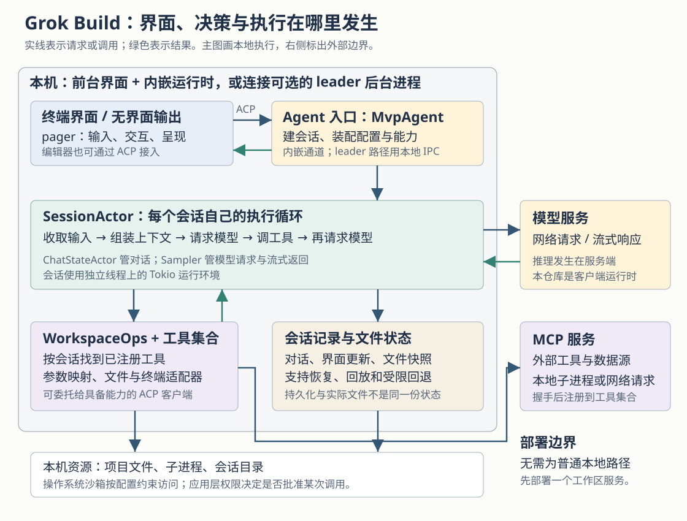
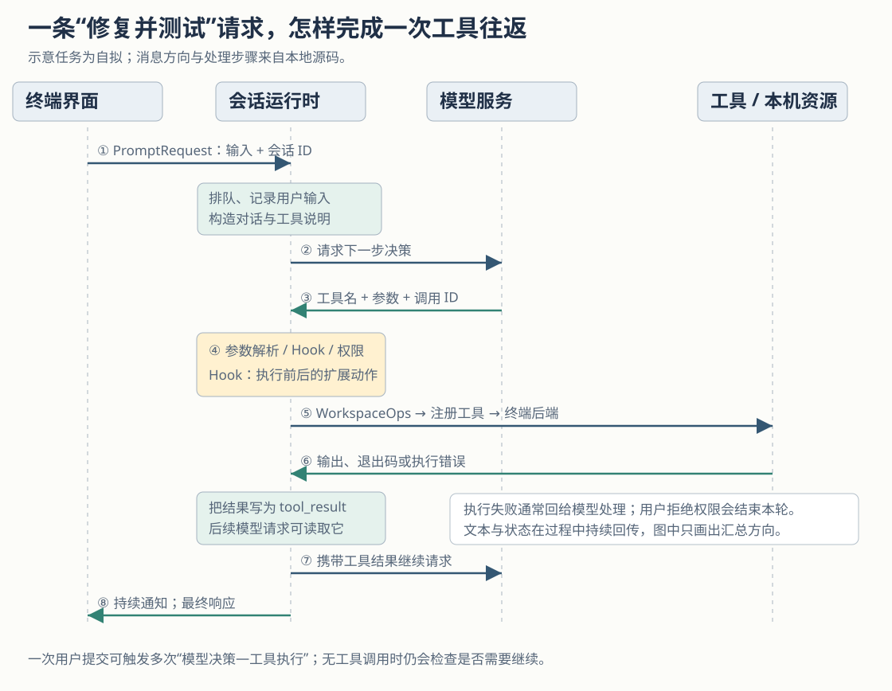

# Grok Build 如何把一句修复请求变成代码修改：从终端界面到工具执行的完整链路

假设一个项目的测试失败了，你在终端输入：“找出日期解析的边界问题，修复它，再运行相关测试。”普通聊天工具可以给出建议；Grok Build 则提供一套把建议落实到工作目录的执行机制：把请求和已有对话交给模型，接收模型提出的读文件、修改文件或运行命令的请求，检查后执行，再把结果交回模型。这个过程可以重复多次，直到产生最终答复，或因取消、权限拒绝、预算限制、错误等原因结束。

这个例子是本文自拟的任务，不是本次实际运行的记录。它要说明项目解决的具体问题：**让模型能够根据代码和执行反馈持续推进工作，同时让用户看见过程、介入决策，并保留可恢复的会话状态。** 模型负责提出下一步，客户端运行时负责组织上下文、约束执行和处理状态；二者合在一起，才构成这里的 Agent，即能反复调用工具推进任务的程序。

本篇依据执行器提供的 `input/repository/` 源码快照，首次建立整体认识。没有历史研报。本次只读源码与测试，没有安装依赖、构建项目、执行仓库脚本或运行测试；文中“测试断言”表示读到了相应测试代码，不表示本次验证通过。源码链接固定到本次快照，便于回查。

**先把项目边界说清：Grok Build 是在用户环境中运行的编码客户端及其运行时。** 仓库以 Rust 编写，用 Cargo 管理多个 crate，即分别承担职责的软件包。发布命令叫 `grok`，源码中的主二进制产物叫 `xai-grok-pager`。它提供 TUI（终端文本交互界面），也支持无界面执行，并能通过 ACP（Agent Client Protocol，客户端与 Agent 交换会话、输入和工具状态的协议）接入编辑器。模型请求由客户端经网络发送；这里没有实现 Grok 模型的训练和推理引擎。[程序入口][entry]与[模型请求客户端][sampling-client]分别能验证这两端的边界。

README 说明，这棵源码从内部单体仓库定期同步而来，公开的是命令行客户端相关代码。因而，理解本地运行机制时可以追踪到实现；模型服务、账号服务及其他在线服务的内部行为，则不能仅靠这棵源码确认。普通本地执行路径会创建本地工作区对象，不要求用户先独立部署一个工作区服务器；仓库中存在代理和服务端接口，也不能据此把它解释成所有操作都要经远端服务器完成。[工作区创建][agent-ops]、[工作区操作分派][workspace-ops]

图中最重要的分工是：界面收集输入并呈现状态，会话运行时推动任务，工具实现产生实际副作用。图画的是本地执行主线；编辑器声明具备终端能力时，命令也可以委托给编辑器客户端执行。

| 读者关心的事情 | 主要实现位置 | 实际职责 |
| --- | --- | --- |
| 命令怎样启动 | `xai-grok-pager-bin` | 解析启动意图，选择界面、单次执行或 Agent 子命令，装配程序 |
| 输入与结果怎样显示 | `xai-grok-pager` | 输入编辑、弹窗、滚动记录、异步交互及 ACP 消息处理 |
| 一次任务怎样推进 | `xai-grok-shell` | 管理会话、排队输入、运行模型与工具循环、处理中断和恢复 |
| 模型看到什么、怎样请求模型 | `xai-chat-state`、`xai-grok-sampler` | 保存和整理对话，构造请求，发送网络请求并接收流式事件 |
| 工具怎样产生实际动作 | `xai-grok-tools` | 注册工具、映射参数、实现文件编辑、终端命令及扩展工具 |
| 文件、权限与回退怎样组织 | `xai-grok-workspace`、`xai-grok-sandbox` | 工作区操作、文件状态、权限决策，以及按配置施加操作系统限制 |

这个划分不是逐目录介绍。例如 `xai-grok-agent` 也参与构造系统提示和装配工具集合，但“持续推进一次用户任务”的关键循环位于 shell 的 `SessionActor`，而非只看名字就能找到的某个 `Agent::run`。[Agent 装配器][builder]、[会话执行循环][turn]

**用户按下回车之后，界面发送的是一条有身份的会话请求。** pager 把同步状态变更与异步动作分开：`app/dispatch` 负责处理动作、改变界面状态并产生 `Effect`；`app/effects` 执行网络或运行时交互。普通文本提交进入 `Effect::SendPrompt`，被包装成 `PromptRequest`，带上会话 ID、正文和 `promptId`。其中 `promptId` 用来关联本次提交与后续通知，避免把不同请求的输出混在一起。[界面组织][pager-app]、[SendPrompt 实现][effects]

这种分离意味着，模型慢、工具耗时或权限等待，不必把整个界面处理过程写成一个阻塞函数。界面可以继续处理终端事件，后台任务随后把结果交回。这是从同步分派、异步 Effect 和事件循环的组织方式得到的设计推断；本文没有测量界面的响应延迟。

ACP 也不意味着每次都要启动另一个可执行程序。内嵌路径中的 `spawn_grok_shell` 创建通信通道，构造 `MvpAgent`，再在独立工作线程上运行请求网关。会话执行还有自己的线程：`spawn_session_on_thread` 为会话创建操作系统线程，并在其中运行 Tokio 异步运行环境。这样可以把界面、Agent 请求入口与会话执行放在不同的运行边界上。[内嵌启动][spawn-agent]、[会话启动][spawn-session]

另一条可选路径是 leader，即承载运行时的持久后台进程。pager 用本地 IPC（进程间通信）把它接到同样的 ACP 接口上。`resolve_leader_mode` 根据命令行参数、适用条件、本地配置和发行构建中的远端设置决定是否使用它；代码的最终兜底是关闭，不能把 leader 视作所有构建的固定默认值。若请求了非关闭的进程沙箱配置，该函数会否决 leader 路径，让进程内工具留在本次沙箱约束之下。[leader 选择][pager-app]、[ACP 连接][acp-connect]

这里的取舍是：持久运行时便于让会话生命周期超出一次前台连接，但需要处理连接、重连和状态回放；内嵌路径的生命周期较直接，也更容易继承当前进程的限制。源码证明了两种连接方式和沙箱否决逻辑；这些收益与代价是根据结构作出的分析。

**真正决定“现在处理哪条输入”的，是会话运行时。** `MvpAgent::prompt` 先查找会话、检查模型状态和请求参数，再把输入交给会话的消息分派或队列；需要立即发送的分支会发出 `SessionCommand::Prompt`。`run_session` 收到命令后调用 `queue_input`，根据当前是否已有任务及是否需要打断，决定何时启动处理。[ACP prompt 入口][acp-agent]、[会话消息循环][run-loop]

`SessionActor` 中的 Actor 可以理解为“一个拥有状态、通过消息接收工作请求的执行单元”。它不只是一个模型调用包装器：新输入、取消、后台任务完成等事情都可能抵达同一会话。把它们纳入明确的队列和状态转换，可以避免只靠几个全局变量判断“Agent 还在不在运行”。不过，会话按消息组织，不代表内部所有工具都串行执行。

回到日期解析的例子，任务在空闲状态被接纳后，会话先记录用户输入、推进提示序号，并建立这次处理的文件状态记录。随后，`process_conversation_turn_inner` 开始反复做三件事：构造模型请求，处理模型响应，在需要时执行工具并继续请求。这条真实路径比“界面把一句话发给模型，然后显示答案”多出一个持续运行的执行循环。[输入及轮次处理][turn]

模型请求不是简单拼接一个聊天字符串。`ChatStateActor::build_conversation_request` 从当前对话状态生成 `ConversationRequest`，带上工具说明和模型参数，并处理图片预算、旧工具结果裁剪、记忆提醒与历史结构整理。这里的上下文，就是下一次请求中模型实际能看到的材料；它可能与界面保存的完整显示记录不同。[请求构造][request-builder]

接着，会话调用 `run_turn_via_sampler`，由 sampler 负责模型请求。sampler 可适配 Responses、Chat Completions 和 Messages 等模型接口，并把不同响应转成统一的文本、工具调用和结束事件。`run_request_task` 管理一次请求的尝试、取消与失败分类。这个适配层让会话循环不必针对每种网络接口重写一遍。[会话调用 sampler][turn]、[请求执行][request-task]、[接口适配][sampling-client]

在自拟例子中，模型可能先请求搜索日期解析函数，再读文件，然后请求 `search_replace` 修改某段文本，最后请求 `run_terminal_cmd` 执行测试。这只是可能的步骤，源码没有保证任务一定按这个顺序完成。**框架约束的是可用工具、执行条件和状态处理，具体工具选择仍来自模型。**

**一个工具名能够执行，是因为它在会话建立时被装配成了可调用对象。** Agent 装配器把终端后端、文件系统、工作目录、会话环境等资源交给工具构建器；`ToolRegistryBuilder::finalize` 检查工具配置所需条件，再生成 `FinalizedToolset`。它保留面向模型的工具名、参数说明以及内部工具标识之间的映射。会话安装完成后，`bind_installed_toolset` 将这套工具绑定到工作区中的会话 ID。[工具装配][builder]、[工具集合][registry]、[会话绑定][spawn-session]

这解释了为什么工具说明和实际执行不能各写一套互不相干的名单：同一配置既影响模型看见的名称和参数，也影响运行时如何把它们映射到实现。工具可用性还受所选 Agent 配置、能力和过滤条件影响；仓库里存在某个工具类型，并不证明每个会话都会暴露它。

模型提出调用后，`prepare_tool_call` 会先发送待处理状态，再解析 JSON（常用的结构化数据格式）参数、查找实际工具、处理必要的参数转换，并经过执行前的 Hook 与权限流程。Hook 是在指定事件前后运行的扩展动作，可以参与检查或提供附加上下文。权限系统需要用户选择时，通过客户端通道请求交互，而不是让模型自己声称“已经获批”。[工具准备与执行][tool-calls]

通过准备的调用进入 `dispatch_observed → WorkspaceOps::call_tool_with_context`。本地工作区按会话 ID 找到工具集合；工具集合再将对外参数映射为内部参数，补入宿主资源，查找注册对象并执行。缺少会话 ID、找不到会话或工具时，这些位置都有明确错误返回。[调用分派][tool-dispatch]、[工作区分派][workspace-ops]、[注册表执行][registry]

终端工具是观察“模型意图怎样变成副作用”的好例子。`BashTool` 将命令、目录、环境、超时和输出限制组装成 `TerminalRunRequest`，交给 `TerminalBackend`。本地终端后端最终构造并启动子进程，收集输出和退出状态。若 ACP 客户端声明了终端能力，则会话可选择 `AcpTerminalAdapter`；子 Agent 也可复用父级后端。因此，“工具从本地集合分派”与“所有命令都由同一个本地终端实现运行”是两件不同的事。[终端工具][bash]、[本地进程启动][local-terminal]、[后端选择][spawn-session]

终端工具还支持后台任务。在启用相应配置时，前台等待到期可以把命令转入后台，随后通过任务查询、输出读取与完成通知继续跟踪。因此，界面暂时不再等待某个命令，并不必然表示进程已经被终止；具体行为取决于工具版本、配置和调用参数。[前台与后台执行][bash]

工具可以并发，但实现对特定文件冲突做了协调。`execute_tool_calls_batch` 为获批调用构造异步任务，使用 `FuturesUnordered` 按就绪情况收取结果，并保留原调用索引和调用 ID。它还解析目标文件路径：当同一批中某路径涉及写操作时，针对该路径的相关操作共享互斥锁。这个保护有明确范围，不能据此声称任意 shell 命令、外部程序或其他会话的写入都能被自动串行化。[批量分派与路径锁][tool-calls]

**工具完成后，结果会流向两个不同的消费者。** `ToolRunResult` 保存结构化的 `output`，也保存供模型阅读的 `prompt_text`。会话把后者写为与调用 ID 关联的 `tool_result`，让下一次模型请求能看见“读到了什么”“替换成功没有”“测试为什么失败”。另一条路径把结构化结果转成 ACP 工具更新，让用户看见执行内容和完成状态。[工具结果结构][tool-output]、[成功和失败处理][tool-calls]

文本也会在生成过程中回传。`SamplingEvent::ChannelToken` 的文本分支被转换成 `AgentMessageChunk`；pager 的 `AcpTracker::handle_update` 将文本、思考片段和工具更新分别归入滚动记录。因而，界面展示并非只依赖最后那条 `PromptResponse`：运行通知负责过程，最终响应负责给出停止原因等收尾信息。[流式事件转换][sampling-events]、[界面更新归并][tracker]

在日期解析的例子中，如果测试报告失败，模型可以根据 `tool_result` 再修改代码；如果测试成功，则可能解释修复并结束。但“没有工具调用”也不总是立即结束：循环还会检查待处理的插入输入、部分续写和其他继续条件。把一次用户提交称为“一轮”，不应误解成只发生一次模型请求。[循环结束判断][turn]

**失败处理的目标，是让可恢复的错误变成下一步信息，同时保留明确的终止边界。** 这几类失败在实现中的后果不同：

| 发生了什么 | 源码中的处理 | 对用户的含义 |
| --- | --- | --- |
| 模型给出了坏参数 | 构造解析错误，有限保留原参数与 JSON 错误位置，并写回工具结果 | 模型有机会改正调用；不是所有坏参数都会让整个会话崩溃 |
| 工具实现报错 | 标记工具失败，把错误写回对话 | 通常仍能继续选择其他动作 |
| 策略禁止某调用 | 记录未执行结果，准备阶段返回继续动作 | 模型可以在限制内寻找替代方案 |
| 用户明确拒绝权限 | 返回 `PermissionReject`，会话转为取消结果 | 当前轮次结束，区别于一般执行失败 |
| 模型服务暂时失败 | 按错误类别、开关、次数和时间预算决定是否重试 | 有恢复路径，也有耗尽后返回错误的边界 |
| 完成时无法写入会话记录 | 磁盘空间不足可把原本完成的结果转为错误 | 屏幕出现答案，不等于会话已可靠保存 |

这些差别可以从 `prepare_tool_call`、`handle_tool_error`、`build_tool_parse_error_message` 和轮次收尾代码直接读到。会话层的暂时性重试代码另设每步与整次输入的预算，避免每次成功后都无限重新获得重试额度；它也不会把认证、限流和所有确定性错误当成同一种故障处理。[工具错误][tool-calls]、[解析错误构造][tool-dispatch]、[重试分类与预算][sampler-turn]、[落盘收尾][turn]

测试提供了较具体的交叉依据：`build_tool_parse_error_message_tests` 检查坏 JSON 是否带回原参数与错误位置；`transient_retry_loop_tests` 用模拟模型服务断言两次 503 后成功、重试预算耗尽以及关闭恢复开关的结果；`disk_full_tests` 检查完成时落盘失败要报告错误，而取消结果不会被磁盘错误覆盖。终端工具测试则区分正常返回、超时和后端执行错误。这些测试检查的层级不同，也不构成真实网络和操作系统组合已经全部验证的证明。[解析测试][parse-tests]、[重试测试][retry-tests]、[磁盘错误测试][disk-tests]、[终端测试][bash]

长任务还有“动作没有进展”的问题。轮次循环记录重复工具调用的特征，达到判定条件后可返回 `StationarityEnded`，结束反复执行同样动作的轮次。它能提供停止条件；至于一次日期解析任务是否真正修对，仍需看修改内容与测试证据，不能仅靠运行时的“完成”状态判断。[重复动作处理][turn]

**持久化、检查点与沙箱，分别解决三种不同的问题。** 持久化回答“下次能否接着对话、回放界面”；检查点回答“哪些已记录文件能退回”；沙箱回答“进程究竟能访问哪些资源”。把三者混在一起，会高估恢复和隔离能力。

对话状态通过 `ChannelChatPersistence` 发往持久化通道，会话保存对话与 `updates.jsonl` 等记录；恢复时可读取历史，重建状态和显示。正在展示的滚动记录、下一次给模型的上下文以及磁盘上保存的内容，有联系，但不是同一个容器。落盘确认与错误处理之所以重要，正是因为这些状态之间需要同步。[持久化适配][chat-persistence]、[会话存储][persistence]

文件回退按提示序号组织。轮次开始调用 `begin_prompt`；编辑工具发出的 `FileWritten` 通知携带旧内容和新内容，通知桥据此记录修改前快照及文本差异；轮次结束收集修改后的状态并保存回退点。界面可以列出每条提示对应的回退位置，但某个位置可能没有文件快照。[文件通知桥][notification-bridge]、[轮次文件状态][turn]、[回退点列表][rewind]

工作区还实现了文件、文本差异和可选 Git 状态组合的检查点。其 Git 捕获、持久化及部分收尾行为受开关控制；`rewind_to` 明确处理“Git 没恢复、文件仍进行了回退”等部分恢复情况。这些代码不能推导出“每轮必有一次 Git 提交”或“任意 shell 副作用均可撤销”。例如发出网络请求、修改数据库、写入没有被记录的外部文件，都超出了本文已核实的文件快照恢复保证。[工作区检查点][checkpoint]

若想把代码修改放在另一个目录，项目还支持 worktree，即 Git 的独立工作目录。界面与无界面模式复用创建、恢复的请求封装；指定引用时可创建干净检出，否则可携带原目录的未提交修改。它改变代码工作的目录范围，操作系统沙箱则约束访问权限，两者用途不同。[工作目录创建与恢复][worktree]

应用层权限决定某次调用获准与否；操作系统沙箱通过内核机制限制实际访问。源码和随附指南均表明，进程沙箱需要按配置启用，默认关闭。`apply_sandbox` 在入口处解析配置并实施限制；Linux 与 macOS 的机制及能力存在差异。例如，随附指南明确注明 `read-only`、`strict` 配置对子进程的禁网在 Linux 生效，在 macOS 不生效。不能仅看到配置名就假设跨平台效果完全相同。[沙箱启动逻辑][sandbox-config]、[沙箱管理器][sandbox]、[随附沙箱指南][sandbox-guide]

一个值得强调的核验细节是：底层 `SandboxManager::apply` 有警告后继续的分支，但上层 `apply_sandbox` 对需要保护的配置还会检查是否实际应用，并在特定保护缺失时拒绝启动；Linux 对必要的拒绝访问挂载另有验证。因此，既不能只读底层函数就断言“沙箱失败总会放行”，也不能仅凭上层某个拒绝分支断言“所有平台、所有配置都绝不降级”。本文核实了这些分支，没有实测各平台的内核约束。

**长对话和外部工具的扩展，也沿着同一个会话循环接入。** 模型可接收的上下文大小有限，长工具输出又会持续占用空间。项目先在工具输出与请求构造处做截断、裁剪；接近上下文窗口限制时，再由 compaction（上下文压缩，即以摘要等材料替换较长历史）减少后续请求的体积。`check_auto_compact_needed` 读取估算用量和模型窗口，`run_compact_only` 执行压缩；摘要请求本身放不下时，还有从原样输入、适配预算输入到有损输入的降级路径。[请求整理][request-builder]、[压缩机制][compaction]

这种设计有利于延续长任务，但摘要和裁剪会损失细节，这是机制本身带来的取舍。对于日期解析中必须精确保留的时区规则或边界样例，把它们落实为文件、测试和可重新读取的结果，比只让模型在长对话中记住更可靠。这是基于上下文处理方式提出的实践建议，不是项目效果的实测结论。

MCP（Model Context Protocol，向模型应用提供外部工具与资源的协议）扩展的是可执行能力。例如，团队可以接入已有的数据查询服务，让模型取得本地仓库之外的信息。源码支持本地标准输入输出及 HTTP（常见的网络请求协议）等连接方式；会话初始化代码并行握手，记录各服务成功或失败，再把允许向模型暴露的工具注册到同一工具桥。这里不仅有接口声明，还能追到 `register_mcp_tools` 的实际调用。[MCP 连接][mcp-servers]、[握手与注册][mcp-init]、[工具桥][tool-bridge]

服务集合在初始化期间变化时，代码通过初始化代次和取消状态防止旧结果继续发布。初始化还区分 Blocking（等待初始化再进行首次模型请求）与 Progressive（先启动，工具就绪后陆续公布）两种策略：前者更容易在首次请求中给模型完整工具视图，后者有利于减少等待，但运行时必须处理工具集合变化。这些是配置支持的取舍，不能据此声称所有会话使用同一种策略。[初始化实现][mcp-init]、[策略定义][mcp-strategy]

技能、项目规则和插件则更多参与指令发现、配置与能力装配。`prompt/agents_md.rs` 会沿项目目录链及用户目录发现规则，并区分来源以参与信任判断；它们进入运行时后可能影响模型行为，却不等同于内核权限。本文核实了发现入口和工具装配关系，未逐项审计全部插件、记忆和子 Agent 机制。[规则发现][agents-md]、[Agent 装配][builder]

**无界面执行复用上述能力，变化主要在客户端如何输入和消费事件。** 顶层 `grok -p` 路径进入 pager 的 `headless::run_single_turn`，同样驱动 ACP 初始化、认证、会话创建和 prompt 生命周期，再把通知转成标准输出。源码支持纯文本、JSON 和流式格式，也提供工具过滤、最大工具循环次数，以及是否等待后台任务和等待超时等参数。另一个名字相似的 shell `run_headless` 用于连接远端会话的运行入口，不能把两者混为同一条调用链。[顶层分流][entry]、[单次无界面执行][headless]、[Agent 运行入口][agent-app]

无界面并不意味着自动批准。当权限请求到达 headless 客户端，代码仅在相应自动批准条件下选择允许选项，否则返回取消。要把它用于 CI，即持续集成中的自动检查，应该明确工具范围、允许规则、工作目录、沙箱和停止条件，并消费结构化结果；不要假设无人值守就能完成原本需要交互授权的任务。这一建议直接来自权限响应分支和参数边界。[无界面权限处理][headless]

对于第一次使用或研究这个项目的人，可以从一个范围明确、能由现有测试判断结果的修复任务开始，观察文件读取、编辑、测试输出和最终说明是否彼此一致；需要多任务隔离时再评估 worktree，需要外部系统能力时再接 MCP。继续读源码时，最有价值的问题也已经具体起来：取消发生在工具已启动之后，哪些状态和子进程会被清理；模型上下文经过压缩后，如何仍与回退点、持久化记录保持一致。这两条都能从本文的会话循环继续追踪，但需要另行核验，不能由整体架构图代替答案。

[entry]: https://github.com/xai-org/grok-build/blob/2bdd1d6a6369de0e8c68132ea4539e9abd9e14a8/crates/codegen/xai-grok-pager-bin/src/main.rs
[sampling-client]: https://github.com/xai-org/grok-build/blob/2bdd1d6a6369de0e8c68132ea4539e9abd9e14a8/crates/codegen/xai-grok-sampler/src/client.rs
[agent-ops]: https://github.com/xai-org/grok-build/blob/2bdd1d6a6369de0e8c68132ea4539e9abd9e14a8/crates/codegen/xai-grok-shell/src/agent/mvp_agent/agent_ops.rs
[workspace-ops]: https://github.com/xai-org/grok-build/blob/2bdd1d6a6369de0e8c68132ea4539e9abd9e14a8/crates/codegen/xai-grok-workspace/src/workspace_ops.rs
[builder]: https://github.com/xai-org/grok-build/blob/2bdd1d6a6369de0e8c68132ea4539e9abd9e14a8/crates/codegen/xai-grok-agent/src/builder.rs
[turn]: https://github.com/xai-org/grok-build/blob/2bdd1d6a6369de0e8c68132ea4539e9abd9e14a8/crates/codegen/xai-grok-shell/src/session/acp_session_impl/turn.rs
[pager-app]: https://github.com/xai-org/grok-build/blob/2bdd1d6a6369de0e8c68132ea4539e9abd9e14a8/crates/codegen/xai-grok-pager/src/app/mod.rs
[effects]: https://github.com/xai-org/grok-build/blob/2bdd1d6a6369de0e8c68132ea4539e9abd9e14a8/crates/codegen/xai-grok-pager/src/app/effects/mod.rs
[spawn-agent]: https://github.com/xai-org/grok-build/blob/2bdd1d6a6369de0e8c68132ea4539e9abd9e14a8/crates/codegen/xai-grok-pager/src/acp/spawn.rs
[spawn-session]: https://github.com/xai-org/grok-build/blob/2bdd1d6a6369de0e8c68132ea4539e9abd9e14a8/crates/codegen/xai-grok-shell/src/session/acp_session_impl/spawn.rs
[acp-connect]: https://github.com/xai-org/grok-build/blob/2bdd1d6a6369de0e8c68132ea4539e9abd9e14a8/crates/codegen/xai-grok-pager/src/acp/mod.rs
[acp-agent]: https://github.com/xai-org/grok-build/blob/2bdd1d6a6369de0e8c68132ea4539e9abd9e14a8/crates/codegen/xai-grok-shell/src/agent/mvp_agent/acp_agent.rs
[run-loop]: https://github.com/xai-org/grok-build/blob/2bdd1d6a6369de0e8c68132ea4539e9abd9e14a8/crates/codegen/xai-grok-shell/src/session/acp_session_impl/run_loop.rs
[request-builder]: https://github.com/xai-org/grok-build/blob/2bdd1d6a6369de0e8c68132ea4539e9abd9e14a8/crates/codegen/xai-chat-state/src/actor/request_builder.rs
[request-task]: https://github.com/xai-org/grok-build/blob/2bdd1d6a6369de0e8c68132ea4539e9abd9e14a8/crates/codegen/xai-grok-sampler/src/actor/request_task.rs
[registry]: https://github.com/xai-org/grok-build/blob/2bdd1d6a6369de0e8c68132ea4539e9abd9e14a8/crates/codegen/xai-grok-tools/src/registry/types.rs
[tool-calls]: https://github.com/xai-org/grok-build/blob/2bdd1d6a6369de0e8c68132ea4539e9abd9e14a8/crates/codegen/xai-grok-shell/src/session/acp_session_impl/tool_calls.rs
[tool-dispatch]: https://github.com/xai-org/grok-build/blob/2bdd1d6a6369de0e8c68132ea4539e9abd9e14a8/crates/codegen/xai-grok-shell/src/session/acp_session_impl/tool_dispatch.rs
[bash]: https://github.com/xai-org/grok-build/blob/2bdd1d6a6369de0e8c68132ea4539e9abd9e14a8/crates/codegen/xai-grok-tools/src/implementations/grok_build/bash/mod.rs
[local-terminal]: https://github.com/xai-org/grok-build/blob/2bdd1d6a6369de0e8c68132ea4539e9abd9e14a8/crates/codegen/xai-grok-tools/src/computer/local/terminal.rs
[tool-output]: https://github.com/xai-org/grok-build/blob/2bdd1d6a6369de0e8c68132ea4539e9abd9e14a8/crates/codegen/xai-grok-tools/src/types/output.rs
[sampling-events]: https://github.com/xai-org/grok-build/blob/2bdd1d6a6369de0e8c68132ea4539e9abd9e14a8/crates/codegen/xai-grok-shell/src/session/acp_session_impl/sampling_events.rs
[tracker]: https://github.com/xai-org/grok-build/blob/2bdd1d6a6369de0e8c68132ea4539e9abd9e14a8/crates/codegen/xai-grok-pager/src/acp/tracker.rs
[sampler-turn]: https://github.com/xai-org/grok-build/blob/2bdd1d6a6369de0e8c68132ea4539e9abd9e14a8/crates/codegen/xai-grok-shell/src/session/acp_session_impl/sampler_turn.rs
[parse-tests]: https://github.com/xai-org/grok-build/blob/2bdd1d6a6369de0e8c68132ea4539e9abd9e14a8/crates/codegen/xai-grok-shell/src/session/acp_session_tests/build_tool_parse_error_message_tests.rs
[retry-tests]: https://github.com/xai-org/grok-build/blob/2bdd1d6a6369de0e8c68132ea4539e9abd9e14a8/crates/codegen/xai-grok-shell/src/session/acp_session_tests/turn/transient_retry_loop_tests.rs
[disk-tests]: https://github.com/xai-org/grok-build/blob/2bdd1d6a6369de0e8c68132ea4539e9abd9e14a8/crates/codegen/xai-grok-shell/src/session/acp_session_tests/turn/disk_full_tests.rs
[chat-persistence]: https://github.com/xai-org/grok-build/blob/2bdd1d6a6369de0e8c68132ea4539e9abd9e14a8/crates/codegen/xai-grok-shell/src/session/chat_persistence.rs
[persistence]: https://github.com/xai-org/grok-build/blob/2bdd1d6a6369de0e8c68132ea4539e9abd9e14a8/crates/codegen/xai-grok-shell/src/session/persistence.rs
[notification-bridge]: https://github.com/xai-org/grok-build/blob/2bdd1d6a6369de0e8c68132ea4539e9abd9e14a8/crates/codegen/xai-grok-shell/src/tools/notification_bridge.rs
[rewind]: https://github.com/xai-org/grok-build/blob/2bdd1d6a6369de0e8c68132ea4539e9abd9e14a8/crates/codegen/xai-grok-shell/src/session/acp_session_impl/rewind.rs
[checkpoint]: https://github.com/xai-org/grok-build/blob/2bdd1d6a6369de0e8c68132ea4539e9abd9e14a8/crates/codegen/xai-grok-workspace/src/session/checkpoint.rs
[worktree]: https://github.com/xai-org/grok-build/blob/2bdd1d6a6369de0e8c68132ea4539e9abd9e14a8/crates/codegen/xai-grok-pager/src/app/worktree_session.rs
[sandbox-config]: https://github.com/xai-org/grok-build/blob/2bdd1d6a6369de0e8c68132ea4539e9abd9e14a8/crates/codegen/xai-grok-shell/src/config/mod.rs
[sandbox]: https://github.com/xai-org/grok-build/blob/2bdd1d6a6369de0e8c68132ea4539e9abd9e14a8/crates/codegen/xai-grok-sandbox/src/lib.rs
[sandbox-guide]: https://github.com/xai-org/grok-build/blob/2bdd1d6a6369de0e8c68132ea4539e9abd9e14a8/crates/codegen/xai-grok-pager/docs/user-guide/18-sandbox.md
[compaction]: https://github.com/xai-org/grok-build/blob/2bdd1d6a6369de0e8c68132ea4539e9abd9e14a8/crates/codegen/xai-grok-shell/src/session/compaction.rs
[mcp-servers]: https://github.com/xai-org/grok-build/blob/2bdd1d6a6369de0e8c68132ea4539e9abd9e14a8/crates/codegen/xai-grok-shell/src/session/mcp_servers.rs
[mcp-init]: https://github.com/xai-org/grok-build/blob/2bdd1d6a6369de0e8c68132ea4539e9abd9e14a8/crates/codegen/xai-grok-shell/src/session/acp_session_impl/mcp_init.rs
[tool-bridge]: https://github.com/xai-org/grok-build/blob/2bdd1d6a6369de0e8c68132ea4539e9abd9e14a8/crates/codegen/xai-grok-tools/src/bridge.rs
[mcp-strategy]: https://github.com/xai-org/grok-build/blob/2bdd1d6a6369de0e8c68132ea4539e9abd9e14a8/crates/codegen/xai-grok-telemetry/src/enums.rs
[agents-md]: https://github.com/xai-org/grok-build/blob/2bdd1d6a6369de0e8c68132ea4539e9abd9e14a8/crates/codegen/xai-grok-agent/src/prompt/agents_md.rs
[headless]: https://github.com/xai-org/grok-build/blob/2bdd1d6a6369de0e8c68132ea4539e9abd9e14a8/crates/codegen/xai-grok-pager/src/headless.rs
[agent-app]: https://github.com/xai-org/grok-build/blob/2bdd1d6a6369de0e8c68132ea4539e9abd9e14a8/crates/codegen/xai-grok-shell/src/agent/app.rs
