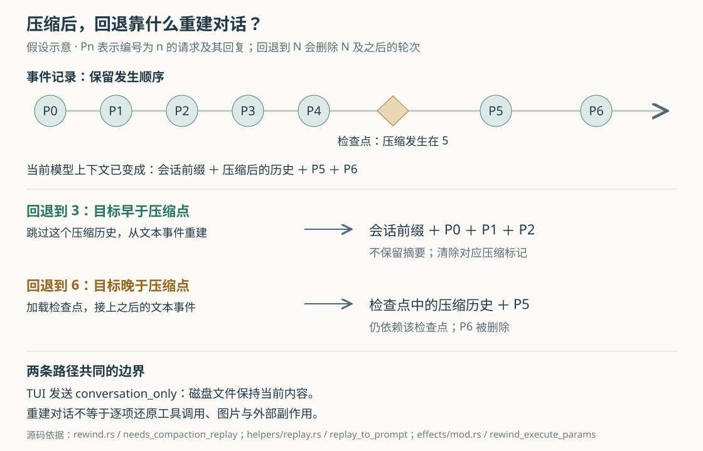

# Grok Build 回退对话时，为什么代码还在：从请求编号到压缩历史重建

假设你让 Grok Build 修改日期解析逻辑，它已经改了代码、跑过测试。随后你发现需求说错了，于是输入 `/undo`，选中那条修改请求，准备重新描述。界面里的请求和后续回答被移除了，原请求回到输入框，但文件里的修改仍然存在。这不是从按钮名称猜出的行为：当前终端界面的实现明确选择了“只回退对话”。

理解这件事，有助于回答一个更实际的问题：**当编码 Agent 已经改变文件、又把长对话压缩过之后，所谓“回到之前”，究竟恢复了什么？** 这里的 Agent 是能够反复调用工具推进任务的程序。Grok Build 把它的对话、文件修改和界面记录分别管理；回退需要协调这些状态，却没有把它们变成一个能整体倒放的环境。

本文依据 `input/repository/` 的当前源码，并读过已有的首篇研报。本篇不再复述输入到工具执行的总体架构，而是核实回退的真实调用链、压缩后的恢复方式和失败边界。上面的场景是自拟例子；本次只读源码、测试和随附文档，没有安装依赖、构建项目或运行仓库测试。以下“测试断言”均指阅读到的测试内容。

**先区分界面提供的操作与底层接口具备的能力。** TUI，即终端文本交互界面，调用 `rewind_execute_params` 构造请求时，固定发送 `force: true` 和 `mode: "conversation_only"`。用户指南也明确写明 `/rewind`、别名 `/undo` 会删除后续对话，保留磁盘上的文件修改。对应测试 `rewind_execute_params_sends_conversation_only_with_force` 直接检查了这些参数。[界面请求构造][effects]、[参数测试][effect-tests]、[会话指南][guide]

底层 `RewindMode` 则有三种选择：

| 模式 | 对话如何处理 | 文件如何处理 |
| --- | --- | --- |
| `ConversationOnly` | 删除目标请求及之后的轮次 | 保持当前内容；重整文件快照的归属 |
| `FilesOnly` | 保留对话和当前请求编号 | 尝试恢复已记录文件 |
| `All` | 回退对话 | 同时尝试恢复已记录文件 |

这也补充了首篇对检查点的概括：项目确有文件回退实现，但不能把底层能力直接解释成 `/undo` 会撤销代码。扩展接口在省略模式时默认选择 `All`，界面却显式选择 `ConversationOnly`；接入它的客户端需要明确自己要哪一种行为。[模式定义][types]、[扩展入口][extension]

**用户选择的是一条请求之前的位置，不是那条请求完成后的状态。** 源码把这个位置写成 `prompt_index`，即会话中请求轮次的编号，从零开始。“回退到 N”保留编号小于 N 的轮次，删除 N 本身及之后的内容。因而，选择修改请求，就是准备重做这条请求；成功响应中的 `prompt_text` 可将它重新放回输入框。

正常界面路径可以追成一条完整调用链：`dispatch_rewind` 检查会话状态并取回可选位置，选定后产生 `Effect::RewindExecute`；Effect 通过 ACP（Agent Client Protocol，客户端与 Agent 交换会话和执行状态的协议）发送 `x.ai/rewind/execute`；扩展处理器将参数转换为 `SessionCommand::Rewind`；会话消息循环再调用 `SessionActor::handle_rewind`，由它改变运行时状态。成功后，界面处理 `RewindExecuteComplete`，删除对应位置之后的滚动记录，并恢复待编辑文本。[界面分派][ui-dispatch]、[异步请求][effects]、[扩展入口][extension]、[会话消息循环][run-loop]、[回退实现][rewind]

任务仍在运行时，界面先提供取消选择；用户接受后，`cancel_then_fetch_rewind_points` 等取消请求得到回应，才查询回退位置。测试专门检查了这个先后次序。它说明界面在协调正在运行的任务，而不能据此推出任意直接调用扩展接口的客户端都自动具备相同的操作流程。[取消与查询][effects]、[顺序测试][effect-tests]

**编号比“数聊天气泡”可靠，因为不是所有用户消息都代表一条新请求。** 例如，后台任务完成后可能自动唤醒 Agent，产生占用新编号的系统合成轮次；运行中插入的一句话、权限跟进等消息，又可能属于已有轮次。会话前缀里还有保存环境信息的用户消息，它也不能当成第一条任务。

`conversation_truncate_for_prompt` 优先使用消息中的显式 `prompt_index` 确定截断位置；对于没有编号的旧记录，它兼容旧的计数方式，并区分哪些合成消息真正开启新轮次。测试 `rewind_synthetic_turn_tests` 构造了“真实请求—后台任务唤醒—真实请求”的历史，分别检查有编号和无编号的情况，要求回退后目标请求及回答确实从模型上下文中消失。这里的上下文，指下一次请求交给模型的材料。[截断算法][truncate]、[合成轮次测试][synthetic-tests]

回退列表也不是从“有多少份文件备份”推出来的。`get_rewind_points` 根据当前请求编号生成全部可选位置，再把文件快照数量附上去；某条请求没有文件变化，仍可以成为对话回退位置。文件跟踪器支持先读元数据、需要恢复时再载入历史文件内容，避免仅打开选择器就读入所有大快照。[位置列表][rewind]、[文件跟踪器][file-state]

**长对话压缩以后，单靠截断内存已经不够。** 压缩是用摘要和必要材料替换较长历史，以便继续放进模型的输入空间。它会改变消息数量和结构：原来很多条真实请求，可能被折叠成一段摘要及少量近期消息。即使目标在压缩之后，“从头数到第 N 条用户消息”也可能落在错误位置。

因此，`needs_compaction_replay` 只要发现当前对话仍带有压缩标记，就选择重放恢复，不仅在目标早于压缩点时才这样做。重放是重新读取记录并计算当前应保留的状态，不会重新执行当年的工具命令。[压缩检测与回退分支][rewind]

为支持这条路径，系统保留了几种用途不同的数据：

| 数据 | 在这里解决什么问题 |
| --- | --- |
| 当前对话及 `chat_history.jsonl` | 保存继续请求模型所需的历史；压缩、回退都可能替换它 |
| `updates.jsonl` | 保存会话事件顺序，包括用户文本、回答片段、压缩与回退标记 |
| `compaction_checkpoints/*.json` | 保存某次压缩完成时的对话，以及压缩时的请求编号、原始环境前缀等 |
| `rewind_points.jsonl` | 保存按请求编号组织的文件前后快照；与压缩检查点不是一回事 |

`persist_compaction_checkpoint` 先向持久化通道提交检查点文件，再往事件流加入 `CompactionCheckpoint` 标记，标记中保存文件路径和压缩位置。存储适配器实际创建 `compaction_checkpoints` 目录并以原子写入方式保存单个检查点文件。这里能确认文件的组织和写入方式，不能据此认定检查点文件、事件标记、对话文件三者构成了一个整体事务。[压缩检查点产生处][compaction]、[持久化处理][persistence]、[文件存储实现][jsonl]

图中假设 P0 到 P4 之后发生压缩，压缩位置记为 5，之后执行了 P5、P6。`replay_to_prompt` 的恢复方式取决于目标与检查点的位置关系：

- **回退到 3：** 目标早于压缩位置 5，不安装这份压缩历史，而从事件中的文本重建 P0 到 P2。检查点若可读，还能提供压缩前的环境前缀；不可读时，这条路径可以保留当前前缀并继续。
- **回退到 6：** 目标在压缩位置之后，加载检查点里的压缩历史作为基础，再接上 P5 的文本，删除 P6。检查点已经代表 P0 到 P4，不能再把其中的摘要当作一条普通用户请求计数。

这是 `ReplayState` 中 `Base` 结构的实际作用：保存基础历史的长度、对应请求编号和加载结果，使后续截断只计算基础之后的轮次。自动压缩产生的继续提示也放在基础之内，不额外消耗一次真实请求计数。[重建算法][replay]

**事件记录还必须说明“哪一段历史已经作废”。** 假设记录依次是 P0、P1、P2，随后回退到 1，再输入新的 P1′。磁盘日志没有删除旧 P1、P2，而是追加 `RewindMarker(1)`。读取者遇到这个标记，就丢掉已累积的旧分支，再接上 P1′。因此，重建不能一到目标编号就停止扫描：日志后面还可能出现回退标记，让先前算出的历史失效。

模型对话重建由 `helpers/replay.rs` 处理；恢复界面记录另有 `storage` 中的回退过滤算法。后者在标记处截断保留事件，再继续接收新事件。两者围绕同一种分支语义工作，却服务不同的输出：一个生成模型对话，一个生成界面可回放记录。相关测试用真实临时文件比较流式回放与完整解析后的过滤结果。[模型历史重建][replay]、[事件过滤][storage]、[界面回放测试][storage-tests]

不过，**这里的重放不承诺逐项还原当时的模型请求。** 在 `replay_to_prompt` 的事件分派中，普通记录主要重建用户和 Agent 的文本片段；工具调用、工具状态等事件被跳过，图片等非文本内容也不会由这些文本累积函数完整重建。检查点本身可以带有更丰富的对话材料，但仅靠检查点之后的事件重建，不能保证恢复每一个原始工具结果和多媒体输入。其适用目标是恢复可继续工作的对话，而不是为任意时刻保存完整执行快照；后半句是根据实现范围作出的判断。[事件处理与文本累积][replay]

恢复结果随后还要同步回会话。`handle_rewind` 替换对话，把 `prompt_index` 设为目标值，截断原请求文本列表，并根据重建结果更新压缩标记。回退到压缩之前且摘要不再保留时，旧标记必须清除，否则后续请求仍可能被当作已经持有压缩摘要；测试检查了这个标记以及相关模型请求头的变化。[状态同步][rewind]、[跨压缩测试][cross-tests]

代码还会取消活跃采样请求、处理待完成的图片清理任务，清掉已不适用的轮次摘要和会话回顾。会话回顾使用递增代次阻止旧异步结果在回退后重新写入。由此可见，回退的收尾不仅是删几条消息，还要防止“被删历史的迟到结果”重新污染当前状态。[回退收尾][rewind]

**文件没有恢复，为什么还要整理文件检查点？** 因为未来的回退仍可能依赖这些文件变化的记录。每轮开始，`begin_prompt` 建立对应位置；编辑工具发出 `FileWritten` 通知时，通知桥把修改前内容送给跟踪器。一个文件在同轮被修改多次，只保留第一次修改前的内容；轮次收尾的 `end_prompt` 再读取这些已记录路径，保存最终内容，供之后判断外部修改。[轮次开始与收尾][turn]、[编辑通知桥][bridge]、[快照结构][file-state]

这套机制不会在每轮开始就复制整个工作目录。通知桥只在有旧内容或明确标记为新文件时加入修改前快照；该入口还跳过工作目录之外的路径。因而，不能由它推导出任意终端命令写出的文件、数据库变化或网络请求都可撤销。[编辑通知桥][bridge]、[快照捕获边界][file-state]

只回退对话时，磁盘上的文件变化还在，原来的后续编号却将被重新使用。`merge_rewind_points_from` 会把被删轮次的文件记录并入最后一个保留位置：同一路径保留最早的修改前内容，更新为最后的修改后内容，然后删除后续位置。例如回退到 2，原编号 2、3 的文件记录会折入编号 1。这样未来再回退到 1，仍能找到这些残留修改之前的状态。

这个合并有具体边界：目标为 0 时直接清空记录；目标前一个位置不存在时，也没有可承接的合并点。它没有创造一份“脱离所有请求的永久撤销记录”。内存跟踪器与磁盘存储复用同一个合并函数；磁盘路径先完整读取，再写回合并结果。测试检查了文件内容能随合并保留，也检查坏记录会让合并中止并保留原文件。[合并算法][file-state]、[存储调用][jsonl]、[合并测试][jsonl-tests]

**恢复失败时，不能笼统地说“系统会退回原状”。** 几条路径的保证明显不同：

| 发生的情况 | 当前实现的结果与边界 |
| --- | --- |
| 目标早于一个损坏或缺失的压缩检查点 | 可忽略该压缩历史，继续用原始文本事件重建；原始环境前缀可能只能沿用当前值 |
| 目标依赖的压缩检查点仍不可读 | 返回失败，不退回错误的内存计数截断；若该检查点被后续有效检查点或回退标记取代，则不一定阻断恢复 |
| 事件流中有无法解析的记录 | 记录警告并跳过；不能保证逐条恢复没有损失 |
| 扩展接口以 `All` 执行，文件已恢复，但随后对话重建失败 | 文件可能已经改变，对话仍未回退；两部分没有一起撤销 |
| 会话层文件回退遇到写入或删除错误 | 主要记录警告后继续；最终成功字段不能代表每个文件都已恢复 |

前两项有直接测试依据：删掉位于 5 的检查点后，回退到 3 仍成功；回退到 6 则返回缺失范围说明，并保留原对话和编号。重建算法还测试了损坏格式、不支持的检查点版本，以及后续标记使旧检查点失效等情况。[跨压缩行为测试][cross-tests]、[检查点错误测试与实现][replay]

后两项来自 `handle_rewind` 的执行顺序和错误分支：它先恢复文件，再重建对话；单个文件写入失败会跳过该文件，删除失败仅记警告，随后仍可能截断文件记录并返回成功。对话重建失败时的响应甚至不列出此前可能已经恢复的文件。这是静态阅读得到的风险判断，本次没有注入故障运行验证。它主要影响显式选择文件回退的调用者；当前 TUI 的只回退对话路径不执行这些文件写入。[执行顺序与错误处理][rewind]

持久化还有另一层边界：`handle_rewind` 把回退标记、快照合并和摘要清理交给持久化通道后就继续返回，没有等待一次明确的落盘确认；持久化处理器对快照合并、检查点写入的部分错误仅记录警告。因此，接口返回成功也不能单独证明所有相关文件已经可靠保存。[回退实现][rewind]、[持久化错误处理][persistence]

另外，文件预览以“当前内容是否等于最近一次修改后快照”判断有无外部变化，报告外部修改、删除或创建。它没有进行三方合并，即不会同时比较旧版本、Agent 版本和用户版本来自动保留双方修改。`force: false` 返回预览；`force: true` 才执行，且可以覆盖已报告的冲突。文件预览测试检查了外部编辑被报告、内容保持原样。[冲突检测][rewind]、[预览测试][cross-tests]

仓库里另有工作区层的 `rewind_to`，不能拿它的错误保证替代会话层实现。`WorkspaceOps::rewind_to` 通过工作区 RPC（远程过程调用接口）分派到 `WorkspaceHandle::rewind_to`，再调用 `rewind_files`。这个文件函数会累积错误，有错误就返回失败并保留快照以便重试；工作区还可按开关组合 Git 状态和修改片段恢复。前面追踪的本地 `SessionActor::handle_rewind` 则自行执行文件恢复，没有调用这套组合入口。函数名相似，并不说明所有调用者共享一套恢复保证。[工作区调用入口][workspace-ops]、[RPC 分派][hub]、[工作区恢复编排][checkpoint]、[文件恢复函数][file-state]

从设计上看，分别管理这些状态有实际收益：界面可以回放完整过程，模型可以使用压缩后的短历史，文件快照也只记录涉及的路径。这些收益是根据数据组织作出的分析，本次没有测量存储开销或恢复速度。代价同样具体：不同记录必须靠请求编号和控制标记对齐，恢复要兼容旧格式、合成轮次与迟到任务，而且不同入口的失败语义并不完全一致。

实践中，可以据此作三种安排：

- **只是改写需求或移除错误对话时，使用 `/rewind`。** 重新发送前检查当前文件差异，并明确告诉 Agent 哪些修改仍在，避免让它依据已经删除的对话假定代码也回到了过去。
- **确实要撤销代码时，单独选择文件或版本控制的恢复办法。** 先保护自己的未提交修改，核对实际恢复范围；终端命令和外部系统的副作用需要各自处理。
- **维护长会话时，把事件记录和压缩检查点一起视为恢复材料。** 复制或迁移会话时只带聊天文件可能不够；如果自行接入扩展接口，应显式选择回退模式，并分别检查对话、文件与持久化结果。

本次能确认的是源码中的调用关系、数据结构和测试所表达的契约。没有运行仓库测试，也没有验证异常断电、多客户端同时操作或全部跨进程模式。配图已检查 XML 结构与引用；当前环境无法启动可用的渲染预览，未完成实际显示核验。

[effects]: https://github.com/xai-org/grok-build/blob/2bdd1d6a6369de0e8c68132ea4539e9abd9e14a8/crates/codegen/xai-grok-pager/src/app/effects/mod.rs
[effect-tests]: https://github.com/xai-org/grok-build/blob/2bdd1d6a6369de0e8c68132ea4539e9abd9e14a8/crates/codegen/xai-grok-pager/src/app/effects/tests.rs
[guide]: https://github.com/xai-org/grok-build/blob/2bdd1d6a6369de0e8c68132ea4539e9abd9e14a8/crates/codegen/xai-grok-pager/docs/user-guide/17-sessions.md
[types]: https://github.com/xai-org/grok-build/blob/2bdd1d6a6369de0e8c68132ea4539e9abd9e14a8/crates/codegen/xai-grok-shell/src/session/acp_types.rs
[extension]: https://github.com/xai-org/grok-build/blob/2bdd1d6a6369de0e8c68132ea4539e9abd9e14a8/crates/codegen/xai-grok-shell/src/extensions/rewind.rs
[ui-dispatch]: https://github.com/xai-org/grok-build/blob/2bdd1d6a6369de0e8c68132ea4539e9abd9e14a8/crates/codegen/xai-grok-pager/src/app/dispatch/rewind.rs
[run-loop]: https://github.com/xai-org/grok-build/blob/2bdd1d6a6369de0e8c68132ea4539e9abd9e14a8/crates/codegen/xai-grok-shell/src/session/acp_session_impl/run_loop.rs
[rewind]: https://github.com/xai-org/grok-build/blob/2bdd1d6a6369de0e8c68132ea4539e9abd9e14a8/crates/codegen/xai-grok-shell/src/session/acp_session_impl/rewind.rs
[truncate]: https://github.com/xai-org/grok-build/blob/2bdd1d6a6369de0e8c68132ea4539e9abd9e14a8/crates/codegen/xai-grok-sampling-types/src/conversation.rs
[synthetic-tests]: https://github.com/xai-org/grok-build/blob/2bdd1d6a6369de0e8c68132ea4539e9abd9e14a8/crates/codegen/xai-grok-shell/src/session/acp_session_tests/rewind_synthetic_turn_tests.rs
[file-state]: https://github.com/xai-org/grok-build/blob/2bdd1d6a6369de0e8c68132ea4539e9abd9e14a8/crates/codegen/xai-grok-workspace/src/session/file_state.rs
[compaction]: https://github.com/xai-org/grok-build/blob/2bdd1d6a6369de0e8c68132ea4539e9abd9e14a8/crates/codegen/xai-grok-shell/src/session/compaction.rs
[persistence]: https://github.com/xai-org/grok-build/blob/2bdd1d6a6369de0e8c68132ea4539e9abd9e14a8/crates/codegen/xai-grok-shell/src/session/persistence.rs
[jsonl]: https://github.com/xai-org/grok-build/blob/2bdd1d6a6369de0e8c68132ea4539e9abd9e14a8/crates/codegen/xai-grok-shell/src/session/storage/jsonl/mod.rs
[replay]: https://github.com/xai-org/grok-build/blob/2bdd1d6a6369de0e8c68132ea4539e9abd9e14a8/crates/codegen/xai-grok-shell/src/session/helpers/replay.rs
[storage]: https://github.com/xai-org/grok-build/blob/2bdd1d6a6369de0e8c68132ea4539e9abd9e14a8/crates/codegen/xai-grok-shell/src/session/storage/mod.rs
[storage-tests]: https://github.com/xai-org/grok-build/blob/2bdd1d6a6369de0e8c68132ea4539e9abd9e14a8/crates/codegen/xai-grok-shell/src/session/storage/replay_tests.rs
[cross-tests]: https://github.com/xai-org/grok-build/blob/2bdd1d6a6369de0e8c68132ea4539e9abd9e14a8/crates/codegen/xai-grok-shell/src/session/acp_session_tests/rewind_cross_compaction_tests.rs
[turn]: https://github.com/xai-org/grok-build/blob/2bdd1d6a6369de0e8c68132ea4539e9abd9e14a8/crates/codegen/xai-grok-shell/src/session/acp_session_impl/turn.rs
[bridge]: https://github.com/xai-org/grok-build/blob/2bdd1d6a6369de0e8c68132ea4539e9abd9e14a8/crates/codegen/xai-grok-shell/src/tools/notification_bridge.rs
[jsonl-tests]: https://github.com/xai-org/grok-build/blob/2bdd1d6a6369de0e8c68132ea4539e9abd9e14a8/crates/codegen/xai-grok-shell/src/session/storage/jsonl/tests.rs
[workspace-ops]: https://github.com/xai-org/grok-build/blob/2bdd1d6a6369de0e8c68132ea4539e9abd9e14a8/crates/codegen/xai-grok-workspace/src/workspace_ops.rs
[hub]: https://github.com/xai-org/grok-build/blob/2bdd1d6a6369de0e8c68132ea4539e9abd9e14a8/crates/codegen/xai-grok-workspace/src/hub_server.rs
[checkpoint]: https://github.com/xai-org/grok-build/blob/2bdd1d6a6369de0e8c68132ea4539e9abd9e14a8/crates/codegen/xai-grok-workspace/src/session/checkpoint.rs
