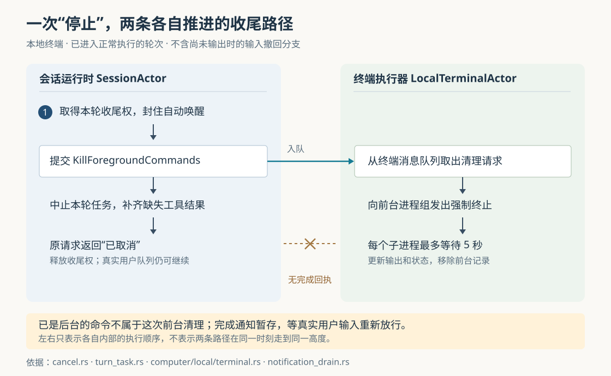

# Grok Build 按下停止后，为什么还有任务在跑：轮次取消、命令存活与自动唤醒

假设 Grok Build 正在运行一组测试，先前启动的开发服务器还在后台，你又排队提交了一条“接着检查登录逻辑”的请求。此时点击停止，会发生什么？当前测试会被要求终止，开发服务器可能继续运行，排队的检查请求也仍可能开始执行。若换成“立即发送”一条新消息，当前测试甚至可能被转到后台继续跑。

这是假设场景，不是本次实测。它揭示了本篇要回答的问题：**停止的是一次模型工作轮次、一个操作系统进程，还是以后自动开始工作的机会？** Grok Build 分别管理这些对象，因此不能从一个“已取消”状态推导出全部工作已经结束。理解这种分工，既能解释实际操作的边界，也能看出编码 Agent——能调用工具持续推进任务的程序——为什么需要比取消一个网络请求更复杂的收尾机制。

本文依据 `input/repository/` 当前源码，结合两篇历史研报继续深入。此前已讨论总体架构和对话回退，本篇聚焦已经进入执行阶段的正常停止，不重述 `/undo` 的历史恢复算法。本次只读源码、测试和随附文档，没有安装依赖、构建项目、启动服务或运行仓库测试；下文的测试结论均指读到的断言。

**先看用户能得到什么结果。** 在本地终端路径中，普通停止、立即发送和会话关闭使用不同策略。下文的普通停止指携带用户停止原因的操作，例如点击停止，不包括无触发原因的程序调用和尚无输出时的输入撤回。这里的“前台”指工具调用仍在等待命令结果，“后台”指运行时已经将它登记为可独立查询的任务，并不等于窗口是否可见。

| 操作 | 正在等待的前台命令 | 已登记的后台命令 | 后续输入与自动唤醒 |
| --- | --- | --- | --- |
| 普通停止当前轮次 | 提交终止请求 | 不设置批量清理后台任务的标志；子 Agent 的清理另有影响 | 保留真实用户队列，抑制任务完成等通知自动开新轮次 |
| 立即发送新消息 | 尝试转入后台；失败或不支持时退回终止路径 | 保留 | 继续处理新输入，不建立普通停止的唤醒屏障 |
| `ShutdownKind::CancelRunningTurn` 关闭路径 | 请求终止 | 显式要求清理 | 清理待处理输入及通知；进程退出另有兜底 |

这些差异直接来自 `CancelOptions` 的字段和调用方，而不是界面文案：普通 ACP 取消不设置 `kill_background_tasks`；内部立即发送使用 `SendNow`；上述关闭分支则同时设置 `cancel_subagents: true` 和 `kill_background_tasks: true`。ACP 是 Agent Client Protocol，即界面与 Agent 交换会话请求和执行状态的协议。其他关闭方式还可能经过进程作用域清理，不能把表中第三行当作唯一关闭入口。[取消参数][commands]、[ACP 入口][acp-agent]、[会话消息循环][run-loop]、[取消实现][cancel]

**界面发出了停止，不代表进程已经退出。** 真实调用链从终端文本交互界面开始：`dispatch_cancel_turn` 决定是否连同子 Agent 一起停止，生成 `Effect::CancelTurn`；`send_cancel` 把这些选择放进 `session/cancel` 通知。服务端 `MvpAgent::cancel` 将其转换成 `SessionCommand::Cancel`，会话消息循环随后调用 `SessionActor::cancel_running_task`。[界面分派][ui-turn]、[通知发送][effects]、[ACP 入口][acp-agent]、[会话消息循环][run-loop]

这里有两次容易混淆的完成。`MvpAgent::cancel` 把消息送入会话通道后就可以返回；会话真正收尾时，还要让原来的用户请求以 `StopReason::Cancelled`（已取消）结束，并发送轮次完成状态。测试旁的说明也指出，界面取消中的等待状态依赖原请求的结束。因而，“取消通知已送达”和“原轮次已结束”已经是两个不同节点。[取消入口][acp-agent]、[轮次收尾][cancel]、[取消测试][cancel-tests]

再往下，还有第三个节点：操作系统中的子进程退出。会话通过工具桥调用 `kill_foreground_commands`；本地终端后端的方法只是把 `KillForegroundCommands` 放入自己的消息队列。这个消息没有结果回执，也没有等待终止完成的接收端。会话可以继续中止本轮任务、修补对话、返回取消结果；终端执行器则另行取出消息清理进程。[工具桥][bridge]、[终端后端][terminal]

图中两条路径各自向下推进，左右位置不表示精确时间。**从实现可以推出：原轮次返回取消，不是“全部子进程已退出”的同步保证。** 这不表示清理没有发生，而是调用契约没有提供这样的完成屏障。

**为什么还需要“取得本轮收尾权”？** 假设停止消息到达时，模型恰好已经完成，正常完成事件也在路上。若两条路径各自删除队首、清空任务并启动下一条请求，旧轮次就可能错误地清掉新轮次。

`turn_task.rs` 用 `FinalizationGate` 保证同一时刻只有一条路径持有收尾资格，资格对象叫 `FinalizationLease`。正常完成和普通取消都必须先申请它。绑定不仅包含请求编号 `prompt_id`，还包含轮次代次 `epoch` 和本次任务实例的身份；源码使用指针身份区分实例，即使编号和代次复用，也不能冒认同一任务。启动队列中的下一轮之前，运行时还会检查收尾资格是否已经释放。[收尾资格与任务身份][turn-task]、[队列启动][notification-drain]

正常完成处理器 `handle_completion` 若申请失败，就把消息当作迟到结果丢弃，不再清理当前任务。测试 `stale_completion_does_not_clear_promoted_turns_running_task` 构造“旧任务完成消息到达、新任务已经成为队首”的情况，断言新任务和它的请求响应都不受影响。另一个测试故意丢弃未完成的收尾资格，要求后续任务仍不能启动。后者体现了一个可见的取舍：异常收尾宁可阻挡推进，也不悄悄放开并发；这不是对生产环境发生频率的判断。[正常完成处理][turn-end]、[队列竞态测试][queue-tests]

**取消模型请求，还要同时阻止迟到内容写回当前会话。** `AgentTask::abort` 中止的是承载本轮工作的异步任务。模型请求由另一个采样执行器管理；这里“采样”指向模型服务请求下一段回答。`SamplerHandle::submit_and_collect_with_metadata` 在等待结果时持有 `CancelOnDrop`：等待对象被丢弃，就发送带请求编号的 `SamplerCommand::Cancel`。采样执行器据此移除活跃请求并触发取消令牌，让请求任务停止继续处理。[轮次任务][turn-task]、[采样请求句柄][sampler-handle]、[采样状态][sampler-state]

取消信号传播需要时间，之前发出的回答片段也可能已经排队。会话因此另有一层接收检查：`cancel_active_sampling_requests` 清除当前请求的事件处理归属；`handle_sampling_event` 收到普通迟到事件时，发现该请求已不再归当前轮次，就直接返回。后台工具结束和待处理图片清理保留了专门分支，所以不能笼统理解为“丢掉所有旧事件”。[请求归属清理][image-strip]、[模型事件接收][sampling-events]

测试 `cancel_propagates_to_sampler_handle_so_no_further_emission` 使用本地模拟模型服务，先发送一个回答片段，再保持连接未结束；取消轮次后，断言请求最终不再处于采样执行器的活跃集合。这支持的是客户端取消传播的契约，不能证明远端模型服务已在同一时刻停止计算或计费。本次也没有运行这项测试。[取消传播测试][cancel-tests]

**终端命令由独立执行器持有，所以停止等待不等于杀掉命令。** Bash 工具将命令、工作目录、输出文件、工具调用编号和所属会话等信息组成 `TerminalRunRequest`，交给终端后端。`LocalTerminalActor` 保存实际子进程和状态；工具调用等待的是回复通道。即使本轮等待被中止，执行器仍可能持有正在运行的进程。这正是必须显式发送清理消息的原因。[Bash 执行入口][bash]、[终端执行器][terminal]

普通停止的前台清理使用强制终止。执行器筛出仍在运行且尚未转入后台的进程，调用 `send_sigkill_to_group`，再对每个直接子进程最多等待五秒，整理输出、通知等待者并移除前台记录。Unix 下，进程组让一次信号可以覆盖同组的命令解释器（shell，负责解释和执行命令的程序）及其后代；Windows 下对应进程作业对象。直接子进程的 `start_kill` 还作为补充调用。[前台清理][terminal]、[跨平台进程组][tty]

这与显式结束后台任务的路径不同：`kill_and_finalize` 先尝试温和终止，超时后再强制终止。不能看到后台任务文档写了“先 SIGTERM、后 SIGKILL”，就认为普通停止前台命令也执行同样流程；SIGTERM 是请求进程退出的信号，SIGKILL 是强制终止信号。[两类终止实现][terminal]、[后台任务指南][background-guide]

这套清理也有明确边界：前台分支没有把发信号或等待失败向会话返回成错误；等待超时后仍会继续收尾。源码还明确考虑过后代脱离进程组并继续持有输出管道的情况。因而，它提供的是针对所管理进程的清理机制，不能解释成任意后代都已被证明消失。已经写出的文件、已提交的外部请求，也没有在取消函数中自动恢复。[取消与终端清理][cancel]、[进程清理细节][terminal]

**立即发送的目标是接管对话，所以优先保住正在做的工作。** `cancel_turn_for_send_now` 复用轮次取消，但使用内部 `SendNow` 触发原因。取消实现跳过普通前台终止，在中止旧轮次后调用 `background_foreground_commands_for_send_now`。终端执行器只选中属于当前会话的前台命令，将它们标记为后台任务，并改用工具调用编号作为查询键；同一个进程继续运行，没有重新执行命令。[立即发送与取消][cancel]、[前后台转换][terminal]

会话还会给相应工具调用补一条结果，说明命令仍在运行，并提供后续查询所需的任务编号。这样，新一轮模型有机会继续跟踪原任务，而不是因为旧调用没返回就再启动一次。`test_background_foreground_commands_keeps_process_alive` 构造运行中的命令，断言转入后台后仍未完成，且能用原工具调用编号查询。这项测试检查的是终端转换方法，并不等于覆盖了完整界面链路。[转换实现与测试][terminal]

若转换返回空列表，会话退回前台终止路径。空列表可能表示已经没有命令，也可能表示后端不支持转换；`TerminalBackend` 接口的默认实现就是返回空列表，部分清理方法的默认实现也为空。因此，上述进程行为应限定在已经核验的本地后端，不能直接推广到编辑器或自定义后端。[转换失败分支][cancel]、[终端接口默认实现][terminal-types]

**保住任务之后，还要防止它违背停止意图，把模型重新叫醒。** 后台命令结束不仅更新界面，还可能生成一条合成输入，让模型继续处理结果。普通停止如果只中止当前任务，稍后到达的“测试完成”消息就可能立刻启动另一轮。

为此，普通停止会同时设置 `task_wake_suppressed` 和 `notifications_suppressed`：前者供工具侧判断是否可以唤醒，后者阻止会话把待处理通知排成新轮次。代码在进入后续异步清理前建立屏障，并清掉可能在轮次间夹带的待注入消息；已排队的 `TaskCompleted`、`WorkflowCompleted` 自动轮次也会被移除。有补送材料的任务完成消息会转回待处理通知，留给后续真实输入消费。这个选择取决于触发原因，不能仅凭调用了 `session/cancel` 推断：没有 `cancelTrigger` 的程序调用不会建立该屏障，对应测试明确区分了这种情况。[停止屏障][cancel]、[取消入口处理][run-loop]、[通知暂存与消费][notification-drain]、[触发原因测试][cancel-tests]

真实用户队列则继续保留。收尾结束后，消息循环仍调用 `maybe_start_running_task`；若队首是此前排队的真实请求，它可以直接成为下一轮，并清除唤醒抑制。新到达的真实输入也会清除屏障。开始处理用户请求时，`consume_deferred_completions_for_user_turn` 将暂存完成信息补入模型上下文，也就是下一次交给模型的材料。[队列推进与屏障解除][notification-drain]、[真实输入接收][run-loop]、[用户轮次开始][turn]

这解释了开头的现象：**停止约束的是自动续跑，不是清空用户明确排好的工作。** 测试 `interactive_cancel_drops_queued_task_wakes_and_promotes_user` 检查了自动完成轮次被移除、真实用户请求保留、补送材料在用户轮次消费后不再重复出现。暂存也不是无限可靠的消息队列：待处理通知上限为五十条，超过后丢弃最旧项。[取消边界测试][cancel-tests]、[通知容量限制][notification-drain]

**子 Agent 又有自己的取消范围。** 界面可以根据设置或选择，决定是否同时停止子 Agent。选择停止时，`cancel_all_session_subagents` 发送绑定会话编号的取消消息；协调器 `cancel_parent_session` 会处理该会话的非工作流子任务，包括前几轮留下的后台子任务，并关闭普通子任务创建入口，拒绝迟到的创建请求。下一轮可以重新开放入口。这里的“工作流”指由单独流程运行拥有的任务；代码明确将它们排除在这次会话级停止之外，并提供独立的工作流取消目标。[界面选择][ui-turn]、[子任务取消发起][cancel]、[子任务协调器][coordinator]、[创建入口检查][coordinator-spawn]

选择让子 Agent 继续时，运行时会尝试将本轮正在前台等待的子 Agent 交接为后台任务，并在工具结果中提供继续查询的信息；交接等待设有超时，失败时保留通用的中断结果。还应注意范围并非完全对称：根会话清理前台命令时调用共享后端的全部前台清理接口，子会话则按所属会话过滤。因此，“保留子 Agent”不能直接推导出它正在执行的每一个前台 shell 命令都保证存活。[子 Agent 交接][handoff]、[前台清理范围][cancel]、[所属会话过滤][terminal]

这里还有一个与恢复有关的细节。中断可能留下“模型提出了工具调用，却没有对应工具结果”的对话尾部。`repair_dangling_after_harness_halt` 会补齐这些缺口，并移除已经无法继续执行的续写提醒；交接成功的子任务可以得到具体后台状态，其他缺口使用合成中断结果。**合成结果修补的是对话协议，不是工具副作用的证明。** 其通用文本甚至包含“未执行”的说法，但不能据此判断一个已启动的命令没有写过文件。[中断后的修补][chat-mutations]、[合成结果文本][conversation]

**关闭会话或退出程序，还有比消息队列更外层的进程清理。** 本地终端把启动的进程组登记到 `ProcessScope`，即一组可从外部统一终止的进程句柄；可选的会话作用域之外，还有进程全局作用域。`take_session` 取走驻留会话时会调用其作用域的 `kill_all`；正常终端界面退出和信号退出路径也调用全局 `kill_all`。这样，即使工作线程卡住、来不及消费正常关闭消息，外层仍有机会发出终止信号。[进程登记][terminal]、[会话移除][session-lifecycle]、[进程作用域][process-scope]、[界面退出][pager-app]、[信号退出][signal-handler]

作用域保存弱引用：启动位置持有进程组时，它才仍然有效；已回收的进程组不会仅因旧编号仍留在集合里，就被再次发信号。这用于防止误杀被操作系统复用的进程编号。`kill_all` 还把作用域标为关闭，之后才登记进来的进程组会立即被要求终止，封住关闭与创建并发的漏洞。不过，这个外层接口不负责等待子进程回收，模块说明也保留了线程卡死时僵尸进程的残余情况。[作用域实现与边界][process-scope]

测试从不同层面表达了这些约定：会话作用域测试断言关闭一个独立作用域不会终止另一个作用域的进程；终端测试检查按所属会话清理不会碰其他所有者；伪终端端到端测试则启动实际界面和后台命令，再通过信号退出检查进程是否消失。最后一项被标记为默认忽略，需要专门运行。本次只阅读了这些测试，不能据此宣称各平台均已验证通过。[会话清理测试][scope-tests]、[终端所属范围测试][terminal]、[退出端到端测试][exit-test]

对使用者而言，最有用的操作判断是：想中止当前推理，使用停止；想让新要求马上接管、同时尽量保留命令，用立即发送；想确保某个后台工作不再运行，应针对具体任务执行终止，并检查它的最终状态。存在用户队列、子 Agent 或工作流时，还要分别确认它们的安排。当前快捷键指南明确说明 Esc 不取消运行轮次，不能从运行时仍支持名为 `Esc` 的触发原因，反推界面按键行为。[快捷键指南][shortcuts]、[后台任务指南][background-guide]

对实现类似系统的人，这份源码给出的可迁移思路是：先明确工作由谁持有，再分别设计轮次收尾、进程终止和自动唤醒的契约；用任务身份拒绝迟到结果，用独立作用域补上线程失效后的清理。代价也很具体：状态更多，取消完成存在层次差异，保留后台任务就必须提供后续查询和通知管理。对于外部服务的撤销、所有后端的终止语义，以及脱离所管理进程组的工作，本次源码追踪没有给出统一保证。

[commands]: https://github.com/xai-org/grok-build/blob/2bdd1d6a6369de0e8c68132ea4539e9abd9e14a8/crates/codegen/xai-grok-shell/src/session/commands.rs
[acp-agent]: https://github.com/xai-org/grok-build/blob/2bdd1d6a6369de0e8c68132ea4539e9abd9e14a8/crates/codegen/xai-grok-shell/src/agent/mvp_agent/acp_agent.rs
[run-loop]: https://github.com/xai-org/grok-build/blob/2bdd1d6a6369de0e8c68132ea4539e9abd9e14a8/crates/codegen/xai-grok-shell/src/session/acp_session_impl/run_loop.rs
[cancel]: https://github.com/xai-org/grok-build/blob/2bdd1d6a6369de0e8c68132ea4539e9abd9e14a8/crates/codegen/xai-grok-shell/src/session/acp_session_impl/cancel.rs
[ui-turn]: https://github.com/xai-org/grok-build/blob/2bdd1d6a6369de0e8c68132ea4539e9abd9e14a8/crates/codegen/xai-grok-pager/src/app/dispatch/turn.rs
[effects]: https://github.com/xai-org/grok-build/blob/2bdd1d6a6369de0e8c68132ea4539e9abd9e14a8/crates/codegen/xai-grok-pager/src/app/effects/mod.rs
[cancel-tests]: https://github.com/xai-org/grok-build/blob/2bdd1d6a6369de0e8c68132ea4539e9abd9e14a8/crates/codegen/xai-grok-shell/src/session/acp_session_tests/cancel_running_task_tests.rs
[bridge]: https://github.com/xai-org/grok-build/blob/2bdd1d6a6369de0e8c68132ea4539e9abd9e14a8/crates/codegen/xai-grok-tools/src/bridge.rs
[terminal]: https://github.com/xai-org/grok-build/blob/2bdd1d6a6369de0e8c68132ea4539e9abd9e14a8/crates/codegen/xai-grok-tools/src/computer/local/terminal.rs
[turn-task]: https://github.com/xai-org/grok-build/blob/2bdd1d6a6369de0e8c68132ea4539e9abd9e14a8/crates/codegen/xai-grok-shell/src/session/acp_session_impl/turn_task.rs
[notification-drain]: https://github.com/xai-org/grok-build/blob/2bdd1d6a6369de0e8c68132ea4539e9abd9e14a8/crates/codegen/xai-grok-shell/src/session/acp_session_impl/notification_drain.rs
[turn-end]: https://github.com/xai-org/grok-build/blob/2bdd1d6a6369de0e8c68132ea4539e9abd9e14a8/crates/codegen/xai-grok-shell/src/session/acp_session_impl/turn_end.rs
[queue-tests]: https://github.com/xai-org/grok-build/blob/2bdd1d6a6369de0e8c68132ea4539e9abd9e14a8/crates/codegen/xai-grok-shell/src/session/acp_session_tests/prompt_queue_actor_tests.rs
[sampler-handle]: https://github.com/xai-org/grok-build/blob/2bdd1d6a6369de0e8c68132ea4539e9abd9e14a8/crates/codegen/xai-grok-sampler/src/handle.rs
[sampler-state]: https://github.com/xai-org/grok-build/blob/2bdd1d6a6369de0e8c68132ea4539e9abd9e14a8/crates/codegen/xai-grok-sampler/src/actor/state.rs
[image-strip]: https://github.com/xai-org/grok-build/blob/2bdd1d6a6369de0e8c68132ea4539e9abd9e14a8/crates/codegen/xai-grok-shell/src/session/acp_session_impl/image_strip.rs
[sampling-events]: https://github.com/xai-org/grok-build/blob/2bdd1d6a6369de0e8c68132ea4539e9abd9e14a8/crates/codegen/xai-grok-shell/src/session/acp_session_impl/sampling_events.rs
[bash]: https://github.com/xai-org/grok-build/blob/2bdd1d6a6369de0e8c68132ea4539e9abd9e14a8/crates/codegen/xai-grok-tools/src/implementations/grok_build/bash/mod.rs
[tty]: https://github.com/xai-org/grok-build/blob/2bdd1d6a6369de0e8c68132ea4539e9abd9e14a8/crates/codegen/xai-tty-utils/src/lib.rs
[background-guide]: https://github.com/xai-org/grok-build/blob/2bdd1d6a6369de0e8c68132ea4539e9abd9e14a8/crates/codegen/xai-grok-pager/docs/user-guide/20-background-tasks.md
[terminal-types]: https://github.com/xai-org/grok-build/blob/2bdd1d6a6369de0e8c68132ea4539e9abd9e14a8/crates/codegen/xai-grok-tools/src/computer/types.rs
[turn]: https://github.com/xai-org/grok-build/blob/2bdd1d6a6369de0e8c68132ea4539e9abd9e14a8/crates/codegen/xai-grok-shell/src/session/acp_session_impl/turn.rs
[coordinator]: https://github.com/xai-org/grok-build/blob/2bdd1d6a6369de0e8c68132ea4539e9abd9e14a8/crates/codegen/xai-grok-tools/src/implementations/grok_build/task/coordinator.rs
[coordinator-spawn]: https://github.com/xai-org/grok-build/blob/2bdd1d6a6369de0e8c68132ea4539e9abd9e14a8/crates/codegen/xai-grok-tools/src/implementations/grok_build/task/coordinator/spawn.rs
[handoff]: https://github.com/xai-org/grok-build/blob/2bdd1d6a6369de0e8c68132ea4539e9abd9e14a8/crates/codegen/xai-grok-shell/src/session/acp_session_impl/subagent_handoff.rs
[chat-mutations]: https://github.com/xai-org/grok-build/blob/2bdd1d6a6369de0e8c68132ea4539e9abd9e14a8/crates/codegen/xai-chat-state/src/actor/mutations.rs
[conversation]: https://github.com/xai-org/grok-build/blob/2bdd1d6a6369de0e8c68132ea4539e9abd9e14a8/crates/codegen/xai-grok-sampling-types/src/conversation.rs
[session-lifecycle]: https://github.com/xai-org/grok-build/blob/2bdd1d6a6369de0e8c68132ea4539e9abd9e14a8/crates/codegen/xai-grok-shell/src/agent/mvp_agent/session_lifecycle.rs
[process-scope]: https://github.com/xai-org/grok-build/blob/2bdd1d6a6369de0e8c68132ea4539e9abd9e14a8/crates/codegen/xai-tty-utils/src/process_scope.rs
[pager-app]: https://github.com/xai-org/grok-build/blob/2bdd1d6a6369de0e8c68132ea4539e9abd9e14a8/crates/codegen/xai-grok-pager/src/app/mod.rs
[signal-handler]: https://github.com/xai-org/grok-build/blob/2bdd1d6a6369de0e8c68132ea4539e9abd9e14a8/crates/codegen/xai-grok-pager/src/app/signal_handler.rs
[scope-tests]: https://github.com/xai-org/grok-build/blob/2bdd1d6a6369de0e8c68132ea4539e9abd9e14a8/crates/codegen/xai-grok-shell/src/agent/mvp_agent/tests/process_scope_reclaim.rs
[exit-test]: https://github.com/xai-org/grok-build/blob/2bdd1d6a6369de0e8c68132ea4539e9abd9e14a8/crates/codegen/xai-grok-pager-pty-harness/tests/pty_e2e/background_task_reaped_on_quit.rs
[shortcuts]: https://github.com/xai-org/grok-build/blob/2bdd1d6a6369de0e8c68132ea4539e9abd9e14a8/crates/codegen/xai-grok-pager/docs/user-guide/03-keyboard-shortcuts.md
