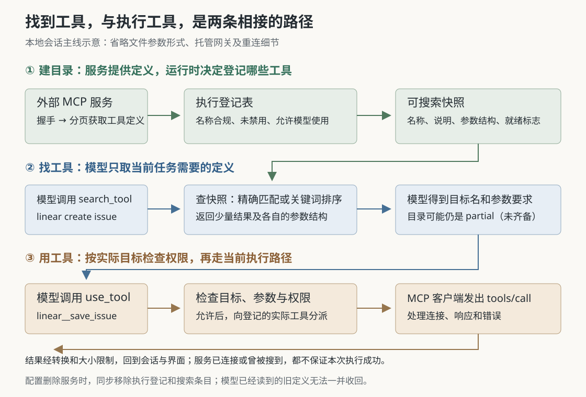

# Grok Build 为什么先搜工具再执行：MCP 目录、权限与真实调用之间的边界

假设你让 Grok Build：“根据这次修复，在 Linear 中创建一条问题记录。”Linear 是管理研发事项的外部服务。即使已经接入它，模型也不一定一开始就收到所有查询、创建、更新工具的说明。当前本地会话采用另一条路径：先搜索相关工具，读到选中工具的名称和参数要求，再提出实际调用；运行时检查权限，才把请求交给对应服务。

这是用于解释源码的假设场景，本次没有连接 Linear。它提出了一个值得深入的问题：**外部工具越来越多、连接又会变化时，怎样让模型找到合适的能力，同时避免把“看见工具”误当成“可以执行”？** Grok Build 把工具发现与工具执行分开，但两者仍需共享一份及时更新的目录。这种分工既减少每次请求携带的工具定义，也带来了搜索遗漏、旧目录和执行失败等边界。

本文依据 `input/repository/` 当前源码，结合三篇已有研报继续研究。此前已覆盖总体架构、对话回退和停止行为，本篇专门追踪 MCP 接入后的发现与调用。MCP 是 Model Context Protocol，即模型应用接入外部工具与资源的协议。本次只读实现、测试和随附文档，没有安装依赖、构建项目、启动服务或运行仓库测试；下文提到测试，均指读到的断言。

**工具已经登记，不代表它的完整定义会出现在模型请求里。** 会话创建时，`spawn.rs` 把 `Bm25ToolSearchIndex` 放进工具桥的共享资源。它读取会话持有的工具元数据快照，供内置的 `search_tool` 使用。工具桥负责统一管理、分派工具调用，而快照保存的是名称、说明、参数结构等可搜索材料。[会话装配][spawn]、[搜索索引][index]

到了真正构造模型请求时，`prepare_tool_definitions_inner` 调用 `tool_definitions_builtins_only`，只取内置工具定义；动态登记的 MCP 工具被排除。模型仍可通过内置的 `search_tool` 搜索、通过 `use_tool` 执行外部工具。对于使用另一种模型请求接口的配置，代码还会把 `use_tool` 的文件参数形式隐藏，只暴露内联参数形式，避免接口不接受相应参数结构而让请求失败。[模型请求准备][sampler]、[工具定义过滤][registry]

这比“所有工具都已经交给模型，只等它挑选”更准确。这里省掉的是随每次请求发送的整套外部工具定义；搜索返回的定义仍会进入对话，运行时也仍需保存完整目录。源码没有提供本次场景的费用、延迟或准确率测量，不能把这种组织方式直接换算成性能收益。



**目录首先来自真实握手和工具枚举，还要经过本地筛选。** 会话消息循环通过启动任务触发 `ensure_mcp_tools_initialized`，后者取得初始化的负责权，创建客户端，再将握手交给 `InitPass` 并发处理。`get_tool_registrations` 内部先完成连接初始化，再循环请求 `tools/list`，按照返回的游标取完各页。这段握手加枚举受到超时预算约束，不能因为服务连接成功后一直不返回工具列表，就无限等下去。[启动入口][run-loop]、[初始化编排][mcp]、[并发握手][init]、[客户端实现][servers]

工具不是原样照收。`McpTool::into_registration` 将服务名与工具名组合成 `server__tool`，例如 `linear__save_issue`。名称必须满足字符规则，分隔位置必须无歧义，组合后也有长度上限。不合规项被跳过并发出登记失败事件。组合名称主要用来路由；它作为 `use_tool` 的参数值传递，因而这里采用的 256 字符目录上限，与提供给模型的函数名所受的 64 字符限制不是同一个限制。[名称准入][names]、[登记生成][servers]

接着，`register_mcp_tool` 检查工具是否被禁用，以及元数据是否允许模型使用。被禁用的定义会暂存，便于重新启用；仅供应用界面使用的工具不会登记到模型工具桥。登记本身还可能失败，例如出现重复名称。因此，**服务报告了多少项工具、界面宣布服务已连接、模型最终能搜索多少项，是不同口径。** `record_connected` 的连接统计使用收到的登记项数量，后续过滤和登记失败仍可能减少可用集合。[登记与连接统计][init]、[登记表实现][registry]

**快服务的工具可以先被搜索到，不必等最慢服务完成。** 每个服务的握手结果提交后，`InitPass` 都会请求刷新快照。刷新任务会合并短时间内重复到达的刷新请求，握手收集过程不用等待每次刷新结束；整个初始化结束前，则要等最后一次刷新完成，随后才发布初始化完成标志并唤醒等待者。[逐服务发布与刷新队列][init]、[快照发布][snapshot]

这使搜索结果可以处于“已有一部分工具，但目录尚未齐备”的状态。`search_tool` 的返回值把它标成 `partial`；初始化结束后标成 `ready`。**这里的 ready 说明初始化流程已收尾，不保证每个服务都成功，更不是每个工具的可用性探测。** 失败的服务也会被计入初始化收尾，搜索快照的完成标志没有表达“全部连接成功”。[搜索响应][search]、[初始化完成发布][snapshot]、[失败记录][init]

这也修正了首篇对两种初始化策略的简化介绍。当前本地模型请求准备路径中，普通 `Blocking` 策略通常只给初始化一个两秒宽限期，超时便继续；同一代配置下，后续请求不会重新支付完整宽限期。`Progressive` 策略不经过这个普通等待分支。不过，若会话声明了 `deliveryTools`，即必须通过指定外部工具交付用户可见结果，两种策略都会选择更完整的初始化等待；该等待另有 120 秒上限及超时记忆。配置代次变化、初始化负责方消失等分支还可能重新安排等待，所以这些常量不能直接当成整个会话启动耗时的保证。[请求侧等待条件][sampler]、[等待预算与代次处理][snapshot]、[交付工具条件][mcp]

测试 `first_prompt_proceeds_at_grace_expiry_not_the_slowest_server` 使用暂停的模拟时钟，检查首次请求在宽限期后推进、后续请求不重新等待、新配置获得新的宽限期；另一项测试检查渐进策略下的交付工具会话仍等待初始化。本次未运行它们，也没有测量实际网络启动时间。[等待行为测试][wait-tests]

**模型怎样从目录里找到具体工具？先尝试精确名称，再做关键词排序。** `Bm25ToolSearchIndex::search_snapshot` 先复制当前快照，避免搜索期间一直持有共享锁。查询若与完整名称或短工具名一致，就直接返回匹配项；否则，用服务名、工具名、说明、参数名组成搜索文档，再用 BM25 排序。BM25 是根据查询词在文档中的出现情况估计相关性的关键词检索方法，这里没有调用另一个模型理解工具语义。[检索实现][index]

代码会拆开下划线、连字符和部分大小写交界，让 `save_issue` 也能按 `save`、`issue` 等词匹配。每次非精确查询都重新建立索引，搜索引擎使用英语语言配置。`search_tool` 默认取五项，按服务分组，返回完整目标名称、截短的说明和输入参数结构。参数结构使用 JSON Schema，即用结构化规则说明哪些字段可传、字段是什么类型。[检索实现][index]、[搜索工具及参数][search]、[搜索输入][search-input]

这套实现适合描述和名称中已有对应关键词的工具集合，但有两个实际边界。其一，代码没有在此处翻译中文查询，也没有证明中文任务能与英语工具说明稳定匹配；使用服务名及明确动作词，是根据检索方式提出的建议。其二，精确匹配短名称用的是“找到第一个就返回”。若两个服务都有 `fetch`，仅搜索 `fetch` 会得到其中一个，甚至不会进入关键词排序。测试 `search_exact_bare_name_ambiguous_returns_first_match` 明确断言只返回快照中的第一项。这不是语义上的“最佳选择”，也不应依赖某个服务永远排在前面；知道完整名称时应使用 `server__tool` 消除歧义。[短名称歧义测试][index-tests]

模型还需要知道何时值得搜索。会话会在合适的请求边界注入外部服务摘要，主要给出服务名、工具数量与说明，不逐项列出所有工具名。默认的增量模式只提示新增、变化或移除的服务；变化检测比较工具数量、服务说明和工具名称集合的指纹，即用于判断内容是否变化的摘要值。[提示编排][mcp]、[摘要与变化检测][search]

这是一种具体取舍：保持 `search_tool` 自身定义稳定，将会变化的目录信息放到提示和搜索结果中。不过，这个变化指纹没有涵盖每项工具的全部参数结构。因此，工具参数改变但数量、名称和服务说明不变时，不能仅靠这份指纹期待一条新的变化提醒。搜索仍会读取当前快照。这是从指纹字段得出的实现边界，不代表本次观察到了某个服务的更新故障。

**搜索不是授权手续，use_tool 也不是绕过权限的入口。** 假设搜索已返回 `linear__save_issue`，模型随后提交如下形状的请求：

```json
{
  "tool_name": "linear__save_issue",
  "tool_input": {"title": "补充日期解析边界测试"}
}
```

这里只示意包装格式，标题字段是否足够，取决于真实服务返回的参数结构。会话的 `prepare_tool_call` 解析包装，取得实际目标名，执行调用前钩子，并按目录中的参数结构进行部分参数修正；随后进入权限流程。权限转换把内联 `UseTool` 映射成 `AccessKind::MCPTool`，其中保存实际的目标名称和输入参数。因此，权限系统可以针对 `linear__save_issue` 判断，而不只是看到通用的 `use_tool`。[调用准备][calls]、[权限输入转换][permission-access]

权限结果可能来自已有规则、自动判断或用户交互；拒绝、取消和用户改发后续要求都有单独分支，不会继续进入正常工具执行。搜到工具不会自动生成允许规则。反过来，源码也没有要求每次执行前必须持有一次搜索产生的凭证：知道名称的调用者可以直接提出调用，最终仍由当前目标、权限与执行路径决定结果。这里的“先搜再用”是能力发现方式，不能当作安全凭证协议。[权限请求与结果分支][calls]、[目标检查与分派][use]

允许后，`UseTool::run` 检查目标是否适合走 MCP 路由，再通过内部调用句柄进入实际登记工具。它绕开外层工具桥互斥锁，避免通用工具在执行中再次请求同一把锁；内部执行也跳过外层已经负责的部分后处理，避免重复处理一次结果。`McpErasedTool::run` 再从共享会话状态取得目标客户端，发出真正的 `tools/call`。[通用调用工具][use]、[内部执行契约][registry]、[实际客户端调用][servers]

这条路线还有托管网关分支：可搜索目录也可以合并由网关提供的工具条目，通过目录保存的调用标识交给网关客户端。若它与本地 MCP 工具重名，本地分派优先；只有本地报告未找到，或拒绝相应本地标识时，才转向网关。本地工具已经实际执行后返回的其他错误会向上报告，不会偷偷换一个服务重做。本篇核实了这处分派，未审计托管网关服务端内部实现。[目录合并][snapshot]、[网关分派与错误边界][use]

**目录变化时，运行时能收回当前登记，收不回模型已经读到的文字。** 假设旧连接还在握手，用户同时禁用了服务。只中止等待是不够的：旧任务稍后返回工具列表，可能把已经删除的服务重新放进目录。

当前实现让每批初始化工作持有 `Generation`，即标识本次服务配置的一代状态。配置变化会取消旧代；异步工作等待时可以响应取消，准备写入时还必须在同一把状态锁下重新确认代次。`record_connected` 把移除旧前缀工具、登记新工具、安装客户端及结束该服务等待状态，放在检查代次后的同一段同步操作里。过期结果不能据此重新登记。[代次实现][generation]、[受条件保护的状态写入][shared-state]、[连接结果提交][init]

正常配置更新采用差异比较：保留配置未变的健康客户端，删除或更换发生变化的客户端。会话再同步移除相关执行登记和搜索快照条目，然后交给新初始化任务处理。`InitPass` 被丢弃时会释放尚未移交给会话的客户端；测试构造了一个握手不返回的服务，修改配置后，断言旧初始化立即结束，其持有的服务进程也被释放。[配置差异处理][servers]、[会话注销与重启初始化][mcp]、[过期初始化测试][wait-tests]

快照刷新也检查代次，并通过独立的刷新锁串行发布，防止较旧刷新晚完成后盖住较新目录。最终初始化完成标志要在最后刷新以后设置。这些措施协调的是运行时当前登记和当前搜索结果；它们不会删除模型历史中已经出现的旧工具名，也不能保证搜索与稍后的调用之间服务一直在线。[快照刷新][snapshot]、[最终发布顺序][init]

这里还需要区分两条入口。若模型直接请求一个 `server__tool`，会话侧的 `mcp_server_dispatchable` 会按该服务的状态提前判断：仍握手或已有普通失败记录时快速拒绝，不等待其他慢服务；需要认证等情况则允许继续分派，以便下层给出具体错误。`use_tool` 包装调用没有走这段直接名称的前置判断，而是在包装解析后，经当前登记表和客户端完成检查及执行。不能把直接调用测试的保证无条件套到包装调用上。[直接入口判断][calls]、[可分派条件][snapshot]、[两种调用准备分支][calls]

**拿到返回值以后，还要区分“协议请求完成”和“业务操作成功”。** 外部服务可以正常返回一条 MCP 响应，同时设置 `isError` 表示工具业务失败。`mcp_output_from_call_result` 将其转换为错误输出；会话再把这类结果送入工具失败钩子，而不是普通成功钩子。正常结果中的文本、图片、资源和结构化内容也有转换规则，并非把原始响应不加处理地交给模型。[结果转换][result]、[会话结果处理][calls]

通用调用返回前还经过 MCP 输出大小限制，避免大段内容直接挤满模型上下文。工具登记表保存实际目标名，会话结果处理优先使用该目标名，便于后续钩子和状态报告识别这次究竟调用了什么；终端界面的 `UseToolCallBlock` 则负责显示服务、动作、参数、输出或错误。这也说明界面负责呈现，实际路由、权限和连接处理都在运行时。[输出大小处理][truncate]、[实际目标名处理][registry]、[结果处理][calls]、[终端显示][ui]

连接错误也不能简单归纳成“失败就安全重试”。`call_tool_round` 遇到超时，会重置部分连接状态供下次使用，但本轮不在该分支立即重发，源码明确考虑了有副作用的工具可能执行两次。相应测试断言一次超时调用只发出一次请求。可是其他传输错误可以进入恢复后重发路径；更外层的 `run` 对带认证客户端的失败还存在重新认证后再次调用分支。因此，不能把前一项测试扩大成“整个调用体系在任何失败下都不会重试”。[调用恢复实现][servers]、[超时分支测试][server-tests]

对于创建问题记录这样的写操作，如果服务已经提交记录、返回途中却断线，客户端未必知道副作用是否发生。本次核验的路径没有提供统一的“只执行一次”保证。服务若支持防重复请求标识，接入时应按其真实参数结构使用；遇到结果不明时，先查询是否已创建，再决定是否重做。这是根据重发边界提出的实践建议，不是对 Linear 具体接口能力的确认。

从这条链路可以得到几项具体的使用和实现判断：

- 搜不到时，先看是 `partial`、目录已完成但为空，还是关键词没有匹配；优先加入服务名和动作词，避免只靠同名短工具名猜测目标。
- 搜到了仍不能执行时，分别查看工具是否已禁用、权限是否允许、认证和连接是否正常；检索成功只证明某一时刻目录里有这项定义。
- 接入很多外部能力时，可以借鉴“稳定的发现入口、按需返回参数定义、独立执行登记”的分工；同时必须处理目录变化和旧结果，不能只实现一个搜索函数。
- 自动化写操作需要单独设计防重复和结果核对。目录更新、连接恢复与外部系统提交不是同一个事务。

本次确认了本地会话中的初始化、搜索、权限输入、分派和结果转换，也用测试断言交叉核验了宽限期、同名搜索、过期初始化与超时分支。尚未运行跨服务端到端验证，未确认中文检索质量、外部服务防重复能力和所有部署方式的行为。配图已做 XML 与引用检查；当前环境的系统预览与图像转换工具均未能渲染 SVG，未完成实际显示核验。

[spawn]: https://github.com/xai-org/grok-build/blob/2bdd1d6a6369de0e8c68132ea4539e9abd9e14a8/crates/codegen/xai-grok-shell/src/session/acp_session_impl/spawn.rs
[index]: https://github.com/xai-org/grok-build/blob/2bdd1d6a6369de0e8c68132ea4539e9abd9e14a8/crates/codegen/xai-grok-shell/src/session/tool_index.rs
[sampler]: https://github.com/xai-org/grok-build/blob/2bdd1d6a6369de0e8c68132ea4539e9abd9e14a8/crates/codegen/xai-grok-shell/src/session/acp_session_impl/sampler_turn.rs
[registry]: https://github.com/xai-org/grok-build/blob/2bdd1d6a6369de0e8c68132ea4539e9abd9e14a8/crates/codegen/xai-grok-tools/src/registry/types.rs
[run-loop]: https://github.com/xai-org/grok-build/blob/2bdd1d6a6369de0e8c68132ea4539e9abd9e14a8/crates/codegen/xai-grok-shell/src/session/acp_session_impl/run_loop.rs
[mcp]: https://github.com/xai-org/grok-build/blob/2bdd1d6a6369de0e8c68132ea4539e9abd9e14a8/crates/codegen/xai-grok-shell/src/session/acp_session_impl/mcp.rs
[init]: https://github.com/xai-org/grok-build/blob/2bdd1d6a6369de0e8c68132ea4539e9abd9e14a8/crates/codegen/xai-grok-shell/src/session/acp_session_impl/mcp_init.rs
[servers]: https://github.com/xai-org/grok-build/blob/2bdd1d6a6369de0e8c68132ea4539e9abd9e14a8/crates/codegen/xai-grok-mcp/src/servers.rs
[names]: https://github.com/xai-org/grok-build/blob/2bdd1d6a6369de0e8c68132ea4539e9abd9e14a8/crates/codegen/xai-grok-mcp/src/tool_name.rs
[snapshot]: https://github.com/xai-org/grok-build/blob/2bdd1d6a6369de0e8c68132ea4539e9abd9e14a8/crates/codegen/xai-grok-shell/src/session/acp_session_impl/mcp_snapshot.rs
[search]: https://github.com/xai-org/grok-build/blob/2bdd1d6a6369de0e8c68132ea4539e9abd9e14a8/crates/codegen/xai-grok-tools/src/implementations/search_tool/mod.rs
[search-input]: https://github.com/xai-org/grok-build/blob/2bdd1d6a6369de0e8c68132ea4539e9abd9e14a8/crates/codegen/xai-grok-tools/src/implementations/search_tool/types.rs
[wait-tests]: https://github.com/xai-org/grok-build/blob/2bdd1d6a6369de0e8c68132ea4539e9abd9e14a8/crates/codegen/xai-grok-shell/src/session/acp_session_tests/wait_for_mcp_prefix_tests.rs
[index-tests]: https://github.com/xai-org/grok-build/blob/2bdd1d6a6369de0e8c68132ea4539e9abd9e14a8/crates/codegen/xai-grok-shell/src/session/tool_index_tests.rs
[calls]: https://github.com/xai-org/grok-build/blob/2bdd1d6a6369de0e8c68132ea4539e9abd9e14a8/crates/codegen/xai-grok-shell/src/session/acp_session_impl/tool_calls.rs
[permission-access]: https://github.com/xai-org/grok-build/blob/2bdd1d6a6369de0e8c68132ea4539e9abd9e14a8/crates/codegen/xai-grok-tools/src/permission_access.rs
[use]: https://github.com/xai-org/grok-build/blob/2bdd1d6a6369de0e8c68132ea4539e9abd9e14a8/crates/codegen/xai-grok-tools/src/implementations/use_tool/mod.rs
[generation]: https://github.com/xai-org/grok-build/blob/2bdd1d6a6369de0e8c68132ea4539e9abd9e14a8/crates/codegen/xai-grok-mcp/src/generation.rs
[shared-state]: https://github.com/xai-org/grok-build/blob/2bdd1d6a6369de0e8c68132ea4539e9abd9e14a8/crates/codegen/xai-grok-mcp/src/shared_mcp_state.rs
[result]: https://github.com/xai-org/grok-build/blob/2bdd1d6a6369de0e8c68132ea4539e9abd9e14a8/crates/codegen/xai-grok-mcp/src/call_result.rs
[truncate]: https://github.com/xai-org/grok-build/blob/2bdd1d6a6369de0e8c68132ea4539e9abd9e14a8/crates/codegen/xai-grok-tools/src/util/mcp_truncate.rs
[ui]: https://github.com/xai-org/grok-build/blob/2bdd1d6a6369de0e8c68132ea4539e9abd9e14a8/crates/codegen/xai-grok-pager/src/scrollback/blocks/tool/use_tool.rs
[server-tests]: https://github.com/xai-org/grok-build/blob/2bdd1d6a6369de0e8c68132ea4539e9abd9e14a8/crates/codegen/xai-grok-mcp/src/servers_tests.rs
