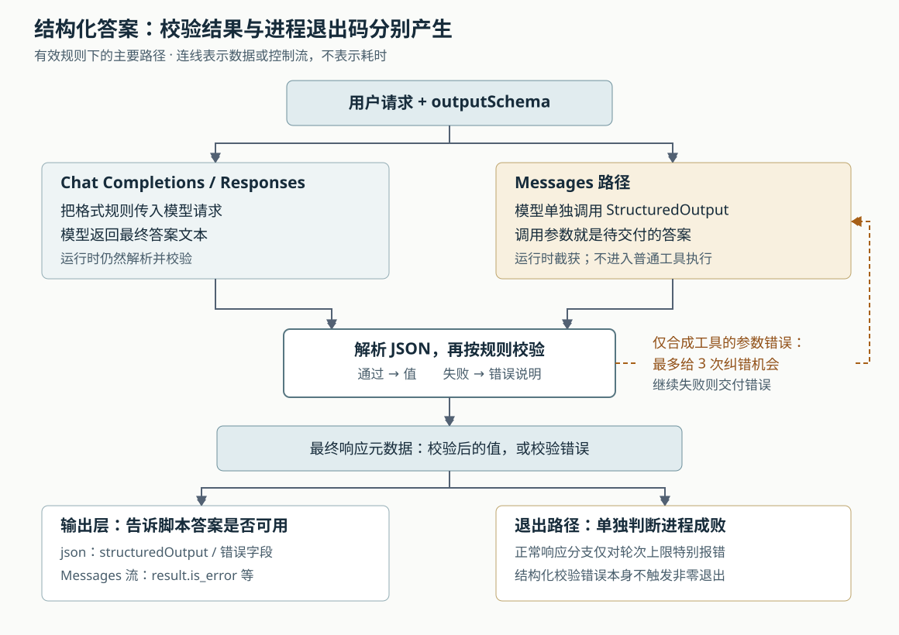

# Grok Build 的无界面输出能证明什么：结构化答案、纠错与退出码

假设你把 Grok Build 接入代码审查脚本，要求它检查修改，返回“是否完成检查”和“发现的问题”。脚本收到了一段 JSON（常用的结构化数据格式），进程也以零退出码结束，于是自动放行。然而，这两个信号仍不足以证明审查完成：JSON 可能只是外层输出格式，里面的答案没有通过格式校验；即使通过校验，也可能只是模型填出了一份结构正确、事实尚未核实的报告。

这是为解释源码构造的场景，本次没有实际执行审查。Grok Build 提供无界面运行入口，让脚本也能使用这套能够调用工具推进任务的程序（Agent）；它也提供结构化答案校验。但当前实现把**请求是否正常返回、答案是否符合格式、任务是否达到要求**分别处理。本文要追清的正是这三件事怎样连接，以及自动化调用者应该检查哪里。

本篇依据 `input/repository/` 当前源码及四篇完整历史研报继续深入。此前已经解释总体架构、回退、停止和外部工具发现，这里集中研究 `grok -p` 的答案交付路径。本次只读源码、测试和随附文档，没有安装项目依赖、构建项目、连接模型或运行仓库测试；文中测试结论均指读到的断言。

**先明确：选择 JSON 输出，与要求模型交付合格的 JSON 答案，是两个设置。** `--output-format json` 决定命令怎样包装结果。`HeadlessEmitter::build_json_result` 把回答放进 `text`，再附上停止原因、会话编号、请求编号等信息。`text` 仍然可以是普通中文，也可以包含执行过程中的说明；这一选项本身没有为答案建立字段约束。[输出实现][headless]

`--json-schema` 才提供答案规则。JSON Schema 是用来描述字段、类型、必填项等约束的规则。例如，可以要求答案必须含有布尔值 `reviewComplete` 和数组 `issues`。命令入口会解析这份规则；如果原本采用默认纯文本输出，就改为 JSON 输出，显式选择的流式格式则保留。[命令入口][entry]、[参数解析][cli]

因此，脚本应当消费专门的 `structuredOutput` 字段，而不是看到外层对象可解析，就认定 `text` 已经符合要求。比如，规则要求 `reviewComplete` 是布尔值，那么 `"reviewComplete": "yes"` 就应被拒绝；但 `"reviewComplete": true` 是否符合实际检查情况，仍不是类型校验能够证明的。

**无界面入口复用了会话运行时，格式校验也发生在运行时。** `run_single_turn` 创建内嵌 Agent，通过 ACP 发送初始化、认证、打开会话和提交请求。ACP 是 Agent Client Protocol，即客户端与 Agent 交换请求和执行状态的协议；这里通过进程内通道使用它，并不要求另起一个远端服务。[无界面装配][headless]

提交时，请求的 `_meta` 附加信息带上 `outputSchema`、`screenMode: "headless"` 和用于关联本次请求的 `promptId`。`MvpAgent::prompt` 取出规则，经会话命令或输入队列传入轮次处理，最终到达 `process_conversation_turn_inner`。这意味着结构化答案不是终端输出层临时从文字中“抠出来”的，编辑器或其他 ACP 客户端也可以通过同一附加字段表达要求。[请求构造][headless]、[Agent 请求入口][acp-agent]、[会话循环][turn]

命令行解析和 ACP 入口都只先检查“规则是可解析的 JSON 对象”。具体规则能否成立，要到会话循环里调用 `jsonschema::validator_for` 编译时才知道。编译结果在本轮复用；后续 `validate_structured_output` 先解析答案，再执行规则校验，分别返回 JSON 语法错误、字段约束错误或规则本身的错误。不能把命令行参数解析成功当成规则已经有效。[参数解析][cli]、[规则编译与校验][turn]



图中画的是有效规则下的主要路径。两条路径共用本地校验，但让模型产生答案的方式不同。

**一种路径是把格式要求直接交给模型接口。** 当前 `ApiBackend::supports_native_schema` 将 Chat Completions 和 Responses 两种模型接口归入这一类。会话把规则写入 `ConversationRequest::json_schema`，接口转换层分别映射到 `response_format` 和 `text.format`，并设置严格模式。模型完成工具工作、返回最终文本以后，运行时仍用本地校验器验证，不仅依赖服务端的约束声明。[接口能力判断][backend]、[Chat Completions 转换][chat-format]、[Responses 转换][responses-format]、[最终答案校验][turn]

这是当前客户端的接口选择策略，不能扩大成任意模型服务都支持所有 JSON Schema 规则。规则是否被具体服务接受、模型是否遵从、远端生成是否正确，本次没有联机验证。客户端能够确认的是：它发出了相应格式要求，并在收到答案后再次检查。

**另一种路径把最终答案包装成一次特殊工具调用。** 对 Messages 接口，当前代码不采用上述原生约束分支。`supports_native_schema` 旁的注释说明，这里的选择是为了避免格式约束妨碍工具使用。尽管通用请求转换代码也能表达 Messages 的格式字段，会话主循环仍显式选择合成工具方案；不能只读到转换器就认定实际请求走了原生约束。[能力选择及其说明][backend]、[实际分支][turn]

运行时向模型提供 `StructuredOutput` 的定义，把答案规则直接作为它的参数结构，同时提醒模型：其他工具用完后，单独调用一次，参数就是最终答案。模型可以先读代码、执行检查，最后提交类似这样的参数：

```json
{"reviewComplete": true, "issues": []}
```

这只是本篇示意，字段是否合格取决于调用者提供的规则。`StructuredOutput` 不会被派发到文件、终端或外部服务。`handle_structured_output_tool_call` 在普通工具执行之前截获它，校验参数，记录一条工具结果，然后决定继续请求模型还是结束本轮。这里借用了模型已有的工具调用能力，构造一个“提交最终答案”的入口。[合成工具定义与截获][turn]

特殊工具必须单独出现。如果模型把它与其他工具放在同一批，运行时给特殊调用补上纠正说明，将它从批次移除，剩余真实工具继续正常处理。即使一批里只有多个 `StructuredOutput`，也不会选一个直接接受。因此，这个约束保证的是答案提交不与同批工具混在一起；它没有把此前或同批的文件修改变成可以整体撤销的事务。[混合调用处理][turn]

**格式不合格时，纠错机会有明确范围。** 对单独提交的 `StructuredOutput`，校验失败后，运行时将具体错误作为工具结果交回模型，要求修正参数并再次调用。计数器初始为零，上限常量为三：前三次失败各给一次继续纠错的机会，之后若仍失败，就携带最后错误结束；在没有其他终止条件介入时，可能出现首次提交加三次重新提交。[纠错分支与常量][turn]

这里有三个不能混为一谈的边界：

- 这段重试专门处理特殊工具的参数校验失败。它不是“所有后端、所有答案错误统一重试三次”；普通最终文本的校验分支没有采用这段重试。
- 模型没有调用特殊工具而直接返回文本时，正常结束分支仍可校验该轮答案文本。它不是无条件拒收所有文本，也没有在这里强制补足一次特殊工具调用。
- 校验重试通过 `continue` 直接回到模型循环，位于普通工具执行后的 `max_turns` 检查之前。因此，`--max-turns` 不能解释成所有模型请求次数的严格上限。这段纠错由自己的计数器约束，实际请求还受其他重试和终止条件影响。[调用顺序与上限位置][turn]

最后一点也解释了为什么 `-p` 的“单次执行”可能包含多次模型请求：单次指提交一条用户任务，运行时内部仍会经历工具往返和纠错。对成本或总时长有硬限制的接入方，应另设对应预算，不能仅按 `--max-turns` 推算总请求数。

**校验结果随最终响应返回，输出层不会重新相信一遍文字。** 会话结束时，`TurnOutcome::Completed` 可以携带 `structured_output: Some(Ok(value))`，也可以携带 `Some(Err(message))`。`build_prompt_response_meta` 将二者分别写成 `structuredOutput` 或 `structuredOutputError`，放进最终 ACP 响应的 `_meta`。[轮次结果][turn]、[响应元数据][response-meta]

这一组织让调用者在原请求返回时拿到校验结论，不必额外等待一条可能迟到的通知。输出层的 `set_structured_output_from_meta` 读取它；如果调用者要求了结构化答案，却没有收到结果或错误，就生成“模型未产生结构化输出”的错误。它不会尝试从已经累计的 `text_buffer` 中再解析一份答案。[结果接收][headless]

测试 `structured_output_without_meta_errors_never_parses_text` 专门构造了“文字缓冲区里已经有合法 JSON，但响应元数据为空”的情况，断言仍报告缺失；另一项测试检查元数据中的答案优先于普通文字。这有实际意义：过程说明和最终答案可以分别处理，输出适配器不会因为某段文字碰巧像 JSON，就把它升级为已验证结果。[输出层测试][headless-tests]

**最容易误判的是：答案校验失败，不一定让进程失败。** `run_single_turn` 收到正常 ACP 响应后，先读取结构化结果，再判断是否带有 `max_turns_reached` 类别。命中轮次上限时，它输出终止结果并返回错误；否则输出结果，返回 `Ok(())`。这一分支没有把 `structuredOutputError`、`refusal` 或普通 `cancelled` 自动转换为进程错误。程序主入口则在最终返回错误时退出为 1。[无界面结果处理][headless]、[程序退出处理][entry]

所以，在没有其他错误或信号介入的情况下，**结构化校验失败可以同时伴随零退出码。** 这不是本次运行观察，而是由“校验错误可以装入正常轮次结果”与“无界面入口没有据此返回错误”两段代码连接得出的结论。

输出格式还会改变错误的表达：

| 输出格式 | 结构化答案失败时怎样表示 | 调用者还要检查什么 |
| --- | --- | --- |
| `json` | `structuredOutput: null`，并带 `structuredOutputError` | 退出码、`stopReason` 和结构化结果字段 |
| `streaming-json` | 最终 `end` 事件带上述字段 | `end` 表示流的终止记录，不能单凭它认定成功 |
| `streaming-messages-json` | 最终 `result` 的 `is_error: true`，带 `errors`，不提供成功答案 | 按该格式检查 `is_error`、`stop_reason` 和 `structured_output` |

前两种格式由 `attach_structured_output` 统一补字段；第三种由 `MessagesReducer::finish` 转换。一个尤其需要谨慎解释的标签是 `error_max_structured_output_retries`：Messages 输出适配器可以把收到的结构化错误映射成它，即使错误来自没有经历上述重试的普通文本校验。**标签说明输出被判为错误，不证明恰好执行过多少次纠错。** 对应测试直接输入一条结构化错误，便断言出现这一标签。[字段附加][reducers]、[原生流式输出][acp-format]、[Messages 结果转换][messages]、[错误映射测试][messages-tests]

反过来，拿到 `end` 也不保证进程随后为零退出：轮次上限分支先输出结束记录，再返回错误；标准输出写入的非管道关闭错误也会被记录，在收尾时返回。因此，流式消费者既要解析终止记录，也要等待子进程退出。[输出写入与收尾][headless]

**没有人在终端前，并不等于所有工具都会获准执行。** 无界面客户端收到需要人工选择的权限请求时，若未开启自动批准，就返回 `Cancelled`；自动批准模式下则优先选择一次允许，没有可用允许选项时仍取消。已由运行时规则决定的调用不需要走这段客户端应答。工具层收到取消后会生成未执行结果，结束为取消轮次。[无界面权限应答][headless]、[工具取消处理][tool-calls]

这与前面的退出逻辑连起来，会出现另一个脚本必须识别的情况：检查依赖的命令没有执行，本轮以 `cancelled` 返回，而无界面入口并不只因这个停止原因就报进程错误。自动化接入应明确需要哪些工具及允许条件；若需要运行中审批，应使用具备双向交互的 ACP 客户端，不能指望只读标准输出流完成审批。这里不展开权限规则和沙箱的全部优先级，避免把客户端自动应答等同于整个授权系统。

对开头的审查脚本，可以据此建立一套具体的验收顺序。这是根据源码提出的接入建议，不是仓库已经提供的统一验收器：

1. **等待进程结束，保留退出码和完整结果。** 非零退出先按失败处理；有终止事件而进程未结束时，继续等待。
2. **检查停止原因和格式对应的错误字段。** 为本业务明确可接受的停止原因；不能把 `cancelled`、`refusal` 或答案截断直接当成审查完成。Messages 格式还应检查 `is_error`。
3. **只消费校验通过的结构化答案。** 对 `json` 和原生流式格式，要求存在 `structuredOutput` 且没有 `structuredOutputError`；同时按自己要求的顶层类型处理，避免把字段缺失与合法空值混淆。
4. **再核对任务证据。** `reviewComplete: true` 是模型提交的字段；格式校验不会证明它真的读完目标文件、执行过测试或找全问题。需要强保证时，应结合工具记录、实际测试结果、文件差异或独立检查决定是否放行。

从实现思想看，Grok Build 在会话中按接口能力选择“怎样请求模型交付答案”，把“答案是否合格”放在会话运行时，把“怎样呈现”留给输出适配器。这让同一会话机制可以服务不同模型接口和客户端，也让校验结果与过程文字分离。代价是调用方必须理解多层结果：正常响应中可以装着校验错误，不同输出格式又会采用不同错误字段和标签。

本次通过入口、会话循环、特殊工具处理、最终响应和输出适配器核实了上述连接，并阅读了参数透传、JSON 校验、元数据映射和输出转换的测试断言。没有运行完整的模型调用或纠错端到端测试，也没有测量各后端的格式遵从率。配图已完成 XML 检查与实际渲染查看。

[entry]: https://github.com/xai-org/grok-build/blob/2bdd1d6a6369de0e8c68132ea4539e9abd9e14a8/crates/codegen/xai-grok-pager-bin/src/main.rs
[headless]: https://github.com/xai-org/grok-build/blob/2bdd1d6a6369de0e8c68132ea4539e9abd9e14a8/crates/codegen/xai-grok-pager/src/headless.rs
[cli]: https://github.com/xai-org/grok-build/blob/2bdd1d6a6369de0e8c68132ea4539e9abd9e14a8/crates/codegen/xai-grok-pager/src/headless/cli.rs
[acp-agent]: https://github.com/xai-org/grok-build/blob/2bdd1d6a6369de0e8c68132ea4539e9abd9e14a8/crates/codegen/xai-grok-shell/src/agent/mvp_agent/acp_agent.rs
[turn]: https://github.com/xai-org/grok-build/blob/2bdd1d6a6369de0e8c68132ea4539e9abd9e14a8/crates/codegen/xai-grok-shell/src/session/acp_session_impl/turn.rs
[backend]: https://github.com/xai-org/grok-build/blob/2bdd1d6a6369de0e8c68132ea4539e9abd9e14a8/crates/codegen/xai-grok-sampling-types/src/types.rs
[chat-format]: https://github.com/xai-org/grok-build/blob/2bdd1d6a6369de0e8c68132ea4539e9abd9e14a8/crates/codegen/xai-grok-sampling-types/src/conversation/chat_completions.rs
[responses-format]: https://github.com/xai-org/grok-build/blob/2bdd1d6a6369de0e8c68132ea4539e9abd9e14a8/crates/codegen/xai-grok-sampling-types/src/conversation/responses.rs
[response-meta]: https://github.com/xai-org/grok-build/blob/2bdd1d6a6369de0e8c68132ea4539e9abd9e14a8/crates/codegen/xai-grok-shell/src/agent/mvp_agent/mod.rs
[headless-tests]: https://github.com/xai-org/grok-build/blob/2bdd1d6a6369de0e8c68132ea4539e9abd9e14a8/crates/codegen/xai-grok-pager/src/headless_tests.rs
[reducers]: https://github.com/xai-org/grok-build/blob/2bdd1d6a6369de0e8c68132ea4539e9abd9e14a8/crates/codegen/xai-grok-pager/src/headless/reducer/mod.rs
[messages]: https://github.com/xai-org/grok-build/blob/2bdd1d6a6369de0e8c68132ea4539e9abd9e14a8/crates/codegen/xai-grok-pager/src/headless/reducer/messages/mod.rs
[messages-tests]: https://github.com/xai-org/grok-build/blob/2bdd1d6a6369de0e8c68132ea4539e9abd9e14a8/crates/codegen/xai-grok-pager/src/headless/reducer/messages/tests/result_usage.rs
[tool-calls]: https://github.com/xai-org/grok-build/blob/2bdd1d6a6369de0e8c68132ea4539e9abd9e14a8/crates/codegen/xai-grok-shell/src/session/acp_session_impl/tool_calls.rs
[acp-format]: https://github.com/xai-org/grok-build/blob/2bdd1d6a6369de0e8c68132ea4539e9abd9e14a8/crates/codegen/xai-grok-pager/src/headless/reducer/acp.rs
