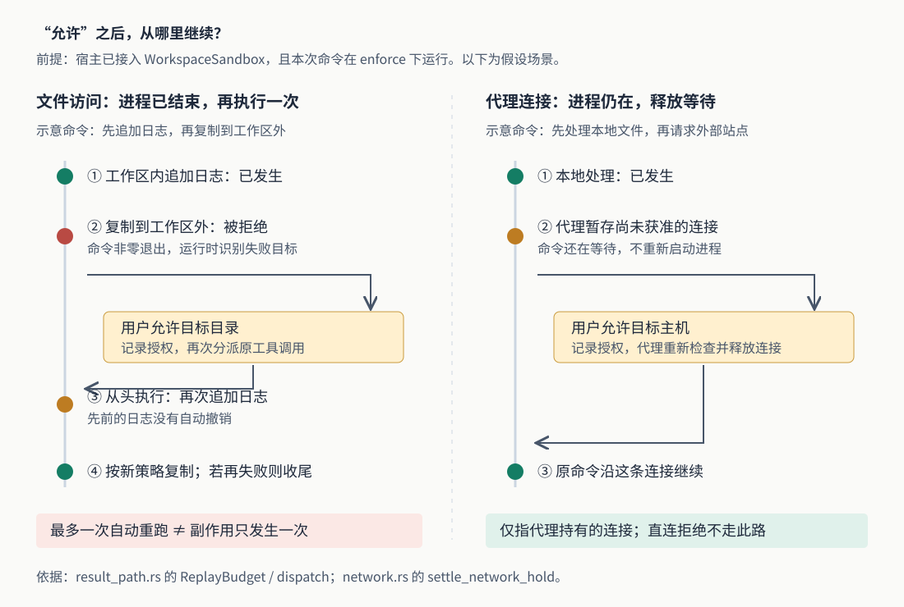

# Grok Build 被沙箱拦下后，为什么“允许”会重跑命令：逐命令隔离的接线与边界

假设一个工具先向工作区内的日志追加“开始导出”，再把文件复制到工作区外。日志写入成功，复制却被沙箱拒绝。用户随后允许访问目标目录，程序应该从复制处继续，还是把整条命令再执行一次？Grok Build 的逐命令沙箱实现选择了后者：记录授权，重新分派原工具调用。因此，日志可能追加两次。

这是解释源码的假设场景，本次没有实际执行。它提出的问题是：**当隔离限制挡住正常开发工作时，怎样扩大必要权限、继续任务，又不把“继续”误当成没有重复副作用？** Grok Build 在工作区层实现了一套按命令构造限制、识别拒绝、向用户请求授权、再执行的机制。它与启动时限制整个进程的沙箱是两条路径，而且本次公开源码并没有证明普通启动已经接入这套逐命令机制。

本文结合五篇已有研报，包括已生成待归档的一篇，继续研究此前只概述过的隔离边界。依据均来自 `input/repository/` 当前快照；没有安装依赖、构建项目、运行仓库测试或验证系统隔离效果。文中的测试结论表示读到了相应断言。

**先确认这套能力在哪里接上，才能讨论它怎样保护命令。** `WorkspaceConfig::sandbox` 是可选字段，保存一个工作区的逐命令沙箱对象 `WorkspaceSandbox`。默认构造器将它设为 `None`；字段注释明确说明，命令行客户端和远端沙箱服务器可以不使用它。独立的 `workspace_server` 入口也显式传入 `sandbox: None`。[工作区配置][config]、[服务器入口][server]

如果宿主程序传入该对象，`build_local_workspace` 才会把同一个启动处理接口交给会话工厂。会话工厂再选择带接口的本地终端后端，并将接口放入工具登记表。这样，工作区保存策略和授权，工具实现负责启动进程，两边通过 `SandboxLaunch::prepare` 连接。[工作区装配][handle]、[会话工具装配][tool-config]

本次检索构造与调用位置，找到 `WorkspaceSandbox::open`、负责启动配套网络代理的 `serve`，以及测试中创建、注入它们的路径；没有找到公开树中正式入口创建并接入该对象的调用。这不证明其他未公开宿主没有使用它，但意味着下文应读作**已实现、可接入的工作区执行链**，不能当成当前普通 `grok` 启动行为。仅设置相关环境变量，也不能替代宿主注入对象。

此前首篇提到的 `--sandbox workspace` 等选项，走的是 `xai-grok-shell::config::apply_sandbox`：在启动阶段施加进程级限制。逐命令机制则在每次启动子进程前包装命令，其自身不会限制宿主进程。两者的后端、配置和网络策略不能相互套用。例如，进程级指南中 macOS 子进程禁网的限制，不能用来判断下文逐命令后端的代理隔离能力。[进程级入口][startup]、[逐命令后端契约][backend]

**接入对象之后，还要分别看模式和当前主机的实现。** 逐命令机制使用 `off`、`observe`、`enforce` 三种模式，默认是 `off`。配置解析优先考虑 `GROK_SANDBOX_MODE` 环境变量、远端下发设置、用户的 `workspaced.toml`；没有前两者决定时，项目内 `.grok/workspaced.toml` 可以提高用户设置的限制级别，不能降低它。[模式解析][mode]

这里有一处必须沿调用方核验的细节：模式类型和底层包装函数的注释把 `observe` 描述为可经代理记录访问；但当前工作区的 `point_at_proxy` 只为 `enforce` 下的工具命令注入代理地址，`finish` 在 `observe` 下也不解析拒绝。接线测试进一步断言：观察模式实际运行命令、不调用隔离包装器，观察摘要为空。因此，**这条工作区命令路径里的 observe 不能被理解成已经完整记录“强制模式将拦截什么”**。[实际启动逻辑][launch]、[结果收尾][sandbox]、[接线测试][wiring-tests]

强制模式也有平台条件。当前逐命令后端只注册了 macOS 的 Seatbelt，即 macOS 提供的进程访问约束机制，通过绝对路径 `/usr/bin/sandbox-exec` 启动。主机探测不只检查文件存在，还尝试用最小规则运行一个无操作程序。[后端选择][detect]

没有后端时，结果还取决于是谁要求强制模式：开发者通过环境变量或自己的配置要求 `enforce`，代码保留该选择，并在准备命令时拒绝运行；如果只是远端统一下发 `enforce`，而用户和项目没有自行要求它，模式解析可以降为 `off`，同时记录降级原因。因此，“强制模式从不降级”不是整个配置体系的准确描述；准确的是：**已经进入强制包装的命令，包装失败不会悄悄改成裸跑。**[模式与主机条件][mode]、[包装执行][backend]

**命令启动之前，运行时把“允许做什么”变成一份具体策略。** `prepare_inner` 取得本次调用的模式、所属会话及仍有效的授权，构造 `SandboxPolicy`。它包含可读范围、可写目录、网络出口、要移除的环境变量，以及始终受保护的路径。工具层不必理解这些规则，只把原程序、参数和工作目录交给启动接口。[命令准备][launch]、[策略结构][policy]

这份策略从工作区可写的基础配置出发，并非照搬本进程选择的任意 `--sandbox` 档位。它再加入当前授权，同时保留不可通过授权开放的限制。例如，运行时控制套接字、信任与配置文件、钩子来源、工作区对应的 Git 敏感位置，以及指定的凭据存储，需要分别避免被命令篡改或读取。钩子是其他程序在特定事件发生时执行的脚本；保护这些位置，是为了防止命令把代码写到以后会在沙箱外执行的地方。[策略构造][policy]、[受保护路径][protected]

这种保护不止检查路径字符串。策略会核对工作区根目录是否仍指向原位置；包装阶段会拒绝无法确认安全的受保护文件硬链接，避免文件通过另一个名字变得可写。Git 元数据读不全、导致无法确认钩子来源时，强制模式也可在启动前拒绝命令。环境过滤则默认移除名称匹配 `*TOKEN*`、`*SECRET*` 等模式的变量，以及部分动态库加载变量。这是按名称过滤的具体规则，不能扩大成“所有秘密都已从环境中识别并清除”。[策略及错误类型][policy]、[启动前核验][backend]

Seatbelt 后端将策略转换成系统规则，并把原命令改为由 `sandbox-exec` 包裹执行。路径通过参数传入，避免路径中的特殊字符被当作规则语法；强制拒绝规则在允许规则之后生成。包装会替换命令对象，所以工具启动点必须在包装之后重新配置输入输出、进程组和退出清理，再真正调用 `spawn()` 创建进程。这里的接口顺序直接关系到日志与取消是否还能正常工作。[系统规则生成][seatbelt-profile]、[包装与启动契约][launch-seam]

**它可以把审批推迟到真正越界时，但不会对所有工具都这样做。** 工作区工具入口 `SessionRoutedToolHandler::handle_call` 先按工具类型、输出形式和模式选择路径。只有处于强制模式、且结果能被拒绝识别器读取的命令工具，才可能用事后的沙箱授权提示替代运行前提示。现有规则明确列出 Grok Build 等工具命名空间；不能读取结果的命令工具仍保留原审批路径。[工作区工具入口][hub]、[路径选择][gate]

即使满足上述条件，也有例外：已经登记的拒绝规则仍可在运行前挡住调用；会话策略若要求 `AlwaysPrompt`，即每次运行前询问，仍然询问；一开始就要求后台运行的命令，在启用运行前审批的宿主上也保留事前审批，因为它通常立即返回“已启动”，没有完整命令结果可供这条识别链读取。[审批顺序][hub-gate]、[后台判断][gate]

这解释了为什么不能概括为“沙箱开启后不再问权限”。更准确的分工是：符合条件的命令可以先在已有资源范围内运行，碰到需要新增授权的资源再问；文件编辑等非命令工具继续走自己的审批。代码还单独阻止文件工具在强制模式下改写模式配置，避免工具自己关掉约束。[工具路径与配置保护][gate]

审批与实际启动之间也可能发生模式变化。入口因此为调用固定模式，`prepare_inner` 使用该调用持有的模式；原本依赖强制隔离而省略了事前审批的调用，若丢失这一固定状态，结果包装层会直接拒绝，不让它按新模式继续启动。这是在防止“批准时有保护、执行时没保护”的异步间隙。[调用模式固定][hub]、[固定状态丢失处理][result-path]

**命令失败后，运行时识别的是可能的沙箱拒绝，而不是重新执行命令里的每一步。** `after_shell_run` 只将 `ToolOutput::Bash` 形式的退出状态和合并输出交给 `WorkspaceSandbox::finish`。后者取出启动时保存的策略、原参数和调用信息，再调用 `decode` 分析失败。[结果链][result-path]、[收尾与识别输入][sandbox]

这套识别有意排除若干情况：未真正受隔离包装的命令不分析；零退出码不分析；126、127 这类常用于不可执行、找不到命令的退出码也不按这里的拒绝处理。即使命令输出含有“Permission denied”，若策略本来允许该目标，代码还会尝试把它识别为普通系统权限等原因，避免把所有访问失败都变成扩权申请。[拒绝识别][violation]

这也带来边界。脚本若吞掉内部失败并最终返回零，识别器不会因此产生授权提示。`Finished::Ran` 表示这条识别路径没有产出可处理的拒绝，不能当成“命令每一步都成功”的证明。它也不是内核访问审计：路径主要从命令输出中提取，而输出本身可以由程序编造。

为降低伪造错误诱导授权的机会，`OwnTargets` 用工作目录、工作区根目录、参数里出现的路径，以及部分环境变量指定的路径构造候选范围。输出提到其他路径时，拒绝可以作为信息展示，但不提出可批准的授权。测试专门构造了运行测试命令却打印无关目录拒绝信息的情况，断言不会生成可授权建议。这个检查仍是受限的文本分析，不是完整理解脚本执行过程；不能把它当成对恶意命令意图的证明。[目标归属判断][attribution]、[识别测试][violation-tests]

**用户点允许以后，必须先成功登记授权，才会重跑。** `settle_violation` 经绑定会话的权限通道发送请求，检查回答允许的目标、范围和期限，再调用 `record_grant`。没有交互通道、回答无法解析、用户取消、授权写入失败，都会保留拒绝，并把说明加回模型可见的工具结果；“界面上点过允许”不能替代运行时成功登记。[授权处理][gate]、[结果说明][result-path]

授权可以只对本次调用有效，也可以覆盖当前会话、工作区或全局。调用与会话授权不写入磁盘，工作区与全局授权可以持久化；有效期按当前时钟判断。仅对本次调用开放时，同样要检查不可授权的受保护范围，不能因为它不落盘就绕过限制。[授权结构][grants]、[授权登记][grant-record]

拒绝与允许冲突时，也不是简单采用最后一条。授权存储的测试说明：较窄的路径拒绝落在较宽的允许目录内时，较宽的允许会整体失效，旁边不冲突的允许仍保留。这样避免宽授权覆盖拒绝，但可能让原本希望继续开放的兄弟目录也需要重新处理。这是实现选择的保守粒度。[授权存储测试][grant-tests]

**文件授权后的“继续”，具体就是再次调用同一工具。** `run_shell_call_with_replay` 保存原分派闭包；收到 `AfterRun::Replay` 后，再执行一次 `dispatch()`，沿用原参数和工具调用编号。它没有暂停在某条系统调用上，也没有在重跑前恢复文件。[重跑实现][result-path]

回到开头的例子：第一次已经追加的日志仍在，第二次从头执行就可能再追加一次；此前成功完成的其他动作同样不能假定已撤销。限制可访问资源，并不会让整条命令变成“要么全部成功、要么完全没发生”的事务。将多个写操作拼成一条长命令时，这个差异尤其重要。

代码用 `ReplayBudget::One` 将这条结果链的自动重跑限制为一次。重跑又遇到拒绝时，授权处理看到它已在授权下重跑，便保留失败，不再发起下一轮授权重跑。若策略认为目标已开放、后端却仍拒绝，还会给出“授权未能应用”的专门说明。这个预算约束的是同一次工具调用的自动重跑，不阻止模型之后提出新的调用，更不保证副作用只发生一次。[重跑预算][result-path]、[再次拒绝处理][gate]、[授权未生效识别][violation]

**网络访问有另一种继续方式，不能套用文件重跑的结论。** 强制模式下，系统网络规则只允许命令连接工作区的本地出口代理；即使授权所有目标主机，开放的也是代理的转发决策，不是把命令的内核网络规则改成任意直连。每次工具命令还会取得用于关联调用的代理凭据，以便代理知道该向哪个会话请求决定。[网络策略][policy]、[代理地址注入][launch]

当代理持有一条尚未获准的连接时，`settle_network_hold` 可以在命令仍运行期间请求授权。获准后，代理重新检查规则并释放原连接，原命令继续等待后的工作，不重新启动。没有对应调用所有者时则拒绝。这条路径在数据上使用 `Replay::Resume`，文件失败后的路径使用 `Replay::Rerun`；二者虽然共用授权处理，实际继续位置不同。[代理中的授权与释放][network]

因此，图右侧只适用于代理确实暂存了连接的情况。程序绕过代理遭到系统拒绝，不等于自动取得一次可恢复的连接；代理启动失败时，强制策略可以保留禁网状态。这里也不能推出程序自身不会重试网络请求，或远端业务只执行一次。

**测试把接线验证得较细，却没有消除实际部署边界。** `real_wiring_tests.rs` 经真实工具入口运行子进程，但需要隔离行为时使用 `StubKernel`：它按策略和命令参数模拟某些拒绝，并非实际 Seatbelt 内核验证。其中的授权重跑测试断言只出现一张授权请求、发生两次受模拟后端检查的执行、第二处拒绝成为最终结果，且本次调用授权不进入持久存储。其他断言覆盖缺少后端不运行、后台请求保留事前审批、模式固定状态丢失时拒绝执行。[接线测试][wiring-tests]

`violation_tests.rs` 检查零退出码被跳过、受保护目标不可授权、无关路径只能展示信息；授权存储测试则检查过期条目立即退出有效集合，但可以留在磁盘上直到下次保存。这些断言支持相应代码契约，本次均未运行。它们不能证明所有 shell、文件系统、系统版本和真实交互界面组合都已验证。[识别测试][violation-tests]、[授权存储测试][grant-tests]

源码还明确接受了一项保护范围限制：Git 敏感位置的保护覆盖工作区自身仓库及其子模块，不全面覆盖工作区里另行创建或克隆的嵌套仓库。注释给出的取舍是，否则每次 `git init`、`git clone` 都可能进入额外审批。这里应保留这项已声明的边界，不能把保护清单解释成所有以后可能在沙箱外执行的代码都已封住；本次没有运行利用场景。[保护范围说明][protected]

实践上，研究或接入这套代码时，应先核对宿主是否注入沙箱对象，再看有效模式、配置来源和实际后端；只读到配置名称不足以确认保护。确实需要授权重跑的任务，适合拆成较小步骤，并让写操作可重复执行而不产生额外结果，例如用覆盖生成的产物代替无条件追加记录。对发布、计费或外部提交等重复执行代价高的动作，应另行核对第一次是否已发生，而不能用“一次自动重跑”推导安全性。

从实现思想看，这套机制把长期运行的控制程序、可变授权和受约束的命令分开，使正常开发动作先在已有范围内执行，需要更多资源时再提出具体请求。代价是必须处理授权所属会话、配置变化、重复执行与拒绝识别的不完整性。当前源码最值得借鉴的是这些明确的连接和失败分支；实际接入状态、平台支持和命令副作用，则始终需要分别确认。

配图已通过 XML 解析与正文引用检查。系统预览工具因沙箱初始化错误无法渲染，当前也没有可用浏览器，因此尚未完成实际显示核验。

[config]: https://github.com/xai-org/grok-build/blob/2bdd1d6a6369de0e8c68132ea4539e9abd9e14a8/crates/codegen/xai-grok-workspace/src/config.rs
[server]: https://github.com/xai-org/grok-build/blob/2bdd1d6a6369de0e8c68132ea4539e9abd9e14a8/crates/codegen/xai-grok-workspace/src/bin/workspace_server.rs
[handle]: https://github.com/xai-org/grok-build/blob/2bdd1d6a6369de0e8c68132ea4539e9abd9e14a8/crates/codegen/xai-grok-workspace/src/handle.rs
[tool-config]: https://github.com/xai-org/grok-build/blob/2bdd1d6a6369de0e8c68132ea4539e9abd9e14a8/crates/codegen/xai-grok-workspace/src/session/tool_config.rs
[startup]: https://github.com/xai-org/grok-build/blob/2bdd1d6a6369de0e8c68132ea4539e9abd9e14a8/crates/codegen/xai-grok-shell/src/config/mod.rs
[mode]: https://github.com/xai-org/grok-build/blob/2bdd1d6a6369de0e8c68132ea4539e9abd9e14a8/crates/codegen/xai-grok-config/src/sandbox_mode.rs
[backend]: https://github.com/xai-org/grok-build/blob/2bdd1d6a6369de0e8c68132ea4539e9abd9e14a8/crates/codegen/xai-grok-sandbox/src/command/backend.rs
[detect]: https://github.com/xai-org/grok-build/blob/2bdd1d6a6369de0e8c68132ea4539e9abd9e14a8/crates/codegen/xai-grok-sandbox/src/command/detect.rs
[launch]: https://github.com/xai-org/grok-build/blob/2bdd1d6a6369de0e8c68132ea4539e9abd9e14a8/crates/codegen/xai-grok-workspace/src/sandbox/launch.rs
[policy]: https://github.com/xai-org/grok-build/blob/2bdd1d6a6369de0e8c68132ea4539e9abd9e14a8/crates/codegen/xai-grok-sandbox/src/command/policy.rs
[protected]: https://github.com/xai-org/grok-build/blob/2bdd1d6a6369de0e8c68132ea4539e9abd9e14a8/crates/codegen/xai-grok-sandbox/src/command/protected.rs
[seatbelt-profile]: https://github.com/xai-org/grok-build/blob/2bdd1d6a6369de0e8c68132ea4539e9abd9e14a8/crates/codegen/xai-grok-sandbox/src/command/backend/seatbelt_profile.rs
[launch-seam]: https://github.com/xai-org/grok-build/blob/2bdd1d6a6369de0e8c68132ea4539e9abd9e14a8/crates/codegen/xai-grok-tools/src/sandbox_launch.rs
[hub]: https://github.com/xai-org/grok-build/blob/2bdd1d6a6369de0e8c68132ea4539e9abd9e14a8/crates/codegen/xai-grok-workspace/src/hub.rs
[hub-gate]: https://github.com/xai-org/grok-build/blob/2bdd1d6a6369de0e8c68132ea4539e9abd9e14a8/crates/codegen/xai-grok-workspace/src/permission/hub_gate.rs
[gate]: https://github.com/xai-org/grok-build/blob/2bdd1d6a6369de0e8c68132ea4539e9abd9e14a8/crates/codegen/xai-grok-workspace/src/permission/sandbox_gate.rs
[result-path]: https://github.com/xai-org/grok-build/blob/2bdd1d6a6369de0e8c68132ea4539e9abd9e14a8/crates/codegen/xai-grok-workspace/src/sandbox/result_path.rs
[sandbox]: https://github.com/xai-org/grok-build/blob/2bdd1d6a6369de0e8c68132ea4539e9abd9e14a8/crates/codegen/xai-grok-workspace/src/sandbox/mod.rs
[violation]: https://github.com/xai-org/grok-build/blob/2bdd1d6a6369de0e8c68132ea4539e9abd9e14a8/crates/codegen/xai-grok-sandbox/src/command/violation.rs
[attribution]: https://github.com/xai-org/grok-build/blob/2bdd1d6a6369de0e8c68132ea4539e9abd9e14a8/crates/codegen/xai-grok-sandbox/src/command/violation/attribute.rs
[grants]: https://github.com/xai-org/grok-build/blob/2bdd1d6a6369de0e8c68132ea4539e9abd9e14a8/crates/codegen/xai-grok-sandbox/src/command/grants.rs
[grant-record]: https://github.com/xai-org/grok-build/blob/2bdd1d6a6369de0e8c68132ea4539e9abd9e14a8/crates/codegen/xai-grok-workspace/src/sandbox/grants.rs
[network]: https://github.com/xai-org/grok-build/blob/2bdd1d6a6369de0e8c68132ea4539e9abd9e14a8/crates/codegen/xai-grok-workspace/src/sandbox/network.rs
[wiring-tests]: https://github.com/xai-org/grok-build/blob/2bdd1d6a6369de0e8c68132ea4539e9abd9e14a8/crates/codegen/xai-grok-workspace/src/sandbox/real_wiring_tests.rs
[violation-tests]: https://github.com/xai-org/grok-build/blob/2bdd1d6a6369de0e8c68132ea4539e9abd9e14a8/crates/codegen/xai-grok-sandbox/src/command/violation_tests.rs
[grant-tests]: https://github.com/xai-org/grok-build/blob/2bdd1d6a6369de0e8c68132ea4539e9abd9e14a8/crates/codegen/xai-grok-sandbox/src/command/grant_store_tests.rs
