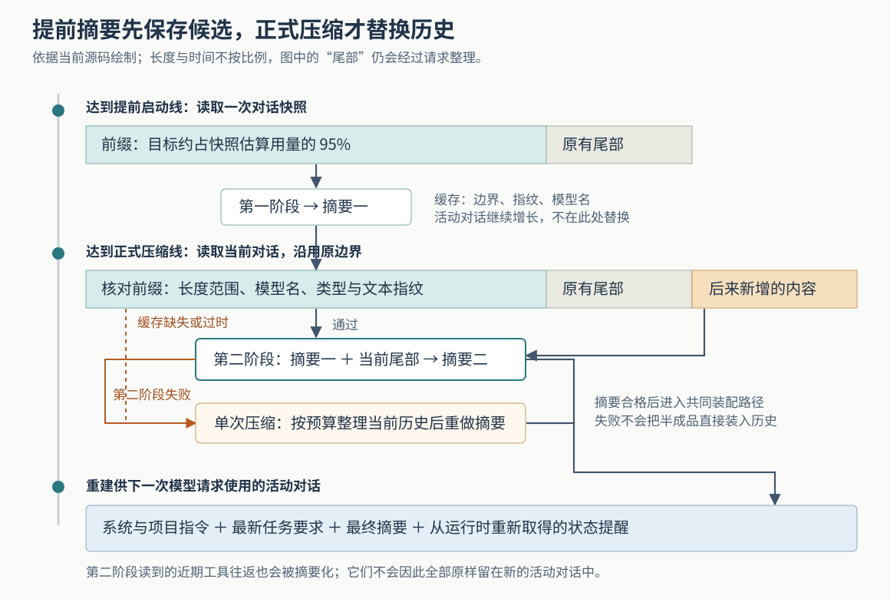

# Grok Build 怎样提前压缩长对话：两阶段摘要、缓存校验与失败退路

假设你让 Grok Build 排查一处解析错误。它已经读了许多文件、运行几轮测试，正在后台整理较早的对话；这时你补充：“先不要继续改代码，解释刚才失败的原因。”如果程序直接用先前的摘要替换全部历史，这条新要求就可能消失。当前实现采用两阶段处理：先提前概括较早的部分，真正需要腾出输入空间时，再把这份摘要和之后的对话一起概括，最后重建供模型继续工作的材料。

这是为解释源码构造的场景，本次没有实际运行。它提出的问题是：**对话仍在增长时，怎样提前做摘要，又避免把不再适用的旧摘要装进当前会话？** Grok Build 用固定边界、缓存检查和失败后的单次压缩路径协调这件事。不过，检查覆盖的字段有限，摘要本身也可能遗漏事实；“缓存可用”与“任务记忆完整”需要分别判断。

本篇依据 `input/repository/` 当前源码，结合六篇历史研报继续深入。此前已经讲过总体链路以及压缩后的回退，这里研究摘要怎样提前生成、何时采用、失败后怎样继续。本次只读实现、测试和随附文档，没有安装依赖、构建项目、连接模型或运行仓库测试；文中的测试结论均指读到的断言。

**程序需要缩短的是下一次交给模型的材料。** 模型一次能处理的输入容量称为上下文窗口，通常用 token 计量；token 是模型处理文本时使用的片段，不与汉字或单词一一对应。工具结果不断加入对话，会逐渐占满窗口。这里的压缩，是让模型生成交接摘要，再用较短的对话替换运行时当前使用的历史，并非无损压缩文件。

决定何时压缩的工作在会话运行时。`turn.rs` 在准备下一次模型请求的循环中，先判断是否应提前启动第一阶段，再检查是否达到正式自动压缩线。`get_estimated_total_tokens` 返回当前记录用量加上最近一次模型计数之后的新增估算；文本估算主要按字节数除以四，图片、工具参数和推理内容另有计算。因此，大段工具输出可以在下一次模型响应之前推动压缩，不必等服务端报错才发现空间不够。[轮次循环][turn]、[计数读取][chat-actor]、[估算规则][token-state]

若一个会话的正式阈值是窗口的 85%，默认提前量为十个百分点，那么估算用量达到 75% 时就有机会启动第一阶段，达到 85% 时进入正式自动压缩。这是解释配置关系的例子，不是所有模型都固定采用这组阈值。提前量由 `prefire_lead_percent` 读取，正式阈值保存在会话配置中。[触发与提前量][compact]

还有一个容易被默认值误导的接线细节：通用的 `CompactionPolicy::default` 将两阶段开关设为关闭，但实际命令行会话会读取 `two_pass_compaction` 功能设置，再显式构造策略；功能登记表中的默认值是开启。判断实际行为，应沿配置解析、`agent_ops.rs` 和 `spawn.rs` 看最终传入的值。当前公开构建中，兼容模板识别函数 `is_cursor_user_template` 固定返回 `false`，也不能把另一兼容分支关闭两阶段的代码当作普通会话的实际选择。[策略默认值][policy]、[功能登记][features]、[会话设置解析][agent-ops]、[策略装配][spawn]、[兼容分支][session-mod]

**第一阶段读快照、存候选摘要，不替换活动对话。** 轮次循环要求两阶段已开启、尚无缓存、达到提前线，并通过 `PrefireState::try_begin` 取得运行资格，才创建后台异步任务。这里的“后台”是同一运行时中独立推进的任务，不是另起一个操作系统进程。已有任务运行时，不再启动第二个并发任务；等候认证恢复等特定停驻状态下，也不会反复启动它。[轮次循环][turn]、[缓存与任务状态][compact-config]

`run_prefire_pass1_inner` 读取一份对话副本，消息少于四项就退出。`split_conversation_for_two_pass` 按每项消息的估算 token 权重选择边界，目标是让前缀覆盖约 95% 的快照；切分还会调整边界，尽量让模型提出的工具调用与随后对应的工具结果落在同一侧。它不是按消息条数简单取前 95%，也不承诺最终比例精确。[后台第一阶段][compact]、[切分算法][two-pass]

前缀经请求整理后，末尾加上摘要要求，交给 `two_pass_sample` 请求模型。整理会按接口要求处理推理内容、未完成的尾部工具调用，并应用图片预算和工具结果裁剪。因此，即使这条路径使用名为 `verbatim` 的“保留原始对话”准备方式，也不能理解成每一项输入都绝对原样发送。[前缀准备][compact]、[对话准备函数][utils]

第一阶段的结果在代码中叫 `NOTE₁`，下文称“摘要一”。`note_for_two_pass_pass2` 优先从响应末尾向前寻找正文超过一千字符的闭合 `
` 块；没有这样的块，就使用整个去除首尾空白的响应。正文超过六万字符时，截取前六万字符并附上截断提示。摘要一随后与切分位置、前缀指纹、模型名及本次耗时一起存入 `AsyncCompactionCache`。这一步没有替换当前历史，正常任务仍可继续产生内容。[摘要提取][two-pass]、[缓存结构][compact-config]

**正式压缩沿用旧边界，把后来新增的内容纳入第二阶段。** `run_compact_only` 负责通知客户端开始、完成或失败，并调用共同的 `run_compact_inner`。后者尝试 `try_two_pass_pass2_apply`：如果第一阶段尚未结束，先等待它；随后取走缓存，再读取当前对话。缓存是取出后消费的，不是在失败后无限重复使用。[压缩入口与第二阶段][compact]

此时检查三件事：原切分位置是否仍落在当前历史范围内且非零，当前模型名是否与缓存一致，当前前缀的指纹是否与缓存一致。通过后，第二阶段的请求保留前缀中的系统消息，以一条运行时合成消息承载摘要一，再接上**当前历史从原边界起的整个尾部**以及新的摘要要求。它不会重新取“当前对话最后 5%”。[采用条件][compact]、[第二阶段请求构造][two-pass]

回到开头的例子，若“先不要继续改代码”是在快照之后加入、且正式压缩读取当前历史之前已经进入对话，它就位于第二阶段的待处理尾部。这给模型提供了按新要求修订交接内容的机会；源码不能保证模型一定正确理解并完整保留这条要求。摘要提示要求记录用户意图、失败与修复、待办事项和当前工作，是对模型的内容要求，不能当作语义正确性校验。[摘要提示][summary-request]

固定边界也带来一个具体代价：第一阶段结束后，只要已有缓存，轮次循环就不再启动新的预先摘要。对话继续增长，第二阶段尾部便可能远大于最初约 5% 的部分。当前采用检查没有按缓存年龄设定过期时限；即使缓存内容未过时，第二阶段仍可能因为尾部很大而变慢或放不下。提前完成一部分工作，有机会缩短正式压缩时的等待；源码没有为本次场景提供延迟、费用或信息保留率测量。

**“指纹相同”覆盖的是选定字段，不能扩大成整条消息完全相同。** `fingerprint_prefix` 将消息项数、每项类型标签和 `text_content()` 的结果送入散列函数；这里的指纹就是用于快速比较这些材料的摘要值。文本修改、类型变化或前缀项数变化，可以据此使缓存失效。[指纹实现][compact]

但 `ConversationItem::text_content` 对用户消息只提取文字，忽略图片地址；对普通助手消息只取正文，不包含它携带的工具调用名称与参数。因此，从实现可直接推出：仅改变这些被忽略字段，其他输入保持相同，不会改变这里参与指纹计算的材料。这说明比较范围有限；本次没有构造运行中的变更场景，也没有证据表明常规路径会频繁发生这种失配。[文本提取][conversation]

部分已知变化还有主动清理：切换模型、发布更新后的系统提示时，会调用 `abort_and_clear_prefire`，中止并等待旧任务，再清除摘要缓存。它们与正式采用前的检查共同发挥作用。若将来扩展到更复杂的消息修改方式，需要让失效条件覆盖那些修改，不能只依赖当前文本指纹。[模型变化清理][model-switch]、[提示更新清理][memory-control]

**提前工作失败时，程序回到单次摘要；空间仍不足时，再逐步牺牲细节。** 第一阶段请求失败或提取结果为空，不保存有效缓存。正式压缩时，没有缓存、缓存检查失败、第二阶段请求失败，或第二阶段摘要被判为过短，都会让尝试函数返回空值，`run_compact_inner` 随后进入单次压缩路径。这里没有实现“缺少摘要一，就在阻塞路径完整补跑两阶段”；实际退路是重新概括当前历史。[退回路径][compact]

第二阶段对摘要的可用性检查也很有限：`is_degenerate_summary` 主要检查清理后的正文是否少于五百字符。它能拒绝明显过短的交接材料，不能发现一份足够长、却写错测试结果或漏掉用户限制的摘要。[摘要检查][utils]

单次路径的输入有三种逐步降低保真度的状态：

| 输入状态 | 具体动作 | 需要接受的损失 |
| --- | --- | --- |
| 保留较完整对话 | 尽量保留工具往返，并经过必要的请求整理 | 图片和工具结果仍可能受预算规则影响 |
| 按预算缩短对话 | 预留 32,768 token 及工具定义开销，删除较早部分，必要时截短最后一个单元 | 部分旧历史不再交给摘要模型 |
| 使用简化材料 | 去掉工具结果、后端工具调用和推理内容，图片换成占位文字；再按约七成窗口减去工具开销来适配 | 摘要模型只能看到较少的执行依据 |

这条路径可以直接从第二种状态开始：若本地估算已无法留出摘要预算，`start_verbatim_compact_turns` 先缩短输入。服务端仍报告上下文过大时，再向下一状态推进。`fit_conversation_to_budget` 保留开头系统消息，优先留下较新的材料，避免留下没有对应调用的开头工具结果；最后一个单元过大时尝试截短，而不是把全部近期内容删空。预算来自估算，不能解释成对所有接口请求大小的绝对保证。[输入状态与预算][compact]、[缩短与简化算法][utils]

失败类型决定是重试还是改输入。共享的 `sample_summary_with_retries` 对暂时错误、空响应和过短摘要进行有限重试；单次压缩每个输入状态最多尝试三次，间隔三秒。明确的输入过大错误则立即交回外层，让外层缩小材料；认证或请求结构等确定性错误也不会靠原样重发来解决。最简化的输入仍过大时，自动压缩会被抑制，避免持续重复同一个失败请求；手动压缩不受这项自动触发抑制约束。[重试循环][sample-retry]、[错误与抑制处理][compact]

**最终装入会话的内容，比“摘要二加原样近期记录”更短，也更依赖运行时补齐。** 两阶段或单次路径取得可用摘要后，都会进入相同的装配过程。`run_compact_inner` 重新取得最新任务要求、项目指令及运行状态，构造新的模型对话。运行状态可以包括仍在运行的命令和子任务、待办项、计划任务、工作流，以及已连接的外部工具服务。[共同装配过程][compact]

关键函数是 `CompactionStateContext::for_compaction`：它保留任务要求和上述状态，却主动清空 `recent_messages`，也就是近期助手与工具工作的原始记录。随后 `build_compacted_history` 将系统消息、环境前缀、项目指令、最新任务要求、最终摘要和状态提醒等材料组装起来。因此，**第二阶段读到过近期工具结果，并不意味着下一次正常模型请求仍能看到这些结果的原文。** 它们通常已经成为摘要中的描述。[压缩状态视图与历史装配][utils]

这能解释一个实用取舍：运行中的命令编号、待办状态等已有结构化来源，不必完全依赖模型从长历史中回忆；错误堆栈、具体代码和执行输出的大量细节，则仍可能在摘要中丢失。运行时补入的状态也只是装配时读取到的状态，后台任务之后仍可能变化。

上述重建以普通会话为主。由其他会话派生、带有继承历史的分支会话，还会经 `resolve_forked_compacted_history` 尝试保留原前缀；若预计保留后仍达到自动压缩线，则释放这部分前缀。因此，不能把“工作尾部被清空”扩大成所有会话中的全部旧消息都必然被删除。[分支会话处理][compact]

装配完成后还有工具结果配对检查；提交替换前会再检查取消状态。压缩与预先摘要通过 `CompactCancelGate` 共享取消令牌：重叠任务加入同一代取消范围，避免用户停止后，新加入的一层等待反而拿到未取消的令牌。随后才记录压缩位置、提交持久化材料并调用 `replace_conversation_for_compaction` 替换活动历史。不能从这段顺序推导出所有文件已同时落盘，但也不能把正在生成摘要理解成旧历史已经被提前删除。[提交顺序][compact]、[取消范围][compact-config]

终端文本界面接收开始、完成、失败或取消事件，切换活动状态并展示记录；选前缀、核对缓存和替换模型历史都由会话运行时负责。界面显示“压缩完成”，说明运行时报告了这次处理完成，不证明摘要保留了每条事实。[运行时通知][compact]、[界面消费][ui-events]

**找回细节需要历史材料和一次主动读取。** `CompactionMode` 把摘要生成方式与历史查阅方式分开：`Summary` 只给摘要；`Transcript` 可以附上完整事件记录的位置；默认类型值 `Segments` 则指向分段 Markdown 记录和索引。会话是否使用这一默认值，仍取决于配置解析。[模式定义][compact-mode]

在分段模式下，当前路径准备保存材料时保留工具输入输出，去掉推理内容并将图片替换为占位文字，再经持久化通道提交。摘要里的提示告诉后续模型，需要确切代码、路径或工具输出时可以读取这些文件。这里保留的是一条补查途径：文件写入是异步提交，正文详细程度也有配置，图片原内容不在这份文本中；不能由提示存在推导出所有历史都已完整保存、已经重新读回，或可以无损恢复。[分段准备][utils]、[保存与查阅提示][segments]

本次读取的测试支持几个不同层面的约定：`two_pass.rs` 检查按权重切分、工具调用与结果不被拆开，以及摘要一提取和截断；指纹辅助测试检查文本与长度变化；`compaction_config.rs` 检查正式阶段能够等待未完成的第一阶段并取到缓存，也检查重叠取消共享令牌。另有会话测试断言，自动压缩被抑制时不再提前摘要，等候认证恢复期间也不反复启动第一阶段。[切分测试][two-pass]、[指纹测试][fingerprint-tests]、[状态测试][compact-config]、[触发抑制测试][flow-tests]、[认证等待测试][auth-tests]

这些断言不能替代模型效果验证。本次没有运行它们，没有测量两阶段与单次压缩的差异，也没有确认图片单独变化、长尾增长或各种并发更新组合下的完整行为。配图已通过 XML 解析、实际渲染与显示检查。

实践中，长任务应把必须精确保留的规则、失败样例和验证结果落实到可重新读取的文件或测试中；压缩后涉及关键决定时，再核对这些材料。若停顿比预期长，可以分别检查是否仍在等待第一阶段、第二阶段尾部是否已经变大，以及是否转入单次路径重试；源码分别记录了等待时间、缓存采用情况、过时判断和输入降级事件，具备相应日志时可以据此定位。若借鉴这套实现，最有价值的分工是先让提前结果保持为候选，再按当前状态决定是否采用，同时保留一条独立可工作的失败退路；摘要的事实质量与消息失效条件，仍需各自验证。

[turn]: https://github.com/xai-org/grok-build/blob/2bdd1d6a6369de0e8c68132ea4539e9abd9e14a8/crates/codegen/xai-grok-shell/src/session/acp_session_impl/turn.rs
[chat-actor]: https://github.com/xai-org/grok-build/blob/2bdd1d6a6369de0e8c68132ea4539e9abd9e14a8/crates/codegen/xai-chat-state/src/actor/mod.rs
[token-state]: https://github.com/xai-org/grok-build/blob/2bdd1d6a6369de0e8c68132ea4539e9abd9e14a8/crates/codegen/xai-chat-state/src/actor/state.rs
[compact]: https://github.com/xai-org/grok-build/blob/2bdd1d6a6369de0e8c68132ea4539e9abd9e14a8/crates/codegen/xai-grok-shell/src/session/compaction.rs
[policy]: https://github.com/xai-org/grok-build/blob/2bdd1d6a6369de0e8c68132ea4539e9abd9e14a8/crates/codegen/xai-grok-agent/src/compaction.rs
[features]: https://github.com/xai-org/grok-build/blob/2bdd1d6a6369de0e8c68132ea4539e9abd9e14a8/crates/codegen/xai-grok-config-types/src/registry.rs
[agent-ops]: https://github.com/xai-org/grok-build/blob/2bdd1d6a6369de0e8c68132ea4539e9abd9e14a8/crates/codegen/xai-grok-shell/src/agent/mvp_agent/agent_ops.rs
[spawn]: https://github.com/xai-org/grok-build/blob/2bdd1d6a6369de0e8c68132ea4539e9abd9e14a8/crates/codegen/xai-grok-shell/src/session/acp_session_impl/spawn.rs
[session-mod]: https://github.com/xai-org/grok-build/blob/2bdd1d6a6369de0e8c68132ea4539e9abd9e14a8/crates/codegen/xai-grok-shell/src/session/mod.rs
[compact-config]: https://github.com/xai-org/grok-build/blob/2bdd1d6a6369de0e8c68132ea4539e9abd9e14a8/crates/codegen/xai-grok-shell/src/session/compaction_config.rs
[two-pass]: https://github.com/xai-org/grok-build/blob/2bdd1d6a6369de0e8c68132ea4539e9abd9e14a8/crates/codegen/xai-grok-shell/src/session/two_pass.rs
[utils]: https://github.com/xai-org/grok-build/blob/2bdd1d6a6369de0e8c68132ea4539e9abd9e14a8/crates/codegen/xai-chat-state/src/compaction_utils.rs
[summary-request]: https://github.com/xai-org/grok-build/blob/2bdd1d6a6369de0e8c68132ea4539e9abd9e14a8/crates/codegen/xai-grok-shell/src/session/helpers/session_compact.rs
[conversation]: https://github.com/xai-org/grok-build/blob/2bdd1d6a6369de0e8c68132ea4539e9abd9e14a8/crates/codegen/xai-grok-sampling-types/src/conversation.rs
[model-switch]: https://github.com/xai-org/grok-build/blob/2bdd1d6a6369de0e8c68132ea4539e9abd9e14a8/crates/codegen/xai-grok-shell/src/session/acp_session_impl/model_switch.rs
[memory-control]: https://github.com/xai-org/grok-build/blob/2bdd1d6a6369de0e8c68132ea4539e9abd9e14a8/crates/codegen/xai-grok-shell/src/session/acp_session_impl/memory_control.rs
[sample-retry]: https://github.com/xai-org/grok-build/blob/2bdd1d6a6369de0e8c68132ea4539e9abd9e14a8/crates/common/xai-grok-compaction/src/code_compaction/sample.rs
[ui-events]: https://github.com/xai-org/grok-build/blob/2bdd1d6a6369de0e8c68132ea4539e9abd9e14a8/crates/codegen/xai-grok-pager/src/app/acp_handler/session_notification.rs
[compact-mode]: https://github.com/xai-org/grok-build/blob/2bdd1d6a6369de0e8c68132ea4539e9abd9e14a8/crates/codegen/xai-chat-state/src/compaction_mode.rs
[segments]: https://github.com/xai-org/grok-build/blob/2bdd1d6a6369de0e8c68132ea4539e9abd9e14a8/crates/codegen/xai-grok-shell/src/session/compaction_segments.rs
[fingerprint-tests]: https://github.com/xai-org/grok-build/blob/2bdd1d6a6369de0e8c68132ea4539e9abd9e14a8/crates/codegen/xai-grok-shell/src/session/compaction_two_pass_prefire_helper_tests.rs
[flow-tests]: https://github.com/xai-org/grok-build/blob/2bdd1d6a6369de0e8c68132ea4539e9abd9e14a8/crates/codegen/xai-grok-shell/src/session/compaction_inline_auto_compact_flow_tests.rs
[auth-tests]: https://github.com/xai-org/grok-build/blob/2bdd1d6a6369de0e8c68132ea4539e9abd9e14a8/crates/codegen/xai-grok-shell/src/session/acp_session_tests/turn/auth_retry_budget_tests.rs
