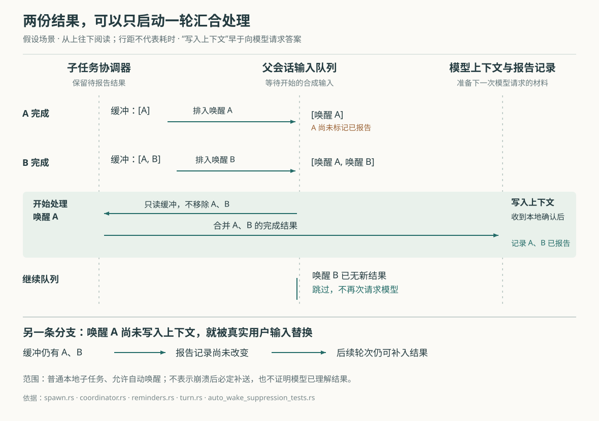

# Grok Build 怎样汇合子任务结果：多路交付、批量提醒与去重边界

假设你让 Grok Build 修复日期解析问题。负责统筹的主会话把“寻找失败样例”交给子任务 A，把“检查调用方”交给子任务 B，自己继续读代码。A 和 B 先后完成，主会话既可能主动查询它们，也可能收到自动提醒。如果每条路径都直接塞入一份结果，同一结论就会反复出现；如果收到“已完成”通知便认定结果已经交付，用户此时插入一条新要求，又可能让尚未进入对话的结果失去补送机会。

Grok Build 为接收会话保留待报告结果，让几条交付路径共享“已报告”的任务编号；自动唤醒还会等提醒写入对话后才标记。第一条唤醒可以一次汇合多个子任务，后续重复唤醒则被跳过。不过，这套记录主要协调本地会话中的提醒，不能证明模型已经理解结果，也没有为所有失败情况提供结果必达、只交付一次的保证。

这是为解释源码构造的场景，本次没有实际运行。本文依据 `input/repository/` 当前源码，结合七篇已有研报，包括尚未归档的结果，继续研究子任务完成后的汇合过程。此前的停止专题解释了哪些工作继续存活；这里关注它们完成后，结果如何进入主会话。没有安装依赖、构建项目、连接模型或运行仓库测试；下文的测试结论均指读到的断言。

**先看交回来的是什么：主要是子会话的最终答复，不是完整工作过程。** Grok Build 中的 Agent 是能够调用工具推进任务的程序；子 Agent 是独立运行模型与工具循环的子会话。`TaskTool::run` 接收任务描述，取得当前会话编号，经 `SubagentBackend` 发起创建。实际使用的 `ChannelBackend` 把请求送给子任务协调器，由协调器统一管理创建、查询、等待和完成状态。[任务工具][task]、[通道后端][backend]

在本地命令行宿主中，协调器接入 `ShellChildRunner`。它取得父会话的配置与必要资源，把准备工作交给专用工作线程池；`run_shell_child` 再准备并启动子会话，子会话在自己的线程中运行。因而，父会话可以继续工作，而不必同步等待每个子会话结束。这是同一程序内的运行组织，不能据此理解成每个子任务都有独立的操作系统进程或文件隔离环境。[宿主接线][shell-spawn]、[子会话执行][child-run]

结束时，`reduce_prompt_turn_result` 把轮次结果和最终文本转换为 `SubagentResult`，其中包含成功、取消、错误、输出文字及执行统计等字段。`completion_summary` 随后从这些字段生成可供提醒使用的记录。虽然名字中有“summary”，这里主要是整理状态、共享输出文字，并按配置截短；它没有另发一次模型请求来重新总结子任务的全部工作。[轮次结果归并][turn-result]、[完成记录构造][state]

这也说明主会话通常接收到的证据边界：子任务说“测试通过”，首先是它交回的一段答复。完成状态和调用次数不能替代测试日志核对，子会话的每条读文件、运行命令记录也不会自动全部并入父会话。

**同一结果可以通过几个入口进入模型上下文。** 上下文指下一次交给模型的对话与其他材料。这里的“前台等待”表示调用者仍在等结果，“后台”表示先取得任务编号、稍后再查询，和终端窗口是否可见无关。

| 入口 | 怎样把完成信息交给主会话 | 是否自行发起新一轮工作 |
| --- | --- | --- |
| 创建或查询工具直接返回 | 前台创建成功返回 `SubagentCompleted`；查询工具返回任务最终状态与输出 | 随当前工具调用继续 |
| 普通工具结果附带提醒 | `TaskCompletionReminder` 查找刚完成的子任务，把提醒附在当前工具结果后 | 随当前轮次继续 |
| 下一轮开始前补入 | `drain_between_turn_subagent_completions` 取出尚未报告的完成记录，补进对话 | 使用本来就要开始的轮次 |
| 自动唤醒 | 宿主向父会话发送一条运行时合成输入，等待队列安排 | 可以启动新轮次，也可能先排队 |

这些路径分别落在任务工具、工具结果收尾、会话提醒和子任务宿主中，却会接触同一份结果。[直接返回][task]、[工具结果收尾][registry]、[会话提醒][reminders]、[自动唤醒][shell-spawn]

等待结束也不总是任务结束。前台创建超过宿主的等待预算时，协调器会把仍在运行的子任务转为后台，返回 `backgrounded` 状态和查询编号；这不是成功完成。查询工具的等待时间到了，也可以返回“仍在运行”。本地宿主将前台等待预算默认设为六百秒，并允许环境变量覆盖；这个时间限制的是等待，不是子任务的总寿命。[宿主等待预算][shell-spawn]、[到期处理][coordinator]、[前后台转换][state]

**协调器先记录完成，再判断谁已经拿到了结果。** `finish_child` 建立完成快照，向仍在等待的查询者发送它，再尝试回复原来的创建调用。这里不是“曾经有人等过”就抑制自动提醒：`waiter_delivered` 只有在向等待者发送结果成功时才置位。已经超时、或已丢弃接收端的等待者，不会因此挡住后续完成通知。[完成分派][coordinator]

协调器还调用 `buffer_completion`，把完成记录放入待报告缓冲。普通直接子任务的目标是父会话；请求获取结果时，协调器按接收会话筛选，避免一个会话取走另一会话应处理的记录。嵌套子任务另有转交规则，工作流直属子任务也有单独处理；本篇的 A、B 场景限定为普通直接子任务。[缓冲目标][buffer]

本地宿主明确启用这份缓冲。随后 `will_wake_for` 综合实际后台状态、是否有等待者收到结果、是否取消或被明确终止、自动唤醒配置、父通道是否仍开放等条件，决定是否发送自动唤醒；独立的目标循环运行期间也会抑制它。自动唤醒功能在登记表中默认开启，但最终仍受配置和上述运行状态约束。因此，“子任务已结束”与“父会话将自动续跑”并不是同一个判断。[唤醒判断][shell-spawn]、[功能默认值][features]

**界面完成通知和模型输入是两条消息。** `present_child_completion` 可以先发出 `SubagentFinished`，再调用 `inject_subagent_completed_prompt`，向父会话发送形如 `subagent-completed-任务编号` 的合成输入。前者供终端文本界面更新任务状态；后者才参与模型后续工作的安排。[结果呈现与输入注入][shell-spawn]

因此，界面显示子任务完成，或通知里带有 `will_wake`，都不能证明完成文字已经写入父会话。`will_wake` 表示这次呈现选择了唤醒路径；发送之后还要经过队列和轮次启动，代码没有在发出这条输入时就把任务标为“已报告”。

**自动唤醒真正开始时，才决定本轮该汇合哪些结果。** `handle_prompt` 识别输入来自子任务完成后，调用 `build_wake_turn_message`。后者向协调器发送 `PeekCompletions`：只读取当前接收会话的缓冲，不移走记录，再用共享的 `ReportedTaskCompletions` 排除已经报告的任务。[轮次入口][turn]、[唤醒内容构造][reminders]、[只读与取出接口][coordinator]

这个函数有三个会改变行为的分支：

- 触发唤醒的任务已经报告过，返回 `Silent`；当前轮次安静结束，不再请求模型。
- 触发任务仍在缓冲中，把所有尚未报告的同会话结果合成一份提醒，返回文字和本次包含的任务编号。
- 缓冲中找不到触发任务，保留最初注入的正文，避免仅因缓冲缺项就把这次输入直接删掉。

回到 A、B 的例子：若两者都在第一条唤醒开始前完成，唤醒 A 可以把两份结果一起写入父会话。它没有要求子任务先互相通信，也没有等到某个固定批次凑齐；它汇合的是当时已经可取、尚未报告的记录。

接下来，`turn.rs` 在轮次开始前补取其他完成记录时，将这份合并提醒的任务编号列为 `suppress_ids`。协调器暂时保留这些项，不让同一轮又把它们补入一次。直到 `push_user_message_and_ack` 确认合成消息已进入对话状态，才调用 `mark_completions_reported` 记录这一批编号。下一次取到缓冲中的副本时，共享记录会将它们过滤掉。[写入与标记顺序][turn]、[暂缓取出规则][coordinator]

如果唤醒 B 还在队列里，`maybe_start_running_task` 会在提升队首前检查已报告编号并删除过时唤醒；即使这一层没有挡住，轮次入口还有刚才的 `Silent` 分支。合并内容与跳过后续唤醒共同减少了重复处理的机会，但本次没有测量节省了多少模型请求或等待时间。[队列提升][notification-drain]、[轮次兜底][turn]

**用户插入新请求时，保留结果比保留唤醒本身更重要。** 假设 A 的唤醒还在排队，用户输入“先解释失败原因”。如果新输入替换了尚未开始的唤醒，已报告记录仍没有改变，协调器缓冲也还保留着结果。后续轮次可以通过 `drain_between_turn_subagent_completions` 将它补进对话。这里保住的是结果的补送机会，不要求旧合成输入必须继续占据队列。[补送实现][reminders]

测试 `preempted_wake_is_redelivered_by_next_between_turn_drain` 正是这样构造场景：先排入子任务唤醒，再插入用户输入，检查旧唤醒被移除、任务仍未标记报告，随后补送时对话中只出现一份结果。`refused_wake_leaves_completion_unreported` 则检查已检测到磁盘空间不足时，轮次在读取缓冲之前被拒绝，结果仍能留给后续补送。这些断言支持特定分支的约定，不能扩大成任意中断都不会丢消息。[唤醒边界测试][wake-tests]

**主会话主动查询到了结果，也要清掉排队中的旧提醒。** `consumed_completion_ids` 统一识别当前工具输出已经交付了哪些任务，例如 `SubagentCompleted`，或查询返回的已完成、失败结果。仍在运行的状态不算；查询返回的取消状态也被该函数显式排除，不能将规则概括为“任何最终状态都算已经消费”。[消费编号识别][completion]

工具侧的 `TaskCompletionReminder` 读取这些编号，避免当前工具结果已经含有结果，又附上一份相同提醒。会话侧的 `handle_bridge_tool_success` 使用同一个识别函数，调用 `drop_pending_items_for_consumed_completions`，删除对应的排队唤醒和待处理通知。一个共享的识别入口，让工具结果去重和队列清理依据相同的输出规则。[提醒收集][completion]、[会话清理][tool-calls]

对于其他刚完成的子任务，提醒收集器可以把结果附到当前工具输出之后。`FinalizedToolset::finalize_output` 负责收集这些提醒、组装交给模型的文字，之后会话再将它写成工具结果。这样，主会话在继续读取文件或执行命令时就能顺便拿到子任务结果，不必每次显式查询。[工具后处理][registry]、[工具结果写入][tool-calls]

**“收到完成结果”仍可能只收到一部分文字。** 当前的子任务完成提醒会直接带上子任务最终输出；有查询工具可用时，`inline_subagent_output` 将内联文字限制为十六千字节。超过范围会显示已展示与原始字节数，并给出查询完整结果的工具提示。字节不是汉字个数，截取函数会照顾文本编码边界。请求还可以配置更早的输出上限；没有查询工具时，格式化函数本身不再应用这道十六千字节限制，但无法凭空恢复上游已经截掉的内容。[输出裁剪与提示][completion]

正常成功且输出非空时，宿主会尝试把完整最终输出写入 `output.json`。协调器取得有效磁盘引用后，可以清掉完成登记项内的输出文字，之后查询再从文件读取。这里保存的仍是最终输出，不是整份子任务执行日志。文件读取、解析或版本检查失败时，查询使用“输出已不可用”的占位文字，而不会自动重新运行子任务。[输出保存][child-run]、[输出文件读写][subagent]、[按需读取][query]

**这些措施没有组成一项覆盖全程的交付事务。** 所谓交付事务，是指取走待交付记录、写入对话、保存已报告状态能够一起成功或一起失败。当前源码能直接看到几处不具备这种整体保证的边界。

首先，普通 `Completions` 请求会先从协调器缓冲移除所选记录，再向一次性回复通道发送；发送失败时，这个分支没有把记录放回缓冲。因此，取出过程中接收者退出，可能影响自动补送。完成登记或输出文件仍可能支持显式查询，不能由此推导结果内容已被删除。[取出与发送顺序][coordinator]

其次，不同交付路径的“已报告”时机并不完全相同。自动唤醒等待对话状态确认；工具附带提醒则在生成提醒时更新共享集合，随后才由会话写入工具结果；轮次间补送也先筛选并标记，再推入提醒。后两条路径没有在此处等待同样的对话写入确认。若在这些步骤之间中断，不能直接套用自动唤醒路径的保证。[三处标记时机][completion]、[补送标记][reminders]、[工具结果接收][tool-calls]

再次，共享集合确实注册成可保存、可恢复的工具状态，普通会话会从 `resources_state.json` 加载；它并非只存在于某次工具调用的局部变量中。但常规工具收尾中的 `save` 只是向后台写入器提交快照，写入错误主要记录警告。自动唤醒中的“已报告”标记也发生在随后会话记录的落盘屏障之前。这里的本地对话确认、状态保存和模型服务接收，仍是不同节点，不能从集合中已有编号推出三者已经同时完成。[状态注册与加载][registry]、[后台持久化][persistence]、[唤醒提交顺序][turn]

最后，缓冲有容量边界：协调器待报告完成记录最多保留二百五十六项，超过后删除最旧项；完成登记另有一千零二十四项的保留上限。正在运行的目标循环还会主动丢弃并标记部分提醒。因此，“已报告”在某些分支中也表示已经按策略处理掉，不能当作模型阅读回执。[缓冲上限][buffer]、[完成登记上限][state]、[策略抑制][reminders]

本次读取的测试从几个层面交叉支持上述解释：协调器测试区分等待者仍在、已超时和已退出的情形；工具提醒测试检查查询结果不会再附同一份子任务提醒；会话测试检查多个完成结果合并、过时唤醒跳过、用户输入抢先后的补送，以及磁盘拒绝前不消费结果。输出格式测试还覆盖多字节文本在裁剪边界上的行为。它们没有在本次运行，也不能替代进程崩溃、磁盘故障与真实模型服务组合下的验证。本篇核验的是普通新建子任务的一次完成，没有据此确认同一子任务身份多次唤醒后的逐次交付语义。配图已通过 XML 解析、实际渲染与显示检查。[协调器测试][coordinator-tests]、[提醒与裁剪测试][completion]、[会话测试][wake-tests]

实践中，子任务最好交回可直接使用的结论，并指出文件、失败样例和验证依据；主会话要核对关键结果，看到截断提示时继续查询。若界面显示完成而主会话尚未处理，可以分别检查任务是否仍可查询、结果是否进入对话、是否有排队唤醒，以及是否被当前运行策略抑制。这比只盯着一个“完成”状态更能定位问题。

对类似系统的实现者，这份源码展示了一种可迁移的分工：执行者保存任务结果，接收会话管理哪些结果已经进入自己的材料，自动唤醒只负责创造处理机会。先只读结果、等写入对话后再标记，可以保护被用户输入抢先的场景；共享去重记录则协调主动查询与被动提醒。若业务要求崩溃后仍必达、每次执行都可区分，或需要证明模型服务已经接收，还需要另外设计持久交付记录与确认协议，不能仅靠这份任务编号集合。

[task]: https://github.com/xai-org/grok-build/blob/2bdd1d6a6369de0e8c68132ea4539e9abd9e14a8/crates/codegen/xai-grok-tools/src/implementations/grok_build/task/mod.rs
[backend]: https://github.com/xai-org/grok-build/blob/2bdd1d6a6369de0e8c68132ea4539e9abd9e14a8/crates/codegen/xai-grok-tools/src/implementations/grok_build/task/backend.rs
[shell-spawn]: https://github.com/xai-org/grok-build/blob/2bdd1d6a6369de0e8c68132ea4539e9abd9e14a8/crates/codegen/xai-grok-shell/src/agent/subagent/spawn.rs
[child-run]: https://github.com/xai-org/grok-build/blob/2bdd1d6a6369de0e8c68132ea4539e9abd9e14a8/crates/codegen/xai-grok-shell/src/agent/subagent/handle_request.rs
[turn-result]: https://github.com/xai-org/grok-build/blob/2bdd1d6a6369de0e8c68132ea4539e9abd9e14a8/crates/codegen/xai-grok-shell/src/agent/subagent/prompt_turn_result.rs
[state]: https://github.com/xai-org/grok-build/blob/2bdd1d6a6369de0e8c68132ea4539e9abd9e14a8/crates/codegen/xai-grok-tools/src/implementations/grok_build/task/coordinator_state.rs
[coordinator]: https://github.com/xai-org/grok-build/blob/2bdd1d6a6369de0e8c68132ea4539e9abd9e14a8/crates/codegen/xai-grok-tools/src/implementations/grok_build/task/coordinator.rs
[buffer]: https://github.com/xai-org/grok-build/blob/2bdd1d6a6369de0e8c68132ea4539e9abd9e14a8/crates/codegen/xai-grok-tools/src/implementations/grok_build/task/coordinator/completion.rs
[query]: https://github.com/xai-org/grok-build/blob/2bdd1d6a6369de0e8c68132ea4539e9abd9e14a8/crates/codegen/xai-grok-tools/src/implementations/grok_build/task/coordinator/query.rs
[features]: https://github.com/xai-org/grok-build/blob/2bdd1d6a6369de0e8c68132ea4539e9abd9e14a8/crates/codegen/xai-grok-config-types/src/registry.rs
[reminders]: https://github.com/xai-org/grok-build/blob/2bdd1d6a6369de0e8c68132ea4539e9abd9e14a8/crates/codegen/xai-grok-shell/src/session/acp_session_impl/reminders.rs
[turn]: https://github.com/xai-org/grok-build/blob/2bdd1d6a6369de0e8c68132ea4539e9abd9e14a8/crates/codegen/xai-grok-shell/src/session/acp_session_impl/turn.rs
[notification-drain]: https://github.com/xai-org/grok-build/blob/2bdd1d6a6369de0e8c68132ea4539e9abd9e14a8/crates/codegen/xai-grok-shell/src/session/acp_session_impl/notification_drain.rs
[completion]: https://github.com/xai-org/grok-build/blob/2bdd1d6a6369de0e8c68132ea4539e9abd9e14a8/crates/codegen/xai-grok-tools/src/reminders/task_completion.rs
[registry]: https://github.com/xai-org/grok-build/blob/2bdd1d6a6369de0e8c68132ea4539e9abd9e14a8/crates/codegen/xai-grok-tools/src/registry/types.rs
[tool-calls]: https://github.com/xai-org/grok-build/blob/2bdd1d6a6369de0e8c68132ea4539e9abd9e14a8/crates/codegen/xai-grok-shell/src/session/acp_session_impl/tool_calls.rs
[subagent]: https://github.com/xai-org/grok-build/blob/2bdd1d6a6369de0e8c68132ea4539e9abd9e14a8/crates/codegen/xai-grok-shell/src/agent/subagent/mod.rs
[persistence]: https://github.com/xai-org/grok-build/blob/2bdd1d6a6369de0e8c68132ea4539e9abd9e14a8/crates/codegen/xai-grok-tools/src/persistence.rs
[coordinator-tests]: https://github.com/xai-org/grok-build/blob/2bdd1d6a6369de0e8c68132ea4539e9abd9e14a8/crates/codegen/xai-grok-tools/src/implementations/grok_build/task/coordinator_tests.rs
[wake-tests]: https://github.com/xai-org/grok-build/blob/2bdd1d6a6369de0e8c68132ea4539e9abd9e14a8/crates/codegen/xai-grok-shell/src/session/acp_session_tests/auto_wake_suppression_tests.rs
