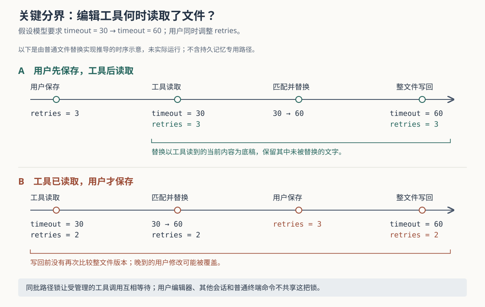

# Grok Build 怎样应对编辑中的文件变化：文本匹配、批内锁与覆盖边界

假设你让 Grok Build 把配置文件中的 `timeout = 30` 改成 `timeout = 60`。模型读过文件后，你又把另一行 `retries = 2` 改成了 `retries = 3`。它接下来会拒绝编辑、保留你的修改，还是把你的修改覆盖掉？当前实现的答案取决于一个很具体的时刻：**编辑工具自己读取文件时，你的修改是否已经保存。**

如果修改已经保存，普通文本替换会以当时的文件内容为底稿，通常能保留不在替换范围内的文字；如果你改动了待匹配的旧文本，工具可能找不到目标而拒绝替换。但若你在工具读取之后、写回之前保存，写回前没有整文件版本比较，你的修改仍可能被覆盖。同批工具调用之间有文件锁，外部编辑器却不参与这把锁。

这是依据源码构造的例子，本次没有实际运行。本文结合八篇历史研报，继续研究文件编辑发生时的保护，而不重复此前对话回退和检查点恢复的算法。依据是 `input/repository/` 当前快照中的实现、调用方与测试，源码链接固定到本次快照；没有安装依赖、构建项目、连接模型或运行仓库测试。下文的测试结论均指读到的断言。

**先限定是哪一种编辑：本篇主要追踪标准文件工具中的 `search_replace`。** Grok Build 是能反复调用工具推进任务的编码 Agent。模型提出“用什么替换什么”，会话运行时负责准备、授权和分派，文件工具才真正读写磁盘。

`grok_build_core_toolset_with` 将标准读取工具 `ReadFileTool` 与替换工具 `SearchReplaceTool` 放进内置工具集合。文件工具配置的本地默认值也是标准集合，但会话创建时还会解析远端设置，并允许换成基于行锚点的 `hashline` 集合。因此，本文的结论适用于实际使用 `search_replace` 的路径，不能仅凭命令叫 `grok` 就认定所有会话都采用同一套编辑规则。[内置工具装配][agent-config]、[文件工具选择][tool-config]、[会话采用配置][agent-ops]

一次普通调用大致这样传递：模型交回文件路径、`old_string`（要找的旧文本）、`new_string`（替换后的文本）和是否全部替换；`execute_tool_calls_batch` 完成调用准备后安排执行，经 `dispatch_observed` 进入 `WorkspaceOps::call_tool_with_context`，再由当前会话的 `FinalizedToolset` 找到登记的工具实现，最终调用 `run_search_replace`。本地工作区会话工厂提供的文件后端是 `LocalFs`。界面负责显示过程与差异，没有在这里另做一套文件合并。[批量执行][tool-calls]、[分派入口][dispatch]、[工作区分派][workspace-ops]、[工具登记与调用][registry]、[本地后端装配][workspace-tool-config]

**当前标准替换工具没有强制要求模型先调用读取工具。** 这是容易被参数名字误导的地方：`SearchReplaceParams` 仍有 `skip_read_before_edit`，默认是 `false`，但字段注释明确说明它在运行时已不生效。它仍影响工具集合装配时的要求：未设置跳过，就要求集合中存在一种读取工具。这里检查的是“有没有读文件的能力”，不是“这个文件刚才是否真的读过”。[参数与装配要求][search-replace]

执行路径没有为普通源码文件取出先前读取的内容、时间或散列值来核对。测试 `consecutive_edits_succeed_without_prior_read` 直接创建文件，随后在没有先调用读取工具的情况下连续执行两次替换，断言两次成功。这比只读参数名或辅助文件顶部仍写着“读取前置校验”的说明，更能确定当前行为。[执行与测试][search-replace]、[辅助文件说明][helpers]

这并不意味着工具可以脱离文件现状任意落笔。它把主要条件放在**当前文件里是否还存在指定旧文本**上。

`handle_replacement` 先通过文件后端完整读取目标内容，再寻找 `old_string` 的出现位置：

| 当前读取内容中的匹配情况 | 工具的动作 | 这个条件能说明什么 |
| --- | --- | --- |
| 没有匹配 | 返回 `NoMatchesFound`，不进入写入步骤 | 本次旧文本已经无法定位；原因可能是文件变化，也可能是参数写错 |
| 恰好一处匹配 | 生成替换后的内容，再写回 | 这段文字能唯一定位，不代表整份文件与模型先前看到的一样 |
| 多处匹配，未开启全部替换 | 返回 `MultipleMatchesFound` | 要求补充周围文字来缩小范围 |
| 多处匹配，开启 `replace_all` | 替换找到的全部匹配 | 由调用者明确接受批量改动范围 |

回到配置例子：若用户提前把 `retries` 改成了 3，工具读到的底稿便已经包含 3，`replace_using_positions` 会复制匹配区间之外的文字，再插入新文本；这项修改通常会保留。若用户提前把 `timeout = 30` 改成了 `timeout = 45`，旧文本又没有在其他地方出现，则替换会被拒绝。反过来，如果旧文本仍在文件中的另一个位置，工具仍可能在那里找到匹配。唯一匹配解决的是文字定位，不能独立确认它就是模型原先想改的那个业务位置。[读取、匹配与替换][search-replace]、[底稿拼接算法][helpers]

基于这种实现，可以作出一个设计分析：较短的旧文本允许周围无关修改继续存在，却也更容易指向错误位置；加入足够的上下文可以减少歧义，但周围文字发生变化时也更容易失败。这是局部文本条件带来的取舍，不是源码提供的编辑正确率测量。

**“精确匹配”还有两个具体的文本处理条件。** 第一，文件只要包含 CRLF，即由回车和换行两个字符组成的行尾，工具便先将它转换成 LF 换行再匹配，写回时再把结果统一转换为 CRLF。因而模型可以使用 LF 形式的多行旧文本匹配这类文件；但原来混用两种行尾的文件，也可能连未编辑区域的行尾一起被统一。`crlf_mixed_line_endings` 的断言明确表达了这一行为。[行尾处理及测试][search-replace]

第二，中文引号、长破折号等外观相似的 Unicode 字符，默认不会自动视为普通引号或连字符。找不到匹配时，工具可以附上附近行和字符差异提示，帮助模型重读并修正参数；开启 `unicode_normalized_fallback` 后，才会尝试将一小组排版字符转换后比较。即使开启，也先采用原本的精确匹配，再检查转换后的候选区间是否完整、是否重叠。它没有按代码含义寻找“差不多”的语句。[匹配退路][search-replace]、[字符映射][unicode]、[候选区间校验][helpers]

**同一批里的两个工具可能同时改同一文件，运行时因此在工具外加了一层锁。** 如果两个调用都先读到旧文件，各自改不同位置，再分别整文件写回，后写者可能覆盖先写者的结果。`execute_tool_calls_batch` 针对这一类交错，先把获准调用按目标路径分组，再让需要协调的调用共享互斥锁；互斥锁就是同一时刻只让一个调用进入受保护区间的机制。[批量锁构造][tool-calls]

这里有几项决定实际范围的细节：

- 路径从参数 `file_path`、`path`、`target_file` 中依次寻找，并按会话工作目录解析。`./`、`..` 和能够解析的符号链接别名会尽量归并；文件尚未创建时，也会解析最近的已存在父目录。
- 只有某条路径在本批中涉及非只读调用，才为它建立锁；同路径的读取调用也会共享该锁。纯读取之间不因此全部排队，不同文件仍可并发。
- 锁在调用 `dispatch_observed` 之前取得，覆盖该次工具执行，所以正常替换的“读取—匹配—写回”处于同一个受保护区间。
- 锁表是这一批执行中的局部对象；解析路径的后台任务失败时，当前分支会警告并退回没有路径锁的结果。

这些行为分别可在批量调度和 `lock_path_for_path` 中核对。路径测试检查了相对路径、符号链接及跨工具参数名称最终得到同一个分组键；它们证明的是分组规则，不能当作外部进程同时写入已经受控的证明。[路径归并][lock-path]、[调度与路径测试][parallel-tests]

锁的作用是让参与同批调度的调用依次执行，不会使多个改动成为一起成功、一起失败的事务。前一个工具已写入，后一个工具因旧文本消失而失败时，这段实现不会自动撤销前一个。两个编辑若相互依赖，更清楚的安排是先取得前一个结果，再依据新内容提出后一个调用。

**用户编辑器和其他会话没有拿到这把锁，读取与写回之间仍有空隙。** 普通终端命令也不会因为命令字符串里出现了文件名，就自动进入对应路径的分组；锁辅助函数只读取上述结构化参数，不分析命令实际会修改哪些文件。路径归并也不是按文件底层身份建立的全系统锁，不能由此推导出不同硬链接名称会自动协调。[锁范围][lock-path]、[局部锁表][tool-calls]

图中第二种时序可以从调用顺序直接推导：工具已经读到 `retries = 2`，生成包含新超时值的完整内容；用户随后保存 `retries = 3`；工具再把自己的完整内容写回。`handle_replacement` 在写回前没有再次读取并比较文件版本，普通 `LocalFs::write_file` 也只接收路径和新字节，没有“仅当旧版本仍相同才写入”的参数。本文没有复现这个并发窗口，也没有测量它出现的概率。[替换写入顺序][search-replace]、[本地文件写入][local-fs]

本地后端会为缺失的父目录创建目录，再调用 `fs::write`。Windows 下若遇到指定的短暂文件共享或锁定错误，会按有限延迟重试；重试复用的是已经生成的新内容，不会重新读取文件并合并用户修改。这个机制处理“暂时写不了”，不处理“现在写的内容是否仍然合适”。[本地写入与重试][local-fs]

**空旧文本是一条不同的路径，默认允许覆盖整个已有文件。** `old_string` 为空时，`run_search_replace` 不进入上述匹配分支，而进入名字叫 `handle_new_file_creation` 的函数。它虽然读取了现有内容，但只有 `empty_old_string_does_not_override` 开启，才拒绝覆盖已有非空文件；该参数的类型默认值是关闭，内置标准工具预设也没有在这里显式开启它。[创建与覆盖分支][search-replace]、[内置预设][agent-config]

测试 `empty_old_string_overwrites_existing_file_by_default` 明确断言：默认设置下，已有文件会被整份新内容取代。开启保护的测试则要求原有内容保持不变。连提供给模型的工具说明也按配置生成：未开启保护，就移除“空旧文本不能覆盖已有非空文件”的承诺。[覆盖测试与说明生成][search-replace]

因此，不能因为函数名含有“创建”，或成功消息写着“文件已创建”，就认定旧文件没有被覆盖。开启这项保护可以挡住该工具分支中的意外覆盖，但它仍是应用层先检查、后写入的条件，不是针对所有外部写入者的不可覆盖创建保证。

**编辑失败通常作为反馈交回模型，成功记录则在写入之后产生。** 找不到旧文本、多处匹配、文件不存在等情况，通过 `SearchReplaceOutput` 的不同结果返回；`ToolOutput::is_error` 将成功应用编辑以外的替换结果视为逻辑失败。会话将错误文字写成与本次调用编号关联的工具结果，并继续工具循环，模型有机会重读或改用更准确的旧文本。这里没有由替换工具自动发起一次模型重读。[结果类型与错误判断][output]、[模型反馈与继续执行][tool-calls]

界面侧的 `acp_tool_update` 把成功结果转换为文本差异，把失败结果转换为失败状态及说明。ACP 是 Agent Client Protocol，即客户端与 Agent 交换会话和执行状态的协议。界面显示的差异来自工具提供的编辑数据，不能证明另一个编辑器在此后又改了什么。[界面结果转换][conversion]

成功写入之后，工具发出 `FileWritten` 通知，携带本次工具读取的旧内容和准备写入的新内容。通知桥据此记录变更和文件快照。这为差异展示与后续恢复提供材料，却不是写入前的冲突屏障：图中若有晚到的用户修改，它不一定出现在这份旧内容里。写入报错时，当前工具也没有执行自动回滚；不能把失败状态理解成磁盘上的字节必然完全没变。[编辑通知][search-replace]、[通知桥][notification]、[文件后端][local-fs]

**上述结论要保留两个边界。** 其一，`hashline` 使用带行号和短散列的锚点来定位、校验编辑，入口和规则不同，不能直接套用 `old_string` 的条件。本篇只核对了它的可选装配和独立入口，没有据此评价两套工具谁更可靠。[替代编辑入口][hashline]

其二，文件工具会先尝试将写入交给持久记忆第二版的专用策略。持久记忆指跨会话保存项目知识的文件；在该功能已经接入、路径属于其受管范围时，策略记录先前读取内容的散列值，修改已有文件前要求当前内容仍与记录相同，不一致就要求重读。普通源码路径会返回 `Outside`，继续走本篇描述的文件后端。测试 `rejects_stale_edits_after_external_mutation` 检查了“读取后被外部改动，拒绝再写”的特定场景。因此，“标准替换工具没有普通文件的先读校验”不等于“项目内任何文件路径都没有版本校验”。本篇没有继续审计这套记忆存储的全部并发保证。[策略路由][memory-route]、[记忆写入校验][memory-policy]、[外部修改测试][memory-tests]

本次读到的测试，为几种分开的契约提供交叉依据：无先前读取仍可连续替换；空旧文本默认覆盖、配置开启后拒绝覆盖；多处匹配需要显式全部替换；Unicode 转换默认关闭且精确匹配优先；混合行尾可能被统一；不同路径别名能归入同一锁组。它们没有在本次运行，路径分组测试也不能替代多会话、外部编辑器和磁盘故障共同作用的验证。配图通过了 XML 解析及正文引用检查；当前环境的渲染工具不可用，未完成实际显示核验。

实际使用时，局部修改宜提供足够的旧文本上下文；遇到无匹配提示，先重新读取并核对变化原因。想创建文件时，应明确是否启用空旧文本的覆盖保护，避免用这一形式重写需要保留用户修改的文件。多任务协作可以按文件划分写入责任，或使用独立工作目录，再通过版本控制合并结果；同批路径锁无法替代这种协作安排。

对类似系统的实现者，这段代码说明了三件需要分别设计的事：旧文本条件帮助定位改动，批内互斥减少受管理调用相互覆盖，版本校验决定是否接受基于旧内容的写入。如果业务要求保护外部编辑，就需要让写入接受可核对的旧版本，并明确所有写入者怎样参与协调；仅把直接写文件换成临时文件再替换，也不能独自解决基于旧底稿覆盖新修改的问题。这是从现有边界提出的设计建议，不能当作本项目已经提供的保证。

[agent-config]: https://github.com/xai-org/grok-build/blob/2bdd1d6a6369de0e8c68132ea4539e9abd9e14a8/crates/codegen/xai-grok-agent/src/config.rs
[tool-config]: https://github.com/xai-org/grok-build/blob/2bdd1d6a6369de0e8c68132ea4539e9abd9e14a8/crates/codegen/xai-grok-shell/src/tools/config.rs
[agent-ops]: https://github.com/xai-org/grok-build/blob/2bdd1d6a6369de0e8c68132ea4539e9abd9e14a8/crates/codegen/xai-grok-shell/src/agent/mvp_agent/agent_ops.rs
[tool-calls]: https://github.com/xai-org/grok-build/blob/2bdd1d6a6369de0e8c68132ea4539e9abd9e14a8/crates/codegen/xai-grok-shell/src/session/acp_session_impl/tool_calls.rs
[dispatch]: https://github.com/xai-org/grok-build/blob/2bdd1d6a6369de0e8c68132ea4539e9abd9e14a8/crates/codegen/xai-grok-shell/src/session/acp_session_impl/tool_dispatch.rs
[workspace-ops]: https://github.com/xai-org/grok-build/blob/2bdd1d6a6369de0e8c68132ea4539e9abd9e14a8/crates/codegen/xai-grok-workspace/src/workspace_ops.rs
[registry]: https://github.com/xai-org/grok-build/blob/2bdd1d6a6369de0e8c68132ea4539e9abd9e14a8/crates/codegen/xai-grok-tools/src/registry/types.rs
[workspace-tool-config]: https://github.com/xai-org/grok-build/blob/2bdd1d6a6369de0e8c68132ea4539e9abd9e14a8/crates/codegen/xai-grok-workspace/src/session/tool_config.rs
[search-replace]: https://github.com/xai-org/grok-build/blob/2bdd1d6a6369de0e8c68132ea4539e9abd9e14a8/crates/codegen/xai-grok-tools/src/implementations/grok_build/search_replace/mod.rs
[helpers]: https://github.com/xai-org/grok-build/blob/2bdd1d6a6369de0e8c68132ea4539e9abd9e14a8/crates/codegen/xai-grok-tools/src/implementations/grok_build/search_replace/helpers.rs
[unicode]: https://github.com/xai-org/grok-build/blob/2bdd1d6a6369de0e8c68132ea4539e9abd9e14a8/crates/codegen/xai-grok-tools/src/util/unicode_confusables.rs
[lock-path]: https://github.com/xai-org/grok-build/blob/2bdd1d6a6369de0e8c68132ea4539e9abd9e14a8/crates/codegen/xai-grok-tools/src/util/lock_path.rs
[parallel-tests]: https://github.com/xai-org/grok-build/blob/2bdd1d6a6369de0e8c68132ea4539e9abd9e14a8/crates/codegen/xai-grok-shell/src/session/acp_session_tests/parallel_dispatch_tests.rs
[local-fs]: https://github.com/xai-org/grok-build/blob/2bdd1d6a6369de0e8c68132ea4539e9abd9e14a8/crates/codegen/xai-grok-tools/src/computer/local/file_system.rs
[output]: https://github.com/xai-org/grok-build/blob/2bdd1d6a6369de0e8c68132ea4539e9abd9e14a8/crates/codegen/xai-grok-tools/src/types/output.rs
[conversion]: https://github.com/xai-org/grok-build/blob/2bdd1d6a6369de0e8c68132ea4539e9abd9e14a8/crates/codegen/xai-grok-shell/src/session/acp_conversion.rs
[notification]: https://github.com/xai-org/grok-build/blob/2bdd1d6a6369de0e8c68132ea4539e9abd9e14a8/crates/codegen/xai-grok-shell/src/tools/notification_bridge.rs
[hashline]: https://github.com/xai-org/grok-build/blob/2bdd1d6a6369de0e8c68132ea4539e9abd9e14a8/crates/codegen/xai-grok-tools/src/implementations/grok_build_hashline/edit/mod.rs
[memory-route]: https://github.com/xai-org/grok-build/blob/2bdd1d6a6369de0e8c68132ea4539e9abd9e14a8/crates/codegen/xai-grok-tools/src/types/memory_v2.rs
[memory-policy]: https://github.com/xai-org/grok-build/blob/2bdd1d6a6369de0e8c68132ea4539e9abd9e14a8/crates/codegen/xai-grok-memory/src/v2_access.rs
[memory-tests]: https://github.com/xai-org/grok-build/blob/2bdd1d6a6369de0e8c68132ea4539e9abd9e14a8/crates/codegen/xai-grok-memory/src/v2_access_tests.rs
