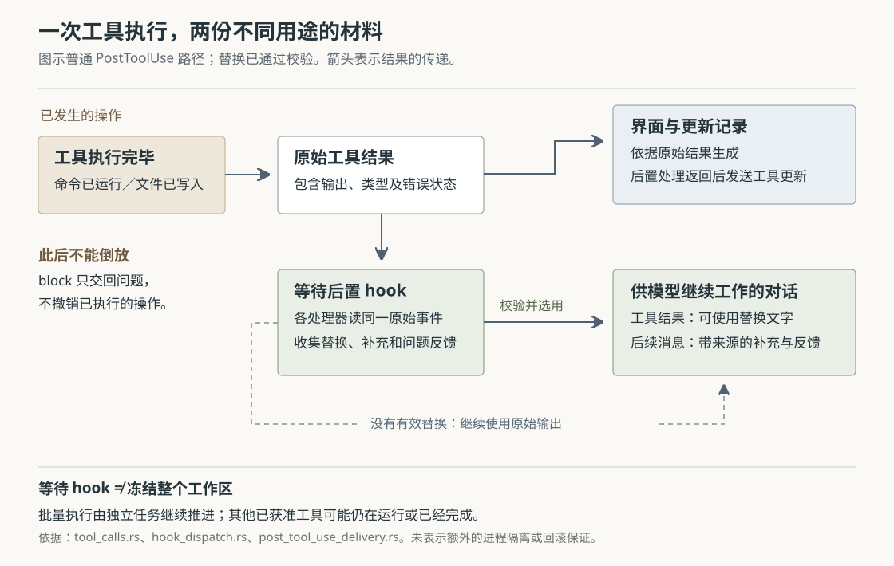

# Grok Build 的工具结果为何会有两份：后置检查、输出替换与失败边界

假设你让 Grok Build 运行测试，测试日志里既有失败原因，也有一段不该发给模型的凭据。你接入一个脚本，希望保留失败信息、遮掉凭据，再让模型继续修复。当前实现确实允许这样处理：工具执行结束后，运行时等待脚本返回，用通过校验的替换文字构造模型收到的工具结果；界面里的工具状态与输出记录，仍依据原始结果生成。

但这带来两个容易误解的边界。第一，脚本此时报告“阻止”，不能撤销已经执行的命令或文件修改。第二，脚本超时、崩溃或返回不合格的替换结果时，程序通常保留原始输出继续工作。因此，这套扩展适合加工反馈，不能直接视为“处理失败就绝不外发”的脱敏屏障。

这是根据源码构造的例子，本次没有实际运行测试或处理凭据。本文结合九篇已有研报，研究尚未展开的后置工具处理，不重复总体架构、沙箱授权或子任务汇合。依据是 `input/repository/` 当前快照中的实现、调用方、测试和随附指南；没有安装依赖、构建项目、连接模型或运行仓库测试。下文的测试结论均指读到的断言。

**先明确脚本处在什么位置：工具已经执行，模型尚未收到本次结果。** Grok Build 是能够调用工具推进编码任务的 Agent。这里的 hook，指程序在特定事件上调用的扩展处理器，可以运行本地命令，也可以向远端地址发送 HTTP 请求；本文主要追踪本地命令的 `PostToolUse`，即工具执行后的处理事件。

这条路径有实际装配入口。`spawn.rs` 创建会话时解析目录信任状态，通过 `discover_hooks` 收集配置与文件中的处理器，再接入插件提供的处理器，放入会话的登记表。项目目录中的 hook 来源需要通过信任判断；全局来源另行收集。因而，仓库里放着一个配置文件，不等于它必然会执行。[会话装配][spawn]、[统一发现入口][discover]、[来源与信任过滤][discovery]

真正接收工具结果的是会话运行时的 `execute_tool_calls_batch`。它取得分派结果后，先保存原始结果是否失败等事实，再决定触发普通后置事件，还是失败事件。普通路径调用 `dispatch_post_tool_use_hook`，把工具名称、调用编号、输入参数、转成 JSON 的结果和耗时组织成事件，等待匹配的处理器运行。JSON 是一种常见的结构化数据格式，便于脚本按字段读取材料。[执行主线][calls]、[后置事件构造][hook-dispatch]

处理器接收的是结构化事件，而不只是终端上那几行文字。结果字段叫 `toolResult`，其中保留工具输出类型；如果工具是通过 `use_tool` 这类内部转发工具调用的，`PreparedToolCall::hook_tool_name` 优先返回解析后的目标名称，例如 `linear__save_issue`。这意味着匹配外部工具时应针对真实目标，而不是只盯着转发工具的名称。[事件字段][event]、[目标名称选择][prepared]

图中的分开不是两次执行工具，而是同一次执行结果被用于两种不同目的。还有一个时序细节：普通路径会先等待后置处理，再发送完成的工具更新；只是生成界面更新时仍使用原始结果，不能把图读成“界面一定先于 hook 收到完成消息”。

**后置处理可以做三件不同的事，名字里的“阻止”最需要谨慎理解。** `PostToolUseHookOutcome` 分别保存问题反馈、补充上下文和输出替换。运行时没有把它们合并成一个“允许／拒绝执行”的开关。[返回数据结构][result]

| 处理器返回的内容 | 运行时怎样交付 | 不应由此推导的保证 |
| --- | --- | --- |
| `decision: "block"` 与 `reason` | 在工具结果之后，向模型补充带处理器名称的问题反馈 | 已执行操作被撤销，或后续工作被程序强制禁止 |
| `hookSpecificOutput.additionalContext` | 向模型补充带来源的说明 | 原始工具输出已被删除或隐藏 |
| `hookSpecificOutput.updatedToolOutput` 或 `updatedMCPToolOutput` | 校验、选择并渲染替换内容，用于本次模型工具结果 | 磁盘、外部服务或界面记录随之改变 |

例如，文件已经改好，格式检查脚本返回 `{"decision":"block","reason":"请先修复格式错误"}`。`tool_calls.rs` 将这段理由包装成后续提醒，工具循环仍走 `ToolLoop::Continue`。模型有机会据此修复，但这里没有自动恢复文件、回滚外部请求，也没有把问题反馈转换成权限拒绝。[反馈交付与继续执行][calls]、[带来源的提醒包装][reminders]

同一个处理器可以同时报告问题和提供替换；多个处理器的问题也可以一起保留。测试 `block_and_replacement_both_reach_the_model` 与 `block_feedback_and_context_reach_model_without_replacing_output` 分别检查了这些契约。因此，`block` 不是“替换为空”的另一种写法，更不是撤回工具结果。[交付测试][delivery-tests]

**替换的是模型使用的结果文字，原始工具对象继续决定界面状态。** 在 `handle_bridge_tool_success` 中，运行时先以原始 `result.output` 生成 ACP 工具更新，再把选中的替换应用到 `result.prompt_text`。ACP 是 Agent Client Protocol，即客户端与 Agent 交换会话和执行状态的协议。替换后的文字最终成为与原调用编号关联的 `ConversationItem::tool_result`，进入下一次供模型使用的对话。[结果处理][calls]

这也解释了一个反常但代码允许的情形：内置测试命令退出码非零，界面显示失败；若后置处理器返回同类型、可解析但误写成“测试通过”的结果文字，模型仍可能读到这段错误说法。运行时保留的工具失败统计来自原始结果，不会因此变成成功。这里说的是实现允许出现的分歧，本次没有构造运行验证，也不意味着内置配置会主动篡改失败信息。

原始记录也有范围。`send_update` 把工具更新交给事件通道，`emit_notification_direct` 再送入更新持久化通道；保存端写入会话更新记录。模型对话则走独立的聊天状态追加接口，后者同样调用持久化接口。因此，“记录保留原始输出”主要指面向界面的 ACP 更新记录，不能理解成所有历史文件都只存原始内容。异步保存还可能发生写入错误，源码在相应分支记录警告；这不是对崩溃或磁盘故障下绝不丢失的保证。[更新发送与保存][updates]、[保存端处理][persistence]、[聊天状态追加][chat-mutations]

对应测试 `post_tool_use_replacement_reaches_model_original_stays_on_record` 真的接上了后置分派和结果处理：断言模型对话含替换标记、不含原始标记；同时断言捕获到的 ACP 更新含原始标记、不含替换标记。这个测试提供了跨组件依据，但它检查的是内存对话和发出的通知，不是一次实际磁盘落盘与重启恢复测试。[跨组件测试][bridge-tests]

替换还会影响图片。替换生效时，结果处理跳过原输出的图片交付，避免模型虽然没看到原文字，却又从同一结果的图片中读到被隐藏内容。测试 `handle_bridge_tool_success_replacement_drops_images_and_keeps_reminders` 检查了图片不再作为后续材料交回模型，同时原有运行时提醒仍然保留。这项保证只针对这次结果的交付；它不清理图片文件，也不删除此前已经进入对话的材料。[图片与提醒处理][calls]、[图片替换测试][bridge-tests]

**输出替换有类型限制，但类型正确不等于内容真实。** 对内置工具，`post_tool_use_rendered_replacement` 尝试把 `updatedToolOutput` 解析回 `ToolsToolOutput`，并要求它和原输出属于同一个枚举分支。也就是说，终端命令的结果要仍然像终端命令结果，不能拿工具搜索结果的结构来替代。解析失败或分支不符，就拒绝替换，保留原始输出，并把对应处理器的运行记录降为失败。[替换校验与降级][delivery]

这里核对的是数据形状，没有逐字段证明替换内容与实际命令、实际退出码或实际文件变化一致。运行时随后只取替换对象渲染出的文字，不把它变成一次新的工具执行。对于开头的日志例子，更稳妥的处理是保留原对象的其他字段，只改需要遮盖的模型输出字段，并保留失败原因。这是基于实现提出的使用建议，不是源码强制要求。

MCP 工具的替换更宽松。MCP 是 Model Context Protocol，即模型应用接入外部工具与资源的协议；外部工具的结果形状并不统一，当前模型交付路径允许替换值是字符串或其他 JSON 值，后者转成 JSON 文字。MCP 结果既接受 `updatedMCPToolOutput`，也接受通用的 `updatedToolOutput`；内置工具则拒绝前者。渲染后的替换正文有 65,536 字符上限，过长时截短，而不是完全丢弃。[类型选择][dispatcher]、[MCP 文字转换][result]、[长度常量][event]

替换文字中的运行时提醒标签会被转义，防止它直接伪装成程序自己插入的提醒。对应测试检查了完整标签、未闭合标签和带属性标签。这个处理只解决特定标签的冒充问题；普通自然语言仍可能误导模型，不能把转义理解成已判断内容可信。[替换转义][delivery]、[标签测试][delivery-tests]

**多个后置脚本按顺序运行，却不是依次改写前一个脚本的结果。** `dispatch_post_tool_use` 遍历匹配的处理器，逐个等待完成；每次传入的仍是同一份事件。后一个脚本不会自动读到前一个脚本改过的 `toolResult`。[处理器执行与汇总][dispatcher]

这一区别会影响扩展组合。假设第一个脚本遮盖令牌，第二个脚本压缩日志；如果第二个仍根据原始事件生成一份替换，最终结果可能重新含有第一个遮盖的文字。当前汇总逻辑对同类替换采用后写者；MCP 同时有两类可用替换时，也比较运行顺序，选择较晚者。它没有自动合并两个脚本的编辑。单个脚本同时填写两个替换字段，则在解析时优先保留 `updatedToolOutput`。[替换选择][dispatcher]、[双字段解析][runner]

因此，脱敏和摘要若必须依次生效，可以在同一个处理器内明确组合，或约定只有一个处理器负责最终替换。不要只凭“运行顺序在后面”，就认为它处理的是前一个脚本的输出。

此外，等待后置脚本也不是冻结整批工作。批量工具通过独立任务持续推进，再把完成结果送回会话；会话逐个消费这些结果并等待相应 hook。同批其他已获准工具可能仍在执行，甚至已经产生了文件修改。后置检查若重新读取工作目录，看到的可能还包含其他工具的影响；不能把它当作目标工具结束瞬间的独占快照。这是依据调度结构作出的推断，本次没有复现并发时序。[批量调度与结果消费][calls]

**“工具失败”不是一种统一的后置事件。** 真正决定路由的是分派结果与工具类型，不能只看自然语言里的“失败”二字。

| 执行返回的情况 | 后置事件 | 当前文件／配置处理器能向模型交付什么 |
| --- | --- | --- |
| 内置工具返回正常结果对象，包括命令非零退出、文件找不到等逻辑失败 | `PostToolUse` | 问题反馈、补充说明，以及通过校验的输出替换 |
| MCP 工具返回带错误状态的结果 | `PostToolUseFailure` | 补充说明；忽略问题阻止与输出替换 |
| 分派本身返回错误，例如工具无法正常调用 | `PostToolUseFailure` | 同上，原错误结果先进入对话，补充说明随后加入 |

关键判断函数叫 `is_mcp_error_result`，只对 MCP 类型且 `is_error()` 为真的输出成立。普通 `PostToolUse` 因此不能简单翻译成“工具成功后”，`PostToolUseFailure` 也没有覆盖所有失败表现。[分支判断与测试][calls]

失败处理器复用相近的返回解析，但 `dispatch_post_tool_use_failure` 只收集 `additionalContext`，丢弃问题阻止与替换字段。`post_tool_use_failure_additional_context_reaches_model` 则通过执行失败调用，断言补充说明出现在失败工具结果之后。这使恢复建议仍能交回模型，却没有把外部工具的错误结果改写成另一份结果。[失败事件汇总][dispatcher]、[失败调用测试][client-tests]

客户端远程回调也有独立边界。`dispatch_post_tool_use_hook` 先收集本地登记表结果，再合入客户端回调贡献；`run_post_tool_use_client_hooks` 当前只增加问题反馈与补充上下文，不提供输出替换。因此，不能把文件脚本能做的事一概套给编辑器或 SDK 注册的回调。SDK 指供其他程序调用功能的软件开发工具包。[回调接线][hook-dispatch]、[客户端回调实现][client-hooks]

**处理器自己出错时，程序优先让任务继续，这正是脱敏例子的风险所在。** 本地命令执行器为 hook 设置超时，等待子进程结束并读取标准输出。普通后置处理的默认时限是 600 秒，可由配置覆盖；超时或启动失败返回失败记录，分派器继续处理其他 hook。没有其他有效替换时，原始结果仍会交给模型。[命令执行与超时][command]、[默认配置][config]、[失败后的继续处理][dispatcher]

对已经结束的命令，还要区分退出方式：

- 正常以零退出时，可以交付问题反馈、补充说明和输出替换。
- 以 2 退出且没有显式问题理由时，标准错误中的非空文字可以成为问题反馈；此时替换与补充说明不会因脚本输出了 JSON 就自动获得信任。
- 其他非零退出同样会丢弃替换与补充说明，但已经解析出的显式 `block` 理由仍可保留，同时记录处理器失败。测试 `post_tool_use_broken_hook_keeps_only_its_block_reason` 检查了这一组合。

这些规则来自 `HookHealth` 对退出状态的判断和后置结果解析。还有一个更细的边界：标准输出不是合格 JSON 时，解析器通常产生“没有信号”的结果；即便看起来像 JSON 却解析失败，也主要写日志，不保证一定出现一条对应的界面失败提示。不能把“界面没报错”当作替换已执行的证据。[解析与异常保留][runner]、[命令解析及测试][command]

输入也并非无限完整。单份工具输入或结果序列化后超过 128 KiB 时，会被截成带标记的字符串，并设置 `toolInputTruncated` 或 `toolResultTruncated`。此时脚本不能再假定 `toolResult` 一定是完整的工具对象。若脚本忽略标志、解析失败，脱敏替换就可能落空；若只检查截取的前部，也不能推断剩余内容已被检查。[载荷截断][event]、[截断标志接线][hook-dispatch]

由此可以看清这套机制的取舍。保留原始界面记录，有助于追查工具实际返回了什么；允许改变模型所见，则方便把长日志、敏感片段或额外检查结论整理成适合继续工作的材料。代价是两份材料可能不同，调试模型行为时必须核对真正进入对话的内容。顺序运行让替换选择可追踪，但没有提供处理器之间的自动流水线；失败后继续让扩展故障较少阻断任务，却不适合独自承担必须成功的外发控制。这些是从实现结构得到的分析，没有性能或准确率测量支持。

实际接入时，后置检查适合告诉模型“这里还需要修复”，输出替换适合明确加工本次反馈。必须阻止的副作用需要在执行前控制；必须遮盖的内容应在最初生成输出或进入模型交付路径时，就有明确的失败阻断安排。若仍使用 hook 做替换，至少应分别核验正常、非零退出、超时、错误数据形状和截断输入时模型会收到什么，并协调多个替换处理器的职责。本篇没有证明项目已经为这些要求提供统一保证。

本次读到的测试分别支持了替换与原始更新分开、图片不随被替换结果泄回模型、错误形状被拒绝、多处理器后写者选择、失败事件仅补充上下文，以及非零退出保留问题理由等契约。它们均未在本次运行。配图已检查 XML 格式与正文引用，并用本地图形库渲染后查看，核对文字、连线和版面。

[spawn]: https://github.com/xai-org/grok-build/blob/2bdd1d6a6369de0e8c68132ea4539e9abd9e14a8/crates/codegen/xai-grok-shell/src/session/acp_session_impl/spawn.rs
[discover]: https://github.com/xai-org/grok-build/blob/2bdd1d6a6369de0e8c68132ea4539e9abd9e14a8/crates/codegen/xai-grok-shell/src/util/hooks.rs
[discovery]: https://github.com/xai-org/grok-build/blob/2bdd1d6a6369de0e8c68132ea4539e9abd9e14a8/crates/codegen/xai-grok-hooks/src/discovery.rs
[calls]: https://github.com/xai-org/grok-build/blob/2bdd1d6a6369de0e8c68132ea4539e9abd9e14a8/crates/codegen/xai-grok-shell/src/session/acp_session_impl/tool_calls.rs
[hook-dispatch]: https://github.com/xai-org/grok-build/blob/2bdd1d6a6369de0e8c68132ea4539e9abd9e14a8/crates/codegen/xai-grok-shell/src/session/acp_session_impl/hook_dispatch.rs
[event]: https://github.com/xai-org/grok-build/blob/2bdd1d6a6369de0e8c68132ea4539e9abd9e14a8/crates/codegen/xai-grok-hooks/src/event.rs
[prepared]: https://github.com/xai-org/grok-build/blob/2bdd1d6a6369de0e8c68132ea4539e9abd9e14a8/crates/codegen/xai-grok-shell/src/session/acp_session.rs
[result]: https://github.com/xai-org/grok-build/blob/2bdd1d6a6369de0e8c68132ea4539e9abd9e14a8/crates/codegen/xai-grok-hooks/src/result.rs
[reminders]: https://github.com/xai-org/grok-build/blob/2bdd1d6a6369de0e8c68132ea4539e9abd9e14a8/crates/codegen/xai-grok-shell/src/session/acp_session_impl/reminders.rs
[delivery-tests]: https://github.com/xai-org/grok-build/blob/2bdd1d6a6369de0e8c68132ea4539e9abd9e14a8/crates/codegen/xai-grok-shell/src/session/acp_session_impl/post_tool_use_delivery_tests.rs
[updates]: https://github.com/xai-org/grok-build/blob/2bdd1d6a6369de0e8c68132ea4539e9abd9e14a8/crates/codegen/xai-grok-shell/src/session/acp_session_impl/updates.rs
[persistence]: https://github.com/xai-org/grok-build/blob/2bdd1d6a6369de0e8c68132ea4539e9abd9e14a8/crates/codegen/xai-grok-shell/src/session/persistence.rs
[chat-mutations]: https://github.com/xai-org/grok-build/blob/2bdd1d6a6369de0e8c68132ea4539e9abd9e14a8/crates/codegen/xai-chat-state/src/actor/mutations.rs
[bridge-tests]: https://github.com/xai-org/grok-build/blob/2bdd1d6a6369de0e8c68132ea4539e9abd9e14a8/crates/codegen/xai-grok-shell/src/session/acp_session_tests/tool_layer_images_bridge_tests.rs
[delivery]: https://github.com/xai-org/grok-build/blob/2bdd1d6a6369de0e8c68132ea4539e9abd9e14a8/crates/codegen/xai-grok-shell/src/session/acp_session_impl/post_tool_use_delivery.rs
[dispatcher]: https://github.com/xai-org/grok-build/blob/2bdd1d6a6369de0e8c68132ea4539e9abd9e14a8/crates/codegen/xai-grok-hooks/src/dispatcher.rs
[runner]: https://github.com/xai-org/grok-build/blob/2bdd1d6a6369de0e8c68132ea4539e9abd9e14a8/crates/codegen/xai-grok-hooks/src/runner/mod.rs
[client-tests]: https://github.com/xai-org/grok-build/blob/2bdd1d6a6369de0e8c68132ea4539e9abd9e14a8/crates/codegen/xai-grok-shell/src/session/acp_session_tests/client_hooks_tests.rs
[client-hooks]: https://github.com/xai-org/grok-build/blob/2bdd1d6a6369de0e8c68132ea4539e9abd9e14a8/crates/codegen/xai-grok-shell/src/session/acp_session/hooks.rs
[command]: https://github.com/xai-org/grok-build/blob/2bdd1d6a6369de0e8c68132ea4539e9abd9e14a8/crates/codegen/xai-grok-hooks/src/runner/command.rs
[config]: https://github.com/xai-org/grok-build/blob/2bdd1d6a6369de0e8c68132ea4539e9abd9e14a8/crates/codegen/xai-grok-hooks/src/config.rs
