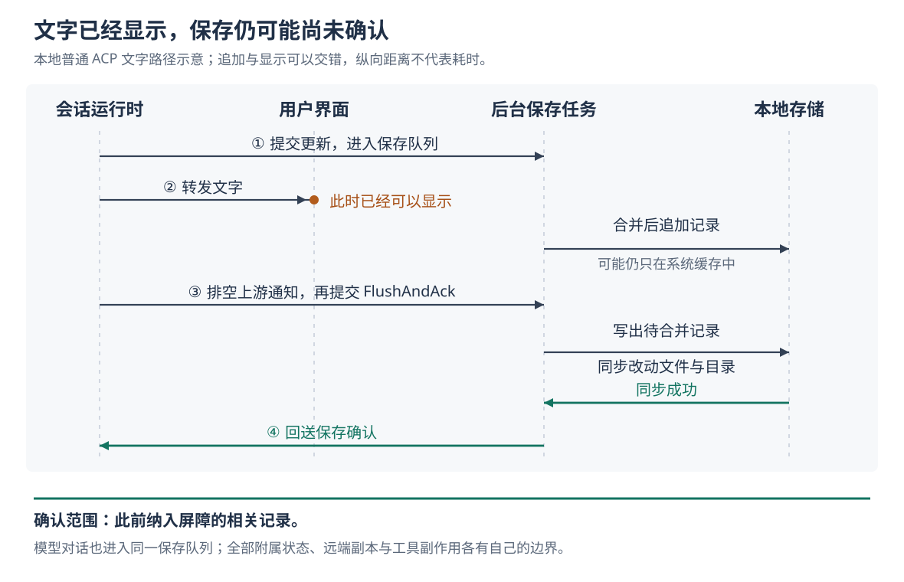

# Grok Build 的回答何时才算保存：写入队列、落盘确认与失败边界

假设你让 Grok Build 修复一个测试。代码已经改好，终端也显示了“修复完成”，这一轮却以“磁盘空间不足”结束。回答既然已经出现，为什么还会失败？重试之后，之前的修改会不会再执行一次？

当前实现允许这种情况发生：文字可以先送到界面，保存任务随后才确认相关记录已写入稳定存储；原本正常完成的轮次，如果收尾时发现磁盘空间不足，会改为报告错误。这个错误说明保存出了问题，**不能据此认定工具没有执行，也不能据此认定所有记录都没有写入**。

这是根据源码构造的场景，本次没有实际运行。此前十篇研报已覆盖总体链路、回退、压缩和工具结果等机制，多次提到异步保存的限制。本篇进一步核实：项目已有明确的保存确认机制，它具体确认什么、怎样处理部分成功，又在哪些地方没有提供同等保证。依据是 `input/repository/` 当前源码及测试；没有安装依赖、构建项目、连接模型或运行仓库测试。下文的测试结论均指读到的断言。

**先看同一轮工作留下的两类记录：界面显示什么，模型下次读什么。**

Grok Build 是能调用工具推进编码任务的 Agent。它既要让用户看见执行过程，也要保留下一次交给模型的对话材料。两者分别进入 `updates.jsonl` 和 `chat_history.jsonl`；JSONL 指每行保存一条 JSON 结构化记录的文件格式。`summary.json` 另外保存会话名称、计数和其他元数据，不能把这里的“summary”理解成完整聊天正文。[存储文件与接口][storage]、[实际存储实现][jsonl]

显示路径从会话运行时的 `send_update` 出发，经事件通道进入 `ReplayBuffer`。后者暂存、合并流式片段，再由 `emit_buffered` 转给实际发送函数。对于普通 ACP 文字通知，`emit_notification_direct` 先向保存通道提交更新，再向客户端网关转发；它没有在转发前等待磁盘确认。ACP 是 Agent Client Protocol，即客户端与 Agent 交换会话请求、文字和工具状态的协议。因此，界面能显示这段文字，只说明显示路径已经推进，不能证明保存路径也已完成。[通知发送][updates]、[事件循环接线][run-loop]

模型对话走另一条入口。会话创建时，`spawn.rs` 把 `ChannelChatPersistence` 接入聊天状态组件；后者追加一条消息时，通过该接口发送 `PersistenceMsg::Chat`，同时更新内存中的对话。`push_user_message_and_ack` 的确认来自聊天状态组件：它已经处理了追加请求，并不等于磁盘已经保存。运行时还需要再等一次保存确认。[会话接线][spawn]、[聊天保存适配][chat-persistence]、[聊天状态处理][chat-actor]、[消息追加][chat-mutations]

这也解释了为什么不能拿界面回放文件替代模型历史：它们承担不同职责，内容可能不同；此前研究过的工具后置处理，就可以让模型收到替换后的输出，而界面记录仍保留原始输出。本篇追踪的是这两条保存路径怎样被协调，而不是重新讨论输出替换。

**真正等待保存的地方，既在输入进入对话后，也在一轮工作结束时。**

普通输入路径先等待 `push_user_message_and_ack`，保证聊天状态组件已经提交本条消息，再向同一保存通道发送 `FlushAndAck`。这个名字可以直译为“排空待写内容并回送确认”。保存任务按队列顺序处理消息，因而这次确认排在已经提交的用户消息与输入回显之后。即使调用方没有提供额外的 `persist_ack` 接收器，普通输入仍会发送这道屏障。[输入提交顺序][turn]、[输入屏障测试][input-tests]

这里的“屏障”指一个明确的等待点：前面的相关写入必须处理到规定程度，等待者才收到成功。它并不暂停界面显示，也没有把整个程序变成一个只能逐步执行的单线程任务。

轮次收尾调用 `flush_to_disk`。它先请求事件循环排空上游通知缓冲，再向保存任务发送 `FlushAndAck` 并等待结果。随后运行时结束本条输入的文件跟踪；如果产生了回退点，会将回退点提交保存，在首次保存未报错时再等一次。这说明收尾不仅关注回答文字，也会协调本轮新增的部分恢复材料。[轮次收尾][turn]、[排空与等待][updates]

图中的保存任务是 `SessionPersistence`：一个持续接收消息、顺序处理写入的后台任务。正常新建会话使用 `JsonlStorageAdapter` 作为本地文件存储实现；聊天记录和普通显示更新都接入这条队列。顺序队列解决“谁先写、确认排在哪里”的问题，文件能否经受进程退出或断电，还要看下面的同步操作。[保存任务创建与处理][persistence]

**屏障做的事，是写出剩余片段，再要求操作系统同步本轮改动过的文件。**

保存任务还会合并相邻、符合条件的 ACP 文字片段。收到 `FlushAndAck` 后，`flush_and_sync` 先调用 `flush_pending`，把尚未写出的合并记录追加到文件；再取出此前记录的写入错误；最后同步被标记为改动过的文件。三个步骤的结果一起决定是否返回成功，前面的错误不会被后面的同步成功掩盖。[合并、错误记录与屏障][persistence]

为什么追加成功之后还要同步？普通追加采用缓冲写入：数据进入文件和操作系统管理的缓存，并不等于存储设备已经可靠保存。代码把 `Flush` 与 `FlushAndAck` 分开：前者主要排空待处理内容，后者还执行文件同步。这里涉及的 `fsync` 是要求操作系统将文件内容及相关信息同步到存储设备的一类操作；源码在 macOS 上还调用 `F_FULLFSYNC`，请求进一步刷新设备缓存，其他支持平台主要调用 `sync_all`。[文件同步实现][storage]

保存任务通过 `dirty_files` 记录哪些文件接受过缓冲写入。普通聊天追加会标记聊天文件，显示更新会标记更新文件，回退点追加则标记相应文件。成功同步后清空标记；同步失败则保留，让后续屏障仍有机会再次同步。没有新增改动时，屏障可以直接成功，不必再次同步所有文件。相应测试断言：流式片段继续采用缓冲追加，第一次屏障只同步改动过的更新文件，紧接着的空闲屏障不再触发文件同步。[改动集合与屏障][persistence]、[屏障测试][persistence-tests]

这是源码可直接证明的组织方式。可以据此分析，它在持续输出的及时性与集中确认保存之间作了分工；本次没有测量延迟或吞吐量，不能把这项设计换算成具体性能收益。

**写入报错后，最关键的问题不是错误文字，而是完整记录是否已经追加。**

本地更新追加先写正文，再更新摘要中的活动时间和计数。于是，一次调用可能正文已写入，却在更新摘要时失败；也可能正文写完，后续文件同步失败。若把这些情况都当成“没有写入”，直接重放同一条记录，就可能产生重复内容。

更新记录的追加路径因此保留以下状态；等待持久追加结果的接口还另行区分确认丢失。这里的“提交”只描述相关追加是否完成，不代表数据库式的整体事务，也不自动代表已可靠落盘。[追加错误类型][storage]、[追加实现][jsonl]、[确认通道][persistence]

| 返回状态 | 源码表达的事实 | 后续处理的边界 |
| --- | --- | --- |
| `NotCommitted`：未确认完整追加 | 更新追加路径没有确认整条记录已写完；文件尾部仍可能残留部分字节 | 可以考虑重新追加完整记录，但不能解释成磁盘完全没变 |
| `Committed`：追加已完成，后续出错 | 完整记录已经写入文件，至少到达系统缓存；失败可能发生在同步或摘要更新阶段 | 通常需要继续同步或处理后续错误，不能把它当成未写入而盲目重放 |
| `AcknowledgementLost`：确认丢失 | 持久追加请求已发送，但等待结果的通道关闭 | 调用方无法从这个错误判断是否已经写入；它本身没有提供通用去重保证 |

对尚在 `pending_notification` 中、等待写出的合并记录，`drain_pending` 遇到 `NotCommitted` 会把它放回待写位置，留给下一次排空重试；遇到 `Committed` 则不放回，以免重复追加，并让相关更新进入后续同步流程。`handle_durable_append` 也会把同步失败但已追加的更新标记为仍需同步。[待写记录处理][persistence]

这套阶段信息并非每条路径都同样细。普通聊天追加先经过返回一般文件读写错误的 `append_jsonl`，再将该错误统一映射为 `NotCommitted`；摘要更新失败才另外标为 `Committed`。因此，不能脱离具体实现，把同名标签当成所有接口都提供的绝对磁盘证据。[聊天追加的错误映射][jsonl]

不过，不能把这理解成“任何写入失败都会自动重试”。普通 `Chat` 消息或已经从合并槽移出、直接写入的更新，在未完成提交时会记录警告，并保存第一项写入错误，供下一道屏障报告；这些分支没有统一的消息重试队列。保存错误用于阻止错误确认，不等于已经补回丢失的记录。

测试对此有有用的反例：一次缓冲更新追加失败，即使随后复制会话目录成功，`FlushAndAck` 仍必须返回那次追加错误。否则，程序只是把现存的旧字节同步了一遍，却错误宣称缺失的新记录已经保存。[错误保留测试][persistence-tests]

反过来，如果聊天正文已追加，只是摘要更新失败，相关文件仍被标记为需要同步；后续屏障可以同步正文并成功。`flush_and_ack_syncs_chat_when_summary_bookkeeping_fails_after_append` 直接检查了这种情况。这既避免因附属计数失败而重复正文，也明确了屏障的确认范围：**聊天正文保存成功，不等于会话中所有附属状态都更新成功。**[正文与摘要测试][persistence-tests]

**保存确认还有几条会改变使用判断的边界。**

首先，正常完成的轮次并不会因为任何保存错误都改成失败。`turn.rs` 在收尾后调用 `disk_full_acp_error`，明确将磁盘空间不足转成对外错误；取消和达到轮次上限的结果保留原有结束语义。其他一般保存错误没有在这里被统一提升为轮次失败。输入处屏障失败的分支也主要记录错误，随后仍可能继续本轮工作，因此它不是“保存失败就立即停止一切工具执行”的门禁。[轮次结果处理][turn]、[错误分类][updates]

这一区别有跨组件测试支持：`completed_turn_flush_enospc_returns_error_and_reports_stop_failure` 用模拟模型响应和返回空间不足的保存通道，断言原本完成的轮次变成错误，并报告停止失败事件；另一个测试断言取消类结果不会被空间不足错误覆盖。这些测试没有制造真实磁盘耗尽，也没有验证断电恢复。[空间不足测试][disk-tests]

其次，完成通知也不能直接充当保存回执。`emit_turn_completed` 选择持久追加模式保存 `TurnCompleted`，也就是可回放的轮次结束记录；但实际发送函数创建确认通道后丢弃了接收端，随后便向客户端转发通知。保存任务会尝试同步，错误则可能只被记录为警告。**“这条通知请求持久写入”与“发送方已经等到持久写入成功”是两件事。**[完成通知入口][turn-end]、[通知提交与转发][updates]、[无人接收确认时的处理][persistence]

再次，屏障不是覆盖全部状态的统一事务。计划、摘要等文件通常采用“写临时文件、同步、再改名替换”的方式，减少原文件被截断后只写了一半的风险；但计划写入失败不会进入普通缓冲记录的错误保留项。测试 `flush_and_ack_succeeds_after_atomic_plan_write_failure` 明确允许后续聊天屏障成功。多个文件之间也没有共同的回滚提交点，不能把一次成功确认理解成整套会话状态同时切换到了一个完整版本。平台保证也有差异：Windows 的目录同步实现直接返回成功，源码注释承认极新的创建仍可能在断电后消失；本次没有验证各平台的实际断电行为。[原子替换实现][storage]、[计划保存处理][persistence]、[计划失败测试][persistence-tests]

还有两个具体的错误通道限制：`flush_to_disk` 排空上游通知时若超时或通道关闭，会记录警告后继续；如果向保存任务发送屏障本身失败，该函数直接返回成功，而不是报告通道错误。这些分支进一步限制了“轮次正常返回”能证明的事情。它们不影响实际收到 `FlushAndAck` 成功回执的含义，却意味着调用方不能把所有正常返回都当成拿到了同等回执。[排空与错误分支][updates]、[上游排空超时][replay-events]

最后，本地保存确认没有等待云端确认。`flush_pending` 虽然会调用远端同步和实时转发组件的 `flush`，这两个方法只是向各自通道发送刷新消息。这里没有等待远端服务确认，也没有把工具产生的文件修改、网络请求等副作用纳入同一个保存事务。[保存屏障][persistence]、[远端同步][remote-sync]、[实时转发][relay-sync]

**如果进程恰好死在一条记录的中间，恢复策略是保住其他完整记录。**

JSONL 追加并不具备“整条记录必然全部写入或完全不写”的性质。写入中断可能留下没有换行符的半条记录。下一次追加时，`append_jsonl_line_sync_with` 会取得追加锁，检查文件末尾；如果最后一个字节不是换行符，就先补一个换行，再追加新记录。这样，旧的残缺内容独占一行，不会把新记录一起粘坏。[追加与残尾处理][jsonl]

读取时，`read_updates_jsonl` 跳过无法解析的更新行；聊天历史读取也跳过坏行，并在需要时尝试保留一份 `chat_history.jsonl.corrupt` 原始副本，复制失败只记录警告。相应测试人为写入一条残缺记录，再追加新消息，断言旧的完整消息和新消息都能读回，残缺记录被跳过。[读取实现][jsonl]、[残尾与恢复测试][jsonl-tests]

这项设计优先让会话在局部损坏后仍可加载，代价是被跳过的记录不再进入本次加载结果。补换行只能隔开损坏，不能恢复缺失的半句话，更不能保证已经执行的工具与恢复后的历史仍一一对应。追加锁也只协调遵守这套协议的追加操作；源码明确说明，整文件原子替换走另一条路径，不能从这把锁推出所有写入者都受同一事务保护。[追加锁范围][jsonl]

对使用者，这份实现最实际的提示是：遇到收尾保存错误，先检查已经发生的文件修改和工具结果，再决定是否重发任务。释放磁盘空间可以让后续写入恢复；程序的小文件可写探测，只证明当时能再次写入，不能补回此前缺失的记录，也不能替你撤销已有副作用。[可写探测][persistence]

对类似 Agent 系统的实现者，可以借鉴这里的分工：让流式显示与保存各自推进，在明确的输入和结束位置等待确认；错误类型保留“完整记录是否已经追加”的事实；对已写入内容重试同步，对未写入内容另行安排补送。同时需要为每个确认写清范围——正文、附属状态、结束通知和远端副本的保证并不相同。只有调用方确实等待了相应结果，才能把内部的保存能力变成对外可依赖的承诺。

[storage]: https://github.com/xai-org/grok-build/blob/2bdd1d6a6369de0e8c68132ea4539e9abd9e14a8/crates/codegen/xai-grok-shell/src/session/storage/mod.rs
[jsonl]: https://github.com/xai-org/grok-build/blob/2bdd1d6a6369de0e8c68132ea4539e9abd9e14a8/crates/codegen/xai-grok-shell/src/session/storage/jsonl/mod.rs
[updates]: https://github.com/xai-org/grok-build/blob/2bdd1d6a6369de0e8c68132ea4539e9abd9e14a8/crates/codegen/xai-grok-shell/src/session/acp_session_impl/updates.rs
[run-loop]: https://github.com/xai-org/grok-build/blob/2bdd1d6a6369de0e8c68132ea4539e9abd9e14a8/crates/codegen/xai-grok-shell/src/session/acp_session_impl/run_loop.rs
[spawn]: https://github.com/xai-org/grok-build/blob/2bdd1d6a6369de0e8c68132ea4539e9abd9e14a8/crates/codegen/xai-grok-shell/src/session/acp_session_impl/spawn.rs
[chat-persistence]: https://github.com/xai-org/grok-build/blob/2bdd1d6a6369de0e8c68132ea4539e9abd9e14a8/crates/codegen/xai-grok-shell/src/session/chat_persistence.rs
[chat-actor]: https://github.com/xai-org/grok-build/blob/2bdd1d6a6369de0e8c68132ea4539e9abd9e14a8/crates/codegen/xai-chat-state/src/actor/mod.rs
[chat-mutations]: https://github.com/xai-org/grok-build/blob/2bdd1d6a6369de0e8c68132ea4539e9abd9e14a8/crates/codegen/xai-chat-state/src/actor/mutations.rs
[turn]: https://github.com/xai-org/grok-build/blob/2bdd1d6a6369de0e8c68132ea4539e9abd9e14a8/crates/codegen/xai-grok-shell/src/session/acp_session_impl/turn.rs
[persistence]: https://github.com/xai-org/grok-build/blob/2bdd1d6a6369de0e8c68132ea4539e9abd9e14a8/crates/codegen/xai-grok-shell/src/session/persistence.rs
[input-tests]: https://github.com/xai-org/grok-build/blob/2bdd1d6a6369de0e8c68132ea4539e9abd9e14a8/crates/codegen/xai-grok-shell/src/session/acp_session_tests/cancel_running_task_tests.rs
[persistence-tests]: https://github.com/xai-org/grok-build/blob/2bdd1d6a6369de0e8c68132ea4539e9abd9e14a8/crates/codegen/xai-grok-shell/src/session/persistence_tests.rs
[disk-tests]: https://github.com/xai-org/grok-build/blob/2bdd1d6a6369de0e8c68132ea4539e9abd9e14a8/crates/codegen/xai-grok-shell/src/session/acp_session_tests/turn/disk_full_tests.rs
[turn-end]: https://github.com/xai-org/grok-build/blob/2bdd1d6a6369de0e8c68132ea4539e9abd9e14a8/crates/codegen/xai-grok-shell/src/session/acp_session_impl/turn_end.rs
[replay-events]: https://github.com/xai-org/grok-build/blob/2bdd1d6a6369de0e8c68132ea4539e9abd9e14a8/crates/codegen/xai-grok-shell/src/session/replay_events.rs
[remote-sync]: https://github.com/xai-org/grok-build/blob/2bdd1d6a6369de0e8c68132ea4539e9abd9e14a8/crates/codegen/xai-grok-shell/src/remote/sync.rs
[relay-sync]: https://github.com/xai-org/grok-build/blob/2bdd1d6a6369de0e8c68132ea4539e9abd9e14a8/crates/codegen/xai-grok-shell/src/relay/sync.rs
[jsonl-tests]: https://github.com/xai-org/grok-build/blob/2bdd1d6a6369de0e8c68132ea4539e9abd9e14a8/crates/codegen/xai-grok-shell/src/session/storage/jsonl/tests.rs
