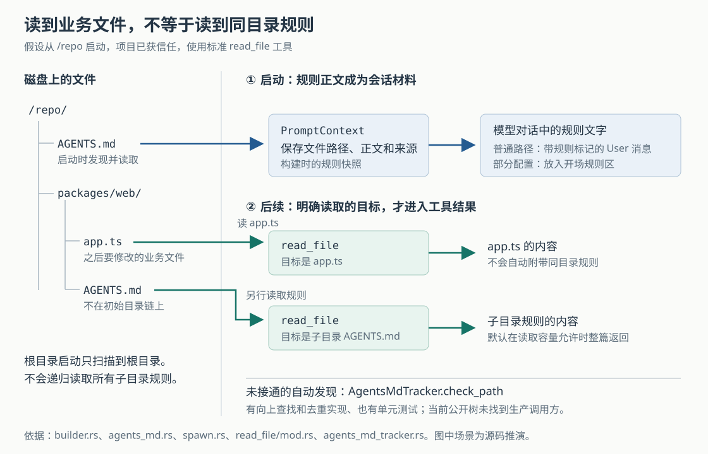

# Grok Build 为什么读了代码却可能漏掉目录规则：启动注入、会话快照与发现边界

假设一个仓库在根目录的 `AGENTS.md` 中写着“修改后运行测试”，在 `packages/web/AGENTS.md` 中另写着“界面文案必须走翻译表”。你从仓库根目录启动 Grok Build，请它修改 `packages/web/app.ts`。它读到了业务代码，是否也一定读到了那条翻译规则？

当前公开源码支持的答案是：**不能这样认定。启动时会读取从仓库根目录到启动目录这条路径上的规则；之后读取一个业务文件，并没有接通自动查找其目录中 `AGENTS.md` 的生产调用链。** 子目录规则仍可以由模型明确调用文件工具读取，但“文件就在旁边”不等于“正文已经进入模型输入”。

这是根据源码构造的场景，本次没有实际运行。本文结合十一篇历史研报，深入研究此前仅被提及的项目指令装配，依据是 `input/repository/` 当前快照中的调用方、实现、测试和随附指南。没有安装依赖、构建项目、连接模型或运行仓库测试；下文的测试结论均指读到的断言。

**先看启动时真正读取了什么。** Grok Build 是能够调用工具推进编码任务的 Agent。这里的项目规则，是告诉模型如何处理某个代码库的文字，例如测试命令、命名习惯和修改范围；`AGENTS.md` 是其中一种受识别的文件名。

实际入口在 `AgentBuilder::build`。当 Agent 定义启用 `agents_md` 时，构建器调用 `read_agents_config_with_paths`，传入工作目录、兼容设置、额外规则目录和项目是否获信任的判断。读取结果不是一组以后再打开的链接，而是 `AgentConfigFile` 列表：每项已经包含文件名、路径、正文和来源，随后存入 `PromptContext.agents_md_files`。`PromptContext` 是构建提示内容所用的数据对象，在这里保存了一份读取当时的规则快照。[构建入口][builder]、[数据与发现实现][discovery]

发现函数先收集用户级来源，再收集项目来源。项目部分通过 `RepoDirChain` 找到当前工作目录及其上级目录，止于 Git 工作树根目录；工作树就是这份仓库实际检出的文件目录。`StartupProjectSources::instruction_dirs` 把它倒排，形成从根目录到当前目录的顺序。普通情况下，若从 `/repo/packages/web` 启动，就会依次检查 `/repo`、`/repo/packages`、`/repo/packages/web`；若从 `/repo` 启动，则不会因为下面还有许多包，就递归遍历整个仓库。[目录链][repo-chain]、[启动来源排序][sources]

这条规则也有边界：不在 Git 仓库中时只检查当前目录；若发现的 Git 根目录恰好是用户主目录，代码会把它按无仓库处理，避免把整个主目录树当作一个项目。运行环境还可以提供一个额外的工作区用户目录，在仓库场景中插入项目指令来源；这不改变“不递归扫描所有后代目录”的基本行为。[目录链][repo-chain]、[工作区来源][sources]

每个选中的目录可以贡献多个受识别的指令文件，也可以贡献 `.grok/rules/` 等规则目录中直接存放的 Markdown 文件；兼容开关控制部分其他工具的规则来源。规则目录不递归，目录内文件按名称排序。对重复发现的文件，实现会尝试用解析符号链接后的实际路径去重；它不会理解几份正文的含义，再把冲突规则合并成唯一答案。[发现与去重][discovery]

**规则进入的是模型对话，优先级也主要通过文字表达。** 普通提醒路径调用 `agents_md_user_reminder`，把已缓存的正文渲染成一个 `<system-reminder>` 文本块。会话创建函数 `spawn_session_actor` 随后将它插入对话，使用的是 `ConversationItem::project_instructions`；识别代码表明，这实际上是一条带 `ProjectInstructions` 来源标记的 `User` 消息。它并没有因为标签里写着“system”，就变成协议中的系统角色消息。[提醒生成][prompt-context]、[会话插入][spawn]、[消息识别][prompt-build]

渲染文字告诉模型：文件按从仓库根目录到当前目录排列，更深目录的规则在冲突时优先；到未列出的子目录工作时，要检查额外指令文件。程序把几份正文全部提供给模型，没有在这里执行一套能够证明“翻译规则已满足”的检查算法。因此，根目录规则与子目录规则的先后关系是明确的提示约定，不能单靠这段装配代码证明每次修改都遵守了它。[规则正文包装][discovery]

并非所有配置都生成这个独立提醒。`include_browser_verification` 为真时，`agents_md_user_reminder` 返回空；当前判断针对内置的两种计划 Agent。相应开场构造路径会从同一份 `PromptContext` 取出规则，划分为工作区规则与用户规则，放入开场消息的规则区。因此，检查规则是否送给模型时，需要沿实际配置追踪，不能只寻找一个固定标签。[配置判断][agent-config]、[开场规则装配][prompt-build]、[规则区渲染][user-message]

**最关键的落差发生在访问新子目录之后。** 用户指南的“Auto-Loading Behavior”描述：读取、列出或编辑初始范围以外的文件时，会检测那里的项目指令、记录路径，并在适用时读取。然而，当前实现中用于这件事的 `AgentsMdTracker`，其文件开头明确说明：没有生产调用方调用 `check_path`；启动目录以下的规则只能通过 `read_file` 到达模型。[用户指南][guide]、[追踪器实现][tracker]

本次没有只采用这段注释的说法，还检索了当前源码树的类型引用与方法调用。结果与之相符：`check_path` 的调用都在追踪器自身的测试中；工具桥有初始化、读取已提醒路径和压缩后重置的接口，但没有实际访问文件后调用它的连接。`seed_agents_md` 也只是“资源表中已有追踪器才初始化”，并不会自己创建追踪器；在当前公开树中，没有找到生产路径把该类型装入资源表的代码。[工具桥][bridge]、[工具资源初始化][registry]

追踪器的算法本身确实存在：给它一个目标路径，它可以向上寻找规则，受仓库边界、查找深度、忽略规则和去重状态约束；压缩后还可以清空状态，允许重新提醒。`check_path_finds_new_agents_md`、`check_path_skips_already_reminded` 等测试直接构造追踪器并调用它，检查发现与去重。另一个测试检查压缩后能够再次发现。**这些断言证明了局部算法的预期，没有证明标准文件工具已经使用它。**[追踪器与测试][tracker]

所以，开头场景中的真实区别是：`read_file("packages/web/app.ts")` 读取的是业务文件；要取得旁边规则的正文，模型仍需另行发出类似 `read_file("packages/web/AGENTS.md")` 的调用。规则提醒中的“去检查子目录”可以促使模型这么做，但它不是文件编辑前必经的程序关卡。这里的结论限定于本次公开源码中的接线，不推断其他未公开宿主或发布版本的行为。[标准读取实现][read-file]、[规则提醒文字][discovery]

还需要排除一个相似但不同的机制：`run_read_file` 确实调用了 `append_cursor_rules_for_read`。若工具参数 `cursor_rules_on_read` 被启用，它会扫描相关祖先目录的 `.cursor/rules/`，处理其中的 `.md`、`.mdc` 文件，把满足条件的规则附到读取结果中。该参数默认关闭；自动匹配主要看文件路径模式，或子目录规则的 `alwaysApply` 标记，表示在该目录范围内始终适用。它不扫描 `AGENTS.md`。因此，本篇指出的是这类命名指令文件的发现缺口，不能扩大成“所有按文件读取附加规则的能力都未实现”。测试 `grok_read_file_output_includes_matching_rule_once` 还明确启用参数、调用标准读取工具，并检查规则正文进入输出。[读取处接线][read-file]、[按读取附加规则的实现与测试][cursor-rules]

明确读取规则时，标准 `read_file` 还做了一个针对性的处理：默认启用的 `WholeReadPolicy.instruction_files` 会让受识别的指令文件优先整篇返回，即使模型给了起始行和行数。这能减少“只看见规则前几行”的情况。但完整格式化结果超过单次读取的 token 上限时，代码会退回分段读取；token 是模型计量文本容量所用的片段，不与汉字或单词一一对应。这个特殊处理解决的是“已经要求读取后，返回多少”，并不解决“是否发现并请求读取”。测试 `nested_agents_md_ignores_model_offset_and_limit` 检查了前一种行为。[读取策略默认值][read-policy]、[完整读取与容量退路][read-file]

**恢复会话时，避免重复与采用新规则是两件事。** 会话创建前会构建 Agent、读取当前规则，但在把独立规则提醒插入对话之前，`spawn.rs` 先检查旧对话是否已经有项目指令。`conversation_has_project_instructions` 只问“有没有”：新消息按 `ProjectInstructions` 标记识别，旧格式则检查第一段文字是否以固定的提醒前缀开头。它没有比较文件内容、修改时间或内容摘要。[插入条件][spawn]、[识别条件][prompt-build]

因此，在这条独立提醒路径上，如果恢复的对话已经保留了一份旧规则，不能因为本次构建重新发现了磁盘文件，就认定旧提醒被替换为新版。它通常会因“已有”而跳过插入。对应测试检查了新标记、旧前缀、普通用户文字不应误判，以及再次处理时不重复插入；这些都是去重契约，不是内容刷新契约。[去重测试][idempotence-tests]

压缩长对话时也需要作相同区分。这里的压缩是用摘要重建较短的模型对话。`run_compact_inner` 取得规则提醒时调用的是当前 Agent 的 `agents_md_user_reminder`，而后者读取缓存的 `PromptContext`，没有在这个位置重新打开规则文件。开场规则区也取自同一对象。若 Agent 曾经重建，快照可能已经改变；但仅仅发送下一条请求或触发压缩，本身不构成从磁盘刷新规则的保证。[压缩装配][compaction]、[快照读取][prompt-context]、[开场构造][prompt-build]

对于保留父会话前缀的压缩路径，`preserve_inherited_prefix` 还会在前缀已有规则消息时，丢掉新压缩部分再次带入的那份规则，避免重复。这延续了同一种取舍：保持对话结构稳定、减少重复内容，但不能把“只保留一份”理解为“这一份一定最新”。[前缀保留与去重][compaction]

**发现规则还受到来源和读取失败的影响。** 项目信任判断会经会话构建参数送入发现函数；未获信任时，项目来源被跳过。用户主目录来源和用户显式配置的额外规则目录则另行处理。尤其是 `[paths] extra_rule_dirs`：即使目录位于一个未获信任的仓库内，仍以用户配置来源加载，也不服从仓库的忽略规则。测试 `extra_rule_dir_inside_untrusted_repo_still_loads_and_ignores_gitignore` 明确检查了这一点。[信任参数接线][rebuild]、[来源过滤与测试][discovery]

这说明来源身份不完全由物理位置决定。把一个目录列入用户的额外规则配置，是主动把其中直接存放的 Markdown 文件变成跨项目读取的规则来源。实践中不宜把这个设置仅当作“多搜一个文件夹”；它也改变了信任过滤和后续规则呈现时的身份。[发现实现][discovery]、[规则身份划分][prompt-build]

被选中的文件也未必能成功进入上下文。发现代码读取目录失败会跳过，`read_to_string(...).ok()?` 会把打不开或不能按 UTF-8 文本读取的候选直接丢掉；这条路径不把单个规则读取失败变成整个 Agent 构建失败。由此带来的好处是，一份坏规则文件不必让所有任务无法启动；代价是，仅凭会话能正常运行，无法判断必需规则是否加载齐全。这是从错误分支得出的取舍分析，源码没有提供规则遗漏率等测量。[候选读取与错误分支][discovery]

普通提醒渲染还有一层有限的文本保护：`neutralize_reminder_tags` 会转义正文和路径中的提醒标签，防止文件直接用同名开闭标签伪造外层包装。测试覆盖了大小写及连字符、下划线变体。但这个函数处理的是特定标签形状，不是判断自然语言规则是否可信，也不能据此推出它能阻止所有提示注入——即外来文字诱导模型偏离原任务的行为。[包装转义与测试][discovery]

**对使用者而言，最可靠的做法是把关键规则的读取变成可见步骤。** 在大型仓库中，从目标子目录新建会话，可以让其祖先链上的规则进入启动发现范围；从根目录跨包工作时，应明确要求先检查目标目录及其祖先上的适用规则，并确认相关正文确实被读取。修改规则后恢复旧会话，也应明确重新读取并说明新旧关系。需要程序保证的要求，例如翻译键检查或禁止某种修改，应落实到测试、检查工具或权限策略中，规则文字本身只负责向模型传达要求。

`grok inspect` 可以帮助核对当前目录能够发现哪些规则，但其 `list_instructions` 会重新调用发现函数；它展示的是这次检查的发现结果，不能单独证明一个已经恢复的会话正携带相同正文。[检查命令实现][inspect]

对于实现类似 Agent 的开发者，这段代码提示了三个应分别验证的环节：发现器能否找到文件，找到的正文是否真的进入当前模型请求，以及产生副作用前是否必须满足规则。Grok Build 的启动装配和恢复去重有明确实现，子目录 `AGENTS.md` 自动发现则在当前公开树中停留在未接通的局部能力。借鉴它时，既要测发现算法，也要测“访问业务文件后，模型究竟收到了什么”；内容刷新还需要独立于去重建立契约。

[builder]: https://github.com/xai-org/grok-build/blob/2bdd1d6a6369de0e8c68132ea4539e9abd9e14a8/crates/codegen/xai-grok-agent/src/builder.rs
[discovery]: https://github.com/xai-org/grok-build/blob/2bdd1d6a6369de0e8c68132ea4539e9abd9e14a8/crates/codegen/xai-grok-agent/src/prompt/agents_md.rs
[repo-chain]: https://github.com/xai-org/grok-build/blob/2bdd1d6a6369de0e8c68132ea4539e9abd9e14a8/crates/codegen/xai-grok-permission-rules/src/repo.rs
[sources]: https://github.com/xai-org/grok-build/blob/2bdd1d6a6369de0e8c68132ea4539e9abd9e14a8/crates/codegen/xai-grok-agent/src/repo.rs
[prompt-context]: https://github.com/xai-org/grok-build/blob/2bdd1d6a6369de0e8c68132ea4539e9abd9e14a8/crates/codegen/xai-grok-agent/src/prompt/context.rs
[spawn]: https://github.com/xai-org/grok-build/blob/2bdd1d6a6369de0e8c68132ea4539e9abd9e14a8/crates/codegen/xai-grok-shell/src/session/acp_session_impl/spawn.rs
[prompt-build]: https://github.com/xai-org/grok-build/blob/2bdd1d6a6369de0e8c68132ea4539e9abd9e14a8/crates/codegen/xai-grok-shell/src/session/acp_session_impl/prompt_build.rs
[agent-config]: https://github.com/xai-org/grok-build/blob/2bdd1d6a6369de0e8c68132ea4539e9abd9e14a8/crates/codegen/xai-grok-agent/src/config.rs
[user-message]: https://github.com/xai-org/grok-build/blob/2bdd1d6a6369de0e8c68132ea4539e9abd9e14a8/crates/codegen/xai-grok-agent/src/prompt/user_message.rs
[guide]: https://github.com/xai-org/grok-build/blob/2bdd1d6a6369de0e8c68132ea4539e9abd9e14a8/crates/codegen/xai-grok-pager/docs/user-guide/12-project-rules.md
[tracker]: https://github.com/xai-org/grok-build/blob/2bdd1d6a6369de0e8c68132ea4539e9abd9e14a8/crates/codegen/xai-grok-tools/src/types/agents_md_tracker.rs
[bridge]: https://github.com/xai-org/grok-build/blob/2bdd1d6a6369de0e8c68132ea4539e9abd9e14a8/crates/codegen/xai-grok-tools/src/bridge.rs
[registry]: https://github.com/xai-org/grok-build/blob/2bdd1d6a6369de0e8c68132ea4539e9abd9e14a8/crates/codegen/xai-grok-tools/src/registry/types.rs
[read-file]: https://github.com/xai-org/grok-build/blob/2bdd1d6a6369de0e8c68132ea4539e9abd9e14a8/crates/codegen/xai-grok-tools/src/implementations/grok_build/read_file/mod.rs
[cursor-rules]: https://github.com/xai-org/grok-build/blob/2bdd1d6a6369de0e8c68132ea4539e9abd9e14a8/crates/codegen/xai-grok-tools/src/implementations/cursor_rules_on_read.rs
[read-policy]: https://github.com/xai-org/grok-build/blob/2bdd1d6a6369de0e8c68132ea4539e9abd9e14a8/crates/codegen/xai-grok-tools/src/types/context.rs
[idempotence-tests]: https://github.com/xai-org/grok-build/blob/2bdd1d6a6369de0e8c68132ea4539e9abd9e14a8/crates/codegen/xai-grok-shell/src/session/acp_session_tests/project_instructions_idempotence_tests.rs
[compaction]: https://github.com/xai-org/grok-build/blob/2bdd1d6a6369de0e8c68132ea4539e9abd9e14a8/crates/codegen/xai-grok-shell/src/session/compaction.rs
[rebuild]: https://github.com/xai-org/grok-build/blob/2bdd1d6a6369de0e8c68132ea4539e9abd9e14a8/crates/codegen/xai-grok-shell/src/session/agent_rebuild.rs
[inspect]: https://github.com/xai-org/grok-build/blob/2bdd1d6a6369de0e8c68132ea4539e9abd9e14a8/crates/codegen/xai-grok-shell/src/inspect/mod.rs
