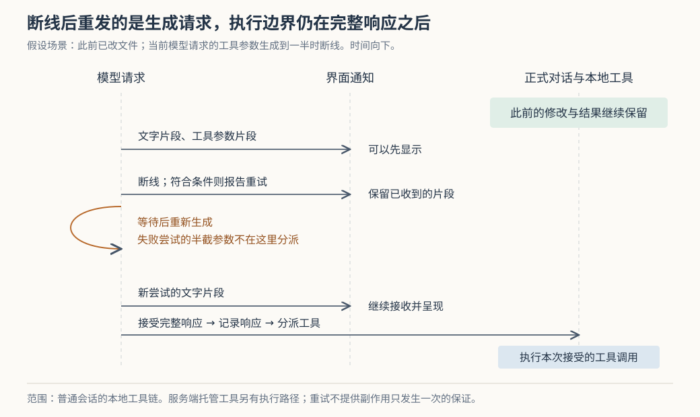

# Grok Build 回答到一半断线后怎样继续：流式显示、请求重试与工具执行边界

假设你让 Grok Build 修复一个测试。它已经修改文件，又开始生成下一步操作：终端显示了“接下来运行测试”，工具参数却只收到一半，连接就断了。随后界面提示正在重试。这时，程序是在接着补完那半条命令，还是重新请求模型？此前的修改会被重做吗？

当前源码给出的答案是：**自动恢复会重新发起模型生成；已经显示的片段、正式进入模型对话的响应、本地工具真正执行的动作，分别由不同路径管理。** 半截工具参数不会仅凭流式通知进入本地执行链；此前已经完成的修改则继续存在。重试也没有为整个任务提供“副作用只发生一次”的保证。

这是依据源码构造的场景，本次没有实际连接模型或制造断线。结合十二篇历史研报，本文深入此前仅概述过的模型请求恢复，不重述沙箱授权后的命令重跑或外部工具自身的连接重试。依据是 `input/repository/` 当前快照中的生产调用链、配置和测试；没有安装依赖、构建项目、执行仓库脚本或运行测试。下文的测试结论均表示读到了相应断言。配图通过了 XML 格式校验；本环境的图像渲染工具未能运行，未完成实际渲染检查。

**先看断线前，哪些事情已经发生。** Grok Build 是能够调用工具持续推进编码任务的 Agent。会话运行时负责组织模型请求与工具循环；`xai-grok-sampler` 则负责发送模型请求、接收逐段返回的数据，并把它们整理成事件和最终结果。这里的流式输出，就是答案尚未全部生成时，客户端已经逐段收到并显示内容。

`spawn.rs` 创建 `SamplerActor`，同时建立采样事件通道，再启动一个接收任务，逐条调用 `handle_sampling_event`。另一边，主工作循环在 `run_turn_via_sampler` 中提交请求并等待结果。因此，同一次生成有两条传递路径：事件路径交付过程信息，等待结果的路径交付完整响应或失败。[会话装配][spawn]、[提交与等待][sampler-turn]

事件处理函数收到文字片段时，把它转换为 ACP 的 `AgentMessageChunk`，送往客户端；ACP 是 Agent Client Protocol，即客户端与 Agent 交换输入和运行状态的协议。收到 `ToolCallDelta` 时，则发送工具名称、编号和参数增量。这些增量供界面呈现生成过程，**该分支没有调用本地工具执行器**。文字与推理片段还进入一份独立的过程采集对象，源码明确说明它不进入 `chat_state`，即供后续模型请求使用的对话状态。[事件转换][events]

真正推进正式对话和本地执行的是主循环：拿到接受的响应后，先提取工具调用，经过相关检查，再用 `record_response_items` 记录响应内容；之后才把工具调用转换为执行参数，交给 `execute_tool_calls`。因而，“界面已经出现运行测试的意图”和“测试进程已经启动”之间有实际代码边界。完整响应也仍可能因输出截断处理、特殊工具校验等分支而不执行；本文不把“收齐”本身当成执行承诺。[主循环][turn]、[记录响应][sampler-turn]

图画的是本文假设场景，不是实测时序。失败尝试的参数片段止于显示路径；新尝试交回可接受的响应后，才进入正式记录与本地执行。

**重新生成发生在两层，不能只数界面上的一次“重试”。** 第一层在采样组件内部。`request_task.rs` 为一次提交保留请求对象，在循环中反复调用 `run_one_attempt`，每次传入当前请求的副本。失败后由 `classify_error` 决定停止、等待后再试、重建网络客户端后再试，或去掉被拒绝的图片再试。这里重建的是网络请求客户端，不是把 Agent 的全部对话与工作区重新创建。[单次请求任务][request-task]、[错误分类][retry]

这条路径没有从已显示的第几个字符继续接收的机制。普通传输恢复再次发送当前请求；特殊恢复可以调整输入，例如删除图片，因此也不能说所有重试的请求正文都完全相同。已经执行完的前一批本地工具，不会因为这一层网络循环就被直接重新分派。

第二层在会话主循环。采样组件已经交回错误时，`handle_sampling_failure` 还会判断是否值得再给一次机会。符合条件便返回 `RetryTransient`，主循环等待后执行 `continue`，重新从对话状态构造请求，再提交给采样组件。新的提交会取得新的请求编号；这与采样组件在同一次提交内部重试是不同的计数范围。[恢复判断与提交编号][sampler-turn]、[重建请求与继续循环][turn]

这解释了为什么“采样组件自己的重试用完了”未必立即结束用户任务，也解释了为什么界面显示的三次补发不能直接理解为最多四次网络访问：每次提交内部还可能尝试多次。反过来，不能把两层上限机械相乘作为固定访问次数，因为认证、限流、输入调整和成功后的下一步各有分支。

**第二层只接住指定错误，并用三种预算限制等待。** `transient_retry_eligible` 把连接错误、响应长时间没有进展，以及部分可重试的服务端错误纳入候选。HTTP 是客户端与服务端通信的协议；例如状态码 503 表示服务暂时不可用。这里不是见到任何失败就重发：服务端明确要求不要重试、输入超出模型容量、明确的图片错误，都会否决这条恢复路径。认证错误、429 限流、响应解析错误、空响应、输出截断等，也不进入这个暂时错误分支；其中一些另有恢复方式，不能据此解释成整个程序都绝不重试它们。[候选判断][sampler-turn]、[分类测试][transient-tests]

对这条会话层补发路径，源码设置了三个限制：

| 限制范围 | 当前实现 | 实际含义 |
| --- | --- | --- |
| 当前生成步骤 | 最多额外补发 3 次 | 获得成功响应后，步骤计数归零 |
| 同一条用户请求 | 累计最多补发 10 次 | 工具执行后进入下一次生成、内部重新进入主循环，都不能无限领取新预算 |
| 一段连续恢复过程 | 在失败时检查已用时间，窗口取 10 分钟与两倍空闲超时中的较大者 | 成功后清除本段恢复起点；它不是整个用户任务的总时限 |

补发前的基础等待时间依次为 2、10、30 秒，再经过随机抖动，即让实际等待略有变化。上述数字仅属于第二层，不是项目的统一网络策略。时间窗口也不是一个到点就强制中断所有请求的定时器：预算在失败时检查，已经开始的等待和请求仍有自己的生命周期。[预算与等待定义][sampler-turn]、[计数更新和清零][turn]

生产装配还限定了适用对象：`transient_retry_enabled` 排除子 Agent，并读取功能设置；设置解析器默认开启，允许配置覆盖。因此，这条补发能力适用于开关启用的主会话，不能自动推广到所有子任务。无界面主会话也可以走它，不是终端界面专属功能。[会话开关][spawn]、[开关解析][features]、[默认值][config]

**重试通知不会把已经显示的半段答案变成正式对话。** 普通 `Retrying` 事件在会话侧主要转为重试状态通知。终端界面的 `apply_retry_state` 将它写入活动状态，显示尝试次数和原因；这个分支没有删除已经收到的文字。后续正常更新到达时，`AcpTracker::handle_update` 清除重试活动状态，再处理新内容。[重试事件处理][events]、[界面状态处理][ui-retry]、[后续更新][tracker]

因此，在所追踪的普通路径中，失败尝试的可见片段可能继续留在显示记录中，而下一次模型请求仍以正式对话为依据重新生成。读者不应把屏幕上连续出现的所有文字，都理解成模型下次会读到的已接受回答。这也是先前保存专题的另一面：保存了显示事件，与接受了一份模型响应，是两件事。

这不是说失败片段毫无用途。过程采集对象可用于追踪和故障分析；这里的结论只限定它在上述自动重试过程中没有作为正常响应逐片写入模型对话。其他客户端如何排版或消费这些事件，需要检查各自实现，不能仅凭终端界面的处理方式推断。

两条路径之间还有一道等待：`submit_turn_request` 得到最终结果后，如果采样组件已排入结束事件，就短暂等待事件接收任务确认处理完成。这样可以让此前排队的片段和状态先被处理，再推进工具或错误恢复。等待上限是五秒，超时会继续推进；如果取消或回退撤销了这次请求的归属，则放弃该旧结果。**这道等待协调的是内部事件处理顺序，不是等待用户看到屏幕，也不是磁盘保存确认。** [等待与归属检查][sampler-turn]

**限制输出后的重试，是另一种明确的设计选择。** `RetryPolicy` 有 `retry_only_before_output` 设置：一旦观察到输出，采样组件会把普通错误恢复的有效重试预算降为零。这里的“输出”包括文字、推理片段、工具参数片段和服务端工具进度，不只指用户能读懂的一句话。[输出判断][request-task]

普通默认策略没有开启这项限制；但会话装配会为带输出额度的工作流子任务，或明确要求该行为的调用方开启它，并关闭相应的异常重复生成恢复。会话错误处理也为这些任务提前返回失败，不让它们再绕进普通补发分支。[策略装配][spawn]、[额度与专用失败分支][sampler-turn]

从机制可以推断，这项选择适合那些难以撤回已交付内容、又需要严控生成额度的调用方：宁可暴露失败，也不在同一个已交付前缀后继续混入另一份生成。不过，不能把这个目的扩张成所有额度统计都精确完备；源码对某些缺失用量的普通响应仍留有待处理说明。

**现有测试支持哪些判断，也留下哪些空白。** `transient_retry_loop_tests.rs` 用模拟模型服务断言：连续两次 503 后成功时，提交三次；持续失败时，原始提交加三次补发后返回错误；关闭开关时第一次失败就结束。无界面主会话有对应断言。测试特意关闭采样组件内部重试，因此这些提交次数只验证第二层，不能当成默认生产配置的总网络次数。[循环测试][loop-tests]

同一文件还反复重新进入主循环，断言累计预算仍共享，避免每次进入都重新领取十次机会。该文件明确说明没有用这组虚拟时钟测试覆盖“真实流停滞触发超时”的整条路径；停滞错误是否进入候选，由处理器层测试另行检查。[预算测试][loop-tests]、[错误处理测试][transient-tests]

采样组件的测试另外断言：Messages 接口返回无法解析的中途事件时，不陷入重试；开启“只在输出前重试”后，即使检测到异常重复生成，也不会在已经输出后重新采样。后者验证的是异常重复恢复的约束，不能冒充本文假设的“半截工具参数断线”的端到端测试。本次没有运行这些测试，也没有找到并核验一项同时覆盖该假设场景、终端排版与磁盘修改结果的完整测试。[采样组件测试][actor-tests]

对使用者而言，看到“正在重试”时，应先分清当前是在等待模型，还是工具已经执行。模型请求恢复保留先前的工作成果，却不会回滚文件；若最终仍失败，重新要求执行前可以先检查文件和已有测试结果。尤其不能从一次完整失败推断“此前什么也没有发生”。

对类似 Agent 系统的实现者，这里的取舍很具体：逐段显示能尽早反馈进展，接受完整响应后再分派本地工具则建立了执行边界；分层恢复能挽救暂时故障，但必须为每一层写清预算单位、输入是否改变、已交付内容怎样处理。当前链路避免了“半截参数直接执行”，却不保证模型后来不会再次提出同一动作，也不能约束已经在服务端执行的托管工具。后者在事件处理中有独立的开始、完成通知，服务端副作用是否重复，仍需服务端协议与实现的证据。[托管工具事件][events]

[spawn]: https://github.com/xai-org/grok-build/blob/main/crates/codegen/xai-grok-shell/src/session/acp_session_impl/spawn.rs
[sampler-turn]: https://github.com/xai-org/grok-build/blob/main/crates/codegen/xai-grok-shell/src/session/acp_session_impl/sampler_turn.rs
[events]: https://github.com/xai-org/grok-build/blob/main/crates/codegen/xai-grok-shell/src/session/acp_session_impl/sampling_events.rs
[turn]: https://github.com/xai-org/grok-build/blob/main/crates/codegen/xai-grok-shell/src/session/acp_session_impl/turn.rs
[request-task]: https://github.com/xai-org/grok-build/blob/main/crates/codegen/xai-grok-sampler/src/actor/request_task.rs
[retry]: https://github.com/xai-org/grok-build/blob/main/crates/codegen/xai-grok-sampler/src/retry.rs
[transient-tests]: https://github.com/xai-org/grok-build/blob/main/crates/codegen/xai-grok-shell/src/session/acp_session_tests/transient_retry_tests.rs
[features]: https://github.com/xai-org/grok-build/blob/main/crates/codegen/xai-grok-shell/src/util/config/resolve/features.rs
[config]: https://github.com/xai-org/grok-build/blob/main/crates/codegen/xai-grok-shell/src/agent/config.rs
[ui-retry]: https://github.com/xai-org/grok-build/blob/main/crates/codegen/xai-grok-pager/src/app/acp_handler/session_notification.rs
[tracker]: https://github.com/xai-org/grok-build/blob/main/crates/codegen/xai-grok-pager/src/acp/tracker.rs
[loop-tests]: https://github.com/xai-org/grok-build/blob/main/crates/codegen/xai-grok-shell/src/session/acp_session_tests/turn/transient_retry_loop_tests.rs
[actor-tests]: https://github.com/xai-org/grok-build/blob/main/crates/codegen/xai-grok-sampler/tests/test_actor.rs
