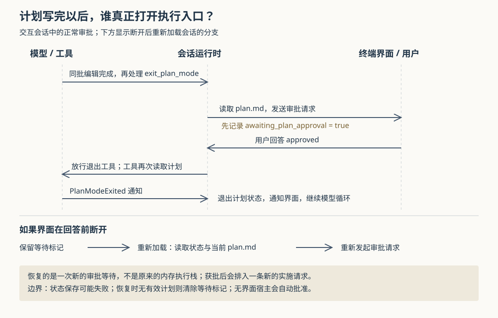

# Grok Build 怎样把计划批准变成实施：审批等待、重启恢复与执行限制

假设你让 Grok Build：“先研究登录模块的重构方案，等我确认再改代码。”它写好计划，终端弹出确认界面；你还没有选择，程序就断开了。重新打开会话后，计划应当继续等你确认，还是直接开始修改？如果确认界面还在，模型又提出一条写文件的终端命令，计划模式能否挡住它？

当前源码把这两个问题分开处理：**专门的等待标记负责恢复尚未回答的计划审批；计划模式中的编辑检查负责拦截一部分文件修改。后者并不拦截所有可能产生写入的工具，前者也不是所有运行方式下都要求人工回答。** 理解这层分工，才能判断“先规划、后实施”究竟提供了什么保证。

这是依据源码构造的场景，本次没有实际运行。本文结合十三篇历史研报，深入此前未展开的计划审批机制，不重复总体架构或普通权限弹窗的全部规则。依据是 `input/repository/` 当前快照中的生产调用链与测试；没有安装依赖、构建项目、连接模型、执行仓库脚本或运行测试。下文的测试结论均指读到的断言。

**进入计划模式，运行时先改变状态，再把要求告诉模型。** Grok Build 是能调用工具持续推进编码任务的 Agent。终端界面中的 `/plan` 命令产生切换模式的动作，带描述时则请求切换后开始一轮工作。运行时的 `handle_session_mode` 接收模式变更，调用 `PlanModeTracker::enter_pending`：此时只是“用户已经打开计划模式，模型尚未收到要求”。第一条相关请求进入时，`inject_plan_mode_reminders` 才将状态变为 `Active`，把计划文件路径和“只能编辑此文件”的提醒加入模型对话。这里的状态跟踪器，是会话持有、负责记录模式及其转换的数据对象。[界面命令][plan-command]、[运行时模式处理][session-mode]、[状态实现][tracker]

计划文件通常位于会话存储目录的 `plan.md`，并非业务仓库中统一共用的一份文件。会话创建时，`spawn.rs` 将跟踪器给出的路径作为 `PlanFilePath` 资源放入工具桥；工具桥是运行时登记、调用工具的连接层。因此，尽管退出工具的模块注释还提到工作目录下 `.grok/plan.md` 的后备路径，本地会话的实际接线使用了会话专属路径，不能只按注释判断。[会话装配][spawn]、[退出工具][exit-tool]

如果用户在模型工作途中才打开计划模式，运行时也会立即激活相关状态，并缓冲一条提醒，在后续安全位置送入对话。模型此刻正在进行的网络请求不会因此被重新生成；状态已经改变、模型稍后才看到提醒，是实现中明确存在的两个时点。这解释了为什么计划模式需要本地检查，不能只依赖一句文字要求。[运行时模式处理][session-mode]

**本地检查比提醒具体，但范围比“禁止一切写入”窄。** `prepare_tool_call` 在解析工具输入、应用执行前扩展处理器的参数改写后，计算本次调用的访问类型，再执行 `plan_mode_edit_gate`。检查拒绝时，运行时向界面与模型记录工具未执行，并继续模型循环；普通的“总是允许”权限配置不能绕过这个先行检查。[工具准备与审批主线][calls]

在当前公开构建中，这层规则可以概括为：

| 工具提出的动作 | 计划模式检查的处理 |
| --- | --- |
| 编辑跟踪器指定的计划文件 | 通过；没有扩展处理器要求询问时，还可跳过普通权限询问 |
| 用常规文件编辑工具修改其他路径 | 拒绝，包括其他 Markdown 文件 |
| 用 `apply_patch` 提交补丁 | 拒绝；这条分支不从补丁正文证明它只改计划文件 |
| 读取、终端命令及其他未落入上述编辑分支的调用 | 通过这一层，继续走普通权限流程 |
| 创建子任务 | 此检查明确放行；不能由此推导子任务没有写入能力 |

对应测试不仅检查了计划外编辑被拒绝，还让执行前扩展把原本合法的计划路径改成业务文件路径，断言仍会拦截。另一方面，`non_edit_tools_not_gated` 使用 `echo hi > /tmp/f`，断言计划模式检查允许这条带写入重定向的终端命令；源码注释也明确说此处拦编辑，不拦终端命令。它随后是否真正执行，仍取决于普通权限判断和其他执行约束。**因此，计划模式是一项工作流程控制，不能单独当作文件系统只读隔离。** [生产检查及单元测试][calls]、[接入层测试][edit-tests]

这里还有一个时机条件：上述编辑检查只在跟踪器为 `Active` 时生效。`Pending` 尚未启用检查，用户工作途中退出所用的 `ExitPending` 也不满足 `is_active()`。所以，界面切换、模型收到提醒和本地检查生效，不能简化为一个永远同步的开关。[状态实现][tracker]、[工具准备与审批主线][calls]

**计划写完后，模型调用的是“申请退出”，不是直接宣告获批。** 模型发出 `exit_plan_mode` 时，运行时会在真正分派工具之前拦截它，读取磁盘上的计划正文，调用 `request_plan_approval`。后者通过 ACP 的扩展方法 `x.ai/exit_plan_mode` 向客户端发送请求，并等待回答。ACP 是 Agent Client Protocol，即客户端和 Agent 交换会话请求与状态的协议；这里的扩展请求与普通工具权限询问分别登记，是两类交互。[工具准备与审批主线][calls]

终端侧的 `handle_exit_plan_mode` 按请求中的会话编号找到对应视图，创建计划审阅界面；它不会简单把后台会话的计划塞进当前焦点会话。用户确认时，界面把 `approved` 送回等待者。运行时收到后才允许退出工具真正执行；工具再次从文件系统读取计划，发出 `PlanModeExited` 通知，并向模型返回可以开始编码的结果。通知桥收到通知，关闭计划状态，同步当前与本轮模式，并向客户端发送默认模式更新。**界面收集决定，运行时控制放行，工具通知完成状态转换。** [终端请求处理][ui-handler]、[界面确认动作][ui-plan]、[退出工具][exit-tool]、[通知桥][bridge]

为什么读取磁盘，而不让模型在退出参数里再写一份计划？工具输入是空对象，正文取自计划文件，这减少了“用户审阅的方案与文件中保存的方案本来就不同”的机会。同批工具调用还设有一个顺序保证：`execute_tool_calls` 把 `ExitPlan` 类型的调用移到末尾，先等待其他调用所在批次处理完成，再准备退出调用。即使模型把“退出计划”排在“更新计划”之前，审批读取也能看到同批更新后的内容。两条接入测试分别调换这两个调用的顺序，均断言审批请求携带更新后的计划；另一条测试断言，前面发生权限取消时，不再发出退出审批请求。[批次安排][calls]、[批次顺序测试][batch-tests]

这仍不是计划版本锁。运行时准备审批时读一次，工具获放行后又读一次，已检查的请求与工具输入没有携带用于核对计划版本的摘要值。根据这条链可以推断：若外部程序在等待期间改写文件，获批时展示的正文和随后工具读到的正文可能不同。本次没有制造这种并发修改。终端另有一条“轮次结束后审阅计划”的路径，会在实施前比较磁盘正文和展示快照，发现变化时要求重新查看；本文追踪的轮次中实时审批分支则直接返回批准，不能把另一分支的比较当成这里已经获得的保证。[工具准备与审批主线][calls]、[退出工具][exit-tool]、[界面两种确认分支][ui-plan]

**拒绝修改、放弃计划和断开连接，会走不同的后续路径。** 正常等待中的决定有三类：

| 回答 | 当前工作轮次中的结果 |
| --- | --- |
| `approved` | 放行退出工具，随后继续实施 |
| `cancelled`，包括请求修改 | 保留计划模式，把反馈变成工具结果，让模型继续规划 |
| `abandoned` | 关闭计划模式，告诉模型用户已放弃方案，再继续模型循环 |

无法解析的响应会转成 `cancelled`，未知的结果字符串也按这一路处理，不会猜测为批准。注意，正在运行时的“放弃”分支返回继续循环；它并不等同于取消整个轮次。[决定解析与处理][calls]、[响应失败测试][resume-tests]

连接错误还有一项重要例外。请求已送出、客户端却在回答前断开时，运行时保留计划状态，当前路径返回取消，并留下待恢复标记。但若错误被识别为 ACP 通道的 `SendFailed`，即请求本身未能送入客户端通道，`ext_method_no_client` 将其视为没有接上客户端，允许退出工具继续执行。测试分别覆盖了“接到请求后断开仍等待”和“直接丢弃接收端则准备成功”。所以，不能笼统地说任何客户端故障都阻止实施。[错误分类与处理][calls]、[连接边界测试][resume-tests]

正式无界面宿主还有更直接的策略：`reply_headless_ext_method` 收到计划退出请求，就返回 `approved`，不等待操作者。这是可读到的客户端行为，而非从前述兼容分支猜出的行为。模型收到“计划已经批准”的工具文字，因而不能单独证明有人审阅过；调用方需要结合宿主的实际策略解释它。[无界面响应策略][headless]

**重启恢复靠的是保存下来的等待意图，而不是复活原来的工具调用。** 在发出审批请求前，`request_plan_approval` 把 `awaiting_plan_approval` 设为真，并提交保存任务。正常回答后，清理对象会把它清为假；等待任务被取消并释放时也会清除。若调用返回连接错误，程序则解除这次自动清理，保留标记，供后续重新加载会话使用。[等待标记与清理][calls]

这份标记保存在 `PlanModeSnapshot` 中，与计划正文分开。重新装配会话时，`PlanModeTracker::from_snapshot` 恢复状态，随后用恢复出的模式初始化供请求使用的模式字段，避免把原本仍在规划的会话误初始化成实施模式。加载入口确认有待审批标记后，发送 `RestorePlanApproval`；命令循环启动异步等待任务，继续接收其他会话命令。[状态恢复][tracker]、[会话装配][spawn]、[加载入口][load]、[命令循环][run-loop]

`resume_plan_approval` 首先检查是否已有同类等待，避免重复建立；再读取当前计划，创建一个新的审批调用编号并重新请求客户端。此时已没有原来的模型工作栈可继续，所以它按结果决定是否排入新请求：批准则退出计划模式，加入“实施 plan.md”的请求；要求修改则保持计划模式，加入带反馈的修订请求；放弃则只退出，不启动新轮次。这里与前面“原轮次中的放弃仍继续循环”存在明确差异。[恢复实现][calls]

恢复也有两个不能省略的条件。第一，计划文件缺失、为空或无法读取时，恢复函数都会清除等待标记，不再发起审批；这条路径没有同时调用退出计划模式。第二，标记保存并不是在弹出界面前同步确认落盘：`persist_plan_mode_state` 只向保存通道提交消息，保存任务写失败时记警告。突然退出或写盘失败后，不能保证最近一次等待状态一定可恢复。测试中的 `last_persisted_awaiting` 读取的是保存通道中的消息，它证明提交了相应快照，没有证明真实磁盘已经成功写入。[恢复实现][calls]、[保存提交][session-mode]、[保存错误处理][persistence]、[恢复测试][resume-tests]

这套设计可借鉴的地方，是把“模型应遵守的要求”“执行前可检查的限制”和“用户尚未回答的决定”分别建模：提醒可以反复注入，编辑检查在本地完成，待审批状态则可以跨会话加载恢复。代价是几个状态之间需要显式接线，客户端不同，审批含义也可能不同。

对使用者，计划模式适合先讨论方案、明确修改范围，再进入实施；若要求确认前绝不产生业务文件写入，还需要另行约束终端命令、外部工具和子任务。对接入者，应明确实现计划审批扩展，决定无操作者时是批准、拒绝还是等待，并区分“当前轮次继续”与“恢复后新建请求”。若业务要求批准精确对应一份不可变方案，还需要补上计划版本核对；当前链路只提供了同批写入先完成的顺序保证。

配图已检查 XML 格式与引用路径；本环境的 SVG 渲染命令因沙箱初始化失败，未完成实际渲染检查。本文对执行行为的判断来自源码与测试断言，未进行动态验证。

[plan-command]: https://github.com/xai-org/grok-build/blob/2bdd1d6a6369de0e8c68132ea4539e9abd9e14a8/crates/codegen/xai-grok-pager/src/slash/commands/plan.rs
[session-mode]: https://github.com/xai-org/grok-build/blob/2bdd1d6a6369de0e8c68132ea4539e9abd9e14a8/crates/codegen/xai-grok-shell/src/session/acp_session_impl/session_mode.rs
[tracker]: https://github.com/xai-org/grok-build/blob/2bdd1d6a6369de0e8c68132ea4539e9abd9e14a8/crates/codegen/xai-grok-shell/src/session/plan_mode.rs
[spawn]: https://github.com/xai-org/grok-build/blob/2bdd1d6a6369de0e8c68132ea4539e9abd9e14a8/crates/codegen/xai-grok-shell/src/session/acp_session_impl/spawn.rs
[exit-tool]: https://github.com/xai-org/grok-build/blob/2bdd1d6a6369de0e8c68132ea4539e9abd9e14a8/crates/codegen/xai-grok-tools/src/implementations/grok_build/exit_plan_mode/mod.rs
[calls]: https://github.com/xai-org/grok-build/blob/2bdd1d6a6369de0e8c68132ea4539e9abd9e14a8/crates/codegen/xai-grok-shell/src/session/acp_session_impl/tool_calls.rs
[edit-tests]: https://github.com/xai-org/grok-build/blob/2bdd1d6a6369de0e8c68132ea4539e9abd9e14a8/crates/codegen/xai-grok-shell/src/session/acp_session_tests/plan_mode_edit_gate_tests.rs
[ui-handler]: https://github.com/xai-org/grok-build/blob/2bdd1d6a6369de0e8c68132ea4539e9abd9e14a8/crates/codegen/xai-grok-pager/src/app/acp_handler/interactions.rs
[ui-plan]: https://github.com/xai-org/grok-build/blob/2bdd1d6a6369de0e8c68132ea4539e9abd9e14a8/crates/codegen/xai-grok-pager/src/app/agent_view/plan.rs
[bridge]: https://github.com/xai-org/grok-build/blob/2bdd1d6a6369de0e8c68132ea4539e9abd9e14a8/crates/codegen/xai-grok-shell/src/tools/notification_bridge.rs
[batch-tests]: https://github.com/xai-org/grok-build/blob/2bdd1d6a6369de0e8c68132ea4539e9abd9e14a8/crates/codegen/xai-grok-shell/src/session/acp_session_tests/plan_exit_batch_barrier_tests.rs
[resume-tests]: https://github.com/xai-org/grok-build/blob/2bdd1d6a6369de0e8c68132ea4539e9abd9e14a8/crates/codegen/xai-grok-shell/src/session/acp_session_tests/plan_approval_resume_tests.rs
[headless]: https://github.com/xai-org/grok-build/blob/2bdd1d6a6369de0e8c68132ea4539e9abd9e14a8/crates/codegen/xai-grok-pager/src/headless/ext_protocol.rs
[load]: https://github.com/xai-org/grok-build/blob/2bdd1d6a6369de0e8c68132ea4539e9abd9e14a8/crates/codegen/xai-grok-shell/src/agent/mvp_agent/session_setup.rs
[run-loop]: https://github.com/xai-org/grok-build/blob/2bdd1d6a6369de0e8c68132ea4539e9abd9e14a8/crates/codegen/xai-grok-shell/src/session/acp_session_impl/run_loop.rs
[persistence]: https://github.com/xai-org/grok-build/blob/2bdd1d6a6369de0e8c68132ea4539e9abd9e14a8/crates/codegen/xai-grok-shell/src/session/persistence.rs
