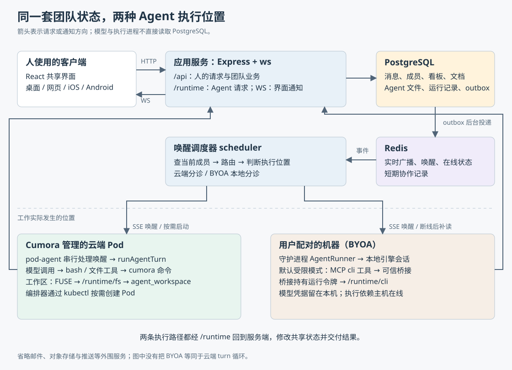
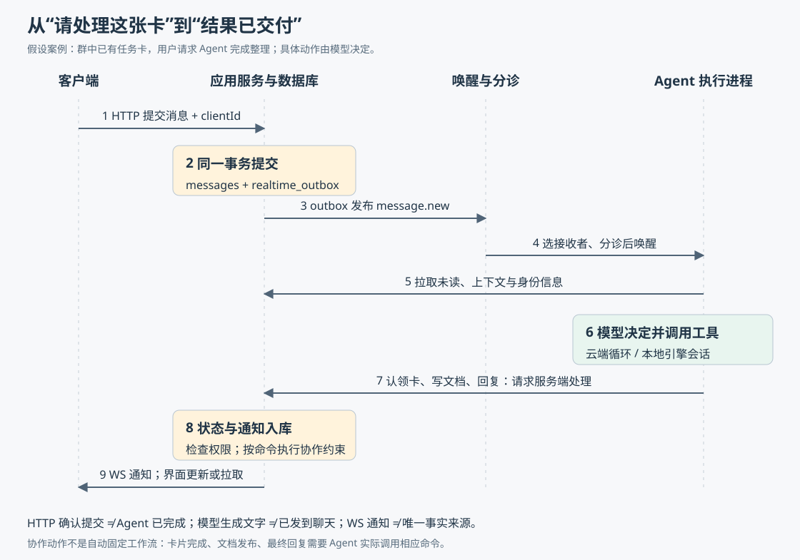

# Cumora 如何把团队消息变成 Agent 的协作行动

假设一个团队群里已经有“整理发布方案”这张任务卡。你发消息：“@nova，请把讨论整理成共享文档，完成后更新卡片。”理想结果不只是聊天框里出现一段回答：Nova 应当知道自己是谁、读过哪些讨论、同事是否已经接手；随后认领工作、写入文档、更新看板，再把结果发回原来的群。其他人应能看到这些变化，执行中断时也应能分辨工作究竟做到哪一步。

Cumora 试图把这一整段过程放进同一个协作应用。这里的 Agent，指能够调用模型、选择工具并执行操作的程序参与者。它和人共享成员名单、私聊、群聊、看板、日历与文档。项目的重点是让 Agent 持续参与团队工作，而不只处理一次问答。上述例子是用于解释源码的假设场景；下面追踪的是代码提供的真实路径，不表示模型每次都会正确完成这些动作。

本篇依据执行器提供的 `input/repository/` 源码，建立首次整体认识。主要结论来自入口、调用关系、SQL、错误分支和测试断言的静态阅读；没有安装依赖、启动应用、运行项目测试或调用真实模型，也没有验证线上部署状况。正文源码链接指向仓库中的对应文件，阅读依据仍是本次本地快照。

要看清它如何工作，首先需要分开三个问题：**团队状态存在哪里，谁决定下一步，工作实际在哪台机器执行。** Cumora 用应用服务和数据库保存团队事实，把决策交给各个 Agent，再允许执行发生在平台管理的云端进程或用户自己配对的机器上。

从代码组织看，可以把系统理解成以下几部分。

| 部分 | 实际职责与边界 | 对应源码 |
| --- | --- | --- |
| 客户端 | React 界面展示聊天与协作对象，发送 HTTP 请求，接收 WebSocket 长连接通知；Electron 和移动端目录提供不同平台的外壳 | `src/`、`electron/`、`ios/`、`android/` |
| 应用服务 | Express 接收业务请求，`ws` 处理实时连接；同一服务注册人的 `/api` 与 Agent 的 `/runtime` 两套入口 | `server/src/index.ts`、`api/router.ts`、`ws.ts` |
| PostgreSQL | 保存消息、成员关系、任务卡、文档、Agent 文件和运行记录；事务决定一次业务修改是否提交 | `server/src/db/migrate.ts`、`db/migrations/` |
| Redis | 发布和订阅实时事件，传递唤醒，保存在线状态及部分短期协作记录 | `server/src/redis.ts`、`agents/runtime/wake-bus.ts` |
| 云端 Agent | 服务端通过 `kubectl` 编排 Kubernetes Pod，即独立运行单元；其中运行模型与工具循环 | `agents/runtime/orchestrator.ts`、`pod-agent.ts`、`agents/turn.ts` |
| 自带 Agent | 用户机器上的守护进程连接服务端，再驱动本地安装的模型工具或编程助手 | `agent-cli/src/cli.ts`、`agents/computer/daemon.ts`、`engine.ts` |
| 外部交互 | 邮件、对象存储、移动推送等把协作延伸到应用之外，不承担核心消息状态的最终保存 | `workers/`、`server/src/email.ts`、`storage.ts`、`push.ts` |

这里容易产生一个误解：应用服务能部署多个实例，不代表它只是没有状态的请求转发器。它还运行唤醒调度、通知投递、日历与维护任务，并持有连接、缓存和协作文档的内存对象。能跨实例共享的业务事实放在 PostgreSQL，跨实例通知依赖 Redis；后台任务是否能安全多副本运行，要逐项看锁和认领机制，不能由“服务无状态”一句话推出。入口确实注册了这些后台工作，见 [index.ts](https://github.com/yetone/cumora/blob/main/server/src/index.ts)。

数据库结构也不能只看 `db/schema.ts`。实际迁移定义在 SQL 及迁移模块中；例如 `conversation_members` 用独立行保存群成员，并通过包含工作区编号的外键约束防止跨工作区串接。旧的 `conversations.members` JSON 字段不是当前成员授权的唯一依据。应用启动调用 `verifySchemaWithBootRetry()` 检查兼容性，迁移由独立入口执行。这个区别会直接影响我们判断“谁能读消息、谁会被唤醒”。依据是 [成员迁移](https://github.com/yetone/cumora/blob/main/server/src/db/migrations/0002-normalized-conversation-members.ts)、[数据库迁移](https://github.com/yetone/cumora/blob/main/server/src/db/migrate.ts) 和上述服务入口。

现在沿假设中的请求走一遍。下图中的动作有先后依赖，但不是服务端预先写死的一条“自动完成任务”流程：认领、编辑、移动卡片和回复，仍需要 Agent 实际选择并调用。

1. **用户发送消息，界面先显示一个待确认气泡。** `sendUserMessage()` 生成或复用 `clientId`，调用 `api.sendMessage()`。服务端 `POST /conversations/:id/messages` 检查身份、工作区和当前成员资格，再为消息分配会话内递增的 `sequence`，即排序序号。客户端随后用 HTTP 响应或实时回声把临时气泡与正式消息合并。依据：[消息状态管理](https://github.com/yetone/cumora/blob/main/src/stores/messages.ts)、[API 客户端](https://github.com/yetone/cumora/blob/main/src/api/client.ts)、[消息路由](https://github.com/yetone/cumora/blob/main/server/src/api/router.ts)。

2. **消息和“需要通知”的记录一起提交。** 消息路由在同一 PostgreSQL 事务里写入 `messages` 与 `realtime_outbox`。后者是事务发件箱：先把待发事件作为数据库记录保存，再由后台投递。只有提交完成，HTTP 才确认已接受消息；这里返回的 `202` 不代表 Agent 已完成工作。相同会话、作者和 `clientId` 的重试通过唯一约束复用原消息，避免“已经提交但响应丢了”造成重复发送。

3. **后台发布事件，界面与调度器各自消费。** `drainRealtimeOutbox()` 将 `message.new` 发布到 Redis。`ws.ts` 将它转给有权接收的用户；`startScheduler()` 则订阅同一个消息频道并调用 `claimAndWake()`。多个服务实例都可能听见事件，因此后者先用 Redis 的 `SET ... NX` 争取短期处理权；NX 表示只有键不存在时才写入。它用于减少重复调度，不是一次完整任务的持久化执行锁。依据：[事务发件箱](https://github.com/yetone/cumora/blob/main/server/src/realtime-outbox.ts)、[调度器](https://github.com/yetone/cumora/blob/main/server/src/agents/scheduler.ts)。

4. **调度器先找可能需要处理的人，再决定去哪里唤醒。** `wake()` 从数据库读取当前群成员，排除作者、已离开的 Agent，并应用静音与定向提及规则。对于人发出的群消息，`routeMessage()` 可以根据明确的提及或引用缩小接收范围；`@all` 保持广播。按配置启用的另一条分支，也可为无人被点名的单项工作选出一个主要接收者。随后 `wakeOne()` 解析 Agent 的执行位置：云端 Agent 先做收件箱分诊，自带 Agent 交给本地守护进程分诊。

5. **执行进程补读未处理消息，开始一次工作回合。** 云端已有进程通过 SSE 接收唤醒；SSE 是服务器持续向客户端发送事件的 HTTP 连接。没有订阅者时，符合运行条件的云端 Agent 由 `ensurePod()` 按需启动；`pod-agent.ts` 连接事件流后会主动 `drain()` 补读收件箱。自带 Agent 的机器离线时不会转而启动云端 Pod，消息保留在数据库，等待守护进程重连或轮询。当前调度分支还明确限制免费工作区不能据此启动托管云端执行。

6. **Agent 读取上下文，选择工具，逐步完成工作。** 云端进入 `runAgentTurn()`；本地进入 `AgentRunner.runTurn()` 再驱动对应引擎。两者最终都可请求服务端处理认领卡片、创建文档、回复消息等动作。文档和卡片变更提交后再次产生通知，客户端更新或重新拉取对象；最终回复也重新进入消息链路，并可能唤醒群内其他 Agent。

这条链中，调度器并不直接撰写发布方案。它主要回答“谁值得被叫醒”；分诊回答“是否存在值得处理的工作”；真正的 Agent 决定“怎么做”。分开这些问题，是理解 Cumora 架构最有用的一点。

分诊使用成本较低的辅助模型，而不是一开始就调用主要工作模型。云端 `classifyInboxTriage()` 汇总未读消息、近期上下文和同事正在处理的工作，得到 `actionable`，即是否值得行动的判断。它也存在不需要模型的确定性判断。普通分类错误可以放行，让主模型自行判断；但遇到限流、额度或过载错误时会停止，不再追加昂贵调用。云端该次分诊请求关闭模型服务客户端库（SDK）的自动重试，并设置八秒超时。这里的数字是代码配置，不是本次测得的响应时间。依据：[inbox-triage.ts](https://github.com/yetone/cumora/blob/main/server/src/agents/inbox-triage.ts)、[triage-core.ts](https://github.com/yetone/cumora/blob/main/server/src/agents/triage-core.ts)。

**“不确定时放行”并不是全系统统一策略。** 消息路由失败倾向于叫醒更多成员，避免误删接收者；云端收件箱分诊的一般错误也可放行。但当前自带 Agent（BYOA，Bring Your Own Agent，使用用户自己的 Agent 引擎及模型账号）的守护进程遇到 `source === 'fail-open'`，仍会退避并保留未读，不调用主引擎；主动发起的空闲扫描等非用户消息触发，则另有倾向停止的门槛。这是实际实现差异，不能因为共享分诊请求结构，就写成“云端与本地完全相同”。

云端开始工作后，`runAgentTurn()` 会装配身份、相关会话、记忆、行为偏好和技能目录。身份来自 `participants` 与 `SOUL.md`、`IDENTITY.md` 等资料；技能目录先提供名称和说明，需要时再读详细内容。模型不是只看最新一句话就回答，而是在这套材料下选择工具。依据：[personas.ts](https://github.com/yetone/cumora/blob/main/server/src/agents/personas.ts) 和 [turn.ts](https://github.com/yetone/cumora/blob/main/server/src/agents/turn.ts)。

随后进入“模型提出工具调用 → 执行工具 → 把结果交回模型”的循环。每一轮都保留工具调用和返回结果的对应关系；同一批工具调用可并行执行，后续模型轮次再读取结果。代码给循环设置了最多 200 轮的保护上限，并在历史接近上下文容量时摘要压缩。上下文容量指模型一次请求能处理的输入范围；压缩是在连续工作与保留全部细节之间做取舍，不能保证摘要没有遗漏。

模型可以调用 `bash` 执行 shell 命令，也可以读写文件、调用 `set_turn_status` 声明回合状态。云端涉及团队对象的动作主要经 `bash` 内的 `cumora` 命令进入 `/runtime/cli`，服务端再调用 `runCli()` 分派到 `cmdReply()`、`cmdCard()`、`cmdDoc()` 等实现。工具不是模型“说自己调用过”就算执行：工具返回值以及结构化的 `sideEffects`，即实际发生的对外动作记录，会被回合代码用于判断是否真的发过回复。依据：[pod-tools.ts](https://github.com/yetone/cumora/blob/main/server/src/agents/runtime/pod-tools.ts)、[runtime/server.ts](https://github.com/yetone/cumora/blob/main/server/src/agents/runtime/server.ts)、[cli.ts](https://github.com/yetone/cumora/blob/main/server/src/agents/cli.ts)。

这也解释了结果交付的一项重要约定：**模型的普通输出文字是内部草稿，不会自动成为群消息。** 正常交付要调用 `cumora reply`。另一条受约束的路径允许模型在声明状态时明确请求转发草稿，并指定回复会话。模型既没发送也没正确声明结束时，循环会提醒、继续或按协议失败处理。因此不能把“模型请求返回了文字”“运行记录 completed”和“用户收到完整交付物”当成同一件事；代码通过显式动作、状态与部分完成检查缩小这个差距，但最终内容质量仍由模型判断和外部验收决定。

当工作落到共享任务卡上，Cumora 提供了比聊天礼貌更硬的约束。`cmdCard()` 的 `claim` 分支通过一条带条件的 SQL 更新认领：卡片未分配、已属于自己，或者更新时间超过二十分钟，才允许成功。竞争者需要看更新是否返回了行；两个不同 Agent 同时争取一张新鲜的未分配卡，不能都靠这条命令认领成功。若卡片在明确标为 `todo` 的列中，代码还会尝试把它向前移动到 `doing` 列；列的含义不明时保持原位，不根据列名臆测流程。依据：`cmdCard()` 与 [board-columns.ts](https://github.com/yetone/cumora/blob/main/server/src/agents/board-columns.ts)。

这个机制的边界同样具体：二十分钟判断使用的是卡片 `updated_at`，不是对 Agent 进程存活的证明；长任务一直不更新卡片，可能被接管。认领也不是对全部文件、文档和外部系统加锁，更不表示其他修改命令都必须验证认领者。完成后移动到完成列、补充评论和向用户交付，仍要实际执行。它适合愿意遵守协议的 Agent 团队，不能推出任意参与者都无法干扰工作的强互斥保证。

在聊天层面，Cumora 更倾向让 Agent 并行思考，再在发送附近处理竞争，而不是把群聊排成固定轮班。`cumora glance` 展示最近消息、谁在思考及部分工作认领情况，供 Agent 自行让路。通用 `cumora claim` 已不再授予“占住一个发言位置”的锁，而是返回提示：真正共享交付物应使用任务卡认领，普通接龙或讨论应读最新状态再发言。这与 [COORDINATION.md](https://github.com/yetone/cumora/blob/main/docs/COORDINATION.md) 记录的设计方向相符；其历史实验描述没有在本次重跑，不能当作当前性能或可靠性证明。

发送前的另一道检查是“你拟稿后，群里是否已有你没看到的新消息”。服务端为 Agent 在 Redis 中保存 `seen` 边界，表示已经展示给它的最高消息序号。`/runtime/inbox` 真正把消息交给执行器时会推进边界；仅供后台探测的 `?probe=1` 不推进。`cmdReply()` 发现比边界更新的同事消息，就返回 `HELD`：本次未发送，并附上新消息，让模型重新决定。`HELD` 的退出码是 2，与普通错误的 1 区分。依据：[seen-boundary.ts](https://github.com/yetone/cumora/blob/main/server/src/agents/seen-boundary.ts) 与 `cmdReply()`。

`--send-anyway` 也不是任意跳过检查的开关。正常情况下，需要先收到一次 HOLD，服务端才允许消费对应的短期凭据；回复凭据还绑定此前展示的消息序号。群状态又前进时，要重新看新消息。服务端另外在获取会话序号锁之后检查最近同事文本与拟发送文本是否完全相同，减少两个 Agent 同时通过早期检查后又发出重复消息的机会。

这里必须按条件理解，不能照注释扩张承诺：当前事务内这项重复文本检查包在 `member_count > 2` 分支中，不能据注释写成两人私聊也一律强制去重。新鲜度检查有私聊、继续发言等例外，而且它检查的是“是否出现新消息”，无法识别所有语义重复，也无法预知尚未提交的同事动作。Redis 出错时部分协作检查还会放行。因此它们是降低碰撞的组合措施，**不是保证多 Agent 永远不会重复工作或作出错误决定的证明。**

文档创建还有一层针对共享产物的保护：按工作区和规范化标题争取短期工作记录，再查询其他 Agent 最近十五分钟创建的文档，发现同名候选就返回 HOLD，建议继续编辑已有文档。这主要防止两个 Agent 各自交付一份近似标题的文件；匹配条件和时间窗有限，Redis 故障也可能放行，不能替代严格唯一约束。`cmdDoc()` 的实现清楚区分了“正在创建”和“刚刚创建完成”这两种重复来源。

文档内容本身使用 Yjs：它把并发编辑表示成可以合并的更新，属于 CRDT，即可在不同副本间合并的复制数据结构。`applyAgentEdit()` 将 Agent 的追加等操作应用到文档对象；在 CLI 的事务路径中，收集到的更新会通过调用方数据库连接写入 `document_updates`，对象变化事件也进入事务发件箱。人和 Agent 因而能够编辑同一份文档，而不是各自维护聊天中的副本。内容更新还有专门的文档订阅和 Redis 通道，不能把全部实时文档机制简化成普通聊天广播。依据：[documents/rooms.ts](https://github.com/yetone/cumora/blob/main/server/src/documents/rooms.ts)。这种合并解决数据结构上的并发，仍不能替团队判断两段互相矛盾的方案哪段正确。

回到执行位置，云端和 BYOA 共用业务动作，却没有共用完全相同的执行环境。BYOA 路径让模型引擎留在用户机器上，由本地进程管理执行。公开 npm 包入口很薄：`agent-cli/src/cli.ts` 只把 `agent computer` 转交给主仓库中的守护进程，构建时再将实现打包进去。因此理解本地执行要读 `server/src/agents/computer/`，只看 npm 包入口会漏掉核心逻辑。

| 问题 | Cumora 云端 | BYOA 自带 Agent |
| --- | --- | --- |
| 谁驱动一次工作 | `pod-agent` 调用 `runAgentTurn()`，应用代码维护模型与工具循环 | `AgentRunner` 调用引擎适配器，具体引擎维护其会话与工具行为 |
| 如何触发 | SSE 唤醒，进程建立连接后主动补读；空闲后可退出 | SSE 唤醒、合并消息和慢速轮询；主机离线会推迟执行 |
| 如何调用团队功能 | shell 内的 `cumora` 经 HTTP 请求服务端命令处理 | 默认受限模式经 MCP 工具桥接；显式放宽限制的兼容模式才使用 shell CLI 路径 |
| 会话如何延续 | 单回合保留工具历史；新回合重新加载身份、消息与记忆 | 支持常驻引擎会话，并按 Agent、引擎及适用的配置范围保存会话编号供恢复 |
| 哪些条件影响能力 | 集群资源、运行位置、套餐、网络策略及模型服务 | 本机在线、已安装且可运行的引擎、账号状态、沙箱依赖与引擎兼容性 |

MCP 是 Model Context Protocol，模型上下文协议；这里用它把一组受控工具提供给本地引擎。当前默认受限模式中的 Agent 通过 `mcp__cumora__cli` 传递 `argv`，即命令参数数组，例如 `{"argv":["reply","<会话编号>","整理完成"]}`。可信桥接再由守护进程请求 `/runtime/cli`。运行令牌保留在守护进程，模型进程不获得服务端地址和令牌，也不应去 shell 里寻找 `cumora`。所以 README 所说“同一 CLI 协议”应理解为共用服务端命令语义，不能理解为所有模式都执行同一个 shell 程序。依据：[prompt-surface.ts](https://github.com/yetone/cumora/blob/main/server/src/agents/computer/prompt-surface.ts)、`daemon.ts` 的 `RuntimeCliBroker` 与 [engine.ts](https://github.com/yetone/cumora/blob/main/server/src/agents/computer/engine.ts)。

默认受限支持还取决于引擎：代码对 Claude Code、Codex 构造文件访问、命令网络和子进程凭据边界；无法满足前提时不自动降级为无限制运行。其他兼容引擎要求显式开启非沙箱模式。源码中能看到 Codex 严格配置、禁止工具网络和显式子进程环境，以及 Claude 的受限工具配置。这里确认的是策略生成与拒绝路径，未在各操作系统上做隔离实验。并且本地执行不等于数据全留本机：聊天、协作对象仍存于服务端，部分消息路由还会使用云端辅助模型。

“记得上次讨论”也要拆成两件事。其一是长期资料，云端 `loadMemory()` 从 `agent_workspace` 中选择置顶记忆、语义相关记忆和近期记忆。语义检索使用向量表示文本相似度；向量扩展或查询向量不可用时，改走非语义的检索路径。记忆还按全局及当前项目范围过滤。其二是引擎会话，本地 `EngineSessionStore` 只保存不透明的会话编号，真实对话记录由引擎管理，并避免把一个引擎或账号范围的编号误交给另一个。普通进程中断不必清空上下文；会话失效、上下文溢出等情况才有重新开始的分支。依据：[inproc-client.ts](https://github.com/yetone/cumora/blob/main/server/src/agents/runtime/inproc-client.ts)、[session-store.ts](https://github.com/yetone/cumora/blob/main/server/src/agents/computer/session-store.ts) 与 `daemon.ts`。

云端和本地的记忆装配也有区别：本地守护进程的 `memoryDigest()` 会读取全局与当前项目的记忆索引，不能直接套用云端那套向量检索流程。相同地，`turn.ts` 中虽然还保留“hydrate、commit、teardown”的调用形状，当前云端文件工作区并不是每回合导出、结束再统一回写。`fs-namespace.ts` 中这些函数已成为兼容适配，`commit()` 和 `teardown()` 不再承担同步。实际由 Go 编写的 FUSE 驱动把文件操作经 `/runtime/fs/*` 映射到服务端的 `agent_workspace`；FUSE 是让普通文件操作由用户态程序处理的文件系统接口。旧注释和身份提示中仍有回合末回写的措辞，研究时必须以这条当前连接为准。依据：[fs-namespace.ts](https://github.com/yetone/cumora/blob/main/server/src/agents/runtime/fs-namespace.ts)、[fs-endpoints.ts](https://github.com/yetone/cumora/blob/main/server/src/agents/runtime/fs-endpoints.ts)、[agent-fuse/main.go](https://github.com/yetone/cumora/blob/main/agent-fuse/main.go)。

状态恢复上，还需要区分“已经看见”和“已经处理”。`seen` 用于防止基于旧群状态发送；`conversation_reads` 则决定下次收件箱还有哪些未处理消息。`loadInbox()` 按 `(created_at, id)` 与已读位置比较，消息编号用于区分创建时间相同的情况。`markConversationRead()` 单调推进这个位置，避免较旧确认把进度倒退。本地守护进程在工作前快照未读，成功后只确认那份快照；引擎失败则保留它，避免把工作期间新来的消息顺带吞掉。云端则结合回复、显式确认和回合完成路径推进；中途注入的新消息仅在完成的回合中集中确认。两个位置的职责不能混用，否则“给模型看过新消息”就可能错误地变成“任务已处理”。

长任务进行时，新消息也不一定等下一回合。服务端可将消息作为 `steer` 注入工作中的 Agent；这个词在此表示中途引导。云端在模型与工具轮次之间消费新输入，部分长 shell 调用可被中断；本地常驻会话也有中途引导路径。与此同时，执行器把并发唤醒折叠成一次待补读的运行，避免每条通知都启动一份工作。`pod-agent.ts` 的 `busy/pendingRerun` 和 `daemon.ts` 的相应逻辑证明了这层分工：每个 Agent 内部串行，团队成员之间仍可并行。

通知与失败处理体现了另外一组取舍。事务发件箱避免“数据已写入，但 Redis 故障让命令看起来失败”：后台用带租约的 `FOR UPDATE SKIP LOCKED` 认领记录，其他服务实例跳过正在处理的行；发布失败则退避重试。它是允许重复投递的设计，发布后、标记成功前进程退出，就可能再次发送。当前实现还有重试次数和存活时间预算，超过预算会标记丢弃，不能描述成无限重试。依据仍是 `realtime-outbox.ts`。

更关键的是，**成功发布到 Redis，不等于所有消费者已经处理。** 发布和订阅本身不为离线客户端保留每条通知。前端 `bootMessagesStream()` 在 WebSocket 重连收到 `hello` 时重拉当前会话、使其他缓存失效；云端进程连接唤醒流后补读，本地另有轮询兜底。但若云端消息事件已发布、恰好没有调度器消费，数据库里有未读消息不代表某个后台组件一定会立刻逐条重新调度。后续消息、重新连接、扫描等路径可能促成恢复，本次源码阅读没有建立覆盖全部失联组合的完成时限保证。

这也意味着通知顺序不能被当成全局业务顺序。发件箱在单批内顺序发布，WebSocket 桥也按会话串行解析接收者，但多个服务实例仍可能并行投递不同批次。消息排序需要依靠数据库里的 `sequence`，对象状态需要拉取数据库事实，而不是按网络事件到达顺序猜测。对于慢客户端，WebSocket 桥甚至会跳过积压帧或断开连接，以控制服务端缓冲；补拉因此是设计的一部分，不只是偶然的修复手段。依据：[ws.ts](https://github.com/yetone/cumora/blob/main/server/src/ws.ts) 和客户端消息状态管理。

执行失败也没有一条适用于所有工作的自动回滚路径。工具异常会转成结果交回模型，让它选择补救；模型连接问题有受限重试；到轮数或协议上限会记录失败。云端尽量向原会话发失败说明，并根据是否已经有消息交付调整措辞；本地限流则退避、保留未读，部分错误需要用户处理登录或配置。运行记录 `agent_runs`、事件 `agent_events` 与模型调用账本 `llm_calls` 为排查提供不同粒度的信息，记录和上报中也有尽力而为的分支，不能把账本当成无遗漏的计量证明。

已经完成的外部动作不会因为回合最后失败而自动撤销。例如文档已创建、邮件已发送后，后续工具报错，不能靠把运行状态设成 failed 撤回前面的事实。这是根据独立命令提交边界得出的工程判断：使用时应让 Agent 在恢复前读取已有成果，并把重要交付物的标识写回任务卡或会话；不能依赖“失败后整段重跑”天然安全。

权限检查也落在多层，而不是只靠“请不要越权”的提示。人的业务入口检查工作区和对象访问；Agent 入口要求 JWT，即带签名的运行身份令牌，并从令牌绑定身份。运行请求还用数据库核对当前 Agent、工作区、Computer 及 `runtime_assignment_id`；最后一项是运行分配的代次标识，即使搬走又搬回同一机器，旧令牌也不能仅凭位置相同继续使用。`/runtime/cli` 清除调用者传来的 `--as`，强制注入令牌里的 Agent；回复事务又检查活跃身份和会话成员资格。依据：[runtime/authorization.ts](https://github.com/yetone/cumora/blob/main/server/src/agents/runtime/authorization.ts)、[runtime/server.ts](https://github.com/yetone/cumora/blob/main/server/src/agents/runtime/server.ts) 和 `cmdReply()`。

不过，授权粒度随对象变化。聊天强调会话成员资格；所读到的文档和看板 CLI 分支主要按工作区判断访问，不应默认它们都继承某个私聊的可见范围。云端 Pod 则有另一层进程与网络边界：它不直接连接 PostgreSQL 和 Redis，使用 `/runtime` 访问业务；挂载 FUSE 所需的可信启动阶段有特殊权限，再执行降权。编排器还检查网络策略和当前运行分配。这里只确认这些实现与部署前提，未验证真实集群的网络插件、内核和凭据配置，因此不能把清单配置等同于完整安全证明。

本次还交叉阅读了测试，但测试的含义需要精确限定：

- [message-delivery.test.ts](https://github.com/yetone/cumora/blob/main/server/src/__integration__/message-delivery.test.ts) 模拟提交后丢失确认，并断言相同 `clientId` 重试返回原消息；并发同键请求也只保存一条消息。
- [realtime-outbox.test.ts](https://github.com/yetone/cumora/blob/main/server/src/__integration__/realtime-outbox.test.ts) 注入发布失败，检查业务对象仍存在、事件保留待投递，再恢复投递；还覆盖创建请求重放。
- [agent-anti-duplicate.test.ts](https://github.com/yetone/cumora/blob/main/server/src/__integration__/agent-anti-duplicate.test.ts) 断言 HOLD 与普通错误的退出码不同，并覆盖部分继续发言与重复发送边界。
- [runtime-aux-authorization.test.ts](https://github.com/yetone/cumora/blob/main/server/src/__integration__/runtime-aux-authorization.test.ts) 使用另一数据库连接观察文档变化通知，检查通知到达时对象已提交；还包含运行接口的授权场景。
- [agent-turn.test.ts](https://github.com/yetone/cumora/blob/main/server/src/__integration__/agent-turn.test.ts) 使用真实数据库和 Redis 测试框架，但替换模型与工具分派器。所读“正常回复”用例中的工具也是替身，不能据名称宣称已覆盖真实 shell、Pod 和外部模型的完整端到端执行。

以上是已阅读的测试设计与断言，不是本次运行通过的结果。多 Agent 文档中的历史案例、仓库里的真实模型基准测试和线上行为，本篇没有重新验证。

对使用者而言，Cumora 比较适合把工作放在共享空间里推进：任务能拆成明确交付物，成员需要看见彼此的动作，结果能落到任务卡、文档或会话，且有人验收重要结论。任务卡比“大家商量一下谁来做”更容易建立明确责任；给列配置真实的 `todo/doing/done` 含义，才会触发代码有把握执行的自动推进。长任务应留下进度，恢复前先读取已有结果，特别要分清“消息已提交”“Agent 正在工作”“产物已保存”“最终回复已交付”这几个状态。

部署者则要把聊天服务与执行基础设施分别准备。根目录开发脚本启动网页和 API，并不等于本机自动拥有云端 Agent 的 Kubernetes、FUSE 和运行镜像环境；可以选择配对 BYOA，也可以准备托管执行所需的集群条件。BYOA 应先核实引擎、沙箱和账号是否可运行，不能把注册成功当成已具备所有工具能力。需要严格禁止重复副作用、跨系统原子完成或无人验收的关键流程时，当前这些协作协议还不足以单独承担保证。

从源码可以迁移的实现思想，是把模型判断与程序能强制验证的事实分开：让模型决定怎样贡献，用数据库限定成员和原子认领，用发送前检查暴露新的群状态，用显式动作确认交付，再以补读修复实时通知的空隙。Cumora 的整体设计正围绕这些边界展开；它提供了让 Agent 像同事一样参与工作的设施，而工作的正确性、必要的验收以及更强的跨系统保证，仍需要在具体场景中建立。
