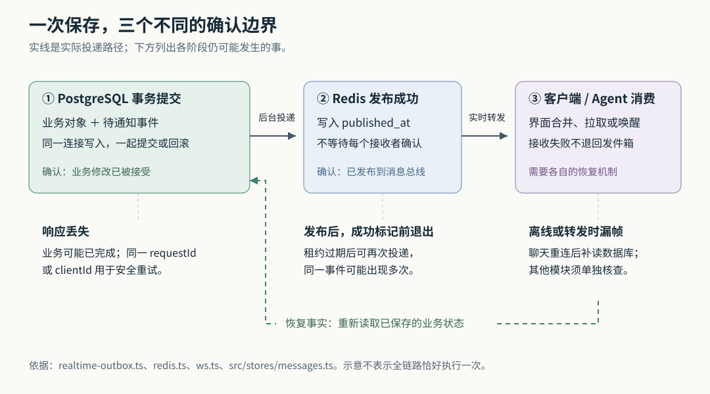
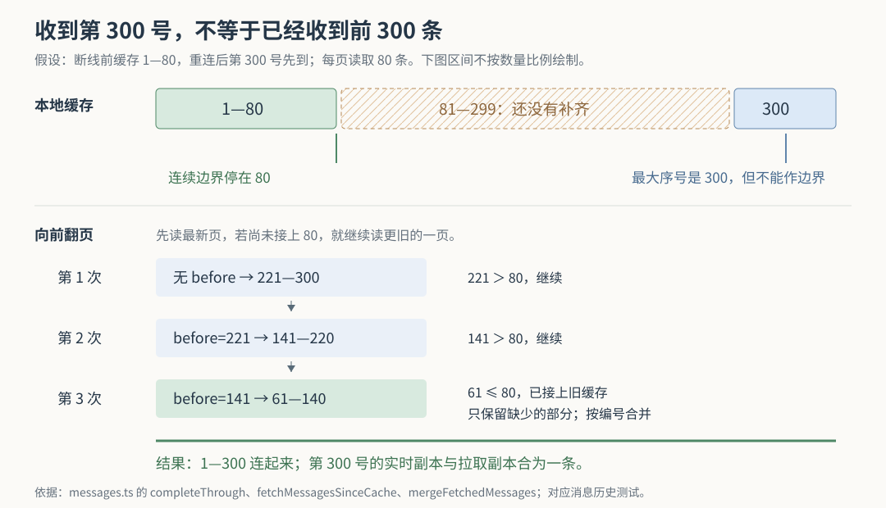

# Cumora 保存成功以后：实时通知、重复投递与断线补读的边界

假设 Nova 已经把发布方案写进文档，又把任务卡移到完成列，并在群里回复“整理好了”。你这边却仍然看到旧卡片，群消息也没有出现。此时直接让 Agent 重做，可能生成第二份文档；只盯着数据库里的“发送成功”，也不能解释为什么同事没看到结果。

Cumora 用两种办法处理这个问题：业务修改提交时，把待发送的通知一起保存；实时连接恢复后，客户端再从数据库补回遗漏。前者保护“已经做成的事不因通知故障变成命令失败”，后者修补“事实已保存，界面却没看见”的间隙。**这两种办法相互补充，但没有构成所有接收者都必然收到、所有动作都只执行一次的保证。**

上一篇已串起消息到 Agent 行动的整体链路。本篇继续追问：这些协作结果跨过数据库、通知总线和客户端时，分别确认了什么？尤其是，断线后已经收到一条最新消息，为什么还必须继续翻旧消息？上述场景是解释用的假设；以下结论来自本次 `input/repository/` 中的实现、调用方和测试断言。没有安装依赖、启动服务、运行项目测试或验证线上行为。配图按代码机制绘制并做了本地渲染检查。

**先看最容易混淆的两个失败：请求没得到答复，和通知没有送到。**

以创建看板为例，`POST /boards` 先检查当前工作区、整理标题和描述，再进入 `withOutboxTransaction()`。事务中依次创建看板、初始化三个列，并调用 `enqueueBoardEvent()` 写入通知；事务提交后才返回新对象编号。这里的事务，是数据库把一组修改作为整体提交或回滚的机制。

`enqueueBoardEvent()` 最终调用 `enqueueBroadcast()`，将 `board.changed` 事件写入 `realtime_outbox` 表。这个表就是事务发件箱：它记录“以后要发送什么”，而不是在业务事务里等待网络发送。关键并不在函数名称，而在于看板和事件使用了**同一个数据库事务连接**。如果事件写入失败，看板创建也会回滚；如果提交成功，两者都已保存。后台通知程序只会读到已提交的记录。依据：[看板路由及事件写入](https://github.com/yetone/cumora/blob/main/server/src/api/router.ts)、[事务与发件箱实现](https://github.com/yetone/cumora/blob/main/server/src/realtime-outbox.ts)。

这消除了一个具体的歧义：Redis——这里承担跨服务实例通知的内存数据服务——暂时不可用时，创建看板不必在数据库提交之后又因为发布通知失败而报错。数据库错误、参数错误仍可使命令失败；被移出命令完成条件的，是这次通知发布。

然而，数据库提交后，HTTP 响应本身仍可能丢失。对此，创建入口另用 `requestId` 标识一次请求。`findIdempotentCreate()` 按对象种类、工作区、创建者和请求编号取得事务级锁，再查询此前创建的对象：输入相同则返回原编号；同一编号配上不同输入则拒绝，返回 `409`。这种重试不会再次创建看板，也不会再插入一条创建事件。它称为幂等处理，即重复提交同一个请求不会重复产生目标对象。依据：[idempotent-create.ts](https://github.com/yetone/cumora/blob/main/server/src/idempotent-create.ts)。

这个保证有明确前提。调用者可以不传 `requestId`，此时没有这项重放保护；网页通过 `pendingCreateRequestId()` 在内存中为相同输入暂存编号，默认保留六十秒，成功或部分不可重试错误会清除。刷新页面、超过期限或换一个编号，不能继续假定是同一次请求。服务端的查重依据也附着在已创建的对象行上，不是一份永久保存的独立请求账本。依据：[客户端请求编号管理](https://github.com/yetone/cumora/blob/main/src/lib/create-idempotency.ts)、[看板创建调用方](https://github.com/yetone/cumora/blob/main/src/stores/boards.ts)。

聊天发送使用另一种编号 `clientId`，并在 `(会话、作者、clientId)` 上用数据库唯一约束查重。首次插入才写 `message.new` 通知，重复请求复用消息编号与序号，返回 `202`。所以“避免重复创建业务对象”和“避免重复收到通知”是两个问题，不能因为前者已有约束，就认为后者也只发生一次。依据：[消息提交路径](https://github.com/yetone/cumora/blob/main/server/src/api/router.ts)。

**发件箱允许多个服务一起投递，但没有把网络变成可靠的收件确认。**

服务启动会调用 `startRealtimeOutboxWorker()`。它每秒运行一次检查，业务提交后也可主动催促检查。`claimBatch()` 默认最多取三十二条尚未成功、未丢弃且已到重试时间的事件，使用 `FOR UPDATE SKIP LOCKED` 跳过其他数据库语句正在锁定的行，再写入投递者编号和十五秒的租约。租约表示这段时间内暂由某个投递者负责；进程消失后，不会留下永久占有记录。

数据库行锁保护的是这次认领语句；语句完成后，持续起作用的是 `locked_until`，而不是覆盖整个网络发送阶段的数据库事务。随后程序按批内排序逐条调用 Redis 发布，再执行 `markPublished()`。这些连接都能在 [realtime-outbox.ts](https://github.com/yetone/cumora/blob/main/server/src/realtime-outbox.ts) 中直接追到，表结构定义在 [数据库迁移](https://github.com/yetone/cumora/blob/main/server/src/db/migrate.ts)。

由此可以区分几种结果：

| 发生的位置 | 已保存的事实 | 后续行为 |
| --- | --- | --- |
| 业务事务未提交就失败 | 该事务中的业务修改与事件一起回滚 | 调用者处理命令失败 |
| 业务已提交，Redis 发布失败 | 业务对象仍在，事件仍待投递 | 记录错误，延后再试 |
| Redis 已发布，写成功标记前进程退出 | 接收者可能已收到，发件箱仍未完成 | 租约过期后可能重复发布 |
| Redis 已发布，某个接收者离线或处理失败 | 发件箱可以已标记成功 | 该接收者依靠自己的恢复路径 |

每条事件都有固定的 `deliveryId`，即投递编号。不过，本次对前端消费代码的搜索没有发现按此编号建立通用去重账本；当前主要依赖重新拉取状态、按消息编号合并等行为容忍重复。编号本身不会自动实现去重。

重试也有预算：记录的失败次数达到十二次，或事件存在满二十四小时，就会被标记为丢弃；已发布记录保留二十四小时，丢弃记录保留七天，再分批清理。这些是源码配置，不是本次测得的恢复时长。更准确的描述是**有预算、允许重复的发布重试**，不能把文件注释里的“至少一次投递”理解成任何故障下都保证最终送达。

还有一个值得部署者核实的边界：十五秒租约是在整批认领时统一开始，而发送是逐条等待，代码没有为批中尚未发送的行续租。Redis 普通命令配置了两秒超时，但三十二条事件加上数据库操作，并不天然能在十五秒内处理完。因此可以从代码推断：慢批次中的后排事件可能在原投递者仍工作时，被另一个实例重新认领。这里指出的是允许重复的另一条路径，没有做故障注入，也不据此声称线上已经发生。依据：[Redis 连接配置](https://github.com/yetone/cumora/blob/main/server/src/redis.ts) 与上述认领、循环实现。

**“按顺序发送”同样只在局部成立。**

`claimBatch()` 会把返回行按创建时间与编号排序，`drainRealtimeOutbox()` 不并行发送同一批事件。这能避免同批中的后一个调用主动抢在前一个调用之前开始。但前一个发布失败后，循环仍会继续发送后一个；多个实例还可以分别持有不同批次。因而即使只有一个投递者，重试也可能让早期事件晚到，更不能由批内排序推出全局顺序。

接收端另做了一层局部保序：`ws.ts` 把 Redis 事件按会话建立异步处理链，避免查询接收者权限的速度差异，把本已收到的同一会话事件再次打乱。不同会话可以并行处理。这保护的是“本实例已接收事件的处理次序”，不能恢复发布端早已乱掉的顺序。聊天真正用于排序的是消息的 `sequence`，即数据库分配的会话内序号；通知的到达时间和随机生成的投递编号都不能代替它。依据：[WebSocket 转发队列](https://github.com/yetone/cumora/blob/main/server/src/ws.ts)、[消息缓存合并](https://github.com/yetone/cumora/blob/main/src/stores/messages.ts)。

看板采取了不同办法。`board.changed` 主要告诉客户端“这块看板变了”，并不携带必须逐条重放的完整卡片操作。`useBoards.applyEvent()` 收到事件后，为已有缓存或当前选中的看板调用 `refreshBoard()`，重新获取完整状态。这让重复、晚到的通知通常只多触发一次读取，无需按通知顺序推算卡片位置。代价是额外请求，而且源码没有在这些并发刷新之间比较版本或请求代次；因此也不能进一步宣称“最后返回的响应一定最新”。这是从赋值路径得出的边界判断。依据：[boards.ts](https://github.com/yetone/cumora/blob/main/src/stores/boards.ts)。

**实时转发会检查现在的权限，也会主动放弃部分发送。**

`resolveWsEventRecipientUserIds()` 没有直接使用连接建立时缓存的成员名单。普通聊天事件需要按事件的工作区和会话重新查询当前成员，工作区级事件则查询当前活跃成员。延迟通知到达时，一个已经被移出群聊的人，不会仅凭旧连接继续被列入普通消息接收者。

有一个窄例外：系统离群通知可以在数据库消息行中保存 `delivery_recipient_id`，让刚被移出群的人收到那一条结束通知。转发函数会核对消息确实属于该群、确实是系统消息，再使用持久化的目标编号；不是在任意事件上附一个目标用户就能重新打开群访问。权限查询失败时，普通桥接会放弃该帧，而不是退回旧成员快照。依据：[ws.ts 的接收者解析](https://github.com/yetone/cumora/blob/main/server/src/ws.ts)。这说明延迟投递与授权必须一起考虑；这里确认的是发送前查询路径，不把它扩张成“查询结束到网络发送之间绝无撤权竞态”的证明。

对慢客户端，WebSocket——浏览器与服务器之间的持续双向连接——还会主动舍弃事件：发送缓冲超过两 MiB 就跳过当前帧，超过八 MiB 则断开连接，释放积压内存。这种控制接收速度落后造成积压的办法称为背压处理。它保护服务器，却也明确表明这条通道不负责保存每个客户端的完整通知历史。

因此，Redis 发布成功以后，权限查询失败、缓冲超限、连接断开，都不会让发件箱自动重置为待投递。甚至超过较低阈值只跳帧、未断线时，也未必会立即触发重连补读。**数据库里有事实，和当前屏幕已追上事实，之间仍可能隔着一次尚未发生的刷新。**

**聊天补读最重要的判断，是区分“最大序号”和“已连起来的范围”。**

`bootMessagesStream()` 收到连接建立后的 `hello` 时，会清除旧的流式输出和正在输入状态，重新加载当前会话；其他会话保留消息缓存，但取消“已加载”标记，等下次打开时补读。Redis 发布与订阅不会为离线浏览器保留每条通知，所以这里读取的是业务消息，而非重放发件箱。

假设断线前缓存了 1—80 号消息。断线期间消息发展到第 299 号；重连后，你还没打开这个会话，第 300 号实时通知先到，缓存变成“1—80，加一个 300”。如果用缓存最大序号 300 判断“补读从哪里开始”，就会错误地认为新消息已经追上，中间 81—299 永久留空。

`completeThrough()` 因而把缓存序号排序，从已有的最早一段开始，只走连续的部分，遇到缺口就停止。上述缓存得出的边界是 80。用户刚发出、尚未得到服务器确认的临时消息使用一个极大序号排在末尾，也被排除在边界计算之外。它计算的是可据以接续的缓存范围，不是从会话起点到该序号的全历史证明。

`fetchMessagesSinceCache()` 接着这样工作：

1. 先取最新八十条。例子中得到 221—300。
2. 这页已满，且最早的 221 仍大于边界 80，于是用 `before=221` 再取 141—220。
3. 再用 `before=141` 取 61—140；这一页已接上原缓存，只纳入缺少的消息，再与已有内容合并。

服务端 `GET /conversations/:id/messages` 提供严格小于 `before` 的序号分页，返回页内按序排列的消息；页面大小默认八十，服务端最多允许五百。客户端选择八十是这里的具体配置，不是算法必须使用的常数。依据：[消息读取路由](https://github.com/yetone/cumora/blob/main/server/src/api/router.ts)、[completeThrough 与补读实现](https://github.com/yetone/cumora/blob/main/src/stores/messages.ts)。

这套算法还承认序号可以有合法空缺。例如同一个 `clientId` 的重试可能先推进会话计数器，再发现消息已经存在，最终提交时没有插入新消息。序号用于排序，不保证每个整数都有消息。若缓存恰有这种缺口，连续边界会保守地提前停止，导致多读一些已有消息，而非冒险跳过未知区间。这个取舍偏向完整性，可能增加补读请求。

最终的 `mergeFetchedMessages()` 按消息编号以及客户端请求编号合并，保留读取期间已经到达的实时消息，再按序号排序。它不会用一份较早发起的读取结果，把刚收到的新消息整批覆盖掉。分页中途出错时，也先保留原缓存，不把半次补读当作已完成；`loadConversation()` 可在后续重新尝试，`reloadConversation()` 的失败分支则记录警告并保持现状。

它还有一个使用边界：空缓存只取最新一页，往前的历史交给用户滚动触发 `loadOlder()`。补读的目标是接回已经拥有的缓存段，而不是每次连线都下载整个会话。

**这不能推广成“所有协作对象断线后都会自动补齐”。**

当前看板的 WebSocket 监听器只处理 `board.changed`，没有处理 `hello`；`BoardsView` 挂载时会读列表，选择看板时则只在没有快照时加载。已缓存的看板如果漏掉一次变化，单凭聊天连接重建，不会走上述消息补读逻辑。后续事件、本人的修改触发刷新，或重置并重新加载，可能使它追上；本次没有找到这条看板路径的统一重连兜底。这里补充了上一篇“客户端重新拉取状态”背后的实际条件，而非否定重新拉取本身的作用。依据：[看板状态管理](https://github.com/yetone/cumora/blob/main/src/stores/boards.ts)、[看板视图](https://github.com/yetone/cumora/blob/main/src/desktop/BoardsView.tsx)。

同一条 `message.new` 也会被 Agent 调度器消费。`startScheduler()` 订阅 Redis，再经 `claimAndWake()` 用消息编号争取六十秒的短期处理权，避免多实例重复唤醒。调度器后续失败并不会阻止发件箱标记 Redis 发布成功。这再次说明，“已发布”“已唤醒”和“Agent 已完成”属于不同状态。执行器补读收件箱等恢复路径另有职责；仅凭发件箱，不能推导出 Agent 一定在某个时限内执行。依据：[scheduler.ts](https://github.com/yetone/cumora/blob/main/server/src/agents/scheduler.ts)。

本次阅读的测试为这些判断提供了不同强度的交叉证据：

| 测试 | 实际覆盖的行为与限制 |
| --- | --- |
| [realtime-outbox.test.ts](https://github.com/yetone/cumora/blob/main/server/src/__integration__/realtime-outbox.test.ts) | 使用数据库和 HTTP 入口，向投递函数注入失败，断言看板与待发事件仍存在，再替换为成功发布函数；也检查并发相同请求只产生一个对象和一条事件。这里没有真的关闭 Redis 服务器。 |
| [messages-history.test.ts](https://github.com/yetone/cumora/blob/main/tests/messages-history.test.ts) | 执行真实消息状态管理代码，替换为内存 API；检查多页补读、先到的第 300 号、中途失败重试、补读期间到达的新消息和滚动历史。它不是浏览器断网实验。 |
| [realtime-outbox-order.test.ts](https://github.com/yetone/cumora/blob/main/server/src/__tests__/realtime-outbox-order.test.ts) | 检查排序函数，并静态检查部分通知入箱发生在提交前；没有证明多实例全局有序。 |
| [membership-concurrency.test.ts](https://github.com/yetone/cumora/blob/main/server/src/__integration__/membership-concurrency.test.ts) | 其中的 WebSocket 路由用例直接调用接收者解析函数，检查移出成员前后与持久化离群通知的例外；并非完整网络传输验证。 |

这些是源码中已有的测试断言，本次没有运行。慢批次租约重叠、看板刷新响应次序，以及各类失联组合的恢复时限，仍属于需要进一步实验核实的边界。

对使用 Cumora 的团队，最实用的做法是把产物编号留在任务卡或会话中：界面没更新时，先读取既有文档、卡片和消息，确认事实，再决定是否重做。对接入方，同一次不确定结果的重试应保留原请求编号；不要用新编号期待旧请求的去重保证。

对维护这套机制的人，排查可以沿三个位置收窄：数据库里有没有业务结果与待发事件，事件是否已发布或已耗尽预算，接收端是否真正执行过拉取与合并。若目标是所有协作视图在断线后自动恢复，就需要逐个补上重连、静默漏帧和刷新失败后的恢复触发；若目标是严格确认每个消费者完成工作，还需要独立的消费确认与重放机制，当前的 `published_at` 承担不了这个含义。
