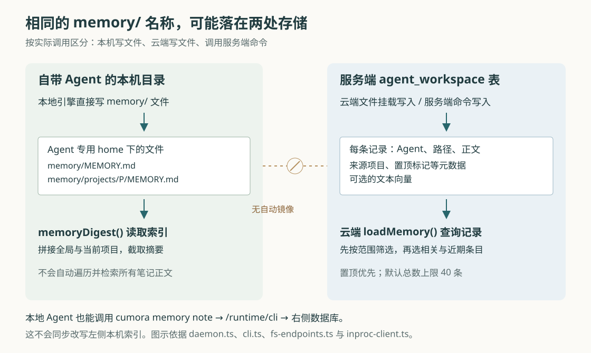
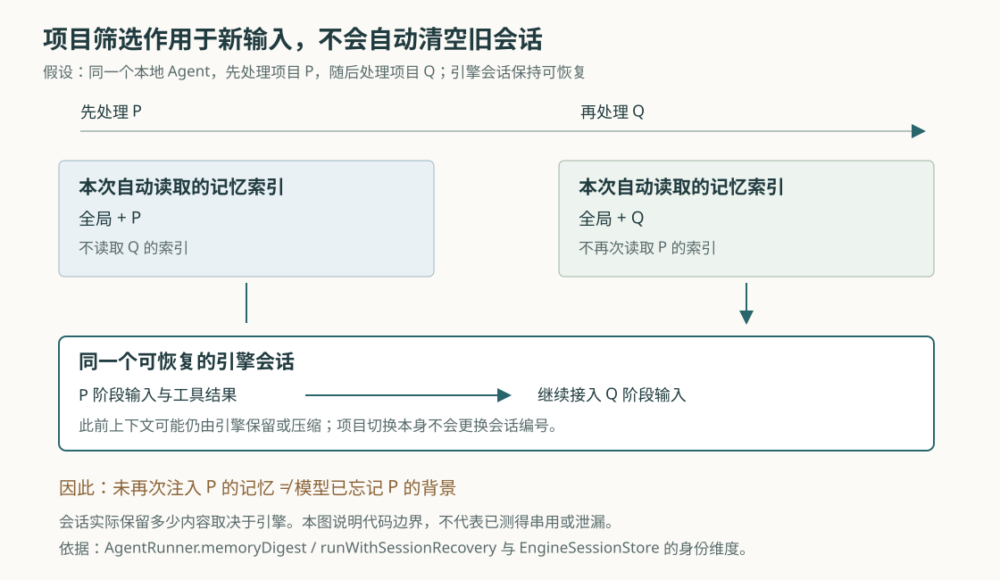

# Cumora 的项目记忆边界：笔记分开以后，旧背景为何仍可能留下

假设 Nova 在项目 P 里参与评审，记下了“只提意见，不直接修改原稿”。随后，项目 Q 的同事请它直接修改共享文档。如果 Nova 把前一个项目的约定当成通用规则，就可能拒绝本来应该完成的工作。这个假设场景说明：让 Agent 记住事情并不难，难的是让它记住适用范围，并在换工作时正确取用。

Cumora 把人和 Agent 放在同一个团队协作空间里。同一个 Agent 可以参与多个群聊，身份持续存在，工作背景却会改变。当前实现用项目来源标记和读取筛选，减少无关笔记进入新一轮模型输入；同时又保留全局身份资料和可恢复的本地引擎会话。因此，**项目记忆筛选能控制本次自动补充的资料，却不能据此认定 Agent 已经忘记其他项目，或不同项目之间已经建立权限隔离。**

前两篇分别解释了整体执行链和实时通知。本篇继续追踪长期笔记、项目归属、云端检索与本地会话之间的连接，细化此前“全局与当前项目记忆”的含义。依据是本次 `input/repository/` 的实现、调用方、设计文档和测试断言；没有安装依赖、启动项目、运行项目测试或调用真实模型，也没有做跨项目串用实验。两幅 SVG 已在本地渲染并检查。

**“记住了”首先要落实为一次保存；本地文件和服务端记录还不是同一份东西。**

以保存 P 的评审约定为例，Agent 可以调用 `cumora memory note "本项目只提评审意见，不改原稿" --kind decision --in <P的会话编号>`。这里的命令行接口负责把参数交给服务端，`cmdMemory()` 再确定当前 Agent、记忆种类和来源，生成文件路径，将正文写入 `agent_workspace` 表。这个表用“Agent 编号 + 文件路径”组织工作区资料；记忆虽然表现为 Markdown 文件，云端实际保存的是数据库记录。来源项目、来源会话、置顶标记等附加信息放在 `meta` 中。依据：[cli.ts 的 cmdMemory](https://github.com/yetone/cumora/blob/main/server/src/agents/cli.ts)。

`--about` 只描述笔记关于谁或什么，并不决定它属于哪个项目；`--kind decision` 也只是分类。真正决定范围的是来源和路径。聊天里说“收到，我记住了”，不会自行变成这一条长期记录；本地执行器的常驻提示也明确要求把值得保留的内容写入记忆文件。

云端还允许 Agent 直接写 `memory/` 文件。普通文件操作经过 FUSE——把文件操作交给用户态程序处理的文件系统接口——转成 `/runtime/fs/write` 请求，最终同样写入 `agent_workspace`。因此，云端直接写文件和调用记忆命令，能汇入同一套服务端存储。依据：[fs-endpoints.ts](https://github.com/yetone/cumora/blob/main/server/src/agents/runtime/fs-endpoints.ts)。

自带 Agent 的情况不同。BYOA 是 Bring Your Own Agent，意为让用户自己的机器和引擎承担执行。本地 `AgentRunner` 把每个 Agent 的主目录设为 `AGENTS_ROOT/<agentId>`；引擎直接写的 `memory/` 文件留在这台机器上。下一次唤醒时，`memoryDigest()` 用本机 `readFile()` 读取索引，并不先下载服务端记忆。

同一个本地 Agent 也能调用 `cumora memory note`，但 `invokeRuntimeCli()` 会把命令参数发送到 `/runtime/cli`，继续执行前面的服务端保存逻辑。这条路径没有同步改写本机 `memory/MEMORY.md`。所以“本地文件已保存”和“服务端记忆命令成功”要分别确认，不能因为都叫 memory 就假定它们自动互通。依据：[daemon.ts 的构造函数、memoryDigest 与 invokeRuntimeCli](https://github.com/yetone/cumora/blob/main/server/src/agents/computer/daemon.ts)；[BYOA 文档的本地与服务端状态边界](https://github.com/yetone/cumora/blob/main/docs/BYOA.md)也明确说明本地内部状态不镜像到服务器。

这带来一个实际使用条件：从本地执行切换到云端，或更换执行机器时，不能仅凭聊天记录仍在，就认为本机笔记也随之迁移。以上连接没有提供这种自动搬运；本篇也未验证人工迁移后的完整行为。

**项目归属来自明确参数和当前工作背景；无法判断时，程序可能把新笔记当成全局资料。**

`resolveMemoryWriteSource()` 负责查出来源，`pickWriteProvenance()` 负责按规则选择。它们优先使用 `memory/projects/<projectId>/…` 路径中的项目，其次考虑显式项目或显式会话；缺少明确指定时，再查看 Agent 当前正在处理哪些会话。后者由 Redis 中短期保存的反向索引提供，随后到数据库查询各会话的项目编号。Redis 在这里是保存短期工作状态的内存数据服务。依据：[memory-write.ts](https://github.com/yetone/cumora/blob/main/server/src/agents/memory-write.ts)、[memory-scope.ts](https://github.com/yetone/cumora/blob/main/server/src/agents/memory-scope.ts)、[thinking-convos.ts](https://github.com/yetone/cumora/blob/main/server/src/agents/thinking-convos.ts)。

例如，只有 P 的一个群在处理中，可以记下群和项目；同一项目的多个群同时处理中，可以记下项目，但不随意选一个群。若当前同时处理 P、Q 两个不同项目，且没有显式指定，项目来源就退回空值。这里的“全局”是该 Agent 的跨项目资料，不表示所有成员都能读取。

这不是偶然遗漏：辅助信息读取失败时，程序也尽量允许保存。Redis 查询失败可以返回空列表；会话项目查询失败可以留下空项目编号。没有路径或显式项目可供确定时，新记忆就可能落为全局。这个选择保住了笔记，却扩大了后续自动读取范围。**无法判定来源时继续保存，与无法判定来源时拒绝保存，是两种不同取舍；Cumora 此处主要选择前者。** 显式项目路径仍能提供确定来源，不能把所有故障一概描述成必然全局化。

旧笔记也不会被系统猜测着迁进某个项目。读取时，`rowProjectId()` 先看 `meta.source.projectId`，没有再从项目路径提取；两处都没有，就按全局处理。对云端自动检索和使用同一判断函数的服务端记忆列表，规则如下：

| 一条记忆的状态 | 仅处理 P 时 | 仅处理 Q 时 | 当前没有项目时 |
| --- | --- | --- | --- |
| 没有项目来源，也不在项目路径下 | 可进入候选范围 | 可进入候选范围 | 可进入候选范围 |
| 属于 P，未置顶 | 可进入候选范围 | 不进入 | 不进入 |
| 属于 P，已置顶 | 可进入候选范围 | 可进入候选范围 | 可进入候选范围 |

“可进入候选范围”不等于最终一定送给模型，后面还有数量限制。置顶表示把资料提升为跨项目优先项，不能只理解为“在 P 里更重要”。`memory pin` 还会切换当前标记：再次调用可以取消置顶。依据：[memoryVisibleInScope 与 rowProjectId](https://github.com/yetone/cumora/blob/main/server/src/agents/memory-scope.ts)、[cmdMemory 的 pin 分支](https://github.com/yetone/cumora/blob/main/server/src/agents/cli.ts)。

修改旧文件也不等于重新划定范围。文件写入接口在更新已有记录时用 `COALESCE(agent_workspace.meta, EXCLUDED.meta)` 保留非空旧元数据，并不合并或覆盖新的来源。因此，给一条已有全局笔记改正文，不能假定它会自动归入当下项目。这个行为保留了既有归属；若要纠正范围，需要检查实际路径与元数据，不能只看最近一次编辑发生在哪个群。

**云端按本次收件箱选记忆，但没有承诺“保存过的相关事实必然出现”。**

云端 `runAgentTurn()` 从收件箱收集会话编号，再把它们传给 `loadMemory()`；投票更新等特定唤醒也会补入相应会话。普通消息唤醒的检索文本来自收件箱前十二项非空正文，拼接后截到四千字符。也就是说，它用本次工作输入寻找相关旧笔记，不是把所有聊天历史都当作长期记忆读取。依据：[turn.ts 的 runAgentTurn](https://github.com/yetone/cumora/blob/main/server/src/agents/turn.ts)。

在独立云端执行进程中，这次读取经过 `HttpRuntimeClient.loadMemory()`，请求 `/runtime/memory/query`；服务端再调用 `InProcRuntimeClient.loadMemory()` 查询数据库。这里既有实际 HTTP 注册点，也有最终 SQL，不能只从某个接口声明推断它已接通。依据：[http-client.ts](https://github.com/yetone/cumora/blob/main/server/src/agents/runtime/http-client.ts)、[server.ts 的 /memory/query](https://github.com/yetone/cumora/blob/main/server/src/agents/runtime/server.ts)。

数据库查询按以下方式取候选：置顶条目优先；在范围内取默认二十条语义相关记录；再补默认十条近期记录；按路径去重，最终默认最多四十条。语义检索是先把文本转换为数字向量，再按向量距离寻找内容相近的笔记；这里使用 PostgreSQL 的 pgvector 扩展支持向量存储与查询。项目条件已放进相关和近期候选的 SQL 中，而不是先从所有项目取少量结果，再丢掉无关项目。返回后还会调用共享范围判断再次过滤。依据：[inproc-client.ts 的 memoryScopeSql 与 loadMemory](https://github.com/yetone/cumora/blob/main/server/src/agents/runtime/inproc-client.ts)。

有两个限制会改变使用者的预期。其一，置顶候选没有单独的条数限制，但最终仍受四十条总数限制；大量置顶记录可以挤掉其他候选，也可能让部分置顶记录本身落选。此前“置顶记忆随身份加载”的概括，应细化为“跨项目可见且优先，并非无限量注入”。其二，一次工作若同时含 P、Q 的会话，读取范围就是两个项目的并集。它没有为每个群分别建立一份独立的模型输入。

向量服务失败时，保存与检索也会分开退让。`embedText()` 遇到网络、限流等错误会返回空值；记忆命令仍可保存正文。读取端没有向量扩展或无法生成查询向量时，改按置顶优先、更新时间排序，取总数上限内的记录。这样临时故障不会直接抹掉笔记，但较旧、未置顶且原本只能靠语义命中的内容，就可能不再自动出现。依据：[embeddings.ts](https://github.com/yetone/cumora/blob/main/server/src/agents/embeddings.ts)。

服务启动还会扫描缺少向量的记忆并尝试补齐，但这是启动时触发的尽力扫描，不能理解成“每条失败记录都有持续重试任务”。此外，FUSE 文件写入先更新正文，再异步计算向量；向量回写没有比对正文版本。因此可以从代码推断：同一文件快速连续修改时，旧计算结果存在后到并覆盖新结果的可能，失败时也可能暂留旧向量。本篇没有做并发实验；这里说明的是“文件已保存”并不同时证明“检索表示已与正文同步”。依据：[index.ts 的 backfillMemoryEmbeddings 调用](https://github.com/yetone/cumora/blob/main/server/src/index.ts)、上述文件写入和向量实现。

**本地预加载只读索引，项目切换也不会自动换掉引擎会话。**

本地 `snapshotUnread()` 从未读消息中收集项目编号，`memoryDigest(projectIds)` 随后读取全局 `memory/MEMORY.md`，再读取这些项目各自的 `memory/projects/<id>/MEMORY.md`，拼接后默认截到四千字符。没有项目时只读全局索引；一次涉及多个项目时，会读多个项目索引。它没有逐条扫描全部笔记，也没有执行云端向量检索。缺失或读取失败的索引会被跳过。依据：[daemon.ts 的 snapshotUnread、memoryDigest 与 chatDelta](https://github.com/yetone/cumora/blob/main/server/src/agents/computer/daemon.ts)、[memory-scope.ts 的索引选择与摘要拼接](https://github.com/yetone/cumora/blob/main/server/src/agents/memory-scope.ts)。

因此，在项目目录里写了完整笔记，却没有在该项目索引中留下可发现的线索，不能期待下一次自动预加载其正文。索引拼接还是先全局、后项目，再对整段截取；全局索引过长，可能挤掉后面的项目内容。保持索引简短、让它指向具体文件，是当前实现下有因果依据的实践建议。也不能把服务端“扫描置顶元数据”的行为套到这里：本地摘要函数只读这些索引文件，并不遍历笔记的置顶标记。

接下来的会话复用，是项目筛选最容易被高估的地方。`EngineSessionStore` 保存的是引擎会话编号，真正的对话记录由 Claude Code、Codex 等具体引擎管理。编号的存储路径区分 Agent、引擎及适用的额外范围；调用方对部分引擎使用提供方配置指纹，Codex 使用运行专用范围。**这些维度没有包含项目编号或群聊编号。** `runWithSessionRecovery()` 每次仍取同一个 Runner 当前的会话编号继续工作。依据：[session-store.ts](https://github.com/yetone/cumora/blob/main/server/src/agents/computer/session-store.ts)、[daemon.ts 的构造函数与 runWithSessionRecovery](https://github.com/yetone/cumora/blob/main/server/src/agents/computer/daemon.ts)。

回到 P、Q 的假设：切换到 Q 后，预加载不会再次读 P 的项目索引，但上一轮送进引擎的 P 背景可能仍在同一个可恢复会话里，也可能已被引擎压缩保留。换项目本身没有触发会话重置。具体保留多少、模型是否真的误用，取决于引擎和模型，本次静态阅读不能确认。

还有更直接的边界证据：`memory list --all` 可以跳过默认项目筛选；`workspace read <path>` 和 `/runtime/fs/read` 按当前 Agent 与给定路径读取，没有附加当前项目条件。它们仍受 Agent 身份边界约束，但项目不是这层文件读取的独立权限单位。因此，这套机制适合减少无关背景自动进入模型，不能单独承担“同一个 Agent 绝不能读到另一项目资料”的要求。依据仍是 [cli.ts 的 cmdMemory 与 cmdWorkspace](https://github.com/yetone/cumora/blob/main/server/src/agents/cli.ts)、[fs-endpoints.ts](https://github.com/yetone/cumora/blob/main/server/src/agents/runtime/fs-endpoints.ts)。

**压缩和重置解决的是继续运行，也不等于保存或清除所有知识。**

云端每次 `runAgentTurn()` 都重新构造本回合的 `history`，即发给模型的输入历史；它没有像本地路径那样恢复一个跨回合的引擎会话编号。同一回合里，工具调用和结果不断增加，超过代码估算的模型上下文窗口的百分之七十五时，会尝试压缩。上下文窗口是模型一次能处理的输入容量；这里的窗口大小来自代码内模型名称映射，不是本次实测或对模型规格的外部核验。

压缩先缩短过长工具输出；仍超预算时，将较旧的调用与结果按关联编号成组取出，交给辅助模型写摘要，再把摘要插回输入。最前面的原始输入和最近两组工具交换保留；幸存条目保持原相对顺序。这个顺序有实际意义：中途到来的“再检查一下日志”如果原本已被后续工具处理，把它挪到历史末尾，就可能重新呈现为待办。当前实现通过原序遍历重建历史，避免这种重排。依据：[turn-compaction.ts](https://github.com/yetone/cumora/blob/main/server/src/agents/turn-compaction.ts)。

摘要生成失败时，程序可以退回删除旧工具组、插入通用提示的方式；压缩后仍超过硬阈值，就结束本回合并记录失败。这里的摘要仅被拼进当前 `history`，没有沿这条路径写入长期记忆文件。它能帮助本回合继续，但不能代替前面的记忆保存；被截断或概括的细节，也没有保持语义完全不变的程序保证。依据：[turn.ts 的 summarizeHistoryItems 与压缩调用](https://github.com/yetone/cumora/blob/main/server/src/agents/turn.ts)。

本地则把原生上下文管理交给引擎。恢复目标明确不存在时，`runWithSessionRecovery()` 清除编号并立即重试一次新会话；普通超时、进程异常等不确定失败，不在这个恢复包装器里直接重放，因为前一次可能已经执行了外部动作。上下文溢出或特定损坏还会让 Runner 丢弃当前会话，留待后续唤醒重新开始。依据：[session-recovery.ts](https://github.com/yetone/cumora/blob/main/server/src/agents/computer/session-recovery.ts)及 `daemon.ts` 的重置分支。

清除会话编号没有同时删除 `memory/` 文件；反过来，删除某条长期笔记，也没有在这些路径中清除已经进入引擎对话的文字。要纠正错误约定，必须先辨明它存在哪一层，不能把“重启守护进程”“删除笔记”“开始新会话”当成等价操作。

**现有测试支持局部规则，还没有证明完整的跨项目行为。**

本次阅读了以下实际断言，而没有执行测试：

| 测试 | 能支持的判断与范围 |
| --- | --- |
| [agents-memory-scope.test.ts](https://github.com/yetone/cumora/blob/main/server/src/__tests__/agents-memory-scope.test.ts) | 用纯函数检查项目可见性、旧记录保持全局、置顶跨范围、混合项目写入退回全局，以及索引路径选择。摘要拼接用例还表明：给拼接函数传入 P、Q，它就会同时拼接；筛选依赖上游正确选路径。 |
| [agent-memory.test.ts](https://github.com/yetone/cumora/blob/main/server/src/__integration__/agent-memory.test.ts) | 通过 CLI 与数据库断言保存、列表、置顶和删除；用替换的向量函数检查生成向量失败时正文仍保存。它没有模拟真实模型，也没有验证本地文件与服务端同步。 |
| [agents-computer-session-store.test.ts](https://github.com/yetone/cumora/blob/main/server/src/__tests__/agents-computer-session-store.test.ts) | 用临时目录检查不同引擎的编号分离、切回后恢复、写入排队和旧格式隔离。它没有建立按项目分会话的契约。 |
| [agents-computer-session-recovery.test.ts](https://github.com/yetone/cumora/blob/main/server/src/__tests__/agents-computer-session-recovery.test.ts) | 用模拟执行函数检查恢复目标丢失后只重试一次，不确定失败不立即重放。 |
| [agents-turn-compaction.test.ts](https://github.com/yetone/cumora/blob/main/server/src/__tests__/agents-turn-compaction.test.ts) | 用构造历史和模拟摘要检查调用结果配对、摘要失败回退、最近工具组保留、中途消息不被挪到末尾。它不能证明真实模型的摘要无遗漏或绝不重复工作。 |

设计文档 [COORDINATION.md](https://github.com/yetone/cumora/blob/main/docs/COORDINATION.md)记录过 Agent 从特定活动中学出过度通用规则，并明确把记忆文件视作需要检查的状态。这为“为什么需要范围”提供了设计背景；其中的历史运行结果，本篇没有重新验证。当前源码所显示的会话复用、全局兼容规则和直接文件读取，又说明范围筛选的效果必须限定在具体路径上。

对使用者，P 的评审约定应写进 P 的项目记忆，并保留会话、文档或任务编号；只有确实跨项目适用的身份偏好才适合全局保存或置顶。本地使用时要维护对应项目的简短索引，并确认自己写的是本机文件还是服务端记录。发现旧规则干扰新任务，应先检查全局索引、相关项目笔记和当前引擎会话，确认来源后再纠正。

对维护者，这套设计有可迁移的价值：保存正文、标记来源、选择候选和延续会话各有独立职责，故障时可以分别退让。它的代价也具体可见：不明来源继续保存会扩大范围，旧记录兼容会保留历史混杂，有限检索会遗漏候选，会话复用会保留此前背景。若要进一步实现严格项目隔离，需要同时设计独立会话、文件与工具授权，以及故障时的来源处理；仅在记忆查询里增加项目条件，还达不到这个目标。
