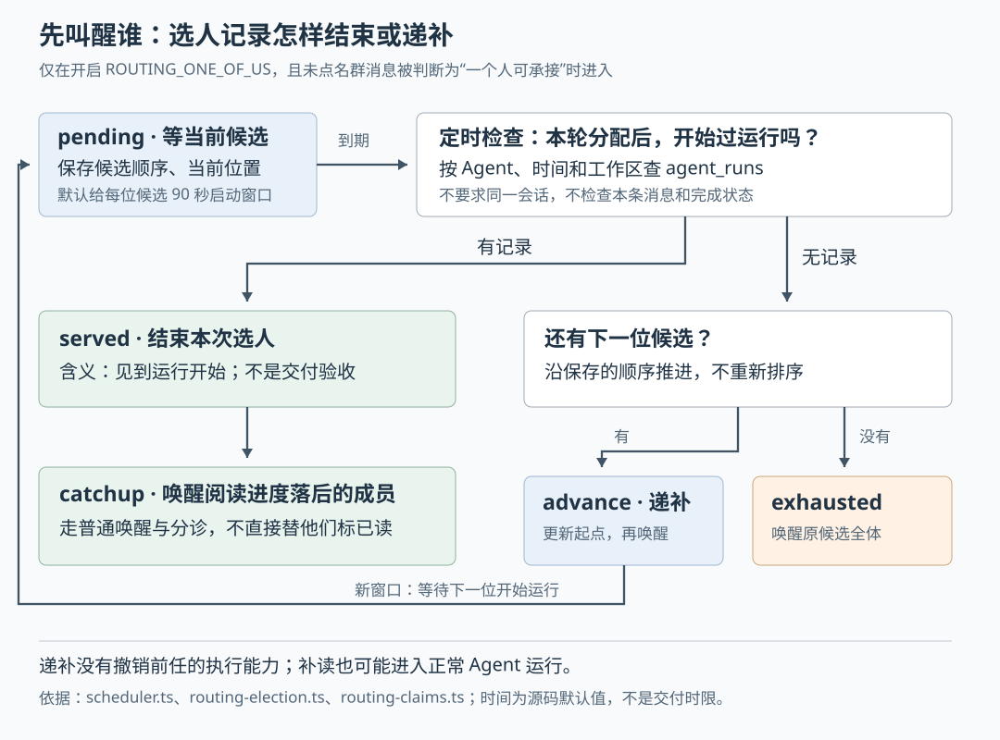

# Cumora 群里没人被点名时：先叫醒谁，超时以后谁接手

假设一个群里有 Atlas、Iris 和 Nova 三位 Agent，也就是能调用模型和工具执行工作的程序成员。你发了一句：“请把讨论整理成发布邮件。”没有点名，但你只需要一封邮件。三位同时开工，可能各写一份；只叫醒一位，它的电脑又可能恰好离线。怎样减少重复劳动，同时避免群里一直没有回应？

Cumora 为这类消息提供了一条可选路径：先判断是否适合由一个人承接，选出首位候选，把候选顺序存入数据库；如果候选迟迟没有开始运行，再依次递补。但**这套机制分配的是“先叫醒谁”，不是保证“只有谁能执行”，也不负责确认成果已经交付。** 理解这一区别，才能正确解读后台的接手状态和超时行为。

已有三篇研报分别讲过整体执行链、实时通知和项目记忆。本篇深入尚未展开的消息选人与递补机制，依据本次 `input/repository/` 的实际调用、SQL、测试断言和设计文档。没有安装依赖、启动项目、运行项目测试或调用真实模型；示例是解释用的假设，不是实测案例。配图已在本地渲染并检查。

**第一步不是挑“最聪明的 Agent”，而是确认这条消息是否需要缩小唤醒范围。**

新消息事件进入 `scheduler.ts` 的 `wake()` 后，程序先读取当前会话成员，剔除作者、已离开的 Agent，以及不符合例外投递条件的静音成员。这一步决定可接收唤醒的成员范围。之后，只有人发出的、非系统消息、非私聊消息，且候选多于一位、没有特殊离群通知接收者时，才进入这里研究的路由分支。“路由”在此就是决定把本次唤醒交给哪些成员。[调用入口：scheduler.ts 的 wake](https://github.com/yetone/cumora/blob/main/server/src/agents/scheduler.ts)。

消息若包含精确的 `@Agent编号`，或引用回复指向候选成员，程序走“是否只针对被点名者”的判断。无人被点名时，则必须额外开启 `ROUTING_ONE_OF_US`，才会尝试挑一位候选。这个开关在 `env.ts` 中**默认关闭**，不能把下面的过程描述为所有 Cumora 群聊的默认行为。`@all` 明确要求全体参与，也不会被这条路径缩小范围。[开关定义](https://github.com/yetone/cumora/blob/main/server/src/env.ts)、[消息分类规则：routing.ts](https://github.com/yetone/cumora/blob/main/server/src/agents/routing.ts)。

开启后，`routeUnaddressedMessage()` 调用辅助模型，给它消息正文的前两千个字符，以及候选的编号和角色。模型需要区分两种意思：

- `each`：希望多人讨论、投票或分别给意见，保留全体候选。
- `one-of-us`：一位成员就能承接的任务或问题，可以建议一位角色合适的候选。

这次调用没有加载完整聊天历史，也没有把实际工具能力逐一交给模型验证。因此，“适合整理发布邮件”主要是根据这条消息和角色描述作出的判断，不能当成对技能、账号或执行环境的资格认证。

模型请求失败时返回 `each`；没有识别到明确的 `one-of-us`，也保留全体。需要精确一点：返回值是用正则表达式提取模式和建议编号，并非完整 JSON 格式校验。这里的程序保障是检查候选和提供退路，不能由“模型按格式作答”推导出它理解了任务。[实现：buildUnaddressedRouteRequest、parseUnaddressedRoute 与 routeUnaddressedMessage](https://github.com/yetone/cumora/blob/main/server/src/agents/routing.ts)。

**模型提名以后，程序按忙闲状态决定谁排第一，再把顺序固定下来。**

假设模型推荐擅长写作的 Nova，但 Nova 正在另一群处理工作，Iris 则空闲。`electLineup()` 会优先选择空闲成员，不会只因角色匹配就把新请求排到忙碌的 Nova 后面。

这里的“忙”有具体判断：状态是 `thinking`、`working` 或 `waiting`，并且更新时间仍在有效期内。调度器传入的有效期是九十秒；忙碌状态过旧时，按可用处理，避免一次未清理的状态让 Agent 永久失去机会。忙碌状态缺少更新时间时则仍按忙碌处理。可用成员内部按编号稳定排序，忙碌成员也按编号排序，最后接到后面。[选人函数：routing-election.ts](https://github.com/yetone/cumora/blob/main/server/src/agents/routing-election.ts)、[状态有效期：status.ts](https://github.com/yetone/cumora/blob/main/server/src/status.ts)。

| 当时的情况 | 首位候选怎样决定 |
| --- | --- |
| 模型建议的成员真实存在且可用 | 接受建议 |
| 建议成员正忙，另有可用成员 | 选择编号排序靠前的可用成员 |
| 建议缺失或编号不属于候选 | 按稳定顺序选择 |
| 所有人都忙 | 优先接受有效建议，否则选排序第一位，仍尝试唤醒 |

这让同样的输入得到同样的排序，便于多服务实例处理。但它没有轮流分配或累计负载的公平性算法；角色建议无效时，编号靠前的成员可能反复成为首选。这是从排序规则得到的推断，本次没有测量实际分配分布。

选人之后，`claimPrimary()` 向 PostgreSQL 数据库的 `agent_routing_claims` 表写入一条记录：消息编号、工作区、会话、候选数组、当前位置、状态，以及租约到期时间。租约指给当前候选保留的一段启动窗口，默认也是九十秒；它与前面的忙碌状态有效期用途不同。

消息编号是主键。同一消息再次插入时，`ON CONFLICT DO NOTHING` 保留旧记录，然后读回原来的候选顺序和位置。这才是跨实例共享的选人记忆：不会因为某次读取的成员顺序不同，就随意改派。在这条分支内，如果写入失败，调度器保留全体唤醒，因为没有记录就无法在超时后递补。[持久化：routing-claims.ts 的 claimPrimary](https://github.com/yetone/cumora/blob/main/server/src/agents/routing-claims.ts)、[表结构：0009-agent-routing-claims.ts](https://github.com/yetone/cumora/blob/main/server/src/db/migrations/0009-agent-routing-claims.ts)。

**启动窗口到期时，程序查的是“运行开始过没有”，不是“发布邮件写好了没有”。**

服务启动调度器时，在开关启用的条件下启动定时检查。`sweepRoutingClaimsOnce()` 每轮最多取二十条到期且仍为 `pending` 的记录，默认每十五秒检查一次。SQL 使用 `FOR UPDATE SKIP LOCKED`：取记录时锁住选中的行，跳过其他检查者正在锁定的行，再把到期时间延后。这样，正常情况下不同服务实例不会同时领取同一条到期记录。[启动与检查：scheduler.ts 的 startScheduler、routing-claims.ts](https://github.com/yetone/cumora/blob/main/server/src/agents/routing-claims.ts)。

随后程序调用 `defaultHasRunSince()`，检查当前候选在本轮分配起点之后，是否产生过 `agent_runs` 运行记录。查询仅限定 Agent、开始时间和适用的工作区，**不限定本会话，不匹配本条消息，也不要求运行成功或结束。**

例如，Iris 被选来写邮件，却在分配后先到另一个群开始了代码评审。只要留下符合条件的运行记录，这条邮件请求的选人记录也可能被标记为 `served`。反过来，一项在分配之前已经开始、之后持续很久的运行，不会单凭“仍然活着”通过这次开始时间检查。

这不是只能靠推测解释的行为。查询实现和紧邻注释都明确采用粗粒度判断：作者把“错误递补导致重复唤醒”和“把别处运行误当作已经接手”作了取舍，倾向减少前者。`served` 因而应理解为“观察到候选在分配后开始过运行，结束这次选人”，不能翻译成“任务完成”。[判定依据：defaultHasRunSince](https://github.com/yetone/cumora/blob/main/server/src/agents/routing-claims.ts)。

运行记录本身也有这层局限。云端 `runAgentTurn()` 创建记录后，还可能因为收件箱没有变化或后续分诊而跳过主模型；自带 Agent 则在通过本地分诊后，通过 `/runtime/runs` 登记，再调用引擎。BYOA 是 Bring Your Own Agent，指用用户自己的机器和引擎执行。两边记录的位置并不完全相同，但都不能证明工具成功、文档已保存或回复已发送。[云端：turn.ts](https://github.com/yetone/cumora/blob/main/server/src/agents/turn.ts)、[本地：computer/daemon.ts](https://github.com/yetone/cumora/blob/main/server/src/agents/computer/daemon.ts)、[运行登记：observability.ts](https://github.com/yetone/cumora/blob/main/server/src/agents/observability.ts)。

如果查不到运行记录，检查程序把位置移到下一位，更新 `cursor_advanced_at`，重新开始启动窗口，再调用 `wakeAgent()`。使用新的分配时间很关键：后备 Agent 在轮到自己以前运行过别的任务，不能凭那条旧记录直接算本轮已经接手。走完最后一位仍没有运行记录，就标记 `exhausted`，并对原候选名单恢复全体唤醒。这里的“耗尽”是候选轮次耗尽，不是确认整个请求无法完成。[递补与耗尽：sweepRoutingClaimsOnce](https://github.com/yetone/cumora/blob/main/server/src/agents/routing-claims.ts)。

九十秒是默认启动窗口，十五秒是检查间隔，都不是向用户保证的响应时间。数据库拥堵、检查批次和执行环境启动还会影响实际等待；本次没有验证时间上界。

**已经判为接手，为什么还要叫醒其他成员？因为他们的未读消息仍在那里。**

回到发布邮件的例子。第一轮只叫醒 Iris，并没有替 Atlas、Nova 把那条请求标成已读。运行时的 `loadInbox()` 按成员资格、静音条件和阅读位置查未读消息，不会联查选人表，把“别人优先承接”的消息从其他成员收件箱中移走。阅读位置由“创建时间 + 消息编号”组成，用来决定后续从哪里继续读。[真实读取：runtime/inproc-client.ts 的 loadInbox](https://github.com/yetone/cumora/blob/main/server/src/agents/runtime/inproc-client.ts)。

当记录变成 `served` 时，`defaultFindCursorLaggingMembers()` 查找阅读位置仍落后于这条消息的活跃 Agent 成员，排除当前候选，然后产生 `catchup` 决定，也就是让这些成员补读。后台再调用普通的 `fanOutWake()`，没有直接推进他们的已读位置，也没有只发送一条“同步进度、不许行动”的特殊指令。后续仍由分诊和 Agent 判断是否需要参与。[补读查询与分发：routing-claims.ts](https://github.com/yetone/cumora/blob/main/server/src/agents/routing-claims.ts)、[普通唤醒：scheduler.ts 的 fanOutWake、wakeOne](https://github.com/yetone/cumora/blob/main/server/src/agents/scheduler.ts)。

因此，减少的是最初那一轮的全体唤醒，不能据此认定整个生命周期只会启动一个 Agent，或成本一定按成员数下降。初次未被选中的成员也可能因别的消息、重连或本地兜底检查而读取到原请求。本地守护进程在消息流健康时仍会做较慢的收件箱复查；这些读取同样不受选人表排他限制。[本地复查：daemon.ts 的 fallbackPollDue 与 AgentRunner.start](https://github.com/yetone/cumora/blob/main/server/src/agents/computer/daemon.ts)。

设计文档强调，不应为了发送前的新鲜度检查而随意推进已读位置，否则本来未处理的消息会从后续查询中消失。当前选人机制采用补读唤醒而非直接标已读，与这个边界一致；但“已经叫醒”仍不等于“已经正确读完”。[设计讨论：COORDINATION.md](https://github.com/yetone/cumora/blob/main/docs/COORDINATION.md)、[单调推进已读位置：markConversationRead](https://github.com/yetone/cumora/blob/main/server/src/agents/runtime/inproc-client.ts)。

**递补没有撤销前任；保存了选人记录，也没有保存完所有后续唤醒。**

这决定了系统故障时能承诺什么。

首先，递补只更新数据库中的当前位置并叫醒下一位，没有向前一位发送取消，也没有要求工具执行携带一个“仍为当前候选”的凭据。假如 Iris 离线超过启动窗口，Atlas 被递补；随后 Iris 恢复，仍可能读取原请求并开始工作。现有选人记录不能阻止这两位同时行动。需要避免重复成果时，还得使用任务卡认领、行动前查看群状态等既有协议；对外部邮件等副作用，不能只依赖本次选人来保证唯一执行。

其次，到期记录的领取和后续业务检查不是一个覆盖全流程的长事务。领取语句结束后，行锁已经释放，后续靠延长后的租约留出处理窗口。这里没有处理中的续租，也没有让终态更新校验领取者代次。因此，从代码可以推断：若处理异常缓慢并跨过新窗口，可能被其他实例再次领取；当前实现不能据此证明任意停顿下都只推进一次。没有做并发故障注入，本篇不把这种可能性描述为已经发生的线上故障。

最后，检查函数先修改记录，再把 `advance`、`exhaust` 或 `catchup` 决定放到内存数组中返回，后台另行执行唤醒。这段没有像前篇业务通知那样，把决定写入事务发件箱——即与业务状态一起保存的待投递记录。其具体后果是：

- 递补后、实际唤醒前进程退出，记录仍为 `pending`，下次到期检查还能继续，但并非保证重发同一个唤醒。
- 标为 `served` 后查询补读成员失败，代码记录错误并返回空名单；该记录已经不再属于待检查状态。
- `served` 或 `exhausted` 已写入，但后台尚未执行对应唤醒就退出，这张表没有待发送状态让下一轮重试；后续恢复要依赖其他唤醒、重连或收件箱检查。

这些边界直接来自更新、返回决定和执行唤醒的先后关系。[完整实现：routing-claims.ts](https://github.com/yetone/cumora/blob/main/server/src/agents/routing-claims.ts)。

重复消息也有条件限制。在调度器再次进入 `one-of-us` 且成功读到原记录的分支时，`pending` 会沿用原位置，`served`、`exhausted` 会跳过本轮唤醒。但查原记录发生在重新调用路由模型之后；若这次模型返回 `each`，程序不会先用旧记录阻止全体唤醒。终态记录还会在超过一天后清理。因此，选人表是短期恢复与观察资料，不是所有投递入口都无条件遵守的永久去重凭证。[分支顺序：scheduler.ts 的 wake](https://github.com/yetone/cumora/blob/main/server/src/agents/scheduler.ts)。

**测试支持了哪些认识，哪些仍需要实验？**

本次阅读的 [agents-routing-election.test.ts](https://github.com/yetone/cumora/blob/main/server/src/__tests__/agents-routing-election.test.ts) 检查了候选排序、忙闲提名、原记录复用、接手判定、递补、耗尽与补读决定，并检查用本轮分配时间作为起点。其中数据库被替换为测试返回值，适合验证分支选择，不能证明真实数据库并发。

[agents-routing-claims.test.ts](https://github.com/yetone/cumora/blob/main/server/src/__integration__/agents-routing-claims.test.ts) 则设计为连接 PostgreSQL，检查实际插入、到期领取语句、位置推进和落后成员查询。但接手判定用注入的 `hasRunSince` 返回值代替真实运行查询；它断言的是状态和待唤醒决定，没有真正启动云端进程或本地引擎。所读用例也没有覆盖多个检查者长时间停顿、终态写入后崩溃或真实模型重新分类等场景。以上均为已读测试设计，未在本次运行。

对使用者，明确指派仍有价值：确定需要谁做时点名；需要多份独立意见时明确说明，必要时使用 `@all`；需要唯一交付物时建立任务卡并在群中留下承接与完成证据。不能仅看到 `served` 就关闭验收，也不能看到 `exhausted` 就断言所有执行环境都无法工作。

对部署者和后续实现者，首先应确认开关是否开启，再把选人记录与真实运行、输入消息、成果和回复对应起来。如果业务需要更强保证，可以考虑让接手记录绑定具体请求、给递补后的执行建立可校验的代次，并持久化后续唤醒决定。这些是基于上述边界的改进建议，不是当前已有能力。Cumora 此处提供的是一种成本与可恢复性之间的折中：把首轮承接范围缩小，同时保留递补和补读；任务最终是否被正确完成，仍要沿真实执行与交付证据确认。
