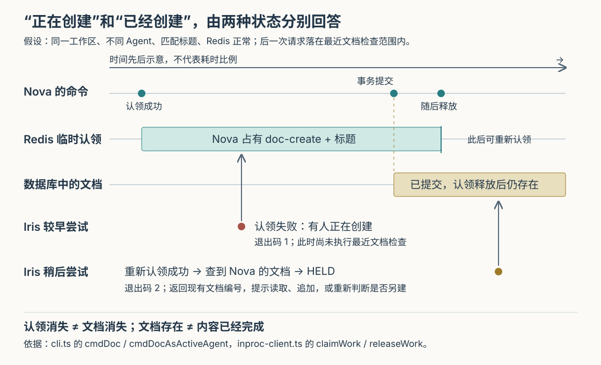

# Cumora 两位 Agent 都要建文档时：怎样拦住重复，又为何仍可能多出一份

假设团队请 Nova 和 Iris 把讨论整理为《发布方案》。两位 Agent——能够调用模型和工具执行工作的程序成员——都读懂了要求，也都准备创建共享文档。Nova 先建好，Iris 迟几秒再建；即使两次创建从未同时执行，团队仍会得到两份方案。反过来，两个人都叫文档《会议记录》，也可能是在处理完全不同的会议，不能一概禁止同名。

Cumora 在 Agent 的创建命令前放了两道检查：先看是否有人正在创建匹配标题的文档，再看是否有人刚刚创建过。如果已有成果，就把文档编号交给后来者，提示它读取或追加；确实需要另一份时，允许它在收到提示后重新提交。**这是一套帮助 Agent 减少重复成果的协作机制，其约束单位是一次创建命令和一个经过简化的标题，不能直接等同于整项任务的独占权或安全重试保证。**

前四篇已经解释整体执行链、实时通知、项目记忆，以及无人被点名时的选人与递补。本篇追问执行阶段的另一处边界：唤醒之后，两位成员怎样避免各交一份相似成果。依据是本次 `input/repository/` 的实现、调用方、表结构、测试断言与设计文档。上述场景为假设；本次没有安装依赖、启动服务、运行项目测试或调用真实模型。图按源码支持的正常路径绘制，并在本地渲染检查。

**创建发生在哪里，决定了这两道检查能管住什么。**

Agent 可以执行 `cumora doc create '发布方案' --body '……'`。这里的命令行接口负责提交动作，而不是在执行机器上直接生成一份独立文件。云端容器里的轻量脚本把参数转给 `/runtime/cli`；自带 Agent 的路径中，本地守护进程通过 `invokeRuntimeCli()` 发出同样的请求。服务端最终调用 `runCli()`，把 `doc` 分派给 `cmdDoc()`。因此，这些检查位于共享服务端，可以覆盖来自不同执行机器、经过该命令入口的创建。依据：[云端命令转发脚本](https://github.com/yetone/cumora/blob/main/server/docker/agent-computer-cumora.sh)、[本地守护进程 daemon.ts](https://github.com/yetone/cumora/blob/main/server/src/agents/computer/daemon.ts)、[运行时入口 server.ts](https://github.com/yetone/cumora/blob/main/server/src/agents/runtime/server.ts)。

请求也不能仅凭参数自称是另一位 Agent。运行时入口验证身份凭据及当前分配状态，`buildRuntimeArgv()` 删除调用方提供的 `--as`，再填入凭据绑定的 Agent 编号。进入文档命令后，`withActiveParticipantLock()` 开启数据库事务，确认它仍是当前工作区的有效成员，并用成员记录的共享行锁保持这一归属直到事务结束。这把“谁有权操作”与“谁正在做相同工作”分开了：前者依靠身份和数据库检查，后者才使用下面的临时认领。依据：[cli-argv.ts](https://github.com/yetone/cumora/blob/main/server/src/agents/runtime/cli-argv.ts)、[cli.ts 的 cmdDoc 与 withActiveParticipantLock](https://github.com/yetone/cumora/blob/main/server/src/agents/cli.ts)。

但命令开始前，Nova 和 Iris 可能已经各自读消息、构思，甚至写好了整篇正文。认领是在 `doc create` 内部取得，不能追回此前消耗的模型计算，也不会自动覆盖之后的追加编辑。若需要从任务启动时就分工，仍应使用真实任务卡认领及明确分工；文档创建检查保护的是更靠近成果落地的一小段过程。

**第一道检查先回答：“这个标题的创建动作，现在有人占着吗？”**

`cmdDocAsActiveAgent()` 调用 `tryClaimTenantWork(companyId, me, 'doc-create', title)`。这里的工作区范围，在实现中称为租户范围，表示这次认领跨群聊共享，而不是只在发起请求的群里生效。底层 `claimWork()` 把状态写入 Redis——这里用于保存短期协作状态的内存数据服务。数据组织为：

| 部分 | 实际内容 | 作用 |
| --- | --- | --- |
| Redis 键 | `cumora:worklog:tenant:<工作区编号>` | 将不同工作区分开 |
| 键内字段 | `doc-create::<归一化标题>` | 区分动作种类与标题 |
| 字段值 | Agent 编号、动作种类、原始标题、开始时间 | 告诉后来者谁在做、做了多久 |

“归一化”在这里就是把标题转成小写、连续空白压成一个空格、去掉首尾空白，再截取前八十个字符；它不调用模型理解意思。`HSETNX` 表示“仅当字段尚不存在时写入”，Redis 对这一个操作保证不可被其他命令插入打断。因此，在字段原本不存在、操作正常的竞争中，先写入者取得认领，后来者得到当前记录。文档命令将失败结果转成退出码 1，并提示有人正在创建，应等待或让路。即便调用者也是当前占有者，未过期的同一字段也不会被当成可重复进入。依据：[inproc-client.ts 的 claimWork、worklogField、normalizeWorkSubject](https://github.com/yetone/cumora/blob/main/server/src/agents/runtime/inproc-client.ts)、[cli.ts 的 tryClaimTenantWork](https://github.com/yetone/cumora/blob/main/server/src/agents/cli.ts)。

这里有一处值得纠正注释带来的直觉。创建分支注释举出 `Q3 plan v1`、`Q3 plan v2`、`Q3 plan draft`，称相近标题会碰撞；实际归一化并不删除版本号或 `draft`，所以这些短标题会得到不同字段。相反，两个很长的标题如果前八十个字符相同，即使后半段不同，也会碰撞。**它识别的是简单文本变体，不是“同一份交付物”。**

文档命令取得认领后，会登记一个清理函数。外层数据库事务提交或失败退出之后，`cmdDoc()` 的 `finally` 才调用 `releaseTenantWork()`。因此正常成功路径不是“插入文档后立刻释放，事务稍后再提交”，而是先让数据库结果确定，再释放临时认领。这个顺序使后来者拿到认领时，通常已经能读到前一位提交的文档。

**第二道检查接着回答：“认领虽然空了，成果是不是已经留下？”**

只靠第一道检查，Nova 创建完就释放，Iris 随后仍能创建。为此，文档命令在认领存续期间查询 `documents` 表，再用同一个标题归一化函数找匹配对象。查询条件和数量限制共同决定检查范围：同一工作区、作者不是自己、创建时间在十五分钟内，按创建时间从新到旧最多取五十份文档。之后才在这五十份里匹配标题。依据：[cli.ts 的 cmdDocAsActiveAgent 创建分支](https://github.com/yetone/cumora/blob/main/server/src/agents/cli.ts)。

找到匹配对象时，服务端不创建新文档，而是返回 `HELD`，即“动作暂缓，需重新判断”，退出码为 2。返回内容包含现有文档编号，并建议执行 `cumora doc read <编号>` 或 `cumora doc append <编号> '……'`。模型由此获得可操作的新事实：它可以补充已有文档，停止重复工作，也可以判断确实需要另一份。程序没有替模型合并两份正文，更没有自动追加原本准备创建的内容。

这比一句“不要重复工作”的提示更具体：服务端真的拒绝了本次创建，并把后续可用的对象交回来。但返回文案中的“这项工作已经完成”，比数据库证明的事情更强。查询只确认文档记录存在，不读取正文、不检查任务状态，也不验证用户是否验收。Nova 可以先创建空文档再逐步填写，Iris 仍会被提示复用。对使用者，更准确的理解是“已有可继续工作的对象”，而不是“需求已经满足”。

这些条件也解释了几个看似反常的结果。同一 Agent 连续创建同名文档，不会被这一层拦住，因为查询排除了自身；十五分钟前的同名文档不在范围内；十五分钟内若有大量其他新文档把匹配对象挤出最新五十份，也可能查不到。检查按工作区共享，没有按项目或会话拆开，所以两个群各要一份《会议记录》时，也可能互相触发暂缓。它以小范围查询减少常见重复，同时保留合法同名创建的空间；把这理解为设计上的折中是分析推断，源码没有给出这些阈值的测量依据。

**“确实要另建”通过一次短期确认表达，但不等于用户批准。**

收到 `HELD` 后，服务端通过 `recordHold()` 保存一枚短期凭记，绑定“Agent 编号 + `doc-create:<归一化标题>`”，有效期为一百二十秒。随后再次执行同标题创建并带上 `--force` 时，`consumeHold()` 用一段 Redis Lua 脚本原子地读取并删除凭记；有凭记才跳过最近文档检查。没有先收到暂缓结果就预先带 `--force`，在 Redis 正常时不会生效。依据：[seen-boundary.ts 的 recordHold 与 consumeHold](https://github.com/yetone/cumora/blob/main/server/src/agents/seen-boundary.ts)。

这一安排把强制参数变成“我已收到上次提示，仍决定继续”，减少模型为了省一次交互而一开始就绕过检查的机会。[COORDINATION.md 的 5d、5e 节](https://github.com/yetone/cumora/blob/main/docs/COORDINATION.md) 明确记录了这种设计意图；其中描述的历史事故和实验不属于本次验证结果。

需要按具体调用理解凭记的边界。第一道临时认领发生在消费凭记之前，所以 `--force` 不能直接越过一个仍被占有的认领。文档凭记只记录标题范围，不绑定某份文档编号、正文或当时的文档集合；它只证明服务端曾记录一次暂缓，不能证明返回内容确已送达、模型理解了提示，更不代表人批准另建。回合结束和会话确认的清理代码清除的是 `reply:<会话编号>` 凭记，不能据此说文档凭记也随回合结束失效；文档这里主要依靠消费和短期过期控制生命周期。

**正常路径能减少重复，异常路径则明确偏向让工作继续。**

认领默认有效期为五分钟。成功写入字段后，程序给整个 Redis 键设置过期时间；由于一个键内有多项认领，读取冲突时还会比较字段值中的开始时间，允许接管过期项。文档创建路径没有持续续期，也没有把“本次仍拥有认领”的凭据交给数据库在插入时核验。因此，若一次创建异常缓慢，临时状态可能先失效，另一位随后取得认领；如果首份文档尚未提交，最近文档查询也看不到它。这是根据执行顺序推导的可能窗口，本次没有做慢请求或进程暂停实验。

同样，不能把 `HSETNX` 单条命令的原子性扩张成整套接管流程的原子性。过期接管实际分成读取旧值、删除字段、重新 `HSETNX`。两位接管者都读到旧值后，第一位删除并写入新认领，第二位仍可能按旧判断删除第一位的新认领，再取得自己的认领。这里没有比较旧值再删除的原子步骤。`releaseWork()` 的持有者核对也采用先读后删，没有独立的认领版本号。它们提供常见路径下的协调，不能据此证明所有过期并发都严格互斥。依据仍是 [claimWork 与 releaseWork](https://github.com/yetone/cumora/blob/main/server/src/agents/runtime/inproc-client.ts)；上述交错是静态推演，不是已复现故障。

Redis 故障时，放行更加直接：`claimWork()` 捕获异常后返回认领成功；若调用者带了 `--force`，`consumeHold()` 遇到 Redis 异常也按凭记有效处理。这就是“故障时放行”：源码注释明确选择不让短期协作设施故障阻断真实工作。没有 `--force` 时，数据库中的最近文档检查仍会执行；但两位同时查询时，未提交结果彼此不可见，而 `documents` 表没有按标题建立唯一约束，所以不能靠这条查询补成强互斥。清理认领失败只记录日志，由过期机制兜底；数据库操作失败则回滚，`runCli()` 将异常转成退出码 1。各个错误分支保护的目标并不相同。

**还要把“两个同事各建一次”与“同一个请求重发一次”分开处理。**

假如 Nova 的创建已提交，但返回途中连接断了，本地只得到网络错误，随后重试。若原命令仍在执行，临时认领可能挡住它；若原命令已经提交并释放认领，最近文档检查又排除了 Nova 自己，重试就可能再创建一份。Agent 的 `doc create` 每次生成新的文档编号，插入时没有写入创建请求编号。网络报错因此不能直接解释成“没有创建成功”。依据：[daemon.ts 的 invokeRuntimeCli](https://github.com/yetone/cumora/blob/main/server/src/agents/computer/daemon.ts)、[cli.ts 的文档插入](https://github.com/yetone/cumora/blob/main/server/src/agents/cli.ts)。

仓库里其实有另一套专门处理重试的机制：面向应用客户端的 `POST /documents` 接受可选 `requestId`。`findIdempotentCreate()` 在事务中按工作区、作者、请求编号取得数据库锁；同一请求已经提交且参数一致，就返回原文档，参数不同则冲突。表上还有对应的唯一索引。这里的“幂等”指重复提交同一请求仍得到原来的结果。它解决同一作者的请求重试，不能自动合并两位作者各自提出的相似工作；反过来，按标题协调不同作者，也不能替代请求幂等。两套机制在当前源码中位于不同入口，不能因为普通应用编程接口（API）支持 `requestId`，就认为 Agent 命令也获得了相同保证。依据：[api/router.ts 的 POST /documents](https://github.com/yetone/cumora/blob/main/server/src/api/router.ts)、[idempotent-create.ts](https://github.com/yetone/cumora/blob/main/server/src/idempotent-create.ts)、[documents 表及索引](https://github.com/yetone/cumora/blob/main/server/src/db/migrate.ts)。

**测试能支持哪些认识，也需要读到断言。**

本次读取的 [agent-anti-duplicate.test.ts](https://github.com/yetone/cumora/blob/main/server/src/__integration__/agent-anti-duplicate.test.ts) 检查先认领者成功、后来者被拒、大小写与空白归一化，以及其他 Agent 不能在普通顺序调用中释放占有者的认领。名为“原子认领”的用例实际是先等待第一次调用完成，再进行第二次，没有制造前述过期接管交错。

[agents-seen-boundary-hold.test.ts](https://github.com/yetone/cumora/blob/main/server/src/__tests__/agents-seen-boundary-hold.test.ts) 用内存替身检查凭记的一次消费、范围、短期过期参数和 Redis 故障放行，也检查标题归一化；它没有通过完整文档命令验证最近十五分钟、最新五十份的筛选。[document-agent-create.test.ts](https://github.com/yetone/cumora/blob/main/server/src/__integration__/document-agent-create.test.ts) 则关注正文是否实际持久化，并在清除内存文档后重读，避免“命令报成功但正文只留在内存”。[realtime-outbox.test.ts](https://github.com/yetone/cumora/blob/main/server/src/__integration__/realtime-outbox.test.ts) 中的文档重试用例检查普通 API 使用同一请求编号时，只留下一个对象和一份创建通知。它们分别验证局部契约，不能拼接成已经运行过的端到端可靠性证明；以上测试本次均未执行。

用于团队日常写方案时，这套设计提供了实用的协作提醒：同事正在建，就暂时让路；对象已经存在，就先读再补；确有不同目的，再明确另建。实践中，固定文档编号比反复按标题创建更稳妥，创建返回不明时也应先查找对象再决定重试。若两项工作本来不同，标题应体现项目、会议日期或用途，减少工作区范围内的误判。对于必须保证唯一的成果，应另以稳定任务标识、请求幂等和提交时的约束建立保证，不能仅依赖标题与短期认领。

这一机制体现的实现思想是：让服务端提供可执行的新事实，并在落地动作处设置检查，让模型重新决定如何贡献；同时把权限、临时占有、对象存在、请求重试和成果完成分别表达。读懂这些边界，才能知道该让 Agent 复用哪份文档、何时允许另建，以及一次失败后究竟还需要核实什么。
