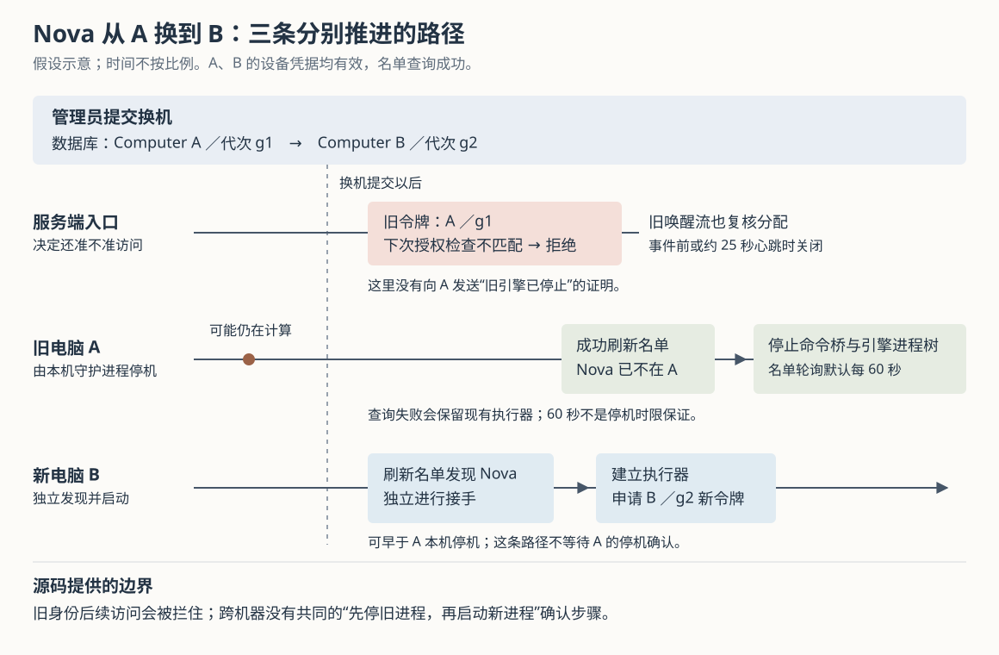

# Cumora 给 Agent 换电脑时：旧令牌如何失效，旧进程为何未必停止

假设 Nova 正在你的笔记本上整理发布方案，你把它改派到一台长期在线的服务器。新机器开始接手时，旧机器可能还在计算，也可能已经准备好调用工具。此时需要分别回答：旧机器还能不能读取团队消息、提交文档？已经打开的消息连接会不会继续收到内容？旧模型进程究竟由谁停止？

Cumora 用数据库里的当前分配限制旧身份访问，再由每台机器的守护进程——常驻后台、负责管理 Agent 执行器的程序——刷新名单并停止不再属于自己的执行器。**撤销访问资格、关闭长连接和终止本机进程，是三件分别推进的事。源码能支持“旧凭据在后续授权检查中被拒绝”，却不能据此保证跨机器交接时，旧进程一定先退出，新进程才启动。**

前五篇已经覆盖整体执行链、实时通知、项目记忆、消息选人与文档去重。本篇沿首次总览只提到的运行身份继续深入，重点研究自带 Agent，也就是 BYOA（Bring Your Own Agent）：由用户自己的电脑和模型引擎执行工作。依据是本次 `input/repository/` 中的注册入口、数据库迁移、授权查询、守护进程、测试与设计文档；示例均为假设。本次没有安装依赖、启动应用、运行项目测试或做真实换机实验，配图按实现绘制并单独渲染检查。

**先从一次接入看起：配对命令换来的设备凭据，还不能直接代表某一位 Agent。**

Cumora 把一处执行主机登记为 Computer。同一台主机可以运行多位 Agent，因此“这台电脑可以连接团队”和“这台电脑现在可以代表 Nova”需要分开管理。

用户运行 `cumora agent computer --pair <配对码>` 后，本地程序向 `POST /api/computers/pair` 提交配对码、主机名和可用引擎等信息。`pairComputer()` 找到或创建 Computer 记录，生成设备令牌，并把它的摘要存入 `computers.credential_hash`；本地 `doPair()` 将设备令牌保存到自己的配置。随后，守护进程用设备令牌读取 `/api/computers/me/agents`，再为名单中的每位 Agent 请求 `/api/agents/:id/runtime-token`。依据：[API 路由](https://github.com/yetone/cumora/blob/main/server/src/api/router.ts)、[registry.ts 的 pairComputer 与 mintAgentRuntimeToken](https://github.com/yetone/cumora/blob/main/server/src/agents/computer/registry.ts)、[daemon.ts 的 doPair 与 ensureToken](https://github.com/yetone/cumora/blob/main/server/src/agents/computer/daemon.ts)。

这里有四种容易混淆的凭据。

| 凭据 | 代码中用来做什么 | 有效范围与主要失效方式 |
| --- | --- | --- |
| 工作区配对码 | 添加电脑；当前实现也会按同名主机重新绑定已有 Computer | 保存在 `companies.pair_token`，持续有效；所有者轮换后旧码失效 |
| 单台电脑的重连码 | 重新连接指定的 Computer，保留它与 Agent 的归属关系 | 保存在 `computers.pair_token`；移除该 Computer 后不能再用它配对 |
| 设备令牌 | 读取本机 Agent 名单、心跳、申请运行令牌等 | 服务端按摘要查找；重新配对会替换摘要，移除电脑会清空摘要并标记撤销 |
| Agent 运行令牌 | 以指定 Agent 身份调用 `/runtime/*`，包括收件箱和团队操作 | 带签名、到期时间与分配代次；还必须通过数据库当前状态核验 |

两种配对码都是持续有效的入口，不能按一次性验证码理解。设备令牌由持有者出示即可使用；工作区配对码也不是主机硬件证明。当前 `pairComputer()` 允许持有效工作区配对码的一方，提交相同主机名来替换已有 Computer 的设备凭据。[BYOA.md 的 Auth & pairing](https://github.com/yetone/cumora/blob/main/docs/BYOA.md) 明确把这条同名重连路径列为需要后续改进的边界；源码也确实按 `company_id + name` 查找，而没有在这一步证明来者就是原物理机器。

管理权限与设备权限同样分开：换机、移除电脑、获取配对码的路由调用 `requireCompanyRole()`，默认要求工作区所有者或管理员；轮换工作区配对码进一步要求所有者。设备令牌本身不能调用这些管理能力。为 Nova 签发运行令牌时，`mintAgentRuntimeToken()` 则要求它仍是活跃 Agent、确实分配给该 Computer、双方属于同一工作区、电脑未撤销，并匹配所选的本地模型服务配置编号 `provider_profile`。这里核验的是登记关系，不是模型服务账号的实时可用性。

**换机真正改变的是数据库中的分配，而不只是新机器拿到一串新令牌。**

管理员调用 `POST /api/agents/:id/computer` 后，`assignAgentToComputer()` 先检查目标电脑、引擎和配置是否合法，再更新 `participants` 中的主机与相关设置。执行更新时，数据库触发器自动生成新的 `runtime_assignment_id`，也就是本次运行分配的代次标识。触发器是在特定字段更新时自动执行的数据库程序，因而不只覆盖这一个 API 调用方。

当前生效的规则来自迁移 `0008`：工作区、Computer、本地模型服务配置、成员种类或离职状态实际变化时，都会更新这个代次。仅把字段设回相同值不会更新；更换模型、角色文字或引擎本身，也不在该触发器的比较条件里。后面这些配置主要由本地执行器刷新处理，不能统称为“所有设置变化都会撤销旧令牌”。依据：[0004 的初始规则与设计说明](https://github.com/yetone/cumora/blob/main/server/src/db/migrations/0004-agent-runtime-assignment.ts)、[0008 扩展后的触发器](https://github.com/yetone/cumora/blob/main/server/src/db/migrations/0008-agent-provider-profile.ts)。

为什么除了 Computer 编号，还需要代次？因为只比较位置，会漏掉“搬走又搬回”的情况。假设 Nova 原来在 A，代次为 g1；搬到 B 后变成 g2；再搬回 A，代次变成 g3。旧令牌虽然也写着“Nova、A、同一个工作区”，却仍携带 g1，无法通过 g3 的检查。g1、g2、g3 在这里是解释用的符号，实际由数据库生成随机标识。

迁移说明直接给出了把这件事放进数据库的理由：批量初始化和管理修复也会改分配，如果只在某个 API 函数中更新代次，其他写入路径就可能遗漏。可迁移的设计思想是，把必须伴随数据变化发生的身份失效规则，放到所有正常写入都会经过的位置。

运行令牌采用 JWT（JSON Web Token，即承载身份字段并带签名的令牌）。签名绑定 Agent 编号、工作区、Computer、分配代次、用途和到期时间。BYOA 签发时明确使用两小时有效期，守护进程在距离到期五分钟以内需要用令牌时重新申请；不能把底层签名函数的一小时默认值当成本地执行路径的实际配置。依据：[jwt.ts](https://github.com/yetone/cumora/blob/main/server/src/agents/runtime/jwt.ts)、[registry.ts 的 AGENT_TOKEN_TTL_SECONDS](https://github.com/yetone/cumora/blob/main/server/src/agents/computer/registry.ts)、[daemon.ts 的 ensureToken](https://github.com/yetone/cumora/blob/main/server/src/agents/computer/daemon.ts)。

**签名说明“服务端签发过”，数据库检查才回答“现在还允许吗”。**

`runtimeRouter` 在所有运行接口前挂载 `authMiddleware()`。它先验证令牌签名、用途、到期时间与字段，再调用 `isRuntimeAgentAuthorized()` 查询当前数据库。查询同时要求：Agent 仍活跃且属于令牌中的工作区，当前 Computer 与令牌相同，代次相同；有 Computer 时，还必须找到同工作区且未撤销的电脑记录。[入口与注册顺序：runtime/server.ts](https://github.com/yetone/cumora/blob/main/server/src/agents/runtime/server.ts)、[实际 SQL：runtime/authorization.ts](https://github.com/yetone/cumora/blob/main/server/src/agents/runtime/authorization.ts)。

因此，Nova 改派到 B 并提交后，A 上的旧令牌即使签名仍正确、还没到期，也不能通过下一次分配核验。数据库查询失败时，入口返回 503，表示目前无法确认授权；它没有因数据库不可用而放行。无效或过期令牌返回 401，分配已改变或被撤销返回 403。这几种失败对于排查很有区别：重新申请令牌可以解决到期，却不能让已经被调离的旧 Computer 重新获得 Nova。

通过入口后，团队操作仍有自己的权限检查。例如 `/runtime/cli` 用 `buildRuntimeArgv()` 删除来者提供的 `--as` 身份参数，再注入令牌绑定的 Agent 编号，防止调用方用参数改成另一位成员。文档命令还用事务核验活跃成员身份。这里建立了运行身份、业务成员与对象操作的多层约束，但它们的检查内容并不完全相同。[cli-argv.ts](https://github.com/yetone/cumora/blob/main/server/src/agents/runtime/cli-argv.ts)、[cli.ts 的 withActiveParticipantLock 与 cmdDoc](https://github.com/yetone/cumora/blob/main/server/src/agents/cli.ts)。

图中最需要注意的是两台机器之间的空隙：新机器不必拿到“旧机器已经停止”的确认，才开始建立自己的执行器。旧机器进程仍存在时，它携带的旧分配身份已经可以被服务端拒绝。这样允许故障主机不再回应时继续交接，同时也把进程是否真正退出留给了另一条路径。前一句是实现事实，关于故障交接的收益是根据机制作出的分析。

**轮换配对码、重新配对与移除电脑，撤销的是不同层的资格。**

轮换工作区配对码时，`rotateCompanyPairingCode()` 只替换 `companies.pair_token`。已有设备令牌、单机重连码和 Agent 分配均不改变，所以它不会让所有电脑退出，也不会让已经签发的运行令牌自动失效。

这次替换还处理了一个并发问题：某次配对已经读到旧码，所有者此时又轮换，旧请求是否还能在轮换完成后登记成功？工作区配对路径在一个数据库事务内读取工作区记录，并持有 `FOR SHARE` 共享行锁直到完成登记；轮换的更新与它冲突。若配对先持锁，轮换等待它提交；若轮换先完成，配对会按更新后的记录核验旧码。由此，轮换成功返回后，不应还有一笔已用旧工作区码获得资格、却尚未提交的正常配对事务。这个边界不延伸到独立的单机重连码。依据：[registry.ts 的 pairComputer 与 rotateCompanyPairingCode](https://github.com/yetone/cumora/blob/main/server/src/agents/computer/registry.ts)。

重新配对同一 Computer 则替换 `credential_hash`。旧设备令牌不再匹配，因而不能继续查名单或申请运行令牌。不过，**这条路径没有更新 Agent 的分配代次；运行授权查询也不比较签发时的设备令牌摘要。** 在 Computer、Agent 分配与其他授权条件不变时，先前已签发且未过期的 Agent 运行令牌仍可能通过普通运行请求的检查。

这是根据配对更新字段、数据库触发器和授权 SQL 联合推导的行为，本次没有重连后重放令牌的实测。它说明，替换设备凭据不会自动撤销从旧设备身份签出的所有下级凭据；若需要这种效果，还要把设备凭据的代次纳入运行令牌与核验，或同步更新相关 Agent 的分配代次。这是改进方向，当前没有这层绑定。

移除电脑更进一步：`revokeComputer()` 写入 `revoked_at`、清空设备凭据摘要并标记电脑离线。之后旧设备令牌无法解析，单机重连码也无法再匹配一条未撤销的 Computer；运行令牌即使代次未变，仍会因为电脑已撤销而核验失败。但工作区配对码继续有效，持有它的一方仍可能添加新的 Computer。因此，“删除可疑电脑”和“替换添加电脑的入口码”解决不同问题，不能互相代替。这也是 BYOA 设计文档明确区分的操作语义。

还有一个容易误判的状态：电脑因缺少心跳被标为 `offline`，与被标为撤销不同。所读授权查询检查 `revoked_at`，没有用在线状态拒绝请求。离线标志主要表达可达性；恢复连接且资格仍有效的机器可以继续请求，不能把灰色状态图标当成已经撤权的证据。

**长连接不能只在建立时验一次身份；但流关闭也不等于引擎退出。**

Agent 使用 SSE（Server-Sent Events，即服务端通过持续的 HTTP 响应推送事件）接收唤醒。事件有时还包含新消息正文，因此旧连接不能因为建立时合法，就在换机后一直保留收取资格。

`/runtime/wake-stream` 将 `isRuntimeAgentAuthorized()` 作为回调交给 `attachWakeStream()`。`wake-bus.ts` 在发送每个事件前重新核验；每二十五秒保活时也核验。核验失败或抛出错误就结束连接，并移除订阅。异步核验按连接排队，避免事件因查询完成顺序不同而颠倒；待处理数量还有上限，避免授权查询停顿时无限积压。依据：[runtime/server.ts 的 wake-stream](https://github.com/yetone/cumora/blob/main/server/src/agents/runtime/server.ts)、[wake-bus.ts 的 deliverTo 与 attachWakeStream](https://github.com/yetone/cumora/blob/main/server/src/agents/runtime/wake-bus.ts)。

机器级控制流 `/api/computers/me/control-stream` 也复核身份，不过它重新解析的是设备令牌。因此，重新配对同一 Computer 后，旧设备控制流会因摘要变化而关闭；旧 Agent 唤醒流检查的却是 Agent 分配与 Computer 撤销状态，不能直接套用前者的失效结论。[API 绑定的授权回调](https://github.com/yetone/cumora/blob/main/server/src/api/router.ts)、[computer/control-bus.ts](https://github.com/yetone/cumora/blob/main/server/src/agents/computer/control-bus.ts)。

还有一处时间边界：运行流建立时验证 JWT 到期时间，后续回调只复核数据库分配，没有再次检查 `exp`。因此，两小时有效期限制的是新 HTTP 请求能否通过令牌验证，不能推导为一条已建立的 SSE 必在两小时整自动断开。分配变化和 Computer 撤销仍会触发后续复核失败。这里描述的是代码中两个检查函数的差异，没有做持续连接实验；二十五秒也只是定时配置，不是数据库停顿等条件下的关闭时限保证。

旧本地执行器发现唤醒流关闭后，会退避重连；若重连得到 401 或 403，就清掉缓存令牌，再尝试申请。旧 Computer 已失去 Nova 时，申请仍会被拒绝。这条循环阻止它靠重连恢复已撤销的资格，却没有在这里调用引擎停机。换言之，连接循环负责恢复连接，本机执行器的去留由名单同步决定。

**正常换机由名单刷新停掉旧执行器；设备已经失效时，这条刷新反而可能失败。**

`daemon.ts` 的 `doRun()` 在启动时调用 `sync()`，之后默认每六十秒刷新一次本机 Agent 名单。若 A 的设备凭据仍有效，查询成功后名单中已没有 Nova，`syncOnce()` 就从本地执行器集合移除它，并等待 `runner.stop({ forceEngine: true })` 完成。若角色、模型、引擎或相关本地服务配置发生变化，`configMatches()` 不通过，也会先停掉旧执行器，再在同一个守护进程里建立新执行器。

`stop()` 不只停止接收唤醒。它还关闭本地命令桥 `RuntimeCliBroker`，中断正在进行的桥接请求，触发一次性引擎的取消信号，并停止常驻引擎会话、等待正在进行的运行收尾。这一点有实际意义：只停最外层程序，它启动的工具子进程可能还活着。

`engine.ts` 为此提供 `terminateEngineTree()`：类 Unix 平台把引擎放入单独的进程组，并结合进程表追踪、重复扫描与信号清理后代；Windows 使用系统的进程树终止命令。停止方法返回的承诺与本地串行 `sync()` 配合，减少同一守护进程内“旧引擎没停完，新引擎已启动”的重叠。清理包含有界重试及兜底分支，不能从这些代码推出任意操作系统故障下都绝无残留进程。依据：[daemon.ts 的 AgentRunner.stop、syncOnce 与 sync](https://github.com/yetone/cumora/blob/main/server/src/agents/computer/daemon.ts)、[engine.ts 的进程终止实现](https://github.com/yetone/cumora/blob/main/server/src/agents/computer/engine.ts)。

这个等待只在该守护进程内部成立。B 上的守护进程独立读取名单并启动 Nova，没有等待 A 的停机确认；A 若断网、卡住，或还没轮到刷新，就可能继续进行本地计算。

更值得区分的是撤销电脑与普通换机。`syncOnce()` 请求名单失败后，记录警告并直接返回，保留现有执行器。移除电脑后，它的设备令牌被拒绝，恰好会使名单查询失败；代码没有在这条失败分支中把所有执行器强制停止。机器心跳失败也只是返回，机器控制协议目前只有重新检测引擎的 `engine.detect` 事件，没有远程停机事件。依据：[daemon.ts 的 syncOnce、heartbeat 与 controlStreamLoop](https://github.com/yetone/cumora/blob/main/server/src/agents/computer/daemon.ts)、[control-event.ts](https://github.com/yetone/cumora/blob/main/server/src/agents/computer/control-event.ts)。

保留执行器可以避免一次临时网络故障就杀掉长任务，这是根据失败处理得出的收益分析；相应代价是，不能把服务端撤销称为“远程进程必已终止”。它会拦住旧身份的后续 Cumora 请求，却不会替你撤销已发生的本地文件修改、已经提交的业务结果，或脱离这套运行接口的外部动作。尤其是显式放宽执行限制的兼容模式，更不能把 Cumora 的运行授权当成本机所有活动的统一控制器。

**连“后续请求被拒绝”也要与“已经获准的请求被取消”分开。**

公共运行中间件先查询分配，再调用后续处理函数，没有持有覆盖整项业务的分配锁。`/runtime/cli` 交给 `runCli()` 的是 Agent 身份和命令参数，没有把令牌中的分配代次一并交给每条业务 SQL 核验。

文档命令的 `withActiveParticipantLock()` 虽会持有成员共享行锁，但检查的是活跃成员、工作区和种类，没有比较原 Computer 与原代次。它能让持锁期间的成员变更与命令排队，却不能证明一笔先通过入口、随后才遇到换机的请求，必然因原分配失效而取消。例如，假设旧请求已经通过中间件，换机先提交，之后它才开始文档事务；只要仍满足该事务的成员检查，源码中没有第二道原分配核验将它必然挡住。这是从检查顺序推导的并发窗口，未做故障注入。

本地命令桥停止时发出网络取消信号，也不能当成服务端事务回滚确认：服务端可能已执行或提交，桥只是不再等待或交回结果。相反，某些接口确有更窄的事务保护，例如运行记录接口锁住活跃成员与对应运行记录，再执行修改；会话通知辅助函数则明确在网络发布前释放数据库锁，并在注释中承认撤销间隙内可能仍有一笔发布。需要按具体操作理解，不能把一个入口的授权扩大成全系统统一的取消屏障。[runtime/authorization.ts](https://github.com/yetone/cumora/blob/main/server/src/agents/runtime/authorization.ts)。

如果业务要求“换机成功返回后，任何旧分配发出的在途写入都不能再提交”，就需要把分配代次带到最终写入并在同一事务中核验，或建立覆盖操作与换机的排他协议。如果还要求“旧机器绝不再计算”，则需要额外的进程管理与确认机制。这些是依据当前边界提出的设计要求，并非 Cumora 已有保证。

**测试提供了哪些证据，哪些判断仍只是静态推导？**

| 已读测试 | 实际断言与范围 |
| --- | --- |
| [runtime-server.test.ts](https://github.com/yetone/cumora/blob/main/server/src/__integration__/runtime-server.test.ts) | 使用实际数据库分配和签发流程，检查搬到另一台电脑、再搬回后旧令牌仍被拒绝；撤销 Computer 后不能签发新令牌，已有令牌也被拒绝。测试的是接口授权，不是真实机器交接。 |
| [agent-provider-profiles.test.ts](https://github.com/yetone/cumora/blob/main/server/src/__integration__/agent-provider-profiles.test.ts) | 检查改变本地模型服务配置后旧运行令牌失效，错误配置不能申请令牌；没有调用真实模型服务。 |
| [computer-pairing-rotation.test.ts](https://github.com/yetone/cumora/blob/main/server/src/__integration__/computer-pairing-rotation.test.ts) | 检查轮换权限、旧工作区码失效、原设备凭据及重连码保留，并用数据库锁安排轮换先完成、旧码配对随后被拒绝的竞争场景。没有覆盖重新配对后重放旧 Agent 运行令牌。 |
| [agent-steer.test.ts](https://github.com/yetone/cumora/blob/main/server/src/__integration__/agent-steer.test.ts) 与 [computer-control-stream.test.ts](https://github.com/yetone/cumora/blob/main/server/src/__integration__/computer-control-stream.test.ts) | 经 Redis 投递事件，注入返回拒绝的授权回调，断言连接关闭且业务事件未写出；这一断言没有贯通真实数据库撤销与真实客户端。 |
| [agents-computer-engine.test.ts](https://github.com/yetone/cumora/blob/main/server/src/__tests__/agents-computer-engine.test.ts) 与 [agent-computer-shim-output.test.ts](https://github.com/yetone/cumora/blob/main/server/src/__tests__/agent-computer-shim-output.test.ts) | 用伪引擎进程检查取消、后代进程清理，用注入的桥接调用检查停止后收到取消且不生成响应。所读进程取消用例跳过 Windows，不能证明所有平台和真实模型引擎行为一致。 |

以上是测试代码的设计与断言，本次没有运行。重新配对后的旧运行令牌、长连接跨过到期时间、换机时在途命令继续提交，以及两台主机的实际重叠时长，都没有在本次实验验证；其中前几项已有明确的字段与调用顺序依据，重叠时长则没有测量数据。

对使用者，给 Agent 换电脑后，应分别检查新机器是否接手、旧机器是否停止、已有成果是否保存。需要确定停止本地工作时，应在旧机器上停止守护进程并核实进程状态；仅看到服务端移除成功不足以完成这项确认。恢复整理发布方案这样的工作时，先读取现有文档和任务状态，再继续执行，避免把一次身份交接误当成工作从未发生过。

对部署者，排查时应把设备身份、Agent 分配、运行请求和本机进程对应起来。轮换工作区码是关闭旧的接入入口，撤销 Computer 是拒绝该设备及相关运行身份，重新配对是替换设备凭据，名单刷新才负责正常的本机停机。Cumora 把这些责任拆开，使服务端可以在旧主机不配合时收回访问资格；需要更强的交接、取消或外部动作保证时，仍须在相应边界上增加可核验的协议。
