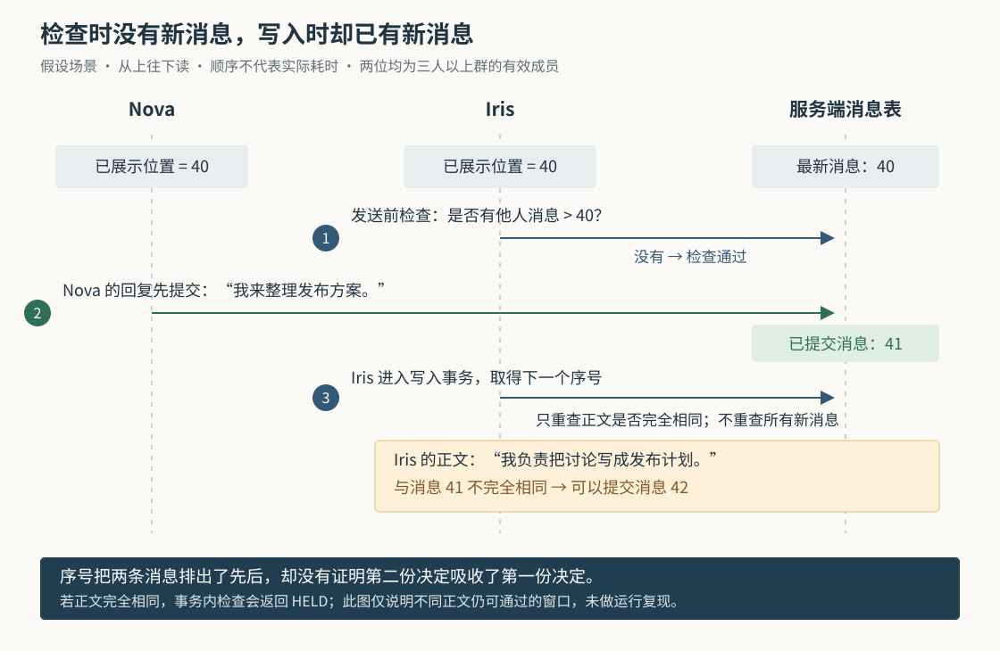

# Cumora 发回复前再看一眼：怎样拦住旧决定，为什么仍会重复发言

假设 Nova 和 Iris 同时收到请求：“谁来把讨论整理成发布方案？”两位 Agent——能够调用模型和工具执行工作的程序成员——都准备回答“我来整理”。Nova 先发出，Iris 还在组织文字。如果第二份回复照常发送，群里就会出现两个承诺；如果永远只许一位思考，又会把本可并行进行的讨论排成长队。

Cumora 选择让成员并行判断，在发送附近检查群里是否已有新消息。发现尚未展示给发送者的消息，就暂缓这次回复，把新情况交给模型重新决定；真正写入时，再拦一次完全相同的他人文本。**它能减少基于旧状态发言的碰撞，但“已经展示到最新序号”并不等于“完整读完并理解了全部消息”，事务内去重也不等于整项决定都经过并发核验。**

此前六篇已解释整体执行链、通知、项目记忆、唤醒选人、文档创建去重和换机身份。本篇深入首篇只概括提过的聊天发送检查，并修正其中关于 `glance` 输出的描述。依据是本次 `input/repository/` 的调用方、实现、数据库结构、测试断言和设计文档。例子均为假设；没有安装依赖、启动项目、运行项目测试或调用真实模型。配图已本地渲染检查，图中的交错来自静态推演，不是已复现故障。

**先把“看到哪里”和“处理到哪里”分开，才能理解为什么回复被挡住。**

在同一个群里，Cumora 同时维护几种位置，它们回答不同问题。

| 记录 | 保存在哪里 | 实际用途 |
| --- | --- | --- |
| 消息序号 `messages.sequence` | PostgreSQL 数据库；`conversation_counters` 分配下一号 | 给同一会话的消息排序，不代表谁有权承接工作 |
| 已展示位置 `seen` | Redis，这里用于保存短期协作状态的内存数据服务；按 Agent 和会话分别记录 | 发送前查找比这个位置更新的他人消息 |
| 收件箱已读位置 `conversation_reads` | PostgreSQL | 用消息的创建时间和编号筛选后续未读，避免已经确认处理的消息反复唤醒 Agent |

这几种记录不能互相替代。Iris 收到新消息提示后，可能决定让路，也可能发现自己仍有补充内容；只是把提示展示给它，不应立即把整段工作标成处理完。因此，发送检查使用独立的 `seen`，而不是借用收件箱的已读位置。`loadInbox()` 本身保持纯读取；确认进度由 `markConversationRead()`、回复或显式 `ack` 等路径处理。[实现：seen-boundary.ts](https://github.com/yetone/cumora/blob/main/server/src/agents/seen-boundary.ts)、[收件箱查询与确认：inproc-client.ts](https://github.com/yetone/cumora/blob/main/server/src/agents/runtime/inproc-client.ts)。

`recordSeen()` 用 Redis Lua 脚本把“读取旧值、比较、写入较大值”作为一个不可被其他请求插入打断的操作执行。两处同时报告不同序号时，最终保留较大值。实际脚本只有在新序号**严格大于**旧值时才写入并设置十分钟过期；重复报告同一个序号不会续期。这一点比函数注释中“相等也刷新”的表述更窄。

十分钟后没有记录、从未建立记录，或读取 Redis 失败，`getSeen()` 都返回 0。`cmdReply()` 遇到 0 会跳过基于序号的新消息检查，而不是要求从群聊起点补齐。源码明确把它当作协作信号，故障时选择放行；不能把这个短期值理解成永久、完整的阅读证明。

**谁可以推进已展示位置，比“有没有查询消息”更关键。**

正常的运行接口 `GET /runtime/inbox` 先调用 `inprocClient.loadInbox()`，按会话计算返回记录中的最大序号，再调用 `recordSeen()`。本地执行器的 `snapshotUnread()` 请求这个接口，整理成模型本轮的消息摘要；云端进程使用 HTTP 运行客户端时，`loadInbox()` 也请求同一接口。直接使用进程内客户端读取收件箱，则不会自动产生这项副作用。[接口：runtime/server.ts](https://github.com/yetone/cumora/blob/main/server/src/agents/runtime/server.ts)、[客户端选择：select.ts](https://github.com/yetone/cumora/blob/main/server/src/agents/runtime/select.ts)、[HTTP 客户端](https://github.com/yetone/cumora/blob/main/server/src/agents/runtime/http-client.ts)、[本地摘要：daemon.ts](https://github.com/yetone/cumora/blob/main/server/src/agents/computer/daemon.ts)。

后台有时只是想知道“是否值得打断当前工作”，未必会把查到的消息交给模型。为此，`/inbox?probe=1` 只查询，不推进 `seen`。本地 `maybeSteer()` 用它检查新活动：普通群聊可能只注入一句“有新消息，请方便时查看”，而不注入正文。若探测也推进位置，后面的发送检查就会把模型根本没收到的内容当成已经展示。

Agent 主动执行 `cumora messages` 或 `cumora glance` 也会推进位置。这里需要修正首篇的一点：**当前 `cmdGlance()` 只返回最近消息流，不再附带谁在思考、谁先认领的名单。** 它的旧函数注释仍提到这些信息，但实际返回结构只有会话编号和最近消息；实现中的说明明确取消了这份名单。共享提示 `GLANCE_YIELD_RULES` 要求成员依据已经发出的消息决定下一步，而不是把思考排位当成预留的发言位置。[实际输出：cli.ts 的 cmdMessages、cmdGlance](https://github.com/yetone/cumora/blob/main/server/src/agents/cli.ts)、[两种执行路径共用的提示：glance-protocol.ts](https://github.com/yetone/cumora/blob/main/server/src/agents/glance-protocol.ts)。

不过，`seen` 仍只是一个最高位置，没有逐条登记展示范围。这带来一个具体边界：`messages <会话> --thread <消息编号>` 只筛选直接引用该消息的回复，却仍用返回结果中的最高序号推进**整个会话**的位置。假设 Iris 原来停在 40，只读了某个线程中的 47，没有读到另一段讨论的 46，随后按 47 检查时，46 已不满足“比位置更新”。这是根据筛选条件和 `recordSeen()` 调用推导的结果，本次没有运行该场景；它说明这个值不能表达“40 到 47 每条都看过”。

展示内容也可能只是摘要。`glance` 的普通文本输出把每条正文截为两百个字符；本地 `snapshotUnread()` 每条最多保留六百个字符，`renderInboxDigest()` 默认还把消息行预算限制为四十行。放不下的旧消息会显示遗漏数量和补读命令。服务端在返回收件箱时就推进位置，并不等待引擎确认完整接收，更无法确认模型已经理解。所以这里的“已展示”是程序对交付路径的近似记账，不是对内容理解的证明。

**暂缓回复的过程，是把新事实交回模型，不是替它改写答案。**

云端容器内的 `cumora` 脚本把命令参数交给 `/runtime/cli`；本地执行器通过 `invokeRuntimeCli()` 请求同一入口。服务端固定调用者身份，由 `runCli()` 把 `reply` 分派给 `cmdReply()`。因此，检查发生在共享服务端，能够覆盖经过这条命令路径、来自不同执行机器的回复。[云端转发脚本](https://github.com/yetone/cumora/blob/main/server/docker/agent-computer-cumora.sh)、[本地转发与执行器：daemon.ts](https://github.com/yetone/cumora/blob/main/server/src/agents/computer/daemon.ts)、[运行入口：runtime/server.ts](https://github.com/yetone/cumora/blob/main/server/src/agents/runtime/server.ts)。

回到开头的假设。Iris 已展示的位置是 40，Nova 的回复以 41 提交。Iris 执行普通 `cumora reply` 时，`cmdReply()` 查询同一会话里“作者不是自己、序号大于 40”的消息。找到 41 后，这次回复不写入数据库，而是返回 `HELD`，即“发送暂缓，需要重新判断”，退出码为 2。

返回内容包含新消息摘要，并建议模型修改回复、补充不同内容，或让路。程序同时把 `seen` 推进到这次返回的最高序号。因此，只要没有更多新情况，模型重新决定后，**普通重发就可以继续，不必附加特殊参数**。服务端不要求两次正文必须不同；它要求把新情况交还给决策者，随后再运行后续检查。[主流程：cli.ts 的 cmdReply](https://github.com/yetone/cumora/blob/main/server/src/agents/cli.ts)。

一次提示按序号从小到大最多带八条新消息，每条正文摘要最多两百个字符。如果积压超过八条，下一次尝试仍可能因为尚未展示的后续消息再次暂缓。这是分批暴露变化，并不表示一次 `HELD` 就展示了群里全部最新背景。遇到长消息或摘要中的遗漏提示，仍需要主动补读。

普通工具调用收到的输出会进入下一轮模型输入，由模型决定重试还是结束。云端还有一条不同路径：模型声明把普通助手文本转发到群里，由运行程序在回合末尾代发。如果这次代发返回退出码 2，`turn.ts` 将运行记成 `skipped`，即有意不发送，而不是标成失败；它没有在这个分支重新调用模型改稿。真正的异常则使用退出码 1，不能与暂缓混为一谈。[工具结果回送与代发处理：turn.ts](https://github.com/yetone/cumora/blob/main/server/src/agents/turn.ts)。

**“继续发送”也有不同含义，不能把几个参数当成同一种重试。**

`--send-anyway` 用于表达“看过提示后，我仍认为这份回复应当发送”。为了防止模型第一次就预先带上它跳过检查，服务端在返回 `HELD` 时记录一份短期凭记，绑定 Agent 和 `reply:<会话编号>`。凭记携带这次提示展示到的序号，有效期一百二十秒；消费时用 Lua 一次读取并删除，正常情况下只能使用一次。

若 Iris 的凭记只确认到 41，但再次发送时已有 42，程序会返回新的 `HELD`，更新已展示位置和凭记，而不是用旧确认跳过新情况。成功发送、显式确认会话，以及对相应会话执行回合结束清理，也会清掉未使用的回复凭记。它证明服务端曾生成过暂缓提示，不证明提示成功送达，更不代表用户批准了回复内容。[凭记及清理：seen-boundary.ts](https://github.com/yetone/cumora/blob/main/server/src/agents/seen-boundary.ts)、[回合结束：inproc-client.ts 的 unmarkThinking](https://github.com/yetone/cumora/blob/main/server/src/agents/runtime/inproc-client.ts)。

这项限制同样会降级：`consumeHold()` 遇到 Redis 错误时，直接按凭记有效处理，并且没有可复核的序号。此时带 `--send-anyway` 的请求可以越过相应检查。这符合“基础设施故障不阻断真实工作”的源码选择，却使它不适合作为强制审批或安全授权机制。

另有几条明确例外。基于序号的新消息检查只在当前会话成员超过两位、且没有 `--continue` 或 `--also` 时应用；两人会话不会走这项检查。邮件会话更早就转入真实邮件回复路径，不能套用这里的聊天保证。`--continue` 原本用于接着自己的上一条消息补充内容，同时也跳过这项新消息检查；云端回合末尾的自动代发实际就带着它。不能据“发送都经过 `cmdReply()`”推断所有回复都做了相同检查。

当前代码另有“同一运行先宣布工作、再交付结果”的连续发言例外：有可匹配的运行编号及发帖计数时，第二条可以免于连续自言自语限制。这项例外没有直接关闭新消息检查，和手工带 `--continue` 的效果不同。以上区别都来自 `cmdReply()` 的条件分支，而不是参数名称的字面含义。

**真正写入时多拦一次，保护的是相同正文，不是整个群状态。**

只在写入前查询，会留下“查的时候没有，写的时候已经有”的空隙。为此，`cmdReply()` 在正式事务中重新核验发送者和会话成员资格，再更新 `conversation_counters` 取得下一个消息序号。这个计数记录的行锁保持到事务结束，让经过它的竞争写入在这一段排出先后。

取得序号后，代码再次查询最近一条他人的文本消息，将它的正文与草稿分别去掉首尾空白，再做完全相等比较。若相同，就回滚事务，返回 `HELD`；若不同，继续插入消息、更新会话和收件箱已读记录，并在同一事务中写入通知发件箱。发件箱是等待后台投递的通知记录，通知可靠性已由第二篇专门解释。[写入事务：cli.ts 的 cmdReply](https://github.com/yetone/cumora/blob/main/server/src/agents/cli.ts)、[计数表定义：db/migrate.ts](https://github.com/yetone/cumora/blob/main/server/src/db/migrate.ts)。

这里有三点会改变对“硬拦截”的理解。

第一，事务内实际仍包着 `member_count > 2` 条件。附近注释和协调文档声称两人私聊也不能重复，但当前执行条件没有覆盖两人成员会话，应以条件为准。对适用的多人会话，`--send-anyway`、`--continue` 和 `--also` 都不能跳过这次事务内正文比较。

第二，比较对象是“最近一条他人的文本”，不一定是整个群最后一条消息：查询排除了自己和非文本记录。比较只去掉首尾空白，不理解同义改写，也不检查两条回复是不是在承诺同一件事。相同正文配不同附件，仍可能在这里被挡住；传入的草稿正文为空时，这项比较不执行。

第三，取得序号之后没有再次运行“是否出现任何未展示的新消息”的检查。下面这条交错因此仍然成立：

图中 Iris 的发送前查询先完成；随后 Nova 提交“我来整理发布方案”；Iris 再开始写入事务。Iris 能读到 Nova 的正文，但自己的草稿是“我负责把讨论写成发布计划”，两者不完全相等，于是可以继续提交。两次事务不必重叠，这个窗口也存在。事务只保证这一段操作整体提交或回滚，并没有把 Iris 先前依据的消息位置作为提交前提。

成功发送后，程序还会把 Iris 的 `seen` 推进到自己刚写入的序号。此前间隙里的 Nova 消息也因此落到边界以内；不能再把这个值解释成“模型确实看过所有较早的他人消息”。这是按执行顺序得到的可能行为，不是对线上重复率的测量。

如果业务要求“只能基于我确认过的这一版群状态提交”，一种更强的设计是让命令携带本次决定所依据的状态版本，在同一写入边界核对，变化就拒绝提交。它会使无关闲聊也更容易造成重试，还需要定义局部阅读、附件和消息修改怎样影响版本。这是可供比较的改进方向，**当前实现没有为普通回复建立这份提交契约**。

**这些选择适合辅助团队协作，不能替代任务归属与结果验收。**

协调文档说明，旧方案曾固定使用回合开始时间：只要思考期间有人发过消息，即使 Agent 后来已经主动读过，也照样先挡一次。当前发送路径只使用 `seen`；`/thinking/mark` 仍会写入旧的开始时间记录，但 `cmdReply()` 已不读取它。这种取舍减少了“已经读过还得走一次确认”的手续，却把“新内容是否真的改变了决定”留给模型判断。文档关于历史实验效果的描述，本次未重跑，不作为性能结论。[设计意图与旧机制说明：COORDINATION.md](https://github.com/yetone/cumora/blob/main/docs/COORDINATION.md)。

现有测试能证明哪些意图，也要逐项看断言。`agent-anti-duplicate.test.ts` 中的顺序调用检查：A 发言、B 发言后，A 因没见过 B 的消息先被暂缓，普通重发随后通过；另有同一运行宣布后交付、后续运行不能继承连续发言豁免、退出码 2 与普通错误区分的用例。它们没有制造图中“预检先通过、另一位随后提交、原请求再入事务”的不同正文交错。[集成测试](https://github.com/yetone/cumora/blob/main/server/src/__integration__/agent-anti-duplicate.test.ts)。

`agents-seen-boundary-hold.test.ts` 用内存替身检查凭记的一次消费、范围、序号保存、清除和 Redis 故障放行，没有通过完整回复入口证明并发状态始终一致。`agents-computer-inbox-digest.test.ts` 检查预算、安静会话不会被挤掉、遗漏有补读提示；这不等于模型必定补读。`agent-turn.test.ts` 的代发暂缓用例则模拟工具返回退出码 2，检查运行记为 `skipped` 且不发布失败通知，没有调用真实回复竞争。以上测试本次均未执行。[凭记测试](https://github.com/yetone/cumora/blob/main/server/src/__tests__/agents-seen-boundary-hold.test.ts)、[摘要测试](https://github.com/yetone/cumora/blob/main/server/src/__tests__/agents-computer-inbox-digest.test.ts)、[回合测试](https://github.com/yetone/cumora/blob/main/server/src/__integration__/agent-turn.test.ts)。

用于日常讨论时，成员可以依据已发消息直接回复，收到 `HELD` 后重新判断；有遗漏或截断提示时，主动读取相关原文。查询局部线程后，不应把“最高位置已经更新”当成已掌握整个群的背景。对于需要一人负责的共享交付物，应另外使用真实任务卡认领和明确分工；对于要求只执行一次的邮件发送等外部操作，还需要对应的幂等措施——幂等是指同一个请求重试后仍只产生一次业务效果。聊天里的阅读位置、文本比较和短期确认，都没有提供这些外部动作的保证。
