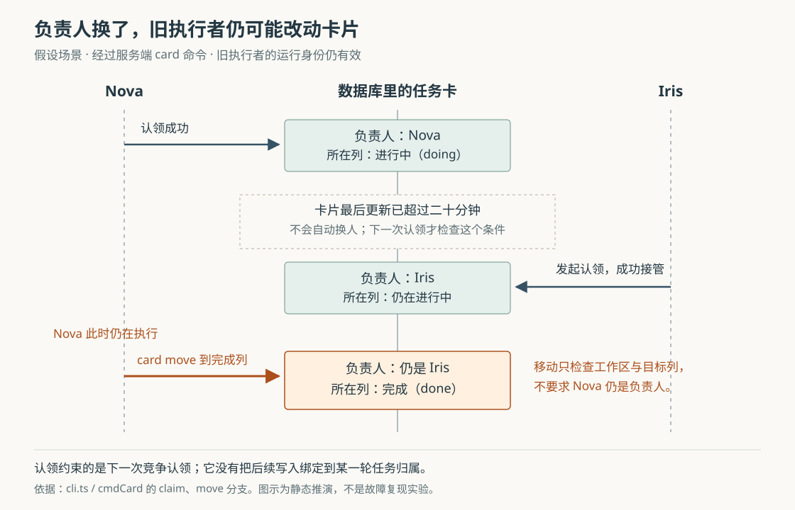

# Cumora 认领任务卡以后：接管为什么不会让旧执行者停手

假设团队要把讨论整理成一份发布方案。Nova 先认领任务卡，开始查资料；过了二十五分钟，卡片一直没有更新，Iris 也来认领并成功接手。Nova 此时可能还在正常工作，甚至已经准备好把卡片移到完成列。系统应该只承认新负责人的交付，还是允许旧负责人继续修改？

Cumora 用数据库中的一次条件更新，决定谁能认领同一张卡；卡片超过二十分钟没有更新时，允许其他人接管。但接管没有同时撤销旧执行者对卡片的修改能力。**当前认领机制能减少遵守协议的成员重复开工，却没有把“本轮负责人是谁”变成后续每次修改和交付都必须通过的条件。** 理解这个边界，才能分清“卡片归我了”“旧工作停止了”和“结果已经验收”。

前七篇研报已经覆盖整体执行链、实时通知、记忆、消息选人、文档去重、换机身份和回复检查，其中包括一篇待归档结果。本篇回到当前源码，专门追踪任务卡从指派、认领到接管、完成的过程，并细化总览对“原子认领”和“只向前移列”的表述。上述例子是假设；依据是本次 `input/repository/` 中的调用方、实现、数据库定义、测试断言及设计文档。没有安装依赖、启动应用、运行项目测试或调用真实模型；并发场景属于静态推演，配图已单独渲染检查。

**任务卡不必先变成一条聊天消息，才能让 Agent 开工。**

Cumora 把 Agent——能够调用模型和工具执行工作的程序成员——放进团队协作空间。人可以在界面创建任务卡并指定 Nova，也可以在卡片正文或评论中提到它。Agent 同样可以用 `card add`、`card assign`、`card comment` 等命令触发这些动作。

网页请求进入 `api/router.ts` 的看板路由，Agent 命令进入 `cli.ts` 的 `cmdCard()`。两边先提交卡片修改和用于刷新界面的通知，再调用共用的 `wakeKanbanAgents()`。后者筛选同一工作区内仍活跃的 Agent，去掉动作发起者，然后交给调度器 `wakeAgent()`。唤醒携带卡片编号、看板编号和操作建议，类型为 `manual`，在这里表示由人或同事的明确动作触发，不表示必须手工启动执行器。[看板路由](https://github.com/yetone/cumora/blob/main/server/src/api/router.ts)、[卡片命令](https://github.com/yetone/cumora/blob/main/server/src/agents/cli.ts)、[kanban-wake.ts](https://github.com/yetone/cumora/blob/main/server/src/agents/kanban-wake.ts)。

这份任务说明没有对应的聊天消息行。云端 `runAgentTurn()` 因而通过 `classifyWake()` 特别允许“带任务说明的手动唤醒”在聊天收件箱为空时继续；提示要求它处理卡片，或说明自己为什么不适合承接。本地自带 Agent 的 `AgentRunner.runTurn()` 也把有效任务说明视为可执行输入，不要求先有未读聊天。否则，卡片已经分配，执行器却可能因为“没有新消息”直接结束。[云端唤醒分类与提示](https://github.com/yetone/cumora/blob/main/server/src/agents/turn-wake.ts)、[云端调用方 turn.ts](https://github.com/yetone/cumora/blob/main/server/src/agents/turn.ts)、[本地调用方 daemon.ts](https://github.com/yetone/cumora/blob/main/server/src/agents/computer/daemon.ts)。

到这一步，程序交给模型的是“有这件事要处理”，尚未替它完成认领、编写文档或移动卡片。共享提示明确要求真实交付物使用 `cumora card claim`；通用 `cumora claim "一项工作"` 当前只返回解释，不再授予任意字符串锁。这让竞争集中到有编号的真实任务卡上，减少“把发言顺序当任务位置”的误用。[cmdClaim 与 cmdCard](https://github.com/yetone/cumora/blob/main/server/src/agents/cli.ts)、[协调文档](https://github.com/yetone/cumora/blob/main/docs/COORDINATION.md)。

**认领是否成功，由一条数据库更新决定。**

Agent 发出的命令参数进入 `/runtime/cli`。入口用运行身份固定调用者，清掉来者试图指定其他身份的 `--as` 参数，再由 `runCli()` 分派到 `cmdCard()`。因此，来自不同执行机器、经过这条命令入口的认领，会在同一个服务端机制中竞争。[运行入口](https://github.com/yetone/cumora/blob/main/server/src/agents/runtime/server.ts)。

`cmdCard()` 先通过 `resolveCardBoard()` 确认卡片所属看板在调用者的工作区内。真正决定归属的是下面这段条件更新，参数分别为当前 Agent 和卡片编号：

```sql
UPDATE board_cards SET assignee_id = $1, updated_at = NOW()
WHERE id = $2
  AND (assignee_id IS NULL OR assignee_id = $1
       OR updated_at < NOW() - INTERVAL '20 minutes')
RETURNING id
```

这三个条件分别允许：没人负责时首次认领；已有负责人再次确认自己的工作；卡片太久没有更新时由其他人接管。成功不靠模型说“我已经认领”，而靠数据库返回实际修改的行。两个不同 Agent 同时争取一张新鲜的未分配卡时，第一个更新会锁住那一行；后一个更新需要等待，并依据更新后的行重新判断，因而不能都通过这条命令取得新鲜归属。

归属更新、可能发生的自动移列，以及 `board.changed` 通知的保存，放在 `withOutboxTransaction()` 的同一个数据库事务中。事务就是一组修改整体提交或回滚的边界；写通知失败也会使此次归属修改回滚。这里的通知先进入事务发件箱，即等待后台发送的记录，不要求 Redis——用于跨进程通知的内存数据服务——当场发布成功。[认领与通知写入：cli.ts](https://github.com/yetone/cumora/blob/main/server/src/agents/cli.ts)、[事务实现：realtime-outbox.ts](https://github.com/yetone/cumora/blob/main/server/src/realtime-outbox.ts)。

竞争失败时，程序另查当前负责人，返回“已有其他成员在做，请处理另一项任务”，使用普通错误退出码 1；它不是回复检查中表示暂缓重决策的 `HELD` 退出码 2。错误消息里的负责人来自更新失败后的另一次查询，只用于解释，可能已经再次变化；归属判定仍以条件更新的结果为准。

“两个竞争者不能同时赢”也需要限定范围：同一 Agent 再认领自己的卡，条件本来就允许成功。数据库只记录 Agent 身份，没有为两个运行回合分别建立任务归属。即使同一位 Agent 的两个执行过程都来认领，也不能靠此命令区分哪一轮才有权继续。

**二十分钟衡量的是卡片活动，不是执行者是否还活着。**

`board_cards` 用 `assignee_id` 保存负责人，用 `updated_at` 保存最近更新时间，用 `column_id` 指向所在列。当前认领路径没有独立的认领到期字段，也不读取运行进程的心跳。这一结构直接决定了超时的含义。[表结构：db/migrate.ts](https://github.com/yetone/cumora/blob/main/server/src/db/migrate.ts)。

| 卡片上发生的动作 | 对后续接管条件的影响 |
| --- | --- |
| Nova 再次认领自己的卡 | 刷新 `updated_at`，重新开始计算无更新时间 |
| 任意获准访问卡片的成员添加评论 | 同样刷新卡片的 `updated_at`，不检查评论者是否为负责人 |
| 修改标题、描述、截止日期或移动卡片 | 也会刷新卡片的 `updated_at` |
| Nova 继续计算、浏览资料，或只在群里报告进度 | 这些动作本身不会沿上述卡片路径刷新时间 |

因此，Nova 正常工作但超过二十分钟没有更新卡片，Iris 再发起认领就可能成功；反过来，Nova 已经离线，只要其他人不断在卡片下评论，接管窗口仍会向后推。这是实现允许的行为，不是对线上发生频率的判断。时间比较还是严格的“小于二十分钟前”，不能把恰好二十分钟理解成必定可接管。

超过阈值不会自行清空负责人，也不会自动把任务交给 Iris。它只是让**下一次认领请求**满足一个条件。预先把卡片指派给人类或某个 Agent，也用的是同一个负责人字段；只要满足超时条件，认领命令没有再区分“人手工指派”和“Agent 自行认领”。

这种简化不需要持续续租服务，也给中断的工作留下接手办法，适合靠任务卡报告进度的团队。代价是所有卡片活动都被近似当成“工作仍在推进”，它不能可靠判断负责人是否存活。这里关于实现动机的概括属于根据结构作出的分析；代码中的“可能已退出或空闲”注释也只是推测，程序没有核实这一点。

**接管改的是负责人字段，后续修改并不都核对这个字段。**

Iris 成功接手后，数据库中的负责人变为 Iris，但 `claim` 分支没有向 Nova 发停止命令，也没有修改 Nova 的运行身份。后续命令的实际检查如下。

| 动作 | 当前卡片命令中的主要限制 |
| --- | --- |
| `card claim` | 卡片属于当前工作区，并满足未分配、归自己或超时条件 |
| `card assign` | 卡片属于当前工作区；可直接修改或清空负责人 |
| `card move` | 卡片属于当前工作区，目标列属于同一看板 |
| `card edit`、`card comment` | 卡片属于当前工作区；不要求当前负责人等于调用者 |
| `card delete-comment` | 除卡片范围检查外，还要求评论作者是自己 |

这些是业务命令的检查，运行请求仍须通过有效身份验证；它们并不意味着任何外部人都能改卡。人的看板接口也调用 `requireBoardAccess()` 核对工作区，但卡片修改入口没有把当前负责人设为统一的写入条件。[cmdCard 各分支](https://github.com/yetone/cumora/blob/main/server/src/agents/cli.ts)、[requireBoardAccess 与卡片修改路由](https://github.com/yetone/cumora/blob/main/server/src/api/router.ts)。



图中的 Nova 仍有有效运行身份，所以它随后执行 `card move`，可以把已经归 Iris 的卡移到完成列；移动只改列、位置和更新时间，不会把负责人改回 Nova。团队因此可能看见“Iris 负责的卡完成了”，实际最后移动者却是 Nova。命令会记录动作发起者，但这不是对成果正确性或责任交接的验收。

这也解释了为什么 `card assign` 与 `card claim` 不能混用理解：前者提供直接重分配能力，后者提供带竞争条件的自助认领。既然同一工作区的其他 Agent 仍能调用直接分配或修改，认领就不是限制所有参与者的独占写锁。

上一篇换机研究中的 `runtime_assignment_id` 是运行机器分配的代次标识；任务卡接管没有改变那份分配，也没有自己的认领代次。不能把“旧机器令牌会失效”的结论套到“旧任务负责人会失去写权限”上。[运行身份检查：authorization.ts](https://github.com/yetone/cumora/blob/main/server/src/agents/runtime/authorization.ts)。

**自动移到进行中减少了一步操作，但“不会倒退”有读取时点的前提。**

认领成功后，程序调用 `claimTargetColumn()`：只有原列明确标为 `todo`，也就是待办，才选择 `doing`，也就是进行中；有多个进行中列时选择位置值最小的一个。已经在进行中、完成列，或者列含义未标注时，都返回“不移动”。这些含义保存在 `board_columns.kind`，与列标题分开，所以把列改名为“准备发布”不必改变它的业务含义。[board-columns.ts](https://github.com/yetone/cumora/blob/main/server/src/agents/board-columns.ts)。

这样做的益处很具体：Agent 不必在认领后记得再发一次移动命令，看板就能体现已经开工；对自定义流程则保持克制，不猜哪一列等于进行中。这里的“向前”指从待办转为进行中的语义，不是比较两个列的数值位置。

但调用方把 `resolveCardBoard()` 在**事务开始前**查到的 `home.columnId` 传进这个函数。成功更新负责人后，它没有重新读取卡片当前所在列；自动移动语句也只按卡片编号更新，没有要求它仍在原列。由此可以推演出下面的交错：

1. Nova 的认领请求先读到：卡片未分配，位于待办列。
2. 在认领事务开始前，人把同一张卡移到完成列，没有分配负责人，并已提交。
3. Nova 的认领事务开始。因为负责人仍为空，条件更新成功。
4. 自动移列使用此前的“待办列”，于是把已在完成列的卡移回进行中。

数据库事务保证了第 3、4 步整体提交，却没有把第 1 步的读取也纳入保护。**纯函数的规则确实不会主动从完成列移出，但真实调用链可能传入过时的位置。** 这是对总览中“不会向后移动”的重要限定。本次没有安排数据库竞争复现，不能把这条可能路径写成已发生的故障。

如果要求认领绝不能撤销别人刚刚确认的完成状态，可以在认领事务锁住卡片后读取当前列，或让移动附带“仍在此前待办列”的条件并检查结果。这些是根据现有空隙提出的改进方向，当前实现尚未建立这份条件。

**“做完”还需要一次有效命令，提示文本与程序也可能不一致。**

`card claim` 的成功说明建议完成后清空负责人，或者移到完成列。当前 `card move` 并没有在进入 `done` 列时清空 `assignee_id`；因此，“无人负责”和“已完成”是两个独立状态。保留负责人可以留下责任线索，但不能把这句提示解释成两种动作都会释放同一把锁。

认领条件本身也没有排除完成列。卡片已完成但仍归 Nova 时，Iris 在卡片足够久没更新后仍能认领成功；自动移列函数会让它留在完成列。也就是说，`claim` 成功并不证明卡片尚未完成，执行者仍应先读取卡片和已有成果，避免对完成的工作再做一遍。[认领与移动分支](https://github.com/yetone/cumora/blob/main/server/src/agents/cli.ts)。

当前唤醒说明还有一处能直接影响最后一步的接口错位：`buildKanbanWakeBrief()` 给出的形式是 `cumora card move <卡片编号> <列编号>`，但 `cmdCard()` 实际只从 `--to`、`--column` 或 `--col` 参数读取目标列。`parseArgs()` 把裸列编号留在位置参数中，不会替它补成标志。逐字照抄这份说明并替换编号，会进入“用法错误”分支；正确形式应为：

```sh
cumora card move <卡片编号> --to <完成列编号>
```

这不表示模型一定会失败：帮助文本给出了正确写法，模型也可能根据错误修正。它说明“提示里包含移动命令”与“照提示能成功移动”是不同的验证问题。[唤醒说明](https://github.com/yetone/cumora/blob/main/server/src/agents/kanban-wake.ts)、[参数解析](https://github.com/yetone/cumora/blob/main/server/src/agents/cli-parse.ts)、[命令实际用法](https://github.com/yetone/cumora/blob/main/server/src/agents/cli.ts)。

**卡片提交、执行器收到任务和最终交付，仍是不同的失败边界。**

卡片修改与界面通知进入同一个数据库事务；直接唤醒 Agent 却发生在提交之后。`wakeKanbanAgents()` 捕获查询或唤醒异常并记录日志，不把已成功的卡片修改改成失败。内部调用是异步发起，它也没有把调度器返回 `false` 当成待补发任务持久化。

调度器对不在线的自带 Agent 返回“此次说明未送达”；对需要启动的云端执行器则会尝试启动和重放唤醒，部分失败有进程内重试。但这些路径不能替代持久化的任务投递记录。本地守护进程另有 `maybeAgendaTurn()`，在安静窗口和检查间隔满足后查询 `/agenda`，有机会从仍保留的分配中再次发现工作；它还受候选筛选和可执行性判断影响，不能据此给出每张卡必然开工的时限。[唤醒实现](https://github.com/yetone/cumora/blob/main/server/src/agents/kanban-wake.ts)、[调度分支](https://github.com/yetone/cumora/blob/main/server/src/agents/scheduler.ts)、[本地补查](https://github.com/yetone/cumora/blob/main/server/src/agents/computer/daemon.ts)、[议程查询](https://github.com/yetone/cumora/blob/main/server/src/agents/agenda.ts)。

执行中断后的恢复同样不能只看“认领是否成功”。如果文档已保存，之后移动卡片失败，前一个命令的成果不会随之回滚；如果负责人没变，再认领还会成功并刷新更新时间。这方便恢复，也意味着“重试认领成功”不能证明后续整段工作适合从头重做。

现有测试支持的范围如下，均为本次阅读断言，未运行：

| 测试 | 实际检查与边界 |
| --- | --- |
| [board-columns.test.ts](https://github.com/yetone/cumora/blob/main/server/src/__tests__/board-columns.test.ts) | 检查待办转进行中、完成列不移动、自定义列不移动等纯函数规则；输入已经给定，不涉及读取过时位置。 |
| [board-column-kind.test.ts](https://github.com/yetone/cumora/blob/main/server/src/__integration__/board-column-kind.test.ts) | 通过数据库和 `runCli()` 检查认领后的列位置及迁移对列含义的填充；所读用例没有安排“读取后被别人移动”的交错，也没有覆盖超时接管后旧负责人写入。 |
| [agent-cli-side-effects.test.ts](https://github.com/yetone/cumora/blob/main/server/src/__integration__/agent-cli-side-effects.test.ts) | 检查卡片动作能向唤醒替身传递完整任务说明；没有真正启动执行器完成任务。 |
| [agents-wake-classify.test.ts](https://github.com/yetone/cumora/blob/main/server/src/__tests__/agents-wake-classify.test.ts)、[agents-wake-options.test.ts](https://github.com/yetone/cumora/blob/main/server/src/__tests__/agents-wake-options.test.ts) | 检查空收件箱例外、说明合并和命令文字存在；没有把说明中的移动示例交给真实命令入口验证。 |

对使用者，较稳妥的流程是先读卡片和产物，认领成功再开工，把有意义的进度和成果编号写在卡片上，最后显式移到完成列。接管长任务前还应确认旧负责人是否仍在执行，并明确交接；这属于团队协议，当前代码不会替团队强制完成。聊天中的“正在做”不会自动维持卡片归属，完成列也不代表成果已经经过质量检查。

对实现者，值得迁移的是把任务落实为共享对象，再用一次条件更新解决认领竞争，并在同一事务里让界面有据可查。若业务进一步要求“只有当前这一轮负责人能提交成果”，则需要为每次接管生成新的任务代次，并在受保护的写入中核对负责人和代次；外部系统的动作还需要自己的重复请求处理。这样的约束要覆盖真实交付入口，同时保留必要的协作者编辑权限。仅仅把认领条件写得原子，或把二十分钟改得更长，都无法补上后续写入与当前任务归属之间的连接。
