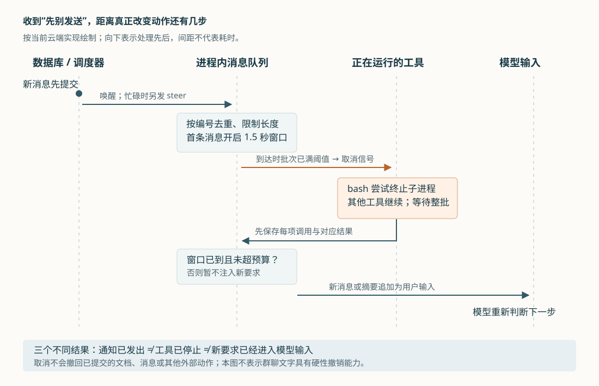
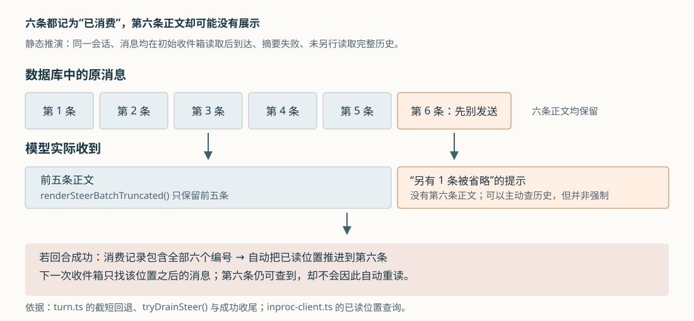

# Cumora 长任务中收到新要求：怎样插话，为什么不等于立即停手

假设 Nova 正在整理发布方案，已经开始读取资料、修改共享文档。你在群里补了一句：“先别发送，改用新版数据。”如果它一直按旧要求做完才读消息，纠正就来得太晚；如果每条新消息都强行重启工作，又可能丢掉上下文，让已经完成的动作重做。

Cumora 给正在工作的 Agent——能够调用模型和工具执行任务的程序成员——增加了一条中途接收消息的路径，代码称为 `steer`，这里可理解为“工作中的引导”。云端会把新消息暂存在进程内，等到合适的执行边界补进模型输入；遇到运行较久的工具，还会尝试发出取消信号。**但群里说“先别发送”，并不等于系统已经停止工具、撤销成果，或确认模型读到了这句话。** 这几个结果分别发生，条件也不同。

前八篇已经覆盖总体执行链、实时通知、记忆、消息选人、文档去重、换机身份、回复检查和任务卡认领。本篇研究尚未展开的中途引导，以云端的“新消息到达—当前工具收尾—模型重新决定—确认已读”为主线，并比较自带 Agent 的实现差异。依据为本次 `input/repository/` 的实际调用、数据查询、测试断言与设计文档；例子和交错场景均为静态推演。本次没有安装依赖、启动项目、运行项目测试或调用真实模型；配图另行渲染检查。

**新消息先保存，再分别告诉执行器“还有工作”和“工作要求变了”。**

人从聊天界面发出的普通消息，进入 `api/router.ts` 的消息写入路径。服务端在数据库事务内保存 `messages` 记录，并把 `message.new` 通知写入事务发件箱；事务发件箱是与业务数据一起保存、等待后台发送的事件记录。提交后，通知才有机会被调度器消费。因此，中途引导所携带的正文有数据库原件，不只存在于一条临时通知里。[消息提交入口](https://github.com/yetone/cumora/blob/main/server/src/api/router.ts)。

`scheduler.ts` 的 `startScheduler()` 订阅新消息，经 `claimAndWake()`、`wake()` 选择接收成员，再由 `fanOutWake()` 调用 `wakeOne()`。本篇从某位 Agent 已经被选中开始追踪，不重复前文的选人规则。`wakeOne()` 先发送普通 `wake` 通知；若引导功能开启、此次携带消息正文、通知总线报告存在订阅者，而且 Redis 中的忙碌记录表明 Agent 正在运行，就尝试另发 `steer`。Redis 在这里负责跨进程通知及短期状态，不负责保存聊天事实。[调度器](https://github.com/yetone/cumora/blob/main/server/src/agents/scheduler.ts)。

两条通知各有用途：`wake` 要求执行器之后补读收件箱，`steer` 则争取让当前工作提前看到新内容。云端执行器在 `pod-agent.ts` 的 `connectStream()` 中接收 SSE，即服务端通过长连接持续推送的事件流。普通唤醒调用 `drain()`；引导事件先调用 `pushSteer()` 入队，也调用 `drain()`。如果执行器已经忙碌，`drain()` 只把 `pendingRerun` 设为真，表示结束后再补读一次，不并行启动第二个回合。[云端执行器](https://github.com/yetone/cumora/blob/main/server/src/agents/runtime/pod-agent.ts)。

这解释了为什么一次新消息既可能影响当前回合，又可能安排后续回合：当前注入争取及时响应，后续补读负责发现还没处理的内容。忙碌判断来自云端回合每两秒刷新、有效期五秒的记录，属于短期运行线索；通知发布返回的数量也只是 Redis 报告的订阅者数量，不是执行器已经接收，更不是模型已经理解。调度器还会发“正在输入”提示，即使引导投递报错被捕获，也可能继续发出这条提示，不能把界面动效当成执行确认。[忙碌记录调用](https://github.com/yetone/cumora/blob/main/server/src/agents/turn.ts)、[通知总线的 `deliver()`](https://github.com/yetone/cumora/blob/main/server/src/agents/runtime/wake-bus.ts)。

**它先把连续插话合成一批，避免群聊不断挤占当前工作。**

`steer.ts` 为每位 Agent 保存一份进程内队列，每项包含消息编号、来源会话、作者、正文和到达时间。来源会话不能省略：同一位 Agent 可能正在群里处理任务，又收到私聊；模型需要知道新要求来自哪里，回复也应回到相应会话。

这里不是每收到一条消息就调用模型，而是由首条消息开启固定的 1.5 秒合并窗口。后续消息可以加入同批，却不把截止时间往后推。这样，持续聊天不会一直延后这批内容的可读时刻。窗口到期只是允许读取，并没有定时器直接替模型读取；真正注入仍要等 `turn.ts` 检查队列。[队列实现](https://github.com/yetone/cumora/blob/main/server/src/agents/steer.ts)。

当前实现还设置了几层不同用途的限制。

| 限制位置 | 当前做法 | 对使用者的含义 |
| --- | --- | --- |
| 调度器发送端 | 每位 Agent 的计数器首增后设六十秒有效期，计数不超过三十才发送引导；Redis 出错时放行 | 这是固定窗口式限流，超过后仍发送普通唤醒；不宜称作精确的滚动一分钟限制 |
| 单条正文与待处理队列 | 正文超过 JavaScript 字符串长度 4,096 时截短；最多保留一百项，超出时移除最旧项 | 输入可能只有前段，队列也可能不含所有旧消息；常量虽名为 `MAX_BODY_BYTES`，实际并非按 UTF-8 字节截断 |
| 每次注入 | 最多取最旧的三十项；三项以内直接展示，更多则生成摘要 | 模型不一定看到每条原文 |
| 单个回合 | 最多注入八批；已注入文本累计达到 64 KiB 后停止继续取批 | 当前回合不会无限吸收群消息；字节预算在整批渲染后累计，因此允许最后一批跨过阈值 |

功能开关 `STEER_ENABLED` 默认开启。关闭它，或限流挡住一次引导，都不会删除原消息。不过，“原文仍在数据库”只证明可以再查，能否自动重新进入收件箱，还取决于后面解释的已读位置。[开关定义](https://github.com/yetone/cumora/blob/main/server/src/env.ts)、[发送端限流](https://github.com/yetone/cumora/blob/main/server/src/agents/scheduler.ts)、[队列与预算](https://github.com/yetone/cumora/blob/main/server/src/agents/steer.ts)。

**模型通常等当前工具批次交代完结果，再读新要求。**

云端的一次回合由多次“请求模型—执行工具—再请求模型”构成。模型给出的工具调用和程序返回的工具结果通过 `call_id` 配对；这个编号告诉下一次模型请求，某份结果究竟属于哪次调用。中途加入用户消息时，Cumora 优先维持这份历史的完整性。

`turn.ts` 每次收到一批工具调用，会用 `Promise.all()` 并行执行，等整批返回后，先把调用项和对应结果加入 `history`，即本回合要继续交给模型的输入历史，再调用 `tryDrainSteer()`。若窗口和预算允许，它把新消息或摘要作为一条用户输入追加进去，接着让模型继续决定。即使模型刚调用 `set_turn_status` 声明可以结束，只要这时成功取到新消息，本次结束声明也会暂缓，先继续处理新输入。[工具循环与 `tryDrainSteer()`](https://github.com/yetone/cumora/blob/main/server/src/agents/turn.ts)。

另一种情况是模型只生成了一段文字，没有再调用工具。程序也会在准备结束这一轮时检查新消息；若取到，就将“尚未发送的草稿”和新要求一起交回模型，让它重新判断。这里保留草稿，是为了避免模型丢失自己刚才的思路；草稿并不因此变成已经发给人的聊天消息。

正文渲染函数还明确标注每条消息的来源会话，要求不同会话的请求分别回应，并在新要求取代旧要求时调整计划。这是交给模型的行为指引，程序没有把自然语言中的“取消”“换数据”编译成一项必定执行的状态转换。因此，这条路径解决的是让新情况进入决策过程，实际如何改计划仍依赖模型。

**长工具可以收到取消信号，但二十秒既不是自动闹钟，也不是停机保证。**

为了避免工具长时间不返回，`turn.ts` 在派发每批工具前注册一个 `AbortController`，即用于广播取消意图的控制对象。`pushSteer()` 收到新项时，会查看当前工具批次已运行多久；默认至少二十秒，才对这个控制对象调用 `abort()`。阈值可由 `STEER_INTERRUPT_AFTER_MS` 调整。[注册与触发条件](https://github.com/yetone/cumora/blob/main/server/src/agents/steer.ts)。

这个判断有三个容易误读的地方。

- **检查由新消息到达触发。** 假设消息在工具批次开始五秒时到达，当时不会取消；队列不会因为后来满二十秒就自行再次检查。若没有后续消息，工具可以继续运行到正常返回或自身超时。若另一条新消息在二十五秒时到达，才可能触发取消。
- **时长属于整批工具。** 同批工具共享取消信号，不只针对消息所提到的某一个命令；但当前分派器只有 `bash`／`shell` 接受该信号，文件读取、写入、编辑和状态声明没有接入取消。循环仍等待整批结果。[`executePodTool()`](https://github.com/yetone/cumora/blob/main/server/src/agents/runtime/pod-tools.ts)。
- **取消与注入有各自的门槛。** 取消后仍要通过 1.5 秒合并窗口检查。若工具很快返回、窗口尚未到期，`tryDrainSteer()` 就不会取消息，下一次模型请求可能先只看到工具被取消的结果，尚未看到引起取消的正文。源码里“中断后立即读取”的注释不能替代这两个实际条件。

真正执行命令的 `tBash()` 会在启动前检查信号；已经取消就直接返回，不启动命令。运行中取消则向直接创建的子进程发送 `SIGTERM`，即请求进程终止的操作系统信号，并安排两秒后的强制终止尝试；结果保留已捕获的输出，标注 `aborted: true` 和 `abortReason: 'steer_interrupt'`，再交回模型。当前这段实现使用 `child.kill()`，没有显式遍历后代进程或向整个进程组发信号，因此不能仅凭注释认定所有子孙进程都会停下，也不能将两秒解释成整个命令树的退出上限。[命令执行与取消实现](https://github.com/yetone/cumora/blob/main/server/src/agents/tools-shared.ts)。

更直接的边界是：取消发生前已经提交的文档修改、聊天消息不会沿此路径撤销。即使终止了本地请求进程，也不能据此认定远端尚未提交。根据调用和提交边界，可以推断这是一种尽力让出执行机会的机制；它没有为聊天中的“停止”建立跨工具、跨服务的统一撤销协议。开头例子若涉及重要发送动作，仍需要在实际提交入口设置可检查的确认条件，不能只依靠中途插一句话。

**失败后保留重试机会，不等于每条消息都已经完整处理。**

引导队列没有持久化。云端进程重连消息流后会补读收件箱，每个回合开始、结束也会清空临时队列。这种设计把数据库中的原消息作为恢复来源，减少维护第二套可靠队列的复杂度。要让恢复成立，就必须谨慎管理“读到哪里”。

`tryDrainSteer()` 在取出批次、完成渲染后，把其中所有消息编号记入 `steeredMessageIds`。回合最终状态为 `completed` 时，收尾代码按会话选择记录的消息编号，调用 `markConversationRead()` 推进已读位置；若最终失败或跳过，这段自动收尾不会推进。这样，已经读到补充要求、却在下一次模型请求中失败的回合，不会仅因这次注入就把原问题和补充要求一起从未读列表中划掉。这是该自动收尾路径的保护，不表示整个失败回合会撤销此前显式回复或 `ack` 已经造成的已读更新。[成功收尾条件](https://github.com/yetone/cumora/blob/main/server/src/agents/turn.ts)、[回复时的已读写入](https://github.com/yetone/cumora/blob/main/server/src/agents/cli.ts)。

已读记录也不是逐条消息的处理证明。`inproc-client.ts` 的 `markConversationRead()` 保存“创建时间、消息编号”这对位置，并只允许向前推进；`loadInbox()` 只找比该位置更新的消息。这能避免较旧确认让进度倒退，也能区分同一创建时间的消息；代价是确认一个较晚位置，会同时越过该会话中更早的消息。[收件箱与已读位置](https://github.com/yetone/cumora/blob/main/server/src/agents/runtime/inproc-client.ts)。

摘要失败时，这个代价尤其清楚。批次超过三条会尝试调用辅助模型生成摘要；请求失败、输出为空等被捕获的异常，退回 `renderSteerBatchTruncated()`，只展示前五条正文，再提示另有多少条被省略。但 `tryDrainSteer()` 仍把整批编号记为已消费，而不是只记展示出的五条。[摘要、截短回退与消费记录](https://github.com/yetone/cumora/blob/main/server/src/agents/turn.ts)。

假设同一会话的六条消息都在初始收件箱读取后到达，第六条正是“先别发送”。如果摘要失败，模型只看到前五条和“另有一条”的提示；它没有另行读取历史，回合最终又成功结束，那么成功收尾仍可以把已读位置推进到第六条。下一次收件箱就不会自动返回它。原文没有丢失，却也不能再用“下次会补读”保证它得到处理。

类似地，队列满时移除的旧消息，若随后有同会话较新的消息被确认，也可能被已读位置越过。单条正文截短后再确认，也不会自动把未展示的后半段安排成下一项任务。这些是由当前队列策略和位置查询联合得出的静态边界，不是本次复现的故障；模型主动查历史可以补救，不能假定它必然这样做。它也修正了对队列注释的宽泛理解：丢失临时队列通常只影响响应速度，但“数据库仍有原件”不足以单独证明后续自动处理一定完整。

**自带 Agent 也能中途接话，却没有复用云端这套取消流程。**

自带 Agent 指工作在用户自己的电脑上执行的成员，也称 BYOA（Bring Your Own Agent）。本地守护进程的 `scheduleWake()` 在忙碌时同样安排后续补读，同时调用 `maybeSteer()` 尝试向常驻引擎会话插话。不过，它并不直接把收到的云端 `steer` 正文放入上述队列；`wake` 与 `steer` 都被当作唤醒线索，再用 `/inbox?probe=1` 查询收件箱。[本地守护进程](https://github.com/yetone/cumora/blob/main/server/src/agents/computer/daemon.ts)。

`maybeSteer()` 检查来源会话是否存在私聊、人的消息或提及自己的内容；满足时，取结果中最后一条的作者与正文，将正文压成一行、截到三百个字符串单位，构造“简短回应后继续当前任务”的提示。不满足时，若群提醒开关允许，则只提醒有新活动，要求在自然停顿时查看。这里的“直接消息”条件是对该会话返回的一组未读做判断，展示内容却只取最后一条，不能理解为所有直接请求原文都已经注入。

提示究竟能否进入正在运行的引擎，又由适配器决定。`engine.ts` 中，Claude 的会话对象把提示排队，在处理流事件的边界写入；Codex 会话发送绑定当前回合编号的 `turn/steer` 请求；Grok 的 `steer()` 则明确不执行注入，依赖之后的唤醒处理。没有可用常驻会话时，`maybeSteer()` 也直接返回。因此不能把“同一服务端命令协议”推成“各引擎具有相同的中断能力”，更不能套用云端二十秒的工具取消条件。[引擎适配实现](https://github.com/yetone/cumora/blob/main/server/src/agents/computer/engine.ts)、[协调设计文档](https://github.com/yetone/cumora/blob/main/docs/COORDINATION.md)。

**测试支持若干局部契约，尚不能证明一句“停下”总能及时生效。**

本次交叉阅读了以下测试实现与断言，未运行它们。

| 测试 | 实际检查的内容 | 不能据此确认的内容 |
| --- | --- | --- |
| [agents-steer.test.ts](https://github.com/yetone/cumora/blob/main/server/src/__tests__/agents-steer.test.ts) | 构造队列状态，检查固定合并窗口、编号去重、移除旧项、单次取批及累计预算 | 没有贯通队列溢出后，数据库已读位置是否越过未展示消息 |
| [agents-steer-interrupt.test.ts](https://github.com/yetone/cumora/blob/main/server/src/__tests__/agents-steer-interrupt.test.ts) | 检查取消只触发一次、未满阈值不取消、预取消不启动；另用真实 `sleep` 命令检查运行中取消及保留部分输出 | 没有建立任意命令树、忽略终止信号的进程、远端已提交动作都可撤销的保证 |
| [agent-steer.test.ts](https://github.com/yetone/cumora/blob/main/server/src/__integration__/agent-steer.test.ts) | 使用数据库和 Redis 测试框架，分别检查通知传输；用模型与工具替身检查新输入、摘要、草稿继续、成功确认和失败保留未读 | 不是贯通真实模型、真实云端工具及用户取消的完整实验；摘要路径断言也不等于摘要语义完整 |

对使用者而言，补充要求最好写明原任务、变化点和适用的会话，并让 Agent 回报“哪些动作已完成、哪些已停止、接下来如何处理”。长篇补充或连续多条关键约束，应要求它重新读取完整消息再行动。看到“正在输入”或运行日志中的 `turn.tool_interrupted`，可以作为排查线索，不能单独视为已遵守新要求的证据。

对实现类似系统的人，这套设计提供了一个可迁移的分工：原消息负责留存，普通唤醒负责安排补读，临时引导争取及时调整，工具结果配对维持执行历史，成功后再确认处理进度。若任务要求更强，还需要分别补上对应约束：关键副作用在提交处检查取消或审批状态；未展示、被省略的消息保留独立待处理记录；处理位置只越过已经确认的连续消息。这样才能让“有机会重新决定”逐步成为“关键新要求不会被跳过”，而无需把自然语言提醒误当成程序已经完成的控制动作。
