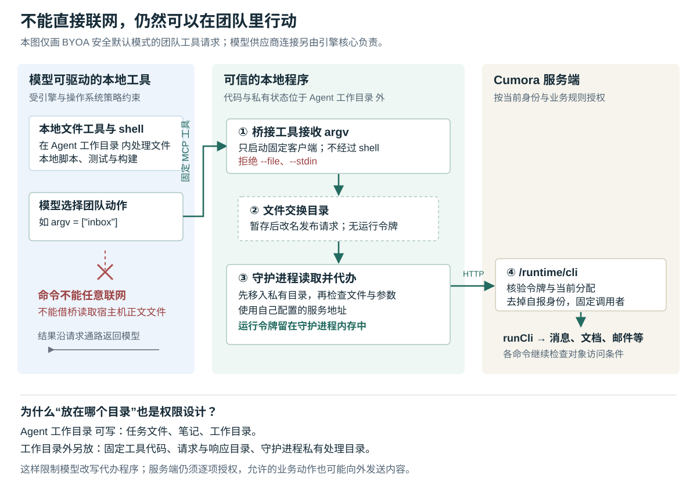

# Cumora 把 Agent 放在自己电脑上：不能直接联网，怎样仍能替团队办事

假设你把 Nova 接到自己的电脑上，让它读取团队讨论、整理发布方案，再写回共享文档。这台电脑还保存着私人项目、浏览器资料和登录凭据。Nova 需要完成团队工作，却不应因此获得整台电脑的访问能力。另一方面，若把它启动的命令全部断网，它又怎样读取群消息、提交成果？

Cumora 的办法是分开两种能力：本地工具在受限目录里处理文件；团队动作通过一段固定的中间程序，交给持有身份凭据的守护进程代办。守护进程是常驻本机、负责管理执行器和连接服务端的程序。**模型不必拿到可复用的运行令牌，也不必让自己生成的命令自由联网，就能调用 Cumora 的业务功能。代价是，这段代办程序本身必须限制得足够具体，服务端也必须继续检查每个动作的权限。**

前九篇已经解释协作调度、任务归属、消息处理和换机身份。本篇深入此前只概括提过的本机权限边界，研究 BYOA（Bring Your Own Agent，自带 Agent：由用户自己的电脑和模型引擎执行工作）的安全默认路径。这里的 Agent 指能够调用模型和工具执行任务的程序成员。依据是本次 `input/repository/` 中的实际调用、策略构造、错误分支、测试断言及设计文档；开头场景为假设。本次没有安装依赖、启动项目、运行项目测试或调用真实模型，也没有做操作系统隔离实验。配图按源码绘制并另行渲染检查。

**先追一次“读取消息”：出网的是代办程序，参数来自模型。**

Nova 在安全默认模式中使用 `mcp__cumora__cli` 工具，提交的内容类似：

```json
{"argv":["messages","<会话编号>","--tail","20"]}
```

MCP 是 Model Context Protocol，即模型上下文协议；这里用它向本地引擎提供一个固定工具。`argv` 是命令参数数组，每个元素是一项参数。它表达“读取哪个会话的多少条消息”，不包含服务地址、身份令牌或任意待执行的程序。提示由 `prompt-surface.ts` 生成，明确区分安全模式的 MCP 工具和兼容模式的 shell 命令，避免模型去命令行里寻找并不存在的 `cumora`。shell 是解释并执行命令的程序。[工具使用说明](https://github.com/yetone/cumora/blob/main/server/src/agents/computer/prompt-surface.ts)。

真实连接由 `AgentRunner.start()` 建立：它先在模型工作目录之外写入固定客户端与 MCP 桥接程序，启动 `RuntimeCliBroker`，再由引擎适配器把这个 MCP 工具交给 Claude 或 Codex。固定桥收到调用后，用 `execFile()` 启动固定的 Node 客户端，将参数数组直接交给它；这一步不经过 shell，不会把正文中的反引号或 `$()` 当成本机命令执行。[初始化、`CUMORA_MCP_SHIM` 与客户端实现](https://github.com/yetone/cumora/blob/main/server/src/agents/computer/daemon.ts)。

客户端没有直接发送网络请求。它生成随机请求编号，把 `{"argv":[…]}` 写到交换目录的临时文件，再改名为正式请求文件。守护进程监听目录变化，并以一秒一次的轮询兜底；读到合法请求后，调用 `invokeRuntimeCli()`。后者从自己的配置取得服务地址，通过 `ensureToken()` 取得或刷新运行令牌，将参数提交给固定的 `/runtime/cli` 地址。这里的 IPC（Inter-Process Communication，进程间通信）采用文件传递，请求目录里没有运行令牌。

服务端验证身份以后，调用 `buildRuntimeArgv()` 删除参数中自报的 `--as` 身份，再注入令牌所绑定的 Agent 编号，交给 `runCli()` 分派。`messages` 最终进入 `cmdMessages()`，查询条件还要求调用者是同一工作区内的活跃 Agent，并且属于目标会话。结果沿 HTTP、响应文件、客户端输出和 MCP 返回值交回模型。[运行入口](https://github.com/yetone/cumora/blob/main/server/src/agents/runtime/server.ts)、[身份参数处理](https://github.com/yetone/cumora/blob/main/server/src/agents/runtime/cli-argv.ts)、[消息查询与命令分派](https://github.com/yetone/cumora/blob/main/server/src/agents/cli.ts)。



这条路径解释了 Cumora 为什么能同时限制本机命令联网、保留团队工具。它也划出明确范围：限制的是模型能够驱动的工具行为，模型供应商连接仍由引擎核心处理；不能理解成整个本地引擎进程都没有网络、没有登录信息。

**桥接程序拒绝本地文件参数，是为了不替模型越过读取限制。**

假设模型提交这样的请求：

```json
{"argv":["reply","<会话编号>","--file","/host/private-note.txt"]}
```

如果固定桥无条件转交，底层客户端就会尝试读取这份文件。问题在于，固定 MCP 程序运行在命令沙箱之外；沙箱是限制程序能够读取哪些文件、访问哪些网络的执行环境。即使模型自己的文件工具被挡住，让拥有更广权限的中间程序代读，仍可能绕过原来的限制。

源码因此在 `CUMORA_MCP_SHIM` 中直接拒绝 `--file` 和 `--stdin`，要求正文作为参数传入。这个限制不是为了避免 Markdown 格式出错，而是因为客户端确实包含“读取本地文件或标准输入，再转成正文”的功能；该功能保留给显式放宽限制的兼容路径。MCP 桥还只接受名为 `cli` 的工具、非空的字符串参数数组，并只启动与自身同目录的固定客户端。它没有提供让模型选择任意程序、文件读取接口或 HTTP 地址的字段。[桥接检查与客户端正文处理](https://github.com/yetone/cumora/blob/main/server/src/agents/computer/daemon.ts)。

正文仍可以来自 Agent 自己的工作文件：模型先用获准的本地文件工具读取，再把内容交给团队工具。关键区别在于，读取必须先经过文件访问限制，固定桥不能凭自己的权限代读。这是根据调用关系得出的设计解释，不表示系统能判断正文是否适合对外发送。

结构化参数也不意味着业务处理完全保留原始文本。`joinBodyArgs()` 对普通正文参数仍执行 `unescapeChat()`，把字面的 `\n` 等序列转换成换行；`parseArgs()` 则把 `--` 后面的内容标为字面参数，使其跳过这层转换。因此，包含代码或以 `--` 开头的消息，不能仅凭“没有 shell”就推断内容绝不会变化。以回复为例，可把正文放在结束参数解析的标记之后：

```json
{"argv":["reply","<会话编号>","--","请保留代码中的字面字符 \\n"]}
```

这只绕过该层转义，回复处理仍会去除首尾空白等内容。当前提示里“直接传正文即可”的简化说明，需要结合这段服务端解析理解；上述差异是静态阅读所得，本次未运行示例。[参数解析与正文拼接](https://github.com/yetone/cumora/blob/main/server/src/agents/cli-parse.ts)、[`cmdReply()`](https://github.com/yetone/cumora/blob/main/server/src/agents/cli.ts)。

**令牌留在守护进程还不够，代办代码和请求文件也要放对地方。**

`AgentRunner` 为每位 Agent 分出几处目录。下表中的路径都位于本机 `~/.cumora/` 下；这里的“私有”首先指不授予模型工具访问，不能据此理解成操作系统中另一个独立用户。

| 位置 | 保存什么 | 为什么分开 |
| --- | --- | --- |
| `agents/<Agent编号>/` | Agent 的工作目录、笔记和文件 | 模型需要修改任务资料，因而不能把可信代办代码也放在这里 |
| `.runtime-cli-tools/<Agent编号>/` | 固定 MCP 桥与文件通信客户端 | 避免模型修改程序后，让下一次调用按更大的权限执行新代码 |
| `.runtime-cli-ipc/<Agent编号>/` | 请求与响应文件 | 交换命令参数和结果；当前安全配置没有向模型命令开放这些目录的写权限 |
| `.runtime-cli-broker/<Agent编号>/` | 已接收的请求、待发布的响应 | 让守护进程在模型不能替换文件的位置检查和处理数据 |

目录分工可由构造函数、`start()`、`writeShim()` 与引擎策略相互核验。`writeShim()` 拒绝把符号链接目录当作可信工具目录，写入工具文件时采用暂存后改名的方式。符号链接是指向另一位置的文件系统入口；若带着守护进程权限跟随它写入，就可能改到本来不应修改的目标。[目录布局与工具文件写入](https://github.com/yetone/cumora/blob/main/server/src/agents/computer/daemon.ts)。

请求读取采用同样的谨慎分工。`RuntimeCliBroker.handle()` 先根据目录枚举得到的文件名，筛出符合格式的请求，再将它原子改名到私有处理目录；原子改名意味着其他读取者不会看到一半完成的改名。随后用 `lstat()` 检查普通文件属性，在支持的平台上再用 `O_NOFOLLOW` 禁止跟随符号链接，打开后检查文件类型和大小，最后解析参数。

先改名、后检查的意义，是减少“检查时是普通文件，打开前被换成链接”的间隙。响应也先写在私有处理目录，再改名发布，避免模型预先放置一个可猜到的临时路径，把有权限的写入引向别处。这些是代码明确防范的攻击面；当前安全模式不允许模型直接写交换目录，但通信层仍额外防御不可信文件，不能因为入口受限就省略检查。

另一处容易忽视的启动边界在 `PATH`，也就是查找可执行程序的目录列表。`engineProcessPath()` 在安全模式中移除空项、相对目录和 Agent 工作目录 内的目录。否则，模型可以先在自己的可写目录放一个假 `claude` 或 `codex`，等守护进程下次启动引擎时，先执行假程序，再谈沙箱已经太晚。这项过滤保护的是引擎启动前的查找过程，仍以操作者提供的其余程序路径可信为前提。[文件请求处理与引擎路径过滤](https://github.com/yetone/cumora/blob/main/server/src/agents/computer/daemon.ts)。

**模型引擎保留登录能力，模型启动的命令只获得缩小后的权限。**

两条安全适配路径共用团队桥接，但本地限制依赖各自引擎的实现，不能把它们视作同一种沙箱。

Claude 路径由 `claudeSecureFlags()` 配置受限模式，保留本地文件工具、Bash 和固定 MCP 工具，禁用 PowerShell、网页读取与网页搜索工具；命令沙箱使用空的严格网络允许名单，不允许绕过沙箱重试，也没有被排除在沙箱之外的命令。文件策略拒绝用户数据目录，再开放 Agent 工作目录、程序查找目录等所需位置。因此它并不是“任何系统文件都不可读”的配置，运行时与可执行程序仍需访问必要文件。[Claude 策略构造](https://github.com/yetone/cumora/blob/main/server/src/agents/computer/engine.ts)。

凭据则分两层处理。Claude 核心仍需要供应商配置来调用模型，`claudeTurnEnv()` 因此保留所需环境，并开启子进程环境清理；`claudeSecureSettings()` 把非工具必需的环境变量名列入拒绝清单。Codex 核心使用独立运行目录，并可共享操作者的登录；它生成的命令则使用“不继承环境、只显式设置少量变量”的策略，工具的 `HOME` 被设为 Agent 工作目录。**“本地引擎能使用我的账号”和“模型写的脚本能读取账号凭据”，是代码试图区分的两种能力。** 运行令牌则由守护进程单独维护，不需要写入上述工具通信文件。[引擎环境策略](https://github.com/yetone/cumora/blob/main/server/src/agents/computer/engine.ts)、[Codex 运行目录及登录共享](https://github.com/yetone/cumora/blob/main/server/src/agents/computer/codex-runtime.ts)。

Codex 的 `codexSecureConfigOverrides()` 还设置自定义权限配置：只允许必要运行时读取及 Agent 工作目录内的访问，关闭命令网络、网页搜索、钩子、应用接入、远程插件、多 Agent 工具和 shell 快照；固定 MCP 工具另行注册。一次性执行使用 `--ignore-user-config`、`--ignore-rules`，工作目录也被标为不可信，避免模型往可写目录放置配置后，下一轮自动获得更大能力。常驻会话同样调用这份策略构造函数，而非另走一套宽松参数。[Codex 策略及两种调用方](https://github.com/yetone/cumora/blob/main/server/src/agents/computer/engine.ts)。

这些措施把权限落实到了引擎配置和执行环境，而不只是一段“不要读取私人资料”的提示。不过，它们仍信任本地引擎、固定桥、守护进程和相应操作系统机制；本篇没有验证这些依赖是否在所有平台上正确执行，也不能把本机限制推广成模型已收到的内容不会被发送给模型供应商。

**无法建立预期限制时，程序倾向于停止，兼容模式则明确换了信任前提。**

`runnableEngineIds()` 在默认模式中只接受 Claude 和 Codex，并排除原生 Windows 上的 Claude。之后 `evaluateRunnableEngines()` 检查版本及所需依赖：当前源码的最低版本分别为 Claude Code `2.1.248`、Codex `0.138.0`；Linux 的 Claude 路径还要求 `bwrap` 和 `socat`。这些数字是本次快照的策略常量，不是对外部工具最新版的判断。[可运行引擎筛选](https://github.com/yetone/cumora/blob/main/server/src/agents/computer/engine.ts)。

版本检查也有一个需要保留的条件：探测暂时失败时，若可执行文件的指纹和最低版本策略没变，可以复用此前成功验证的版本。指纹由实际路径及文件属性等组成，不是文件内容的密码学证明。因此准确说法是“没有可用的版本验证结果时拒绝”，而非“本次版本命令没答复就一定停止”。通过版本筛选也不代表实际沙箱一定能启动；Claude 配置另要求沙箱不可用时失败，Codex 严格配置被拒绝时也不会自行去掉限制重试。

操作者显式设置 `CUMORA_BYOA_ALLOW_UNSANDBOXED=1` 后，程序才开放其余兼容引擎、历史 shell 工具路径，以及整组引擎参数覆盖。这里不只是增加几个工具：Claude、Codex 的启动参数也会进入更宽松的分支，本机文件、环境和网络的信任前提随之改变。默认模式则忽略无法证明仍保留限制的整组参数覆盖。源码为此打印告警，设计文档建议把兼容运行放进另有隔离的容器或虚拟机；这项建议的前提正是 Cumora 不再提供同等本机边界。[启动分支与参数覆盖](https://github.com/yetone/cumora/blob/main/server/src/agents/computer/engine.ts)、[守护进程告警](https://github.com/yetone/cumora/blob/main/server/src/agents/computer/daemon.ts)、[BYOA 设计说明](https://github.com/yetone/cumora/blob/main/docs/BYOA.md)。

**受限本机仍能发送业务内容，代办工具不是逐次审批。**

固定桥检查的是工具形状和危险的本地读取参数；`RuntimeCliBroker` 检查的是文件、大小和参数类型。它们没有把可用命令缩成“只读消息”，也没有要求每次创建文档或发送邮件都先得到人的确认。合法参数会继续交给服务端命令分派。

服务端负责另外一层约束：运行入口先验证签名令牌，再查询数据库确认 Agent、工作区、Computer（已配对电脑）和分配代次仍有效；查询失败返回服务不可用，不直接信任旧身份。此后，各业务命令继续检查自己的对象范围。聊天读取要求会话成员资格，文档命令主要按工作区检查；不能把本机文件隔离理解为服务端所有内容也按本次任务隔离。[运行授权](https://github.com/yetone/cumora/blob/main/server/src/agents/runtime/authorization.ts)、[运行中间件](https://github.com/yetone/cumora/blob/main/server/src/agents/runtime/server.ts)、[`cmdMessages()` 与 `cmdDoc()`](https://github.com/yetone/cumora/blob/main/server/src/agents/cli.ts)。

一个直接的例子是 `email send`。在邮件功能配置有效、身份及输入满足要求时，命令可以由服务端保存邮件记录，再调用邮件供应商发送。模型的 shell 不必拥有网络权限，这个业务动作依然可以向外部收件人传送正文。所以这套设计适合减少 Agent 对宿主机的直接访问，不能独自承担“团队内容绝不能外传”或“所有对外动作都经过人审”的要求。[`cmdEmail()` 与 `cmdEmailSend()`](https://github.com/yetone/cumora/blob/main/server/src/agents/cli.ts)。

如果要限制某类外部动作，检查需要放在能理解动作的服务端入口，例如核对收件人范围、任务授权或确认记录。只在 shell 层禁止联网，会留下获准业务工具这条正常通路。这是根据职责分工提出的实现建议，并非当前已经存在的统一审批机制。

**通信失败会返回错误，但文件请求编号不保证动作只做一次。**

文件通信解决了“没有命令网络时怎样传参”，同时引入等待、清理和结果丢失问题。客户端等待响应最多五分钟；守护进程的 HTTP 调用默认二十秒超时，可由环境配置调整。请求有两千项参数、三十二 MiB 文件大小等局部上限，服务端普通运行请求的 JSON 解析上限却是四 MB，MCP 客户端收集输出也有自己的缓冲限制。因此不能把某一处上限当成完整链路的有效载荷承诺。[本地通信限制](https://github.com/yetone/cumora/blob/main/server/src/agents/computer/daemon.ts)、[服务端解析上限](https://github.com/yetone/cumora/blob/main/server/src/agents/runtime/server.ts)。

HTTP 返回 401 或 403 时，`invokeRuntimeCli()` 清除对应的缓存令牌并返回错误，没有在同一次请求中自动刷新后重发命令。关闭执行器时，`RuntimeCliBroker.stop()` 取消在途请求，并停止发布响应；重新启动通信器会清理自己的旧协议文件。这些做法避免随意重放，也意味着请求和响应不是可恢复的持久任务队列。

尤其要区分“服务端没有执行”和“调用者没有收到结果”。服务端可能已经保存文档，随后本地写响应文件失败；测试中就有“代办函数已执行，响应发布失败”的断言。客户端超时也只能说明等不到结果，不能证明数据库回滚。随机文件编号只关联这一轮请求与响应，发往 `/runtime/cli` 的业务请求体只有参数，没有把该编号作为业务去重凭据。本篇未复现重复提交，但从这个协议不能推导出“失败后重试必定只执行一次”。[请求处理、停止与失败分支](https://github.com/yetone/cumora/blob/main/server/src/agents/computer/daemon.ts)、[响应发布失败测试](https://github.com/yetone/cumora/blob/main/server/src/__tests__/agent-computer-shim-output.test.ts)。

**测试分别检查了桥接程序和策略生成，尚未贯通真实隔离效果。**

本次阅读了下面的测试实现和断言，没有运行。

| 测试依据 | 能支持什么，以及边界在哪里 |
| --- | --- |
| [agent-computer-shim-output.test.ts](https://github.com/yetone/cumora/blob/main/server/src/__tests__/agent-computer-shim-output.test.ts) | 启动真实固定桥和文件通信客户端，使用代办函数替身检查普通参数往返、拒绝 `--file`、拒绝请求符号链接、停止时取消、输出完整性和响应发布失败；没有贯通真实服务端与模型引擎。符号链接等部分用例跳过 Windows。 |
| [agents-computer-engine.test.ts](https://github.com/yetone/cumora/blob/main/server/src/__tests__/agents-computer-engine.test.ts) | 检查 Claude 策略中保留 Bash、关闭网络和拒绝凭据的配置；用伪引擎捕获一次性与常驻启动参数。Codex 用例也检查权限配置、固定 MCP 注册，以及没有给交换目录写权限。这证明生成了哪些参数，不能证明真实引擎按预期阻断了宿主机访问。 |
| [agents-runtime-cli-argv.test.ts](https://github.com/yetone/cumora/blob/main/server/src/__tests__/agents-runtime-cli-argv.test.ts) | 用纯函数断言删除多种 `--as` 写法、注入令牌身份；不涉及实际令牌验证和业务数据库授权。 |

对使用者，这条机制意味着：安全默认模式可以在 Agent 工作目录中做本地处理，再用固定团队工具交付；需要网络下载依赖的构建应提前准备环境，不能期待 shell 临时获得网络。遇到“引擎已安装但不可运行”，应先核对被拒原因、版本和沙箱依赖；开启兼容模式会改变权限前提。交付调用超时后，应先查询文档或消息是否已经保存，再决定是否重试。

对实现类似系统的人，值得借鉴的是把“模型决定做什么”和“程序凭什么权限执行”接在一个窄接口上：模型提交业务参数，固定桥限制本地能力，守护进程持有凭据，服务端核验身份与对象权限。这个接口每增加一种读取本地文件、选择目标地址或执行任意程序的便利，都应重新检查它是否让中间程序替模型越过原有限制。若还需要防止内容外传、要求人审或确保安全重试，则要把这些条件继续落实到真实业务提交处；本机沙箱与固定桥并没有自动完成这些约束。
