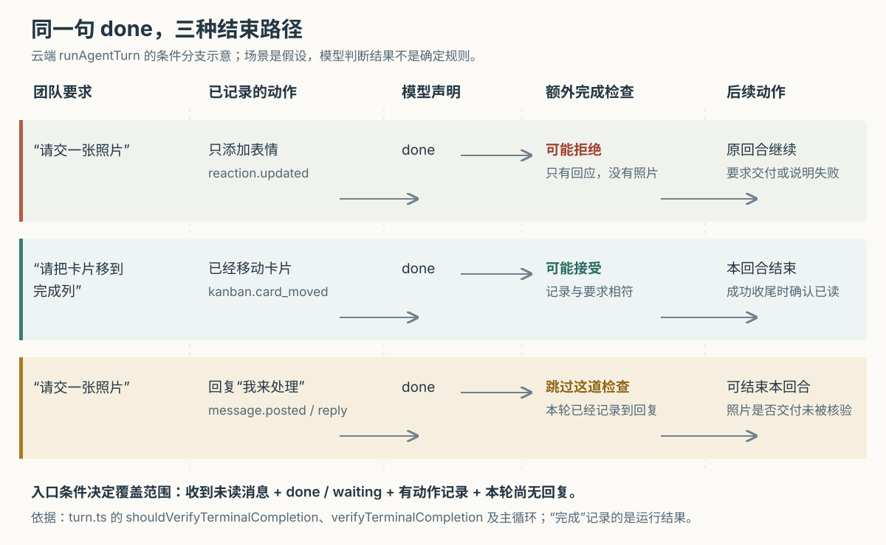

# Cumora 怎样判断 Agent 可以收工：发过回复，为什么仍不等于交付完成

假设你在群里请 Nova 生成一张活动配图。它先点了一个“正在看”的表情，然后结束工作；另一种情况是，它先回复“我来处理”，随后也结束了。两次都没有交出图片，系统会不会同样要求它继续？如果要求只是“把任务卡移到完成列”，又是否必须补一句聊天回复才能收工？

Cumora 在云端执行循环中加入了一道有条件的完成检查：当 Agent——能够调用模型和工具执行任务的程序成员——只做了非回复动作，却声明可以结束时，另请辅助模型判断这些动作是否满足请求。只有表情、没有图片，可以被要求继续；确实移动了指定卡片，则可以不发消息就结束。**但只要本轮已经记录到一次回复，这道额外检查就会跳过；它不区分“我来处理”和真正交付成果。因此，运行记录里的 `completed` 表示本轮执行被接受为结束，不能直接当作整项请求已经验收。**

前十篇已研究消息调度、协作竞争、长期记忆、自带执行器和本机权限。本篇深入此前只概括提到的“部分完成检查”，追踪声明结束、收集动作记录、辅助判断、继续执行与确认已读之间的真实连接。依据为本次 `input/repository/` 的实现、调用方、测试断言与设计文档；例子均为假设。本次没有安装依赖、启动项目、运行项目测试或调用真实模型；SVG 配图另用现有静态图像库渲染并目视检查。下文源码链接指向对应文件，阅读依据是本次本地快照。

**先把模型的文字、发出的消息和运行状态分开。**

Cumora 是让人和 Agent 共享群聊、文档与看板的协作应用。一次云端工作由 `pod-agent.ts` 的 `drain()` 调用 `runAgentTurn()` 开始；后者反复让模型提出工具调用、执行工具，再把结果交回模型。这一整段执行称为一个回合。

模型直接输出“图片做好了”，首先只是内部草稿。正常交付要通过 `bash` 工具执行 `cumora reply`，由服务端保存群消息；`bash` 在这里是执行命令的工具。模型也可以明确要求运行器转发草稿，但必须另外声明目标会话。这样，决定说什么和真正向团队发送，是两个可以分别检查的动作。[云端执行入口](https://github.com/yetone/cumora/blob/main/server/src/agents/runtime/pod-agent.ts)、[回合循环与交付处理：turn.ts](https://github.com/yetone/cumora/blob/main/server/src/agents/turn.ts)。

这些记录回答的问题不同：

| 记录 | 实际说明什么 | 单凭它不能说明什么 |
| --- | --- | --- |
| 普通模型输出 | 模型生成了一段文字 | 团队已经收到这段文字 |
| 工具返回成功 | 这次工具执行按其返回契约成功 | 用户要求的全部工作已经完成 |
| `set_turn_status` 声明 | 主模型认为应继续、结束、等待、澄清或报告阻碍 | 运行器已独立核验成果 |
| 运行记录 `completed` | 本轮按当前结束路径完成收尾 | 文档质量、附件内容和每个会话的请求都通过验收 |

项目的协作设计文档要求按任务实际需要的项目判断完成，而不是“每位成员都参与过就算结束”。这是给 Agent 的行为原则；是否落实为运行器检查，仍要看下面的条件分支，不能把提示原则扩展成程序保证。[设计说明：COORDINATION.md](https://github.com/yetone/cumora/blob/main/docs/COORDINATION.md)。

**声明“做完了”是一项协议操作，工具本身不会检查成果。**

模型用 `set_turn_status` 把判断交给运行器。协议是双方约定的信号格式，这里包括 `status`、原因 `reason`、下一步 `next_step`，以及是否转发草稿等字段。`tools-shared.ts` 的 `tSetTurnStatus()` 检查状态是否合法、原因是否为空；要求转发草稿时，还必须填写会话编号。它不查询图片、文档或任务卡，也不检查原因是否属实。[状态定义、工具说明与校验](https://github.com/yetone/cumora/blob/main/server/src/agents/tools-shared.ts)。

主循环只把 `done` 和 `waiting` 当作可结束当前回合的状态。`done` 表示模型认为请求已处理，或判断无需动作；`waiting` 表示已经采取行动，正在等外部回应。`continue`、`needs_clarification` 和 `blocked` 都会继续循环：有疑问应真正向用户提问，有阻碍应真正报告，不能只在内部填一个状态。因此，“请求还在等外部事件”也可能对应一条 `completed` 运行记录——结束的是本回合，并非外部工作已经完成。

没有工具调用也不会立即按“做完”处理。`runAgentTurn()` 最多追加两次提示，要求模型明确发送、丢弃草稿或声明状态；再不遵守时，通常按协议失败结束。不过源码有一个明确例外：**如果本轮已经记录到可见回复，提示两次后仍没有声明，运行器会自行推定 `done`。** 对没有动作的空闲或后台扫描回合，则可以记为跳过。这细化了首篇“需要显式声明”的表述：显式声明是正常协议，已有回复时仍存在推定完成的退路。[状态解释、无工具返回与 `turn.status_inferred` 分支](https://github.com/yetone/cumora/blob/main/server/src/agents/turn.ts)。

**运行器靠动作记录识别回复，不靠命令文本或“发送成功”几个字。**

以真正回复群消息为例，执行路径是：

`runAgentTurn()` → `executePodTool()` → `tBash()` → 容器内的 `cumora` 转发脚本 → 服务端 `/runtime/cli` → `runCli()` → `cmdReply()`。

服务端完成回复后，在命令结果中返回 `sideEffects`，即结构化的对外动作记录，包含 `message.posted`、`command: reply`、会话编号和消息编号等字段。移动任务卡返回 `kanban.card_moved`；创建文档返回 `document.created`；添加表情返回 `reaction.updated`。例如，实际的 `cmdCard()` 移动分支先在数据库事务中更新卡片并保存通知，再返回动作记录。[工具分派](https://github.com/yetone/cumora/blob/main/server/src/agents/runtime/pod-tools.ts)、[运行接口](https://github.com/yetone/cumora/blob/main/server/src/agents/runtime/server.ts)、[业务动作及返回值：cli.ts](https://github.com/yetone/cumora/blob/main/server/src/agents/cli.ts)。

转发脚本把动作记录写进 `tBash()` 指定的临时结果文件，与普通命令输出分开。`tBash()` 读回后，主循环收集到本轮的 `cliSideEffectsThisTurn`。识别“发过回复”的函数只要求事件是 `message.posted`、命令是 `reply`，且没有明确标为不可见；并不读取消息正文。可见回复标记一旦置为真，本轮不会再清回假。[容器转发脚本](https://github.com/yetone/cumora/blob/main/server/docker/agent-computer-cumora.sh)、[结果解析：cli-result.ts](https://github.com/yetone/cumora/blob/main/server/src/agents/cli-result.ts)、[`tBash()`](https://github.com/yetone/cumora/blob/main/server/src/agents/tools-shared.ts)。

这比检查命令字符串可靠：写了 `cumora reply` 不代表服务端成功保存，命令输出里提到“sent”也不应直接算作交付。运行器还会在命令最终失败时检查返回的动作记录，因为一个命令可能先完成业务修改，随后在别处出错。**命令退出失败与业务没有发生，不是同一件事。**

但这里的记录是命令结果的传递渠道，不是一套独立核验的持久交付账本。脚本写结果文件失败时，会把记录补写到标准错误输出，解析器尝试恢复；文件解析、读取或写入失败也会留下“不可靠”标记。通道不可靠且无法确认已发回复时，运行器会拒绝自动转发草稿，避免贸然再发一份。它并没有因此建立“所有外部动作都可完整追溯”的保证。

**额外完成检查只覆盖四个条件同时成立的回合。**

`turn.ts` 的 `shouldVerifyTerminalCompletion()` 依次要求：本轮有未读收件箱内容；本次状态是 `done` 或 `waiting`；本轮尚未记录到可见回复；本轮至少已有一条动作记录。普通读文件、查询资料等没有对外动作记录的工具执行，不会自行满足最后一项。

这正好覆盖一种容易误判的情况：Agent 点了表情，确实“做了事”，但用户要求的是一张图片；也保留另一种合理情况：用户只要求移动卡片，卡片已经移动，不需要强迫 Agent 再发一句“已完成”。判断交给辅助模型，称为语义检查，即根据请求与动作的含义作判断，而不是把某个表情或命令固定认定为成功。

四个条件也划出了几处实际空白。

第一，**本轮先回复“我来处理”，随后声明 `done`，会跳过这道检查。** 回复识别函数不区分承诺、进度汇报和最终成果。如果此后一直不声明状态，而是连续无工具返回，两次提示后的推定完成分支也可能接受结束。这是按分支条件作出的静态推演，本次没有复现真实模型行为。

第二，**完全没有动作记录，却直接声明 `done`，同样不会进入辅助检查。** 主循环可以接受这次终止，不要求再拿出成果证据。它适合“旁观后决定保持安静”，也给“错误地以为什么都不用做”留下空间。

第三，`postedReplyViaTool` 是整回合共用的真假标记，没有按会话或请求分开。假设同一回合同时处理群聊 A 和私聊 B，在 A 发过一条回复后，B 是否还缺成果，不会再由这道检查单独核验。成功收尾中的跨会话回复审计只是记录事件，不阻止结束；它也不能补成逐请求验收。[检查条件、回复标记与跨会话审计](https://github.com/yetone/cumora/blob/main/server/src/agents/turn.ts)。

**辅助模型看的是有限快照，不会重新打开成果检查。**

`verifyTerminalCompletion()` 的提示要求它区分“轻量回应已经足够”和“用户要的成果仍缺失”，也要求不要让这位 Agent 重复同事已经完成的工作。模型来自辅助模型选择逻辑，可用 `OPENAI_COMPACTION_MODEL` 配置覆盖；不能因配置名带有“压缩”就以为这里运行的是历史压缩算法。

它收到三类材料：

| 材料 | 实际范围 | 判断边界 |
| --- | --- | --- |
| 本回合开始时渲染的会话背景 | 正常加载每个会话最近 25 条消息；普通正文先截为 400 个字符；验证输入再取渲染文本前 24,000 个字符 | 长请求、窗口外消息及截断后的约束可能不在其中 |
| 当前结束声明 | 状态、原因、下一步及草稿处理字段 | 原因仍是主模型的陈述，不是独立事实 |
| 本轮动作记录 | 最后 20 条 `sideEffects` | 更早记录可能不在输入；记录也未必包含成果正文 |

这些是代码中的长度与数量限制，不是本次测量结果。比如，创建文档的记录提供文档编号、标题和正文长度，没有把正文交给检查模型；移动卡片的记录提供卡片与列编号。检查函数没有工具定义，也没有在判断前查询当前文档或卡片状态。它能根据记录判断“做了哪类动作”，不能据此验收文档是否写对、图片是否符合要求。[会话查询：inproc-client.ts 的 `loadContext()`](https://github.com/yetone/cumora/blob/main/server/src/agents/runtime/inproc-client.ts)、[背景渲染及 `verifyTerminalCompletion()`](https://github.com/yetone/cumora/blob/main/server/src/agents/turn.ts)、[文档动作字段](https://github.com/yetone/cumora/blob/main/server/src/agents/cli.ts)。

还有一个与长任务有关的限制：传入的是事先生成的 `renderedConversationContext`，不是不断增长的 `history`。本轮中途收到并注入的新消息、主模型后来读取的资料、完整工具返回值，都没有由这个调用一并交给检查模型；函数也不会重新拉取最新群消息。因而，“根据可见背景判断同事是否已经完成”不等于“收工时重新核对团队当前成果”。这是参数流和函数实现直接支持的范围限制，不表示真实模型必然误判。

**检查拒绝以后，继续原回合；接受以后，还会改变后续补读。**

检查模型必须返回含 `complete` 布尔值的 JSON 对象，即结构化文本结果。代码允许从代码块等常见包裹中提取对象；缺少合法判断则按检查失败处理。请求设置十秒取消计时器、最多 500 个输出词元，词元是模型计量输入输出的单位；这些都是配置上限，不能解释成实际延迟承诺。

检查抛错、超时或返回非法结果时，主循环把它转换为“不接受结束”，而不是立即把整轮判成执行失败。拒绝结果和建议会作为新输入追加到同一份历史，清除本次结束声明，把状态切回思考，让主模型继续交付、提问或报告失败。整个过程没有回滚先前已经发生的动作。再次声明结束时，若仍满足入口条件，可以再次调用检查；没有单独的拒绝次数上限，仍受整个回合最多 200 次循环和上下文预算约束。[验证错误处理、继续循环与预算分支](https://github.com/yetone/cumora/blob/main/server/src/agents/turn.ts)。

接受“只做动作、不发回复”的结束后，代码设置 `markInitialInboxReadOnCompletion`。当本回合最终状态仍是 `completed`，它会按会话推进初始收件箱的已读位置。这样，卡片已经按要求移动，就不必因原消息仍未读而在以后重复处理。

这里确认的是整份初始收件箱，而不是检查模型逐条列出的已完成请求。结合前述输入截断，可以推断：模型可能只据有限材料接受结束，程序随后却确认更大的初始消息集合。这是实现边界，不是已测得的漏处理案例。已读更新出错会被捕获并记录，不撤销已完成动作，也不自动把运行改成失败。

其他被接受的结束路径未必推进这份初始已读位置，但成功收尾会更新进程内的收件箱指纹，即由本轮输入计算的去重标识。下一次唤醒若看到相同指纹，可直接跳过主模型。因此，“未确认已读”也不能解释为“一定马上再处理一遍”；进程重启以后，这个内存标识又不再存在。反过来，失败回合不更新成功指纹，只是保留以后重试的可能，不表示已经安排了定时重试。

**草稿转发和自带 Agent，还有各自的结束依据。**

模型明确声明 `assistant_text: reply` 时，运行器可以转发本轮积累的草稿。`resolveDeclaredAutoRelayTarget()` 要求目标属于本回合初始收件箱的会话，不按“这里只有一个群”之类的猜测选位置。已有回复会抑制转发；发送失败或目标不合法可使运行失败。由于额外完成检查在转发之前运行，不能把“准备转发”当成检查时已经存在的交付。[转发目标校验](https://github.com/yetone/cumora/blob/main/server/src/agents/auto-relay.ts)、[转发执行与结果处理](https://github.com/yetone/cumora/blob/main/server/src/agents/turn.ts)。

自带 Agent，也就是 BYOA（Bring Your Own Agent，由用户自己的机器和模型引擎执行），则没有走上述云端循环。`AgentRunner.runTurn()` 调用本地引擎，按返回的退出码把运行记为 `completed` 或 `failed`；没有引擎错误时，再确认本轮看到的消息。所读这条路径没有调用 `verifyTerminalCompletion()`。因此，同一个运行列表里的“完成”，在云端可能经过上述条件检查，在自带执行器上主要对应引擎正常结束；都不能直接替代业务验收。[本地执行、结束记录与 `ackSeen()` 调用](https://github.com/yetone/cumora/blob/main/server/src/agents/computer/daemon.ts)。

**测试证明了分支能够连接，没有证明模型会正确验收。**

本次阅读测试实现，未运行测试。

| 测试依据 | 实际检查什么 | 尚不能证明什么 |
| --- | --- | --- |
| [agent-turn.test.ts](https://github.com/yetone/cumora/blob/main/server/src/__integration__/agent-turn.test.ts) 的表情后结束用例 | 给定“用户要图片、只有表情”的动作，模拟检查返回拒绝，断言原回合继续并最终写入带附件的回复 | 检查结论由替身预先给定；没有验证真实模型能识别缺失成果，也没有真实生成图片 |
| 同文件的仅动作完成用例 | 模拟卡片移动记录和接受结果，断言产生验证事件并推进数据库已读位置 | 工具被替换，没有调用真实移卡入口；正常移卡会返回对应记录，本篇另从 `cmdCard()` 核验 |
| 同文件的遗漏状态、非法转发目标和通道不可靠用例 | 检查两次提示后的推定完成、协议失败后仍可再次执行，以及拒绝错误转发 | 不等于所有会话请求都已满足，也没有建立所有异常下都不重复发送的保证 |
| [agents-cli-result.test.ts](https://github.com/yetone/cumora/blob/main/server/src/__tests__/agents-cli-result.test.ts) | 检查回复事件识别、损坏记录标记、临时结果文件读取和标准错误中的备用记录恢复 | 测试自行写入记录，未贯通真实服务端、容器脚本与模型 |
| [agents-auto-relay.test.ts](https://github.com/yetone/cumora/blob/main/server/src/__tests__/agents-auto-relay.test.ts) | 检查明确声明的目标必须属于初始收件箱，且不替模型猜路由 | 不评价草稿质量或最终发送效果 |

从这些条件看，当前方案把确定性校验和模型判断分开：程序检查状态格式、识别动作类型、限制转发位置；模型判断“只做这些是否已经足够”。这种做法能够容纳不同任务，避免把“必须发一条消息”写成通用完成规则。额外调用只放在部分无回复回合，也会减少调用次数；这是根据分支结构作出的取舍分析，并非源码给出的性能结论。

对使用团队，交付标准应落实在可查看的对象上：文档内容与链接、图片附件、卡片所在列、外部动作的结果。看到“我来处理”或运行列表变绿，都还需要核对约定成果。对于只要求移动卡片的任务，没有聊天回复也可以是正常完成，应直接看卡片状态。

对实现类似系统的人，如果业务要求更强的完成保证，可以沿现有动作记录继续建立“哪个请求需要哪个成果、成果当前是什么状态”的对应关系，再按请求核验，而不是用整回合“发过一次回复”统一放行。文档类任务需要按编号重新读取正文或检查约定结构；外部动作需要查询实际结果；语义质量仍可留给模型或人审。这些是基于本次边界提出的设计建议，当前源码没有实现这样的统一验收层。Cumora 已经把“模型说结束”和“程序接受结束”分开，但接受所依据的证据仍有限；看清证据覆盖到哪里，才能正确解释一次完成记录。
