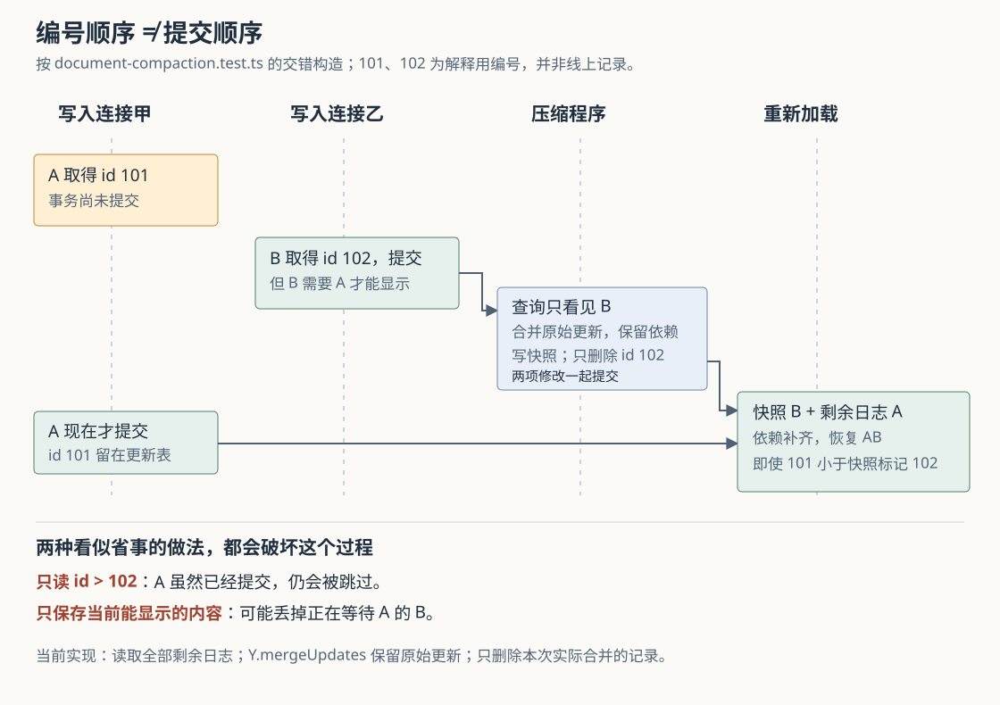

# Cumora 的共享文档怎样保存：为什么不能只留下当前看得见的内容

假设你正在共享文档里修改发布时间，Nova 同时补充发布检查清单。双方都看到了变化，但服务随后重启：这些修改能否重新出现？再进一步，系统为了减少加载成本，把许多次编辑合成一份快照；如果某条编辑已经保存，却还缺少前面的数据、暂时无法显示，它应不应该被留下？

Cumora 让人和 Agent——能够调用模型与工具执行工作的程序成员——修改同一份结构化文档，并把编辑保存为可合并的更新。它的压缩程序保留数据库里的原始更新，而不是简单复制页面当前显示的内容；重新加载时，还会读取所有剩余更新，不按“编号大于快照编号”筛选。**这些安排保护的是编辑的完整信息，包括暂时无法显示的部分。但编辑能够合并、页面已经变化、数据库已经提交，仍是三个不同的结果。**

此前研报解释过文档创建去重和通用实时通知，本篇深入正文编辑、保存与快照压缩，不重复创建选人与任务认领。依据为本次 `input/repository/` 的调用方、实现、数据表、测试断言及文档；开头场景为假设。本次没有安装依赖、启动项目、运行项目测试或做数据库故障实验。配图按测试构造的交错绘制，已单独渲染并目视检查，不能当作线上事故记录。

**先把两位编辑者接到同一份正文上。**

网页的 `DocumentEditor` 调用 `openDocument()` 建立文档会话，再让 TipTap 富文本编辑器的协作扩展绑定到 `session.doc`。这里的 `Y.Doc` 是 Yjs 库管理的一份文档副本。Yjs 使用 CRDT，即可在不同副本之间合并修改的复制数据结构：各方交换编辑更新，重复应用同一更新不会再插入一遍；在获得必要更新后，副本可以合并出一致状态。这不负责判断两位作者写出的发布时间是否矛盾。[编辑器绑定](https://github.com/yetone/cumora/blob/main/src/components/DocumentEditor.tsx)、[浏览器会话](https://github.com/yetone/cumora/blob/main/src/lib/yjsSession.ts)。

Nova 执行 `cumora doc append <文档编号> '## 发布检查\n\n- 确认时间'` 时，服务端 `cmdDocAsActiveAgent()` 检查文档所属工作区，再调用 `applyAgentEdit()`。后者把 Markdown——用文本符号表达标题、列表等格式的写法——转换成编辑器使用的节点，插入文档的 `default` 片段。这个片段保存正文树：标题、段落、列表、表格等都有对应结构。人和 Agent 因而不是各自维护一份正文，再定期用整篇文本互相覆盖。[命令入口](https://github.com/yetone/cumora/blob/main/server/src/agents/cli.ts)、[正文读写与 `applyAgentEdit()`](https://github.com/yetone/cumora/blob/main/server/src/documents/rooms.ts)、[格式转换](https://github.com/yetone/cumora/blob/main/server/src/documents/markdown.ts)。

这里不能只看变量名或注释。`yjsSession.ts` 还初始化了名为 `content` 的文本对象，一些同步测试也使用它；真正的富文本正文连接，要结合编辑器的协作绑定与服务端 `pmFragment()` 读取的 `default` 片段确认。格式转换测试则进一步把生成的节点转回编辑器结构，断言标题、图片和列表确实具有相应类型。[节点兼容测试](https://github.com/yetone/cumora/blob/main/server/src/__tests__/document-markdown.test.ts)。

这也解释了 Agent 编辑命令为什么分得较细：`replace` 查找某个文本节点里的第一处匹配，只修改文字；`replace-block` 则找到第一个包含指定片段的顶层块，删除整个块，再插入重新解析的结构。找不到时，命令返回错误，不自动追加到末尾。它们提供可控的编辑动作，却没有要求提交“我之前读到的文档版本”。因此，能够合并并发修改，并不意味着模型基于旧内容作出的修改一定合适。

**正文存储分成内存、更新日志和快照，通知还走另一条路。**

服务端 `getOrCreateRoom()` 为打开的文档建立进程内房间，其中保存 `Y.Doc` 和本机订阅者。冷加载，也就是没有可复用内存副本、需要从数据库恢复时，`hydrateDoc()` 读取保存的字节并依次应用。数据库中的几类记录各有职责：

| 位置 | 保存什么 | 不能替代什么 |
| --- | --- | --- |
| `documents` | 标题、工作区、创建者等索引信息 | 不保存整篇正文 |
| `document_updates` | 一次次编辑的二进制更新及作者 | 单条更新可能需要其他更新才能完整显示 |
| `document_snapshots` | 多条更新合并后的字节，以及合并时记录的最大编号 | 最大编号不能证明所有更小编号都已经包含在内 |
| 进程内文档房间 | 供当前阅读、编辑和同步使用的副本 | 不能直接证明其中每项变化已经持久保存 |

表结构可见 [数据库定义](https://github.com/yetone/cumora/blob/main/server/src/db/migrate.ts)，实际恢复与压缩以 [persistence.ts](https://github.com/yetone/cumora/blob/main/server/src/documents/persistence.ts) 为准。

正文更新通过现有 WebSocket 长连接发送：浏览器先订阅文档，收到 `doc.sync` 初始状态，再交换 `doc.update`。服务端房间把更新交给本机订阅者，同时经 Redis——这里用于跨服务实例传递临时消息的服务——转发给其他实例；远端收到后应用更新，但不重复写数据库。光标和正在编辑的成员信息使用 `doc.awareness`，只传播，不持久化。[服务启动注册](https://github.com/yetone/cumora/blob/main/server/src/index.ts)、[文档连接处理](https://github.com/yetone/cumora/blob/main/server/src/ws.ts)、[房间与跨实例转发](https://github.com/yetone/cumora/blob/main/server/src/documents/rooms.ts)。

还要分清 `doc.changed` 和 `doc.update`。前者通知文档列表等界面“某个对象变了”，可以随业务修改写入事务发件箱，即与业务数据一起保存、等待后台发送的通知记录；后者携带正文的实际编辑字节，房间直接发布它。**不能把通用发件箱对对象变化通知的保护，直接套到每一条正文更新上。** 网页的文档 HTTP 接口主要处理标题等信息，也没有另藏一份可替代 Yjs 正文的完整文本。[文档接口](https://github.com/yetone/cumora/blob/main/server/src/api/router.ts)。

**Agent 命令等待数据库写入，浏览器编辑的等待边界不同。**

先看 Nova 的追加。`cmdDoc()` 通过 `withActiveParticipantLock()` 开启数据库事务，并锁定仍活跃的 Agent 身份；随后把同一条数据库连接交给 `applyAgentEdit()`。后者在一次 Yjs 事务里完成编辑，并把产生的更新收集到 `collected` 数组。这里的 Yjs 事务负责把文档修改组织成一次更新，与数据库负责提交或回滚的事务不是同一件事。

收集完成后，`applyAgentEdit()` 逐条等待 `persistUpdateWith()` 写入 `document_updates`；失败会抛出，而不是只记录警告。调用方再写入 `doc.changed` 发件箱记录，最后提交数据库事务，命令才返回。创建带正文的文档也使用这条路径，因此新文档索引和初始正文可以在同一事务中保存，避免正文写入使用另一条连接、看不见尚未提交的父记录。[`cmdDoc()` 与事务包装](https://github.com/yetone/cumora/blob/main/server/src/agents/cli.ts)、[`collectInto` 与 `persistUpdateWith()`](https://github.com/yetone/cumora/blob/main/server/src/documents/rooms.ts)。

但房间的更新监听器会先通知本机订阅者，并尝试发布正文更新；它没有等外层数据库事务提交。若之后数据库写入或提交失败，事务可以回滚数据库，已经改变的内存文档和已经发出的编辑却没有对应的撤销分支。**这是从当前调用顺序推出的失败边界，本次没有注入故障复现。** 所以 Agent 命令的成功返回有数据库提交依据，旁观者提前看到变化则没有同等含义。

浏览器的路径更值得仔细区分。`handleDocFrame()` 收到 `doc.update` 后，通过 `withAuthorizedDocOperation()` 在数据库事务内核验用户及工作区成员资格，再调用 `applyLocalUpdate()`。虽然调用时传入了事务连接，`applyLocalUpdate()` 只把它交给房间加载过程，没有像 Agent 路径那样设置 `collectInto`。实际更新仍由房间监听器使用全局连接池异步保存；写入失败只输出警告，不能传回已经结束的编辑调用。[授权与调用方](https://github.com/yetone/cumora/blob/main/server/src/ws.ts)、[`applyLocalUpdate()` 与更新监听器](https://github.com/yetone/cumora/blob/main/server/src/documents/rooms.ts)。

这意味着授权事务的提交，不是正文写入的提交确认。浏览器 `WsClient.send()` 返回成功，也只表示已把数据交给当前套接字；`createDocumentSession()` 随后清空待发送更新、报告同步状态，不等待服务端的持久化确认。源码注释对此明确标注。从控制流程看，实时传播无需等待正文保存完成，但相应地需要另行处理保存失败。这里没有测量编辑延迟，也不能据此声称某种性能提升。

**压缩时先问“数据库已经保存了什么”，不问“这个房间现在显示什么”。**

房间累计的更新计数达到 200 时，会尝试调用 `compactDocument()`；这是代码中的触发阈值，不是每隔固定时间必定执行，也不是对数据库现有日志总数的精确盘点。压缩失败会记录警告，后续编辑可以再触发尝试。[触发与错误处理](https://github.com/yetone/cumora/blob/main/server/src/documents/rooms.ts)。

压缩程序没有直接编码当前内存房间。原因可以从跨实例路径看出：另一个实例可能已经把编辑写进数据库，但 Redis 通知尚未送达本机；本机房间仍旧，不能拿它替换更完整的已保存状态。测试专门构造了这种情况：内存只有 A，数据库已有 A、B，压缩后的冷加载仍应得到 AB。[压缩与冷加载测试](https://github.com/yetone/cumora/blob/main/server/src/__integration__/document-compaction.test.ts)。

当前实现的实际步骤是：

1. 开启数据库事务，尝试取得这份文档专用的事务级咨询锁。咨询锁是应用按约定名称取得的数据库锁；另一位压缩者已持有时，本次直接退出，不继续竞争覆盖快照。普通编辑写入不通过这把锁。
2. 用 `readDocumentState()` 读取旧快照和这份文档的所有剩余更新，记下本次实际读到的更新编号。
3. 用 `Y.mergeUpdates()` 合并这些原始字节，写入或替换快照。
4. 只删除刚才记下的那些更新记录，然后提交。任何步骤抛错，就回滚快照替换和日志删除，并释放连接。

这样，一边有人继续编辑，一边压缩程序可以缩短已经保存的日志；本次没读到的新记录留给下一次处理。两位压缩者也不会同时把各自读到的不同状态覆盖成快照。[完整实现：`compactDocument()`](https://github.com/yetone/cumora/blob/main/server/src/documents/persistence.ts)。

**最容易误删的，恰恰可能是编号更小、提交更晚的更新。**

考虑测试构造的另一种交错。更新 A 先取得数据库编号 101，但事务未提交；依赖 A 的更新 B 取得编号 102，却先提交。压缩程序只能看见 B。此时，“见过最大编号 102”不能证明 A 已包含在快照中，因为编号的分配顺序不是事务提交顺序。

这张图包含两个独立问题。

第一个问题是**不能按最大编号丢弃未见过的更新**。若压缩后执行“删除编号小于等于 102 的全部记录”，A 恰好在查询后、删除前提交，就会被误删。当前实现使用 `id = ANY(本次读到的编号数组)`，只删除真正参与合并的记录。若 A 在压缩结束后才提交，冷加载也必须读到它，所以读取代码没有 `id > snapshot_at_update_id` 这个过滤条件。

第二个问题是**暂时无法显示的更新也有价值**。B 缺少 A，不能立即整合成可见文字；但这不表示 B 是无用数据。当前实现直接使用 `Y.mergeUpdates()` 合并保存的更新字节，让仍在等待依赖的内容留在快照里。以后 A 到达，再应用快照和日志，就有机会补齐完整状态。不能把这个步骤随意改成“把更新应用到临时文档，再只编码已经整合出的状态”。源码对此有明确说明，测试也断言这种迟到依赖在一次、两次压缩之后都能恢复为 AB。[依赖保存与精确删除](https://github.com/yetone/cumora/blob/main/server/src/documents/persistence.ts)、[迟到提交测试](https://github.com/yetone/cumora/blob/main/server/src/__integration__/document-compaction.test.ts)。

冷加载还有一道较隐蔽的保护：快照和剩余日志由同一条 `UNION ALL` 查询读取。PostgreSQL 的 MVCC，即多版本并发控制，会让这条语句在一致的可见状态下读取两部分。否则，若先读旧快照、压缩恰好提交并删掉旧日志、再单独读日志，就可能拼出一份缺数据的结果。单条查询和“快照替换、精确删除一起提交”配合，消除这类错配。

这里存在一个应修正的阅读印象：`db/migrate.ts` 的表注释仍描述“快照加上大于快照编号的更新”，但当前 `persistence.ts` 的查询读取全部剩余记录。**表字段的名称和旧注释不能替代实际恢复算法；当前最大编号是记录值，未被用作过滤剩余日志的安全界线。**

**断线重发能补传输缺口，却不是保存确认协议。**

浏览器会话收到连接恢复的 `hello` 后重新订阅。`applyServerSyncAndGetLocalReplay()` 先编码本机文档，再根据服务端状态向量计算差量；状态向量用于描述副本已经包含了哪些编辑。随后它应用服务端状态，并通过普通 `doc.update` 路径重发服务端缺少的部分。这样，即使旧连接曾报告发送成功、数据却在途中丢失，同一会话仍保留的本地编辑可以再次发送。[差量计算](https://github.com/yetone/cumora/blob/main/src/lib/yjsSync.ts)、[会话重连与重试](https://github.com/yetone/cumora/blob/main/src/lib/yjsSession.ts)。

这个机制有明确条件。首先，本地状态由当前会话的 `Y.Doc` 保留；`destroy()` 会销毁它，所读路径没有浏览器本地数据库保存或重建该状态的步骤，不能据此承诺刷新页面后仍能找回全部未上传编辑。其次，差量依据服务端提供的房间状态计算，不是依据数据库提交凭据。若某项编辑已进入服务端内存、异步写入却失败，再同步未必会把它识别为服务端缺失内容。因此重连补发不能替代持久化失败后的专门重试或确认。

另外，客户端会检查重发更新连同 Base64 编码和 JSON 外壳后是否超过 4 MiB 的入站消息限制；Base64 是把二进制转成可放进文本消息的编码。超限时报告同步错误，保留当前内存状态，没有自动分块上传。服务端初始状态另有 32 MiB 的原始字节限制，不能因初始同步允许更大，就推断本地大批离线编辑也能一次补回。这些是当前代码的容量边界，不是本次测量结果。[帧大小计算](https://github.com/yetone/cumora/blob/main/src/lib/yjsSync.ts)、[服务端限制](https://github.com/yetone/cumora/blob/main/server/src/ws.ts)。

**测试已经把哪些边界写进断言，哪些仍需实验。**

本次阅读到的证据可以分为三组，均未在本次运行：

| 测试 | 实际检查的结果 | 不能据此扩大成的保证 |
| --- | --- | --- |
| `document-agent-create.test.ts` | 创建带正文的文档后，数据库存在更新；驱逐内存房间再读，正文与后续追加仍在 | 所有编辑入口都具有相同的事务保存方式 |
| `document-compaction.test.ts` | 旧房间不覆盖已保存编辑；迟到的低编号提交和缺依赖更新保留；并发压缩者互斥；删除后抛错会回滚；冷读取不混用两代状态 | 从未成功写入数据库的编辑也能靠压缩找回 |
| `yjs-session.test.ts`、`yjs-sync.test.ts` | 模拟传输丢失、离线编辑、删除合并、发送失败重试和超限；相同更新重放不重复生效 | 真实数据库写入失败、进程崩溃与页面刷新均已得到端到端验证 |

对应源码：[Agent 正文保存测试](https://github.com/yetone/cumora/blob/main/server/src/__integration__/document-agent-create.test.ts)、[数据库压缩测试](https://github.com/yetone/cumora/blob/main/server/src/__integration__/document-compaction.test.ts)、[浏览器会话测试](https://github.com/yetone/cumora/blob/main/tests/yjs-session.test.ts)、[同步差量测试](https://github.com/yetone/cumora/blob/main/tests/yjs-sync.test.ts)。浏览器会话测试使用的传输替身把更新应用到另一个内存文档，没有连接真实数据库；数据库压缩测试则使用真实事务和序列语义，构造提交时序。它们分别证明不同层的契约，不能互相代替。

对使用和继续改进 Cumora，这些区别带来几条具体建议：

- 团队可以让人和 Agent 并行补充不同部分，但修改同一结论前仍应读当前正文、核对目标片段；结构能够合并，不替代内容复核。
- 确认交付保存时，应优先检查能够从数据库重新恢复的内容；仅在当前页面或同一进程已有的房间里读回，可能只验证了内存状态。设计保存状态时，也应区分“已发送”“已进入服务端副本”和“已提交”。
- 若继续完善正文可靠性，值得优先验证浏览器异步保存失败、Agent 外层事务回滚但更新已经传播、以及失败后重连到仍保留该更新的房间。这些故障组合比再演示一次正常并发编辑，更能检验当前确认边界。改动压缩算法时，则应保留迟到低编号、未满足依赖、精确删除和一致读取这几组测试约束。
