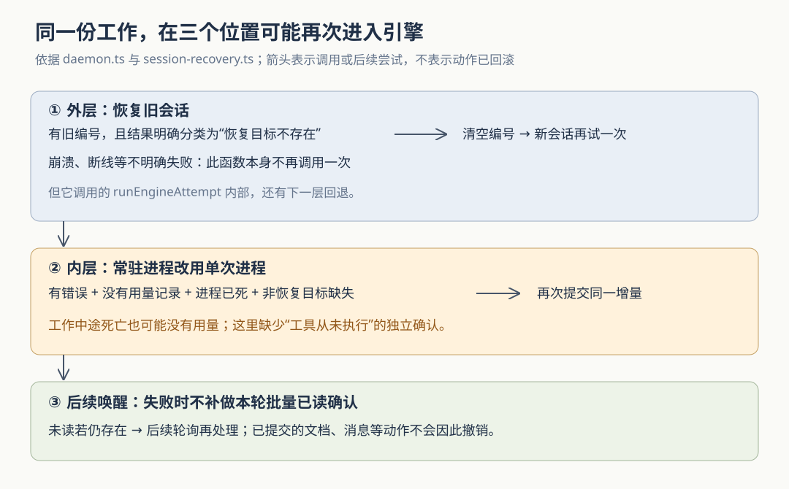

# Cumora 的本地 Agent 报错以后：什么时候重试，为什么仍可能重复动作

假设 Nova 已经把发布方案追加到共享文档，却在发出“整理好了”之前进程退出。团队只看到一次失败，文档其实已经变了。此时重新提交原来的要求，可能补齐回复，也可能把方案再追加一遍。另一种失败发生得更早：Nova 想恢复昨天的工作会话，引擎却说找不到那个会话，今天的工作根本还没开始。这两种错误都表现为“运行失败”，恢复办法却不应相同。

Cumora 为自带 Agent——由用户自己的电脑和模型引擎执行工作的程序成员——区分了恢复目标缺失、上下文过长、连接中断等失败。外层恢复函数只在确认旧会话不存在时，清空编号并立即新开一次；不明确的失败则返回调用方。**但实际调用链里面还有一层从常驻进程转为单次进程的回退，它用“没有用量记录”帮助判断能否再次提交。源码表明，中途死亡也可能不返回用量，所以外层的谨慎规则不能直接推广成整个系统“不重放已经做过的工作”的保证。**

此前研报已经讲过本机权限、身份交接和项目记忆，也概括过会话恢复。本篇专门追踪错误怎样穿过引擎适配器、恢复函数和收件箱确认，解释为什么局部“不重试”仍可能在整体上再次执行。依据为本次 `input/repository/` 的实现、调用方、测试断言与设计文档；开头场景和下文故障交错均为假设或静态推演。本次未安装依赖、启动项目、运行项目测试或调用真实模型；不将可能的重复描述为已复现事故。SVG 配图已另行渲染并目视检查。

**先区分三个东西：团队里的群聊、引擎会话和一次执行尝试。**

群聊与文档等团队事实保存在服务端。引擎会话则由 Claude、Codex 等本地执行程序管理，保存模型此前接收的信息和工具执行过程。一次尝试是守护进程向引擎提交本轮要求、等待结果的过程；同一次团队工作，可能因恢复或回退而产生多个尝试。

本地路径不经过云端的 `turn.ts` 模型循环。`AgentRunner` 在 `daemon.ts` 中读取未读消息、准备本轮输入，再交给引擎自己的执行循环；工具需要修改 Cumora 时，经守护进程调用服务端。因此，引擎退出与业务动作回滚不是同一件事。设计文档也明确说明本地执行绕过云端循环，模型上下文和原生压缩由引擎负责。[本地执行入口](https://github.com/yetone/cumora/blob/main/server/src/agents/computer/daemon.ts)、[BYOA 设计说明](https://github.com/yetone/cumora/blob/main/docs/BYOA.md)。

Cumora 自己保存的是一个会话编号，不是完整的引擎记录。`EngineSessionStore` 按 Agent、引擎及适用的额外范围组织编号文件，写入时先写临时文件，再改名替换；保存请求排队，避免旧写入覆盖新值。守护进程在运行中定期捕获编号，结果返回后也更新编号，重启后再加载。这让它有机会继续原上下文，但不证明每次工具动作都已经写进引擎记录，更不是服务端动作的去重凭据。保存错误只记录警告，不会让整个 Agent 停止。[会话编号保存](https://github.com/yetone/cumora/blob/main/server/src/agents/computer/session-store.ts)、[编号捕获与加载：`setSessionId()`、`runEngineAttempt()`、`loadSessionId()`](https://github.com/yetone/cumora/blob/main/server/src/agents/computer/daemon.ts)。

**接着看错误怎么变成“可以新开一次”的依据。**

引擎适配器把各家程序的返回形式转换为 `EngineRunResult`，其中有退出码、错误、会话编号，以及可选的模型用量。用量在这里指输入、输出等令牌数量；令牌是模型计量文本的单位。`failure.kind` 则提供可供程序判断的错误类别，例如恢复目标不存在、连接故障和身份认证失败。

`engineFailureOf()` 优先接受适配器已经提供的分类；没有时，再从错误文本分类。通用分类器只有在此次确实携带恢复编号时，才把“session not found”等措辞识别为 `resume-not-found`，即恢复目标不存在。程序还会从结构化事件中提取真正的错误，排除普通事件字段和成功回复里的模型文字，避免把模型说出的“找不到会话”误当成引擎诊断。这里依赖适配器和文本规则，不能理解成系统独立询问了引擎存储并证明工作从未开始。[错误结构、分类与诊断提取](https://github.com/yetone/cumora/blob/main/server/src/agents/computer/engine.ts)。

`runWithSessionRecovery()` 的规则很小，也很明确：

1. 先用当前恢复编号调用一次传入的执行函数。
2. 如果没有旧编号，或错误不是“恢复目标不存在”，直接返回结果。
3. 否则调用重置，清空编号并停止现有常驻引擎，然后不带旧编号再调用一次。
4. 第二次无论成功还是失败都返回，不在这个函数里继续递归重试。

它的设计理由可以直接从注释读到：若目标确实不存在，本轮没有成功进入那个会话；若只是超时、连接重置或进程被终止，则之前可能已经产生外部动作，立即重放会有风险。[恢复函数](https://github.com/yetone/cumora/blob/main/server/src/agents/computer/session-recovery.ts)、[实际重置与调用方](https://github.com/yetone/cumora/blob/main/server/src/agents/computer/daemon.ts)。

这里的“两次”只计算外层调用传入执行函数的次数。它没有限制这个执行函数内部还能调用多少种传输方式；这正是需要继续往里追的地方。

适配器自身也可能处理恢复。例如 `CodexSession.handle()` 收到 `thread/resume` 会话握手的错误响应时，会改发 `thread/start` 新开会话；这条分支没有先要求错误属于“目标不存在”。当时本轮输入仍等待会话就绪，属于开始工作前的握手回退。它说明“只有缺失才新开”准确描述的是外层函数，不能当作所有引擎的统一恢复策略。[Codex 握手与输入排队](https://github.com/yetone/cumora/blob/main/server/src/agents/computer/engine.ts)。

**真正的边界藏在里面：没有用量，不代表模型没有工作。**

外层传入的是 `runEngineAttempt()`。有可用常驻引擎时，它先调用 `session.send()`；常驻方式让同一进程处理多轮要求，减少反复启动成本。没有常驻能力，或常驻方式已被标为不可用时，则调用 `adapter.run()` 启动单次执行。

问题在于，两条路可以在一次 `runEngineAttempt()` 中先后发生。常驻调用返回后，代码同时满足以下条件，就转而调用单次执行：结果含错误、没有 `usage` 用量、进程已经不存活，而且错误类别不是恢复目标缺失。回退携带相同的本轮增量和此次尝试原有的恢复编号，并把常驻方式标为本进程后续不再使用。注释把它解释为“尚未到达模型的常驻传输故障，可以安全回退”。[实际条件与回退参数：`runEngineAttempt()`](https://github.com/yetone/cumora/blob/main/server/src/agents/computer/daemon.ts)。

如果故障发生在程序尚未成功启动时，这个解释成立。但判断条件比“模型尚未开始”更宽：

- `ClaudeSession` 可以在中途接收模型事件、调用逐轮用量回调；正常的最终 `result` 事件才把本轮汇总用量放入返回结果。若中途走 `die()`，返回的是退出码、错误和会话编号，没有附带 `usage`。
- `CodexSession.die()` 同样在进程死亡时返回错误和会话编号，没有带上用量。即便它已经接收过执行中的信息，这条死亡结果也不因此自动带上 `usage`。

这两点来自适配器实际的返回对象，不能用“费用账本里可能已有记录”补足；内层条件检查的是本次返回结果上的字段。[常驻引擎的事件处理与死亡返回：`ClaudeSession`、`CodexSession`](https://github.com/yetone/cumora/blob/main/server/src/agents/computer/engine.ts)。

因此可以静态推演出一条风险路径：常驻引擎已经提交文档追加，随后在最终结果前退出；死亡结果没有用量，符合进程回退条件；守护进程立即把同一本轮要求交给单次执行。**即使外层最终把错误分类为连接故障并拒绝再试，内层的另一次提交也可能已经发生。** 如果单次执行成功，外层甚至只会看到成功结果。

这不是“必然追加两遍”的结论。旧会话记录可能帮助模型认出已有进展，模型也可能重新读文档后决定只补回复；反过来，死亡前最后几步是否已进入引擎记录、恢复后如何理解同一要求，本次没有真实故障实验，不能确认。能够确定的是：内层没有用一个独立的“本轮尚未交给模型／尚未执行工具”确认来限制回退。

**把错误留给下一次唤醒，也不能撤销上一次成果。**

引擎返回后，聊天执行路径把错误转换为对外可见的错误信息。上下文过长或记录格式损坏时，守护进程清空会话，目的是让下一次唤醒能从干净状态继续，而不是在当前恢复函数里立即重做。普通不明确失败通常保留会话编号，给下次继续上下文的机会。限流会设置一分钟暂停；部分需要人处理的错误设置十五分钟暂停。这些是当前代码中的退避参数，不是恢复耗时保证。[`mustResetSession()`、`resetEngineSession()`、`classifyTurnOutcome()` 与聊天执行收尾](https://github.com/yetone/cumora/blob/main/server/src/agents/computer/daemon.ts)。

守护进程在调用引擎之前保存一份未读位置快照，正常结束后用 `ackSeen()` 确认这份快照；失败时跳过这次批量确认，让仍未读的消息有机会被后续通知或轮询重新处理。这里的确认是推进收件箱已读位置，不是用户验收成果。确认请求本身通过 `runtimeBest()` 发送：网络失败或非成功响应会被吸收，因而正常结束也可能未能推进服务端已读位置。[`snapshotUnread()`、`ackSeen()` 与 `runtimeBest()`](https://github.com/yetone/cumora/blob/main/server/src/agents/computer/daemon.ts)。

还要给“失败保留未读”加一个条件：引擎里的工具可能已经主动执行过 `ack`，回复命令也会更新已读位置。`cmdReply()` 在保存消息的数据库事务里更新 `conversation_reads`；守护进程跳过收尾确认，不会把这个位置倒退回来。因此，失败后是否还有同一条消息等待处理，取决于之前已经提交过什么，而不只取决于最终退出码。[显式确认与回复保存](https://github.com/yetone/cumora/blob/main/server/src/agents/cli.ts)。

回到开头的文档追加：如果追加已提交而消息仍未读，下一轮可能再次得到原要求；如果回复已经提交并推进已读位置，即便引擎稍后失败，也不能假设原消息还在收件箱。这两种交错说明，**业务动作、引擎结果和收件箱位置分别提交，没有被包进同一个跨进程事务。** 保留未读优先避免漏掉尚未完成的工作，同时把“先核对已有结果，再继续”留给恢复后的执行过程。

**测试约束了局部规则，还没有证明整条链只做一次。**

本次读取的测试提供了几类证据：

| 测试 | 实际断言 | 对本篇结论的限制 |
| --- | --- | --- |
| `agents-computer-session-recovery.test.ts` | 缺失目标只新开重试一次；第二次失败不再试；连接重置、超时等不明确失败只调用一次传入函数 | 传入的是模拟函数，没有执行真实 `runEngineAttempt()` 的常驻转单次回退 |
| `agents-computer-engine-failure.test.ts` | 分类区分启动、恢复、连接等错误；成功模型文字不当作引擎诊断 | 文本分类正确不等于外部动作从未发生 |
| `agents-computer-engine.test.ts` | 用假引擎进程检查启动错误、常驻中途退出、诊断清理等行为 | 已读用例不构成“业务动作提交后死亡，再回退执行”的端到端验证 |
| `agents-computer-session-store.test.ts` | 编号按引擎分开、保存顺序保持、替换失败清理临时文件 | 编号可靠保存不等于引擎记录与业务提交同步完成 |

对应文件：[恢复测试](https://github.com/yetone/cumora/blob/main/server/src/__tests__/agents-computer-session-recovery.test.ts)、[错误分类测试](https://github.com/yetone/cumora/blob/main/server/src/__tests__/agents-computer-engine-failure.test.ts)、[引擎适配器测试](https://github.com/yetone/cumora/blob/main/server/src/__tests__/agents-computer-engine.test.ts)、[编号保存测试](https://github.com/yetone/cumora/blob/main/server/src/__tests__/agents-computer-session-store.test.ts)。这些是静态阅读所得的测试契约，本次没有运行它们。

从设计上看，Cumora 尽量保留继续工作的能力：恢复旧会话避免丢上下文，明确缺失时新开一次，常驻方式失败时尝试兼容路径，失败不批量确认则避免把工作静默吞掉。这些选择对读取、检查和可重复覆盖的操作较友好；追加文档、发送邮件等会累积结果或产生外部影响的动作，需要更强的核对。

对使用者，看到失败后应先检查已有成果和最近工具记录，再要求重做；仅凭红色运行状态判断“什么都没发生”并不可靠。对执行器设计者，本篇最值得迁移的经验是：**重试安全必须沿真实调用链检查，不能只看名字叫“恢复”的那个函数。** 若要收紧当前边界，可以让适配器明确报告“输入尚未成功交付”，据此允许传输回退；对已经交付或结果不明的尝试，先恢复、查询既有成果，再决定是否提交动作。对重要动作，还可考虑引入幂等键——用同一个业务动作编号识别重复请求——但这属于改进建议，并非本次源码已经提供的统一保障。
