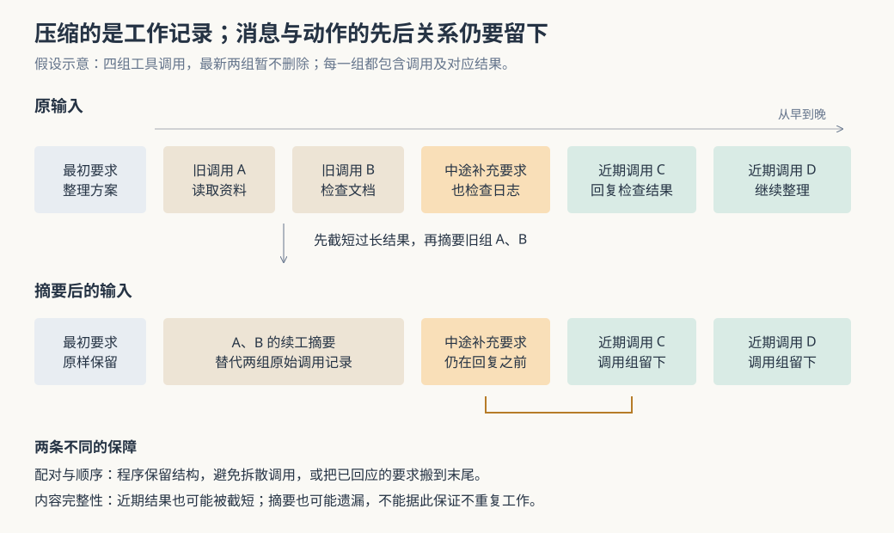

# Cumora 的长任务怎样继续：上下文压缩保住了什么，又会丢掉什么

假设 Nova 正在整理发布方案：它先读群聊，再查多份文档、检查日志，最后准备更新任务卡。你中途补充“也检查一下部署错误”，它已经回复过检查结果，却还要继续处理其他资料。随着工具记录越来越多，模型一次能够接收的内容逐渐装不下。此时直接删掉旧记录，可能让它忘记已做的动作；把补充要求挪到输入末尾，又可能让已处理过的要求看起来像刚刚到达。

Cumora 在云端执行过程中缩短工具结果，必要时再让辅助模型把较早的调用整理成续工笔记，让原来的执行循环继续。**它对调用配对和保留内容的相对顺序设置了明确规则，但并不保证压缩前后的信息完全等价；甚至“最近两组调用保留”，也不表示它们的返回内容完整保留。** 理解这一点，才能判断长任务为什么还能继续，以及为什么仍应重新核对重要成果。

此前研报讨论过项目记忆、本地会话恢复和工作中的消息插入。本篇专门研究云端单轮执行内部的压缩：触发依据是什么，哪些内容交给摘要模型，失败后怎样继续，测试实际约束了什么。依据是本次 `input/repository/` 的调用方、实现、测试断言与配置；开头及下文例子均为假设或静态推演。本次未安装依赖、启动项目、运行项目测试或调用真实模型；配图已另行渲染并目视检查。

**先看工作记录为什么会不断增长。**

Cumora 让 Agent——能够调用模型和工具执行工作的程序成员——参与团队群聊、文档和任务卡。云端的 `pod-agent.ts` 通过 `drain()` 调用 `runAgentTurn()`；后者把初始消息交给模型，让模型选择工具，执行后再把结果交回模型。这样一次“模型决定—工具执行—读取结果”会重复多次，代码称每次模型调用为一个 `hop`，这里称为一步。[云端执行入口](https://github.com/yetone/cumora/blob/main/server/src/agents/runtime/pod-agent.ts)、[执行循环](https://github.com/yetone/cumora/blob/main/server/src/agents/turn.ts)。

本轮记录保存在进程内的 `history` 数组里。初始输入在前，每一步随后追加模型提出的 `function_call`，即工具调用，以及运行器生成的 `function_call_output`，即对应结果。两者用 `call_id` 关联。中途收到的新要求，也会作为用户角色的输入插入数组。

下一步请求会重新发送整份当前记录。实现没有用 `previous_response_id` 让模型服务接续旧响应；代码注释把这一选择解释为模型代理服务对该字段的兼容限制。可以直接核实的是：请求中发送完整的 `input`，不传这个接续编号。这样运行器能自己重写输入，但长链路会反复携带之前的工具记录。普通助手文字和模型推理记录并未一并存入这个数组；模型实际通过 `cumora reply` 发送的群消息，则可由工具结果留下动作证据。

这里的“上下文”，就是本次给模型判断下一步所提供的信息；“上下文窗口”，是一次请求能够容纳的信息规模。压缩改的是本轮输入数组，并不是删除数据库中的群聊或文档，也不是把这段经历自动写成长期记忆。下一轮调用重新构造输入，不能把当前摘要当作已经持久保存的会话档案。[记录构建、追加与请求发送：`runAgentTurn()`](https://github.com/yetone/cumora/blob/main/server/src/agents/turn.ts)。

**系统先看上一份模型响应的用量，再决定是否压缩。**

`turn.ts` 在每一步开始时，用 `compactThresholdFor()` 算出软阈值：代码所认定的模型窗口的 75%。超过以后，调用 `compactHistoryWithSummary()`，尝试把记录压到软阈值的 90%以内；压缩后若本地估算仍超过窗口的 95%，本轮以失败结束，记录 `budget.stop`。

这些窗口数字来自 `contextWindowFor()` 的模型名称匹配表，未知名称回退为 200,000。它们是项目自己的预算配置逻辑，不能视为当前所有模型真实规格的保证。[预算与停止分支](https://github.com/yetone/cumora/blob/main/server/src/agents/turn.ts)。

变量 `totalTokensThisTurn` 的名字容易引起误解：这里并不是把本轮历次调用的用量累加起来判断窗口是否装满。有用量时，它取上一份响应报告的输入与输出令牌之和；令牌是模型计量文本的单位。真正用于费用统计的累计值另存在 `turnUsage` 中。没有用量时，程序改为估算当前记录大小，工具结果追加后还会重新估算。[用量读取](https://github.com/yetone/cumora/blob/main/server/src/agents/turn-stream.ts)、[用量更新与压缩入口](https://github.com/yetone/cumora/blob/main/server/src/agents/turn.ts)。

估算函数把数组项目序列化为 JSON——用于传输结构化数据的文本格式——再按字符粗估：ASCII 字符约每 3.5 个计一个令牌，其余按 JavaScript 字符串单元计数。这照顾了中文与英文的差异，却不是模型的真实分词器，也没有完整计入独立传入的指令和工具定义。因此，它提供预算判断的近似值，不能证明下一次请求必然被模型服务接受。尤其是，有真实用量时，判断依据来自上一份响应，刚执行完的工具结果还不在那份输入里；它不是每次发送前都精确计算完整请求。[`estimateTokens()` 与 `estimateHistoryTokens()`](https://github.com/yetone/cumora/blob/main/server/src/agents/turn-compaction.ts)。

**第一步压缩并不写摘要，而是截短每份过长的工具结果。**

工具结果进入记录前，`modelToolOutputPayload()` 已先设置约 8,000 个 UTF-8 字节的上限。超过时，它生成带截短标记、原始长度和内容开头的包装，并提示模型：遗漏部分有用时，应改用范围更小的查询。这是对单份结果的保护，还不是后续的历史压缩。

触发历史压缩后，`truncateOversizedOutputs()` 再把所有过长的字符串结果保留到前 600 个字符串单元，追加截短说明。常量名是 `COMPACTED_OUTPUT_BYTES`，提示也写着 bytes，但实际用的是 `.length` 和 `.slice()`，并非 UTF-8 字节计数。阅读监控里的相关长度时，需要保留这个差别。

这一步有两个直接后果。首先，最近的调用也会被截短；“保留最近两组”只约束下一步删除哪些组。其次，只靠截短就满足预算时，辅助模型根本不会被调用，不会另外提炼被删尾部的关键事实。假设一份日志最后才写着真正的失败原因，前面全是正常启动信息，留下开头并不能代替理解整份日志。[结果入列前限制](https://github.com/yetone/cumora/blob/main/server/src/agents/turn.ts)、[第一阶段压缩](https://github.com/yetone/cumora/blob/main/server/src/agents/turn-compaction.ts)。

**仍然太长，才把较早的调用换成续工笔记。**

`partitionHistory()` 按调用编号分组，并按首次出现的顺序排列。最前面的非工具输入保留；最新两组调用不删除；更早的组才允许替换。这个单位是调用组，不是执行步骤：一步可以提出多个工具调用，所以保留两组不等于保留最近两步的完整工作。

摘要成功路径会一次选出全部可删除的旧组，调用一次辅助模型，再把它们换成一条用户角色的摘要消息；它不会每删一组就测试是否已经足够。摘要正文最多保留 4,000 个字符串单元。与之相比，失败后的普通删除路径会从最早一组逐步删除，达到估算预算就停止。这两条路径的收缩策略并不相同。[`compactHistoryWithSummary()`、`summarizeAndSplice()` 与 `compactHistoryInternal()`](https://github.com/yetone/cumora/blob/main/server/src/agents/turn-compaction.ts)。

真正交给摘要模型的资料还会进一步缩减。`summarizeHistoryItems()` 调用 `formatItemsForSummary()`，每份调用参数只取开头 600 个字符串单元，结果取开头 1,200 个，合计文本限制约为 32,000 个字符串单元；放不下的项目计为省略。此前的结果已经过第一阶段截短，摘要模型不会回头拿原始工具输出。它接收的是选中的旧调用组，也不会自动连同原始任务和夹在中间的所有补充要求一起阅读。

提示要求辅助模型保留路径、编号、错误文字、已经作出的决定和下一步动作。这是有实际用途的续工笔记：例如记住方案文档编号，比只写“已做一些准备”更便于继续。但提示无法恢复已经截掉的信息，也不能保证模型没有误解。实际选用 `OPENAI_COMPACTION_MODEL`，为空时使用辅助模型配置，并经过模型用途策略检查；不能按旁边“使用 Agent 自身模型”的旧注释理解。[摘要资料与请求构造](https://github.com/yetone/cumora/blob/main/server/src/agents/turn.ts)、[配置](https://github.com/yetone/cumora/blob/main/server/src/env.ts)、[用途策略](https://github.com/yetone/cumora/blob/main/server/src/agents/model-policy.ts)。

**压缩还必须保住“这句话是在那次动作之前到达的”。**

图中补充要求“也检查日志”位于调用 B 与回复调用 C 之间。压缩后，旧组 A、B 变成摘要，但补充要求仍在 C 之前。实现不是把剩余项目按类型重新拼接，而是通过 `tailWithoutDroppedGroups()` 遍历原数组，只跳过决定删除的调用组。这样保留下来的工具项目、中途要求和内部提醒都维持相对顺序。

这个规则有两个作用：不会只留下结果却删掉对应调用，也不会把已回应的补充要求搬到所有动作之后。测试还专门检查同一步的“调用甲、调用乙、结果甲、结果乙”不被重新整理成另一种排列。程序优先保持原本已在使用的请求结构，而不是追求表面整齐。[分组与重建算法](https://github.com/yetone/cumora/blob/main/server/src/agents/turn-compaction.ts)。

但顺序保障仍有条件：它保护的是**幸存项目之间**的顺序。当更多工作发生，调用 C 也进入可删除范围时，中途要求仍可留下，证明它已经处理的工具记录却可能只剩摘要。摘要又统一插在最前面的种子输入之后，不再逐个占据原事件位置。因此，当前实现避免了把要求重新搬到末尾的结构问题，却没有建立每条要求与其完成证据永久绑定的机制。推断上，模型仍可能忘记某项动作已做过；本次没有用真实模型复现这种重复。

**摘要失败时优先继续，但继续依据会变弱。**

摘要调用抛错或返回空正文时，生产调用方会把失败抛回压缩函数，后者退回普通删除路径：照样截短结果，按旧到新删除可删组，用通用说明告诉模型“此前一些工具记录已省略，请继续”。压缩函数没有另设摘要重试循环，也没有原样保留所有旧记录等待恢复。

这让临时的模型故障不必立即结束整轮工作，代价是后续决策可能只知道“做过一些事”，缺少具体内容。`usedLlmSummary` 可以区分是否用了摘要；`turn.compacted` 还记录截短数量、删除组数等。单看这个事件不能判断关键信息是否完整，也不能把这些字符量指标解释成精确的令牌压缩率。

压缩后仍超过硬阈值则停止本轮，已执行的文档修改或消息发送不会因此回滚。失败分支没有进入成功时的统一完成处理，但先前工具也可能已经推进部分已读位置。因此，“下次唤醒重新开始”不等于自动重放相同请求，更不等于恢复已经删掉的本轮记录；是否还有未读工作、如何核对既有成果，要继续看具体状态。[压缩回退](https://github.com/yetone/cumora/blob/main/server/src/agents/turn-compaction.ts)、[停止与回合收尾](https://github.com/yetone/cumora/blob/main/server/src/agents/turn.ts)。

**测试约束了结构与回退，没有证明摘要语义完整。**

本次阅读的主要测试是 [agents-turn-compaction.test.ts](https://github.com/yetone/cumora/blob/main/server/src/__tests__/agents-turn-compaction.test.ts)，没有运行。

| 测试构造 | 断言能支持的认识 | 验证边界 |
| --- | --- | --- |
| 过长结果、原始输入与调用编号 | 截短保留调用结构，不修改调用者原数组；原始问题不被删除 | 不判断被截尾部是否关键 |
| 多组旧调用、摘要回调和摘要报错 | 旧组整体替换；最近两组不删除；一次压缩至多调用一次摘要回调；异常退回删除 | 摘要由替身返回，没有验证真实模型准确性 |
| 已回应的中途要求、交错工具项目 | 要求仍位于保留的回复调用之前，剩余项目不重排 | 用例中的回复调用仍被保留，不能证明删除回复以后仍正确理解完成状态 |
| 中英文、表情与超长摘要 | 粗估规则、摘要长度上限和空摘要占位行为符合实现 | 不校验真实分词、完整请求大小或模型服务接受情况 |

其中“最近调用完整保留”的用例使用短结果，断言重点是调用编号仍然存在，不能推导成长结果也原样保留。另一个差别是：通用压缩函数允许空摘要变成占位文字，而生产摘要函数会把空正文当作错误抛出；沿真实调用链阅读，才能知道线上路径会选择删除回退。

对使用团队，长任务应把关键编号、已经提交的动作和待办项留在可重新读取的文档或任务卡中。日志和长列表尽量按问题缩小查询范围；看到压缩或失败以后，先查现有成果，再要求重做。对于发送邮件、追加文档等可能累积结果的操作，一段“我已做过”的摘要不应替代实际核对。

对实现类似系统的人，这段代码提供了一个具体经验：压缩不仅要降低输入大小，还要保住工具协议和事件先后。当前设计用确定性的数组规则保护结构，用辅助模型维持大致的工作连续性，并在摘要失败时选择继续。若任务需要更强的恢复能力，可以另外保存“哪项要求由哪个动作完成”的持久记录，让压缩后的输入引用它；也可在摘要前单独提取重要编号和提交结果。这些是基于当前边界提出的建议，并非已有保障。理解这套压缩时，最值得分别核对的是：程序是否保住合法结构，模型是否还掌握关键事实，以及团队成果能否从外部状态重新确认。
